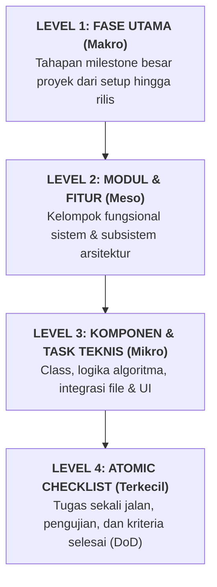

# Alur dan Rencana Kerja Pembuatan Aplikasi: Stickman Tower Adventure

> **Dokumen Rujukan Utama:** [Stickman_Game_Design_v0.1.md](file:///home/yusuf/projekan/game/game1/Stickman_Game_Design_v0.1.md)  
> **Tech Stack:** Kotlin, libGDX, Gradle, Tiled Map Editor, Target Android & Desktop (LWJGL3)  
> **Metode Pembagian:** Dekomposisi Bertingkat — dari Makro (Fase Utama), Meso (Modul Fungsional), Mikro (Komponen/Task), hingga Terkecil (Atomic Checklist & Kriteria Selesai).

---

## 1. Peta Hierarki Dekomposisi

Alur kerja ini dibedah ke dalam 4 tingkatan presisi:



---

## 2. Roadmap Visual Keseluruhan (Macro Pipeline)

```mermaid
flowchart LR
    Fase0["Fase 0:<br/>Setup & Scaffolding"] --> Fase1["Fase 1:<br/>Core Platforming"]
    Fase1 --> Fase2["Fase 2:<br/>Core Combat"]
    Fase2 --> Fase3["Fase 3:<br/>Enemy AI & MVP Loop"]
    Fase3 --> Fase4["Fase 4:<br/>Combo & Touch UI"]
    Fase4 --> Fase5["Fase 5:<br/>RPG & Save Data"]
    Fase5 --> Fase6["Fase 6:<br/>Tiled Map & Tower"]
    Fase6 --> Fase7["Fase 7:<br/>Asset & Audio Polish"]
    Fase7 --> Fase8["Fase 8:<br/>Android Build & QA"]
```



---

## 3. Bedah Rinci Alur Kerja: Dari Terbesar ke Terkecil

---

### FASE 0: Persiapan Lingkungan & Scaffolding Proyek (Setup & Toolchain)
> **Tujuan Terbesar:** Memastikan toolchain Kotlin & libGDX terpasang dengan benar pada Linux Mint tanpa membebani kapasitas disk (30 GB tersisa) dan dapat di-build dengan lancar.

#### Modul 0.1: Verifikasi dan Audit Environment Linux Mint
- **Task 0.1.1: Pengecekan JDK dan Android SDK**
  - [x] Periksa instalasi JDK aktif dengan perintah terminal `java -version` (terverifikasi JDK 17 & 21 aktif).
  - [x] Pastikan variabel `JAVA_HOME` dan `ANDROID_HOME` terpasang (`/home/yusuf/Android/Sdk`).
  - [x] Verifikasi sisa disk (21 GB tersisa dan termonitor aman).

#### Modul 0.2: Pembuatan Fondasi Proyek via Gdx-Liftoff
- **Task 0.2.1: Generator Setup**
  - [x] Jalankan generator resmi **Gdx-Liftoff** (v1.14.2.3).
  - [x] Konfigurasi parameter proyek:
    - *Project Name:* `stickman-tower`
    - *Package Name:* `com.stickman.tower`
    - *Language:* Kotlin
    - *Platforms:* `Desktop (LWJGL3)` dan `Android`
    - *Extensions:* FreeType
  - [x] Ekstrak/inisialisasi ke direktori kerja utama.
- **Task 0.2.2: Inisialisasi Version Control & Git Hygiene**
  - [x] Buat file `.gitignore` yang memblokir `.gradle/`, `build/`, `local.properties`, `.idea/`, `.vscode/`.
  - [x] Lakukan inisialisasi Git: `git init`, `git add .`, commit perdana `feat(setup): initialize libGDX Kotlin multiplatform project scaffold`.

#### Modul 0.3: Pengujian Build Perdana (Sanity Check)
- **Task 0.3.1: Running Desktop Module**
  - [x] Jalankan `./gradlew core:build lwjgl3:compileKotlin` via terminal (Build SUCCESS).
  - [x] Konfigurasi Gradle Wrapper 9.8.0 dan `local.properties` Android SDK terhubung.
  - [x] Verifikasi konsumsi RAM build desktop stabil dan cache Gradle bersih.

---

### FASE 1: Core Platforming Engine (Pondasi Gerak & Fisika Dasar)
> **Tujuan Terbesar:** Membuat karakter stickman placeholder yang dapat bergerak halus di atas platform dengan deteksi collision dan kontrol kamera yang responsif.

#### Modul 1.1: World, Viewport & Sistem Kamera 2D
- **Task 1.1.1: Konfigurasi Virtual Resolution**
  - [x] Tentukan target resolusi dunia logika (`GameConfig.kt`: World Units 16:9, `16f x 9f` meter logis).
  - [x] Implementasikan `FitViewport` pada `OrthographicCamera` untuk mencegah distorsi aspek rasio di layar berbeda.
- **Task 1.1.2: Camera Follow System**
  - [x] Buat class `CameraManager.kt` dengan algoritma *linear interpolation (lerp)* mengikuti pemain secara mulus.
  - [x] Tambahkan batasan batas map (*clamping*) agar kamera tidak menampilkan ruang kosong di luar level.

#### Modul 1.2: Player Entity & Controller Kinematik Custom
- **Task 1.2.1: Model Karakter dan Vektor Gerak**
  - [x] Buat class `Player.kt` (`position`, `velocity`, `width = 0.8f`, `height = 1.8f`, `facingRight`).
  - [x] Buat stickman visual dinamis (persendian beranimasi saat lari/lompat/jatuh) menggunakan `ShapeRenderer`.
- **Task 1.2.2: Sistem Input Abstraksi**
  - [x] Buat antarmuka `GameInput` (`isMoveLeft()`, `isMoveRight()`, `isJumpJustPressed()`, `isJumpPressed()`).
  - [x] Buat implementasi desktop `KeyboardInput.kt` membaca tombol `A`, `D`, `Space` / `W` / `K`.
- **Task 1.2.3: Platformer Physics (Gravitasi & Lompatan)**
  - [x] Definisikan konstanta fisika: `GRAVITY = -28f`, `MOVE_SPEED = 7.5f`, `JUMP_VELOCITY = 11.5f`.
  - [x] Terapkan kalkulasi Euler integration dengan lompatan variabel (lepas tombol = lompat lebih pendek).
  - [x] Tambahkan toleransi *coyote time* (120ms) dan *jump buffering* (120ms) untuk kontrol responsif.

#### Modul 1.3: Collision Platform Sederhana
- **Task 1.3.1: Deteksi Lantai & Rintangan**
  - [x] Buat class `Platform.kt` (bounding box `Rectangle` dan rendering highlight).
  - [x] Implementasikan collision resolver terpisah sumbu X dan Y: deteksi mendarat, langit-langit, dan dinding samping.
  - [x] Buat arena platform bertingkat di `PlayScreen.kt` untuk validasi gerak dan lompatan.

#### Modul 1.4: Karakter State Machine (FSM Dasar)
- **Task 1.4.1: Enumerasi dan Alur State Gerak**
  - [x] Buat `enum class CharacterState { IDLE, RUN, JUMP, FALL }`.
  - [x] Implementasikan fungsi `updateState()` dengan transisi otomatis berdasarkan velocity dan status grounded.
  - [x] Tambahkan overlay HUD debug (menampilkan FPS, State, Koordinat, Velocity, dan petunjuk kontrol).

---

### FASE 2: Core Combat & Hitbox Engine (Sistem Pertarungan Dasar)
> **Tujuan Terbesar:** Membangun sistem serang, deteksi serangan (hitbox) versus tubuh penerima serangan (hurtbox), kalkulasi damage, dan respon benturan.

#### Modul 2.1: Arsitektur Hitbox vs Hurtbox
- **Task 2.1.1: Pemisahan Bounding Box**
  - [x] **Collision Box:** Mengatur interaksi karakter dengan platform/lantai (`bounds`).
  - [x] **Hurtbox:** Area tubuh karakter/dummy yang dapat menerima serangan (`Hurtbox.kt`).
  - [x] **Hitbox:** Area serangan senjata/pukulan yang aktif pada fase tertentu dengan pelacakan exclusion multi-hit (`Hitbox.kt`).
- **Task 2.1.2: Debug Hitbox Visualizer**
  - [x] Tambahkan rendering garis warna menggunakan `ShapeRenderer`:
    - Hijau = Collision box platform dan tubuh.
    - Biru (Cyan) = Hurtbox tubuh.
    - Merah = Hitbox serangan aktif.

#### Modul 2.2: Basic Attack & Frame Window Lifecycle
- **Task 2.2.1: Attack Phase Timing**
  - [x] Definisikan 3 fase serangan dalam `Player.kt` dan `AttackPhase.kt`:
    - *Startup:* Waktu ancang-ancang mengangkat pedang (0.08 detik).
    - *Active:* Frame di mana hitbox merah aktif dan bilah pedang menebas ke depan (0.12 detik).
    - *Recovery:* Waktu jeda setelah memukul sebelum karakter boleh bergerak kembali (0.15 detik).
  - [x] Tambahkan state `ATTACK` ke dalam State Machine karakter. Batasi pergerakan horizontal selama fase serangan untuk memberi bobot tebasan.

#### Modul 2.3: Damage Calculator & Health Component
- **Task 2.3.1: Komponen Nyawa (Health)**
  - [x] Buat class `Health.kt` (`currentHp`, `maxHp`, `isDead`, `takeDamage()`).
  - [x] Buat entitas sasaran latihan `TrainingDummy.kt` dengan knockback physics dan mini HP bar di atas kepala.
- **Task 2.3.2: Logika Damage & Invincibility Frame (i-Frame)**
  - [x] Tambahkan durasi kebal sesaat setelah terkena hit (0.25-0.35 detik) untuk mencegah multi-hit bug pada ayunan yang sama.
  - [x] Berikan dorongan fisik (*knockback*) searah hadap tebasan saat target terkena serangan.

#### Modul 2.4: Visual Feedback & Game Juice
- **Task 2.4.1: Hit Feedback**
  - [x] Implementasikan efek kedip merah (*flash red*) pada stickman saat menerima damage.
  - [x] Tambahkan efek *hit stop / micro freeze* (0.05 detik) saat tebasan mengenai sasaran via `HitStopManager.kt`.
  - [x] Buat pop-up angka damage melayang (*FloatingText.kt*) yang meluncur ke atas dan memudar secara halus.
  - [x] Implementasikan visual tebasan pedang sabit energi (*Slash Arc*) bercahaya emas saat tebasan aktif.

---

### FASE 3: Basic Enemy AI & Validasi MVP Stage Loop
> **Tujuan Terbesar:** Memiliki 1 musuh aktif dengan kecerdasan buatan (AI) sederhana dan 1 stage terisolasi yang dapat dimainkan dari awal hingga menang/kalah. Ini adalah pintu verifikasi MVP!

#### Modul 3.1: Enemy Entity & AI State Machine
- **Task 3.1.1: Model Musuh Dasar**
  - [x] Buat class `Enemy.kt` yang mengimplementasikan `Health`, `Hurtbox`, `Hitbox`, platformer physics, dan mini HP bar.
- **Task 3.1.2: Logika FSM Enemy AI**
  - [x] `PATROL`: Bergerak bolak-balik dengan cliff avoidance (deteksi jurang agar tidak jatuh dari platform).
  - [x] `DETECT PLAYER`: Deteksi pemain dalam radius 6.5 meter secara horizontal & vertikal.
  - [x] `CHASE`: Kecepatan lari meningkat (+40%), mengejar pemain secara agresif.
  - [x] `ATTACK`: Serangan telegraphed (mata kuning/merah menyala tanda bahaya 0.25s), disusul tebasan hitbox yang melukai pemain.
  - [x] `HURT & DEAD`: Terkena knockback, berkedip putih, animasi roboh di tanah saat HP habis, lalu despawn otomatis.

#### Modul 3.2: Stage MVP Sederhana (Level 1 Prototype)
- **Task 3.2.1: Layout Stage Sederhana**
  - [x] Buat arena statis: platform bertingkat, 3 musuh di posisi strategis, lentera Checkpoint, dan portal Exit.
  - [x] Tentukan spawn point pemain dan batas kamera map.

#### Modul 3.3: Game Loop: Kondisi Menang, Kalah & Checkpoint
- **Task 3.3.1: Trigger Menang & Kalah**
  - [x] Kondisi Kalah: HP Pemain == 0 $\rightarrow$ Banner `GAME OVER`, layar redup, tombol `[R]` untuk respawn di Checkpoint.
  - [x] Kondisi Menang: Mengalahkan semua musuh dan menyentuh portal $\rightarrow$ Banner `STAGE CLEAR! MVP VALIDATED!`, tombol `[SPACE]` atau `[R]` untuk main ulang.
- **Task 3.3.2: Checkpoint Manager**
  - [x] Buat objek `Checkpoint.kt` dengan api lentera yang menyala biru (Cyan) saat diaktifkan pemain.
  - [x] Reset posisi dan HP pemain ke checkpoint aktif terakhir saat respawn.

#### Modul 3.4: Milestone Check: Validasi MVP (TERCAPAI)
- [x] **Kriteria Verifikasi MVP:**
  1. Karakter bisa jalan, lompat variabel, coyote time, dan mendarat mulus di platform.
  2. Kamera 2D lerp mengikuti karakter tanpa jitter dengan boundary clamping.
  3. Serangan tebasan pedang mengenai musuh, memicu hit stop, knockback, dan floating damage text.
  4. Musuh berpatroli, mengejar pemain, dan membalas menyerang dengan telegraphed windup.
  5. Pemain bisa kalah jika HP habis, dan menang jika membersihkan musuh dan mencapai portal exit.
  6. Game berjalan stabil 60 FPS di desktop.

---

### FASE 4: Combat Lanjutan & Mobile Touch Controls
> **Tujuan Terbesar:** Meningkatkan kedalaman gameplay aksi (combo 3-hit, dodge/dash ber-iframe, skill & ultimate) serta menghadirkan virtual controller layar sentuh untuk Android.

#### Modul 4.1: Sistem Serangan Combo (3-Hit Combo Chain)
- **Task 4.1.1: Buffer Input & Combo Window Timer**
  - [x] Buat `ComboManager.kt` dengan state: `ATTACK_1`, `ATTACK_2`, `ATTACK_3`.
  - [x] Buat timer *combo window* (misal: 0.3 detik setelah hit selesai): jika tombol serang ditekan sebelum timer habis, sambung ke attack berikutnya.
  - [x] Konfigurasikan pukulan ke-3 memiliki damage terbesar dan knockback lebih jauh.

#### Modul 4.2: Mekanik Dash / Dodge (Menghindar)
- **Task 4.2.1: Dodge Roll / Dash Kinematics**
  - [x] Berikan dorongan kecepatan horizontal tinggi instan selama 0.2 detik.
  - [x] Aktifkan status `isInvulnerable = true` (kebal damage) selama durasi dodge.
  - [x] Berikan cooldown singkat (misal: 0.6 detik) agar pemain tidak melakukan *spam* dodge tanpa batas.

#### Modul 4.3: Hybrid Skill System (Cooldown + Ultimate Energy)
- **Task 4.3.1: Skill Biasa (Cooldown-Based)**
  - [x] Buat class `Skill.kt` dengan properti `cooldownTime` dan `remainingCooldown`.
  - [x] Implementasikan Skill 1: Serangan tebasan meluncur (*Dash Strike* / AoE).
  - [x] Buat logika aktivasi: jika cooldown == 0, aktifkan skill dan set cooldown timer.
- **Task 4.3.2: Ultimate Skill (Energy-Based)**
  - [x] Buat komponen `UltimateEnergy.kt` (`currentEnergy`, `maxEnergy = 100`).
  - [x] Tambahkan akumulasi energi: setiap serangan dasar atau combo yang berhasil mendarat menambah +5 hingga +10 energi.
  - [x] Tombol ultimate hanya aktif saat energi mencapai 100%.
  - [x] Saat aktif: luncurkan serangan dahsyat berarea luas, kurangi energi menjadi 0.

#### Modul 4.4: On-Screen Touch Controls (Virtual Buttons Android)
- **Task 4.4.1: Virtual D-Pad / Touch Buttons**
  - [x] Gunakan `Touchpad` bawaan libGDX (scene2d.ui) untuk analog kiri-kanan ATAU buat dua tombol sentuh panah Kiri dan Kanan (`VirtualController.kt`).
  - [x] Buat tombol aksi di sisi kanan layar:
    - Tombol `Attack` (ukuran terbesar)
    - Tombol `Jump`
    - Tombol `Dodge`
    - Tombol `Skill 1` (dengan overlay lingkaran cooldown)
    - Tombol `Ultimate` (dengan indikator glow/nyala saat energi penuh)
- **Task 4.4.2: Dual-Input Layer Abstraction**
  - [x] Integrasikan `InputProcessor` sehingga sistem membaca input dari keyboard (desktop) dan tombol layar (Android) tanpa mengubah logika karakter `Player.kt` (`CompositeInput.kt`).

---

### FASE 5: Sistem Progresi RPG & Penyimpanan Data Lokal
> **Tujuan Terbesar:** Menghadirkan sistem EXP, level-up, statistik, dan menyimpan seluruh progres karakter ke dalam penyimpanan lokal file JSON / Preferences.

#### Modul 5.1: Model Statistik Karakter
- **Task 5.1.1: Stat Container**
  - [x] Buat class `CharacterStats.kt`:
    - `level: Int`
    - `maxHp: Float`
    - `attackPower: Float`
    - `defense: Float`
    - `critRate: Float`
- **Task 5.1.2: Rumus Damage Calculation**
  - [x] Rumus: $\text{Final Damage} = \max(1f, (\text{Raw Damage} - \text{Target Defense}) \times \text{Multiplier})$ dengan deteksi Critical Strike.

#### Modul 5.2: Sistem EXP dan Level Up
- **Task 5.2.1: Drop EXP & Kurva Level**
  - [x] Musuh yang mati menjatuhkan EXP point (25 EXP) dan Koin Emas (10 G).
  - [x] Rumus kurva level up: $\text{ReqEXP}(L) = \lfloor 50 \times L^{1.4} \rfloor$.
  - [x] Efek level up: kembalikan HP ke penuh, naikkan `maxHp` (+10%), `attackPower` (+8%), `defense` (+0.5), dan tampilkan banner teks `LEVEL UP! Lv. X`.

#### Modul 5.3: Sistem Penyimpanan Data Lokal (Save/Load)
- **Task 5.3.1: Data Schema Progresi**
  - [x] Buat data class `SaveData.kt`:
    ```kotlin
    data class SaveData(
        var playerLevel: Int = 1,
        var currentExp: Int = 0,
        var highestTowerFloor: Int = 1,
        var gold: Int = 0,
        var unlockedCharacters: ArrayList<String> = arrayListOf("STICKMAN_SWORD")
    )
    ```
- **Task 5.3.2: Serialisasi JSON & LibGDX Preferences**
  - [x] Gunakan `com.badlogic.gdx.utils.Json` untuk convert `SaveData` ke string JSON (`SaveManager.kt`).
  - [x] Simpan ke file lokal: `Gdx.files.local("stickman_save.json")` dengan toleransi fallback ke `Gdx.app.getPreferences("StickmanSavePrefs")`.
  - [x] Tambahkan fitur auto-save saat stage berhasil diselesaikan, naik level, atau saat menyentuh checkpoint.

#### Modul 5.4: User Interface (In-Game HUD)
- **Task 5.4.1: scene2d.ui / ShapeRenderer HUD Layer**
  - [x] Tampilkan Player Status Card: Badge Level (`Lv. X`), Bar HP (berwarna dinamis hijau/kuning/merah dengan angka `HP: current/max`).
  - [x] Tampilkan bar EXP cyan dengan progres persentase (`EXP: current/req (%)`).
  - [x] Tampilkan bar energi ultimate emas di bawah bar EXP dengan indikator `READY [O]`.
  - [x] Tampilkan counter koin emas (`[G] X Coins`), status combat (`ATK | DEF | CRIT`), status Skill & Dodge, dan notifikasi auto-save `[OK] Progress Tersimpan`.

---

### FASE 6: Stage Design, Tiled Map & Multi-Floor Tower
> **Tujuan Terbesar:** Mengganti platform kotak primitif dengan map visual dari Tiled Map Editor, serta membangun arsitektur tower bertingkat dengan boss sederhana.

#### Modul 6.1: Integrasi Arsitektur Level & Multi-Floor Tower
- **Task 6.1.1: Pemodelan Data & Level Builder Menara**
  - [x] Buat arsitektur data lantai menara `TowerFloor.kt` & builder level `TowerLevelBuilder.kt`.
  - [x] Definisikan boundary map, platform, spawn point, hazard, chest, dan exit portal per lantai.
- **Task 6.1.2: Multi-Floor Loader & Stage Transition**
  - [x] Sistem pergantian lantai otomatis (Lantai 1 $\rightarrow$ Lantai 2 $\rightarrow$ Lantai 3 Apex Arena).
  - [x] Kamera boundary clamping dinamis yang menyesuaikan batas vertikal/horizontal setiap lantai.

#### Modul 6.2: Rintangan & Objek Interaktif Lingkungan
- **Task 6.2.1: Jebakan (Hazard)**
  - [x] Duri lantai (*SpikeHazard.kt*): memberikan damage instan (18 dmg) dan melentingkan pemain ke atas saat terinjak.
  - [x] Platform tembus dari bawah (*One-Way Platform*): pemain bisa melompat dari bawah menembus ke atas, tapi mendarat kokoh di atasnya.
- **Task 6.2.2: Peti Reward (Chest)**
  - [x] Objek peti harta (*TreasureChest.kt*) yang bisa ditebas/disentuh untuk menjatuhkan +50 G koin dan memulihkan +35 HP pemain.

#### Modul 6.3: Multi-Lantai Tower Loop & Boss AI (Tower Guardian)
- **Task 6.3.1: State Mesin Stage Tower**
  - [x] Lantai 1: Pengenalan rintangan duri, platform bertingkat, dan musuh patroli dasar.
  - [x] Lantai 2: Panjatan vertikal tinggi, duri mematikan di lantai bawah, one-way platform, dan peti harta karun puncak.
  - [x] Lantai 3 (Boss Floor): Arena tertutup megah di puncak menara di mana gerbang portal keluar terkunci sampai Boss ditumpas.
- **Task 6.3.2: Boss AI 2-Fase (Tower Guardian)**
  - [x] Boss berukuran raksasa (`width = 1.4f, height = 2.8f`, HP 350f) dengan Bar HP epik di bagian atas layar.
  - [x] Memiliki 2 fase serangan:
    - *Fase 1 (HP > 50%):* Serangan tebasan jarak dekat (*Heavy Cleave*) dan lompat menghantam tanah (*Ground Slam Shockwave*).
    - *Fase 2 (HP <= 50% - Enrage Mode):* Aura merah membara, pergerakan lebih cepat (+50%), dan meluncurkan proyektil tebasan angin (*Wind Slash* via `Projectile.kt`).

---

### FASE 7: Audio, Visual Polish & Diversifikasi Karakter
> **Tujuan Terbesar:** Memasukkan asset visual sprite atlas, animasi stickman yang hidup, efek audio (SFX/BGM), menu utama, serta variasi karakter (Agile vs Heavy).

#### Modul 7.1: Sprite Sheet & TextureAtlas Management
- **Task 7.1.1: Pembuatan & Packing Asset Visual**
  - [ ] Gunakan tool `TexturePacker` bawaan libGDX untuk menggabungkan frame sprite stickman ke dalam satu file `.atlas`.
  - [ ] Muat animasi menggunakan class `Animation<TextureRegion>`:
    - Animasi: `idle`, `run`, `jump_up`, `fall_down`, `attack1`, `attack2`, `attack3`, `dodge`, `hurt`, `death`.
- **Task 7.1.2: Partikel dan Efek Visual (VFX)**
  - [ ] Buat efek partikel debu saat melompat/mendarat via `ParticleEffect`.
  - [ ] Buat efek garis tebasan pedang (*Slash arc effect*) pada setiap ayunan senjata.

#### Modul 7.2: Audio & Sound Effects (SFX)
- **Task 7.2.1: Sound Manager**
  - [ ] Buat class `AudioManager.kt` untuk mengontrol volume master, musik, dan efek suara.
  - [ ] Integrasikan SFX:
    - `sfx_jump.wav`
    - `sfx_slash_light.wav`, `sfx_slash_heavy.wav`
    - `sfx_hit_impact.wav`
    - `sfx_dodge_whoosh.wav`
    - `sfx_enemy_death.wav`
  - [ ] Integrasikan Background Music (BGM): musik bertema menara/aksi yang loop otomatis.

#### Modul 7.3: Sistem Menu Lengkap
- **Task 7.3.1: Screen Navigation Architecture**
  - [ ] `MainMenuScreen`: Tombol Start, Character Select, Settings, Exit.
  - [ ] `CharacterSelectScreen`: Memilih arketipe karakter sebelum memulai game.
  - [ ] `PauseScreen`: Melanjutkan permainan atau kembali ke Menu Utama.
  - [ ] `GameOverScreen` dan `VictoryScreen`.

#### Modul 7.4: Diversifikasi Karakter (Sesuai GDD v0.1)
- **Task 7.4.1: Arketipe 1 — Fast/Agile Stickman (Dual Daggers)**
  - [ ] Kecepatan lari tinggi, durasi startup/recovery serangan sangat cepat, damage per hit moderat.
  - [ ] Skill: Dash ganda dan serangan berputar kilat.
- **Task 7.4.2: Arketipe 2 — Heavy/Strength Stickman (Greatsword)**
  - [ ] Kecepatan lari lebih lambat, recovery serangan lebih lama, damage per hit besar, jangkauan serang lebar, knockback sangat kuat.
  - [ ] Skill: Hantaman tanah area (*Ground Breaker*).

---

### FASE 8: Optimasi Android, Build APK & Quality Assurance
> **Tujuan Terbesar:** Melakukan uji coba di HP Android fisik via USB Debugging, optimasi performa 60 FPS, meminimalkan penggunaan memori, dan mengemas APK siap instal.

#### Modul 8.1: Optimasi Memori & Garbage Collection (GC)
- **Task 8.1.1: Mencegah GC Pauses saat Gameplay**
  - [ ] Hindari alokasi objek baru di dalam method `render()` (misal: jangan lakukan `Vector2()`, `Rectangle()`, atau instansiasi objek berulang setiap frame).
  - [ ] Gunakan teknik *Object Pooling* (`com.badlogic.gdx.utils.Pool`) untuk proyektil, partikel, atau floating damage numbers.
  - [ ] Buat `AssetManager` terpusat untuk memuat semua tekstur dan suara di awal (*loading screen*), serta memastikan pelepasan memori (`dispose()`) saat screen ditutup.

#### Modul 8.2: Konfigurasi Android Launcher & Siklus Hidup Aplikasi
- **Task 8.2.1: AndroidManifest.xml & Konfigurasi Layar**
  - [ ] Kunci orientasi ke Landscape: `android:screenOrientation="sensorLandscape"`.
  - [ ] Aktifkan mode Immersive Sticky Fullscreen (sembunyikan tombol navigasi bar dan status bar Android secara otomatis).
  - [ ] Tangani siklus hidup aplikasi libGDX: otomatis pause audio dan game saat aplikasi di-minimize (`onPause()`) dan resume saat dibuka kembali (`onResume()`).

#### Modul 8.3: Pengujian di Perangkat Android Fisik
- **Task 8.3.1: USB Debugging & Deployment**
  - [ ] Sambungkan HP Android via kabel USB dan aktifkan *Developer Options* $\rightarrow$ *USB Debugging*.
  - [ ] Cek koneksi device: jalankan `adb devices`.
  - [ ] Deploy langsung ke HP tanpa emulator: `./gradlew android:installDebug android:run`.
- **Task 8.3.2: User Experience Check di Layar Sentuh**
  - [ ] Uji apakah ukuran virtual button pas untuk ukuran jempol (tidak terlalu kecil, tidak saling tumpang tindih).
  - [ ] Uji responsivitas multi-touch (bisa menekan tombol arah kiri/kanan bersamaan dengan tombol lompat dan serang).

#### Modul 8.4: Build Final APK Release
- **Task 8.4.1: Standalone APK Packaging**
  - [ ] Jalankan `./gradlew android:assembleRelease` atau `assembleDebug`.
  - [ ] Ambil file APK hasil build di `android/build/outputs/apk/`.
  - [ ] Lakukan instalasi uji coba di perangkat untuk memastikan tidak ada crash saat aplikasi dibuka tanpa koneksi PC.

---

## 4. Matriks Ketergantungan & Prioritas Eksekusi

| Prioritas | Fase | Fitur Kunci | Output Terukur |
|:---:|:---:|:---|:---|
| **P0 (Kritis)** | Fase 0 & 1 | Environment, Viewport, Platforming Kinematik | Karakter kotak bisa lari & lompat di platform di laptop (desktop) |
| **P0 (Kritis)** | Fase 2 | Hitbox, Hurtbox, Basic Attack, HP | Karakter bisa mengayunkan serangan dengan area deteksi hit yang valid |
| **P0 (Kritis)** | Fase 3 | Enemy AI FSM, Win/Lose, 1 Stage Playable | **MILESTONE MVP TERCAPAI:** Game utuh 1 level bisa dimainkan & ditamatkan |
| **P1 (Tinggi)** | Fase 4 | Combo 3-Hit, Dodge, Skills, Android Virtual Button | Combat terasa seru dan kontrol sentuh HP berfungsi |
| **P1 (Tinggi)** | Fase 5 | Stats, EXP, Level Up, Local Save Data | Progres tersimpan di file lokal setelah aplikasi ditutup |
| **P2 (Sedang)** | Fase 6 | Tiled Map Editor, Multi-Floor Tower, Boss | Level visual rapi dan terdapat pertarungan boss menantang |
| **P2 (Sedang)** | Fase 7 | SpriteSheet, Sound Effects, Music, 2 Karakter | Tampilan stickman dinamis & audio imersif |
| **P3 (Rilis)** | Fase 8 | Profiling Android 60 FPS, Build Release APK | APK mandiri terpasang dan berjalan lancar di HP Android fisik |

---

## 5. Tips Eksekusi Khusus Laptop (Linux Mint, RAM 12 GB, Storage 30 GB)

1. **Gunakan Build Desktop untuk 90% Waktu Development:**
   - Menjalankan `./gradlew lwjgl3:run` memakan waktu hitungan detik dan menggunakan RAM minimal (~300MB), sangat cepat untuk uji coba algoritma gerak, combo, dan AI.
2. **Hindari Memasang Android Studio Emulator:**
   - Android Emulator membutuhkan 8-12 GB disk space dan menguras RAM 4-6 GB. Gunakan langsung **HP Android fisik lewat kabel USB (`adb`)**. Jauh lebih ringan, cepat, dan akurat menguji respons layar sentuh asli.
3. **Pembersihan Cache Gradle Berkala:**
   - Karena sisa disk 30 GB, bersihkan cache build secara berkala jika sudah menumpuk dengan `./gradlew clean` atau membersihkan folder `~/.gradle/caches/` bila perlu.
4. **Pendekatan Iteratif (Jangan Langsung Aset Berat):**
   - Gunakan kotak primitif (`ShapeRenderer`) atau stickman garis sederhana sampai mekanik combat terasa sangat enak dimainkan. Jangan buang waktu membuat animasi rumit sebelum hitbox dan collision terasa solid.
