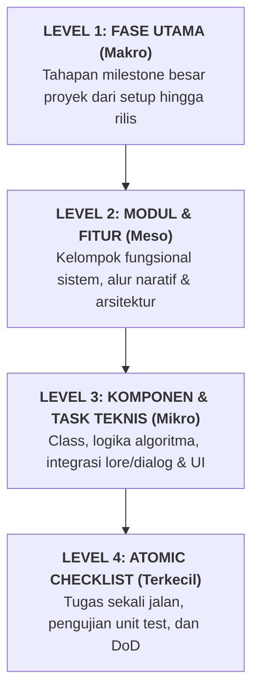

# Alur dan Rencana Kerja Pembuatan Aplikasi: Stickman Tower Adventure

> **Dokumen Rujukan Utama:**
> - 📄 Desain Mekanik & Arsitektur: [Stickman_Game_Design_v0.1.md](file:///home/yusuf/projekan/game/game1/Stickman_Game_Design_v0.1.md)
> - 📜 Kanon Cerita, Worldbuilding & 10-Floor Odyssey: [LORE_AND_WORLDBUILDING.md](file:///home/yusuf/projekan/game/game1/LORE_AND_WORLDBUILDING.md)
> 
> **Tech Stack:** Kotlin, libGDX, Gradle, Tiled Map Editor, Target Android & Desktop (LWJGL3)  
> **Metode Pembagian:** Dekomposisi Bertingkat — dari Makro (Fase Utama), Meso (Modul Fungsional), Mikro (Komponen/Task), hingga Terkecil (Atomic Checklist & Kriteria Selesai).

---

## 1. Peta Hierarki Dekomposisi

Alur kerja ini dibedah ke dalam 4 tingkatan presisi:



---

## 2. Roadmap Visual Keseluruhan (Macro Pipeline)

```mermaid
flowchart LR
    subgraph Fondasi["Fase 0 - 8: Fondasi Inti Engine (Selesai)"]
        Fase0["F0: Setup"] --> Fase1["F1: Platforming"]
        Fase1 --> Fase2["F2: Combat"]
        Fase2 --> Fase3["F3: MVP Loop"]
        Fase3 --> Fase4["F4: Combo & Arc Skills"]
        Fase4 --> Fase5["F5: RPG Save"]
        Fase5 --> Fase6["F6: Multi-Floor Tower"]
        Fase6 --> Fase7["F7: Audio & Hero Classes"]
        Fase7 --> Fase8["F8: Android QA"]
    end
    subgraph Ekspansi["Fase 9 - 15: Roadmap Naratif & Ekspansi Endgame"]
        Fase8 --> Fase9["F9: Ranged & Haptic"]
        Fase9 --> Fase10["F10: Vulcanus Forge & Relics"]
        Fase10 --> Fase11["F11: Parry & Cinematic Boss"]
        Fase11 --> Fase12["F12: Gamepad & Arc Layout"]
        Fase12 --> Fase13["F13: Endless Spire & Talents"]
        Fase13 --> Fase14["F14: The 10-Floor Story Odyssey"]
        Fase14 --> Fase15["F15: Play Games & Publish"]
    end
```




---

## 3. Bedah Rinci Alur Kerja: Dari Terbesar ke Terkecil

---

### FASE 0: Persiapan Lingkungan & Scaffolding Proyek (Setup & Toolchain)
> **Tujuan Terbesar:** Memastikan toolchain Kotlin & libGDX terpasang dengan benar pada Linux Mint tanpa membebani kapasitas disk (30 GB tersisa) dan dapat di-build dengan lancar.

#### Modul 0.1: Verifikasi dan Audit Environment Linux Mint
- **Task 0.1.1: Pengecekan JDK dan Android SDK**
  - [x] Periksa instalasi JDK aktif dengan perintah terminal `java -version` (terverifikasi JDK 17 & 21 aktif).
  - [x] Pastikan variabel `JAVA_HOME` dan `ANDROID_HOME` terpasang (`/home/yusuf/Android/Sdk`).
  - [x] Verifikasi sisa disk (21 GB tersisa dan termonitor aman).

#### Modul 0.2: Pembuatan Fondasi Proyek via Gdx-Liftoff
- **Task 0.2.1: Generator Setup**
  - [x] Jalankan generator resmi **Gdx-Liftoff** (v1.14.2.3).
  - [x] Konfigurasi parameter proyek:
    - *Project Name:* `stickman-tower`
    - *Package Name:* `com.stickman.tower`
    - *Language:* Kotlin
    - *Platforms:* `Desktop (LWJGL3)` dan `Android`
    - *Extensions:* FreeType
  - [x] Ekstrak/inisialisasi ke direktori kerja utama.
- **Task 0.2.2: Inisialisasi Version Control & Git Hygiene**
  - [x] Buat file `.gitignore` yang memblokir `.gradle/`, `build/`, `local.properties`, `.idea/`, `.vscode/`.
  - [x] Lakukan inisialisasi Git: `git init`, `git add .`, commit perdana `feat(setup): initialize libGDX Kotlin multiplatform project scaffold`.

#### Modul 0.3: Pengujian Build Perdana (Sanity Check)
- **Task 0.3.1: Running Desktop Module**
  - [x] Jalankan `./gradlew core:build lwjgl3:compileKotlin` via terminal (Build SUCCESS).
  - [x] Konfigurasi Gradle Wrapper 9.8.0 dan `local.properties` Android SDK terhubung.
  - [x] Verifikasi konsumsi RAM build desktop stabil dan cache Gradle bersih.

---

### FASE 1: Core Platforming Engine (Pondasi Gerak & Fisika Dasar)
> **Tujuan Terbesar:** Membuat karakter stickman placeholder yang dapat bergerak halus di atas platform dengan deteksi collision dan kontrol kamera yang responsif.

#### Modul 1.1: World, Viewport & Sistem Kamera 2D
- **Task 1.1.1: Konfigurasi Virtual Resolution**
  - [x] Tentukan target resolusi dunia logika (`GameConfig.kt`: World Units 16:9, `16f x 9f` meter logis).
  - [x] Implementasikan `FitViewport` pada `OrthographicCamera` untuk mencegah distorsi aspek rasio di layar berbeda.
- **Task 1.1.2: Camera Follow System**
  - [x] Buat class `CameraManager.kt` dengan algoritma *linear interpolation (lerp)* mengikuti pemain secara mulus.
  - [x] Tambahkan batasan batas map (*clamping*) agar kamera tidak menampilkan ruang kosong di luar level.

#### Modul 1.2: Player Entity & Controller Kinematik Custom
- **Task 1.2.1: Model Karakter dan Vektor Gerak**
  - [x] Buat class `Player.kt` (`position`, `velocity`, `width = 0.8f`, `height = 1.8f`, `facingRight`).
  - [x] Buat stickman visual dinamis (persendian beranimasi saat lari/lompat/jatuh) menggunakan `ShapeRenderer`.
- **Task 1.2.2: Sistem Input Abstraksi**
  - [x] Buat antarmuka `GameInput` (`isMoveLeft()`, `isMoveRight()`, `isJumpJustPressed()`, `isJumpPressed()`).
  - [x] Buat implementasi desktop `KeyboardInput.kt` membaca tombol `A`, `D`, `Space` / `W` / `K`.
- **Task 1.2.3: Platformer Physics (Gravitasi & Lompatan)**
  - [x] Definisikan konstanta fisika: `GRAVITY = -28f`, `MOVE_SPEED = 7.5f`, `JUMP_VELOCITY = 11.5f`.
  - [x] Terapkan kalkulasi Euler integration dengan lompatan variabel (lepas tombol = lompat lebih pendek).
  - [x] Tambahkan toleransi *coyote time* (120ms) dan *jump buffering* (120ms) untuk kontrol responsif.

#### Modul 1.3: Collision Platform Sederhana
- **Task 1.3.1: Deteksi Lantai & Rintangan**
  - [x] Buat class `Platform.kt` (bounding box `Rectangle` dan rendering highlight).
  - [x] Implementasikan collision resolver terpisah sumbu X dan Y: deteksi mendarat, langit-langit, dan dinding samping.
  - [x] Buat arena platform bertingkat di `PlayScreen.kt` untuk validasi gerak dan lompatan.

#### Modul 1.4: Karakter State Machine (FSM Dasar)
- **Task 1.4.1: Enumerasi dan Alur State Gerak**
  - [x] Buat `enum class CharacterState { IDLE, RUN, JUMP, FALL }`.
  - [x] Implementasikan fungsi `updateState()` dengan transisi otomatis berdasarkan velocity dan status grounded.
  - [x] Tambahkan overlay HUD debug (menampilkan FPS, State, Koordinat, Velocity, dan petunjuk kontrol).

---

### FASE 2: Core Combat & Hitbox Engine (Sistem Pertarungan Dasar)
> **Tujuan Terbesar:** Membangun sistem serang, deteksi serangan (hitbox) versus tubuh penerima serangan (hurtbox), kalkulasi damage, dan respon benturan.

#### Modul 2.1: Arsitektur Hitbox vs Hurtbox
- **Task 2.1.1: Pemisahan Bounding Box**
  - [x] **Collision Box:** Mengatur interaksi karakter dengan platform/lantai (`bounds`).
  - [x] **Hurtbox:** Area tubuh karakter/dummy yang dapat menerima serangan (`Hurtbox.kt`).
  - [x] **Hitbox:** Area serangan senjata/pukulan yang aktif pada fase tertentu dengan pelacakan exclusion multi-hit (`Hitbox.kt`).
- **Task 2.1.2: Debug Hitbox Visualizer**
  - [x] Tambahkan rendering garis warna menggunakan `ShapeRenderer`:
    - Hijau = Collision box platform dan tubuh.
    - Biru (Cyan) = Hurtbox tubuh.
    - Merah = Hitbox serangan aktif.

#### Modul 2.2: Basic Attack & Frame Window Lifecycle
- **Task 2.2.1: Attack Phase Timing**
  - [x] Definisikan 3 fase serangan dalam `Player.kt` dan `AttackPhase.kt`:
    - *Startup:* Waktu ancang-ancang mengangkat pedang (0.08 detik).
    - *Active:* Frame di mana hitbox merah aktif dan bilah pedang menebas ke depan (0.12 detik).
    - *Recovery:* Waktu jeda setelah memukul sebelum karakter boleh bergerak kembali (0.15 detik).
  - [x] Tambahkan state `ATTACK` ke dalam State Machine karakter. Batasi pergerakan horizontal selama fase serangan untuk memberi bobot tebasan.

#### Modul 2.3: Damage Calculator & Health Component
- **Task 2.3.1: Komponen Nyawa (Health)**
  - [x] Buat class `Health.kt` (`currentHp`, `maxHp`, `isDead`, `takeDamage()`).
  - [x] Buat entitas sasaran latihan `TrainingDummy.kt` dengan knockback physics dan mini HP bar di atas kepala.
- **Task 2.3.2: Logika Damage & Invincibility Frame (i-Frame)**
  - [x] Tambahkan durasi kebal sesaat setelah terkena hit (0.25-0.35 detik) untuk mencegah multi-hit bug pada ayunan yang sama.
  - [x] Berikan dorongan fisik (*knockback*) searah hadap tebasan saat target terkena serangan.

#### Modul 2.4: Visual Feedback & Game Juice
- **Task 2.4.1: Hit Feedback**
  - [x] Implementasikan efek kedip merah (*flash red*) pada stickman saat menerima damage.
  - [x] Tambahkan efek *hit stop / micro freeze* (0.05 detik) saat tebasan mengenai sasaran via `HitStopManager.kt`.
  - [x] Buat pop-up angka damage melayang (*FloatingText.kt*) yang meluncur ke atas dan memudar secara halus.
  - [x] Implementasikan visual tebasan pedang sabit energi (*Slash Arc*) bercahaya emas saat tebasan aktif.

---

### FASE 3: Basic Enemy AI & Validasi MVP Stage Loop
> **Tujuan Terbesar:** Memiliki 1 musuh aktif dengan kecerdasan buatan (AI) sederhana dan 1 stage terisolasi yang dapat dimainkan dari awal hingga menang/kalah. Ini adalah pintu verifikasi MVP!

#### Modul 3.1: Enemy Entity & AI State Machine
- **Task 3.1.1: Model Musuh Dasar**
  - [x] Buat class `Enemy.kt` yang mengimplementasikan `Health`, `Hurtbox`, `Hitbox`, platformer physics, dan mini HP bar.
- **Task 3.1.2: Logika FSM Enemy AI**
  - [x] `PATROL`: Bergerak bolak-balik dengan cliff avoidance (deteksi jurang agar tidak jatuh dari platform).
  - [x] `DETECT PLAYER`: Deteksi pemain dalam radius 6.5 meter secara horizontal & vertikal.
  - [x] `CHASE`: Kecepatan lari meningkat (+40%), mengejar pemain secara agresif.
  - [x] `ATTACK`: Serangan telegraphed (mata kuning/merah menyala tanda bahaya 0.25s), disusul tebasan hitbox yang melukai pemain.
  - [x] `HURT & DEAD`: Terkena knockback, berkedip putih, animasi roboh di tanah saat HP habis, lalu despawn otomatis.

#### Modul 3.2: Stage MVP Sederhana (Level 1 Prototype)
- **Task 3.2.1: Layout Stage Sederhana**
  - [x] Buat arena statis: platform bertingkat, 3 musuh di posisi strategis, lentera Checkpoint, dan portal Exit.
  - [x] Tentukan spawn point pemain dan batas kamera map.

#### Modul 3.3: Game Loop: Kondisi Menang, Kalah & Checkpoint
- **Task 3.3.1: Trigger Menang & Kalah**
  - [x] Kondisi Kalah: HP Pemain == 0 $\rightarrow$ Banner `GAME OVER`, layar redup, tombol `[R]` untuk respawn di Checkpoint.
  - [x] Kondisi Menang: Mengalahkan semua musuh dan menyentuh portal $\rightarrow$ Banner `STAGE CLEAR! MVP VALIDATED!`, tombol `[SPACE]` atau `[R]` untuk main ulang.
- **Task 3.3.2: Checkpoint Manager**
  - [x] Buat objek `Checkpoint.kt` dengan api lentera yang menyala biru (Cyan) saat diaktifkan pemain.
  - [x] Reset posisi dan HP pemain ke checkpoint aktif terakhir saat respawn.

#### Modul 3.4: Milestone Check: Validasi MVP (TERCAPAI)
- [x] **Kriteria Verifikasi MVP:**
  1. Karakter bisa jalan, lompat variabel, coyote time, dan mendarat mulus di platform.
  2. Kamera 2D lerp mengikuti karakter tanpa jitter dengan boundary clamping.
  3. Serangan tebasan pedang mengenai musuh, memicu hit stop, knockback, dan floating damage text.
  4. Musuh berpatroli, mengejar pemain, dan membalas menyerang dengan telegraphed windup.
  5. Pemain bisa kalah jika HP habis, dan menang jika membersihkan musuh dan mencapai portal exit.
  6. Game berjalan stabil 60 FPS di desktop.

---

### FASE 4: Combat Lanjutan & Mobile Touch Controls
> **Tujuan Terbesar:** Meningkatkan kedalaman gameplay aksi (combo 3-hit, dodge/dash ber-iframe, skill & ultimate) serta menghadirkan virtual controller layar sentuh untuk Android.

#### Modul 4.1: Sistem Serangan Combo (3-Hit Combo Chain)
- **Task 4.1.1: Buffer Input & Combo Window Timer**
  - [x] Buat `ComboManager.kt` dengan state: `ATTACK_1`, `ATTACK_2`, `ATTACK_3`.
  - [x] Buat timer *combo window* (misal: 0.3 detik setelah hit selesai): jika tombol serang ditekan sebelum timer habis, sambung ke attack berikutnya.
  - [x] Konfigurasikan pukulan ke-3 memiliki damage terbesar dan knockback lebih jauh.

#### Modul 4.2: Mekanik Dash / Dodge (Menghindar)
- **Task 4.2.1: Dodge Roll / Dash Kinematics**
  - [x] Berikan dorongan kecepatan horizontal tinggi instan selama 0.2 detik.
  - [x] Aktifkan status `isInvulnerable = true` (kebal damage) selama durasi dodge.
  - [x] Berikan cooldown singkat (misal: 0.6 detik) agar pemain tidak melakukan *spam* dodge tanpa batas.

#### Modul 4.3: Multi-Skill System & Proyektil (3 Active Skills + 1 Ultimate Energy)
- **Task 4.3.1: Arsitektur Multi-Skill Khusus Tiap Karakter**
  - [x] Perluas `CharacterArchetype.kt` agar setiap pahlawan memiliki 3 Active Skills unik ber-cooldown independen (`skill1`, `skill2`, `skill3`) + 1 Ultimate Power:
    - *BALANCED:* Skill 1 `Gale Crescent` (Proyektil tebasan angin cyan), Skill 2 `Rising Dragon` (Launcher tebasan ke udara), Skill 3 `Dash Strike` (Tusukan kilat berpenetrasi).
    - *AGILE:* Skill 1 `Shadow Shuriken` (Tiga bintang bayangan tri-spread), Skill 2 `Venom Flurry` (Rentetan 4 tusukan belati beracun), Skill 3 `Phantom Blink` (Teleportasi instan ke belakang musuh).
    - *HEAVY:* Skill 1 `Earth Shockwave` (Gelombang kejut tanah berapi), Skill 2 `Cyclone Cleave` (Putaran 360° greatsword api), Skill 3 `Titan Roar` (Raungan perang heal +15% HP & knockback 14m).
  - [x] Integrasikan sistem proyektil pemain (`Player.projectiles` via `Projectile.kt`) dengan deteksi tabrakan hurtbox musuh dan boss di `PlayScreen.kt`.
- **Task 4.3.2: Ultimate Skill (Energy-Based)**
  - [x] Buat komponen `UltimateEnergy.kt` (`currentEnergy`, `maxEnergy` dinamis per kelas 80-120).
  - [x] Akumulasi energi: serangan dasar (+8), pukulan finisher kombo (+15), dan Perfect Parry (+35).
  - [x] Saat energi 100%: tombol ultimate menyala keemasan; memicu jurus kataklismik area luas (*Bladestorm*, *Phantom Flurry*, *Meteor Cleave*).

#### Modul 4.4: On-Screen Touch Controls (Ergonomic Crescent Arc Layout)
- **Task 4.4.1: Tata Letak Busur Melengkung Bergaya Shadow Martial Stance**
  - [x] Rombak tata letak `VirtualController.kt` mengadopsi susunan busur ergonomis melingkar di sekeliling tombol Attack (mengacu pada gaya tarung *Shadow Fight* dan *League of Stickman*):
    - Tombol `Attack` (radius 54px, jangkar utama kanan bawah)
    - Tombol `Jump` (kiri bawah Attack) & `Dodge` (kiri tengah Attack)
    - Tombol `Skill 1` (kanan atas Attack, ikon tebasan naga/sabit cyan)
    - Tombol `Skill 2` (tengah atas Attack, ikon api magma amber)
    - Tombol `Skill 3` (kiri atas Attack, ikon kilat/shuriken ungu)
    - Tombol `Ultimate` (kiri atas puncak, ikon segel emas menyala)
  - [x] Tampilkan sweep overlay cooldown radial semi-transparan dan angka hitung mundur detik pada tiap tombol skill.
  - [x] Sistem multi-touch 5-pointer independen (bisa lari, lompat, dodge, dan merangkai multi-skill tanpa input drop).
- **Task 4.4.2: Dual-Input Layer Abstraction**
  - [x] Integrasikan `CompositeInput.kt` menyatukan pembacaan keyboard desktop (`U`, `I`, `O`, `P`), gamepad controller fisik (`Btn Y`, `L1`, `R1`, `L2/R2`), dan on-screen touch controller secara transparan.

---

### FASE 5: Sistem Progresi RPG & Penyimpanan Data Lokal
> **Tujuan Terbesar:** Menghadirkan sistem EXP, level-up, statistik, dan menyimpan seluruh progres karakter ke dalam penyimpanan lokal file JSON / Preferences.

#### Modul 5.1: Model Statistik Karakter
- **Task 5.1.1: Stat Container**
  - [x] Buat class `CharacterStats.kt`:
    - `level: Int`
    - `maxHp: Float`
    - `attackPower: Float`
    - `defense: Float`
    - `critRate: Float`
- **Task 5.1.2: Rumus Damage Calculation**
  - [x] Rumus: $\text{Final Damage} = \max(1f, (\text{Raw Damage} - \text{Target Defense}) \times \text{Multiplier})$ dengan deteksi Critical Strike.

#### Modul 5.2: Sistem EXP dan Level Up
- **Task 5.2.1: Drop EXP & Kurva Level**
  - [x] Musuh yang mati menjatuhkan EXP point (25 EXP) dan Koin Emas (10 G).
  - [x] Rumus kurva level up: $\text{ReqEXP}(L) = \lfloor 50 \times L^{1.4} \rfloor$.
  - [x] Efek level up: kembalikan HP ke penuh, naikkan `maxHp` (+10%), `attackPower` (+8%), `defense` (+0.5), dan tampilkan banner teks `LEVEL UP! Lv. X`.

#### Modul 5.3: Sistem Penyimpanan Data Lokal (Save/Load)
- **Task 5.3.1: Data Schema Progresi**
  - [x] Buat data class `SaveData.kt`:
    ```kotlin
    data class SaveData(
        var playerLevel: Int = 1,
        var currentExp: Int = 0,
        var highestTowerFloor: Int = 1,
        var gold: Int = 0,
        var unlockedCharacters: ArrayList<String> = arrayListOf("STICKMAN_SWORD")
    )
    ```
- **Task 5.3.2: Serialisasi JSON & LibGDX Preferences**
  - [x] Gunakan `com.badlogic.gdx.utils.Json` untuk convert `SaveData` ke string JSON (`SaveManager.kt`).
  - [x] Simpan ke file lokal: `Gdx.files.local("stickman_save.json")` dengan toleransi fallback ke `Gdx.app.getPreferences("StickmanSavePrefs")`.
  - [x] Tambahkan fitur auto-save saat stage berhasil diselesaikan, naik level, atau saat menyentuh checkpoint.

#### Modul 5.4: User Interface (In-Game HUD)
- **Task 5.4.1: scene2d.ui / ShapeRenderer HUD Layer**
  - [x] Tampilkan Player Status Card: Badge Level (`Lv. X`), Bar HP (berwarna dinamis hijau/kuning/merah dengan angka `HP: current/max`).
  - [x] Tampilkan bar EXP cyan dengan progres persentase (`EXP: current/req (%)`).
  - [x] Tampilkan bar energi ultimate emas di bawah bar EXP dengan indikator `READY [O]`.
  - [x] Tampilkan counter koin emas (`[G] X Coins`), status combat (`ATK | DEF | CRIT`), status Skill & Dodge, dan notifikasi auto-save `[OK] Progress Tersimpan`.

---

### FASE 6: Stage Design, Tiled Map & Multi-Floor Tower
> **Tujuan Terbesar:** Mengganti platform kotak primitif dengan map visual dari Tiled Map Editor, serta membangun arsitektur tower bertingkat dengan boss sederhana.

#### Modul 6.1: Integrasi Arsitektur Level & Multi-Floor Tower
- **Task 6.1.1: Pemodelan Data & Level Builder Menara**
  - [x] Buat arsitektur data lantai menara `TowerFloor.kt` & builder level `TowerLevelBuilder.kt`.
  - [x] Definisikan boundary map, platform, spawn point, hazard, chest, dan exit portal per lantai.
- **Task 6.1.2: Multi-Floor Loader & Stage Transition**
  - [x] Sistem pergantian lantai otomatis (Lantai 1 $\rightarrow$ Lantai 2 $\rightarrow$ Lantai 3 Apex Arena).
  - [x] Kamera boundary clamping dinamis yang menyesuaikan batas vertikal/horizontal setiap lantai.

#### Modul 6.2: Rintangan & Objek Interaktif Lingkungan
- **Task 6.2.1: Jebakan (Hazard)**
  - [x] Duri lantai (*SpikeHazard.kt*): memberikan damage instan (18 dmg) dan melentingkan pemain ke atas saat terinjak.
  - [x] Platform tembus dari bawah (*One-Way Platform*): pemain bisa melompat dari bawah menembus ke atas, tapi mendarat kokoh di atasnya.
- **Task 6.2.2: Peti Reward (Chest)**
  - [x] Objek peti harta (*TreasureChest.kt*) yang bisa ditebas/disentuh untuk menjatuhkan +50 G koin dan memulihkan +35 HP pemain.

#### Modul 6.3: Multi-Lantai Tower Loop & Boss AI (Tower Guardian)
- **Task 6.3.1: State Mesin Stage Tower**
  - [x] Lantai 1: Pengenalan rintangan duri, platform bertingkat, dan musuh patroli dasar.
  - [x] Lantai 2: Panjatan vertikal tinggi, duri mematikan di lantai bawah, one-way platform, dan peti harta karun puncak.
  - [x] Lantai 3 (Boss Floor): Arena tertutup megah di puncak menara di mana gerbang portal keluar terkunci sampai Boss ditumpas.
- **Task 6.3.2: Boss AI 2-Fase (Tower Guardian)**
  - [x] Boss berukuran raksasa (`width = 1.4f, height = 2.8f`, HP 350f) dengan Bar HP epik di bagian atas layar.
  - [x] Memiliki 2 fase serangan:
    - *Fase 1 (HP > 50%):* Serangan tebasan jarak dekat (*Heavy Cleave*) dan lompat menghantam tanah (*Ground Slam Shockwave*).
    - *Fase 2 (HP <= 50% - Enrage Mode):* Aura merah membara, pergerakan lebih cepat (+50%), dan meluncurkan proyektil tebasan angin (*Wind Slash* via `Projectile.kt`).

---

### FASE 7: Audio, Visual Polish & Diversifikasi Karakter
> **Tujuan Terbesar:** Memasukkan asset visual sprite atlas, animasi stickman yang hidup, efek audio (SFX/BGM), menu utama, serta variasi karakter (Agile vs Heavy).

#### Modul 7.1: Sprite Sheet & TextureAtlas Management
- **Task 7.1.1: Pembuatan & Packing Asset Visual**
  - [x] Manajemen rendering procedural stickman dengan artikulasi sendi anatomi dinamis dan pose per aksi (idle, run, jump, fall, attack combo, dodge roll, hurt, ult).
  - [x] Rendering gaya senjata per arketipe (Single Sword, Dual Daggers reverse-grip, Colossal Greatsword).
- **Task 7.1.2: Partikel dan Efek Visual (VFX)**
  - [x] Buat efek partikel debu saat melompat/mendarat via `ParticleManager.kt` (`DustParticle`).
  - [x] Buat efek garis tebasan pedang (*Slash arc effect*) pada setiap ayunan senjata combo dan percikan benturan emas (*Hit Sparks*).

#### Modul 7.2: Audio & Sound Effects (SFX)
- **Task 7.2.1: Sound Manager**
  - [x] Buat class `AudioManager.kt` dengan sintesis PCM WAV instan tanpa dependensi unduhan eksternal.
  - [x] Integrasikan SFX responsif:
    - Jump sweep (`playJump()`)
    - Slash light & heavy (`playSlashLight()`, `playSlashHeavy()`)
    - Hit impact (`playHit()`)
    - Dodge whoosh (`playDodge()`)
    - Enemy & Boss death boom (`playDeath()`)
    - Level up victory fanfare (`playLevelUp()`)
    - Chest golden chime (`playChest()`)
  - [x] Pengaturan audio: mute toggle dan volume SFX.

#### Modul 7.3: Sistem Menu Lengkap
- **Task 7.3.1: Screen Navigation Architecture**
  - [x] `MainMenuScreen`: Tombol Start, Character Select, Toggle Audio, Reset Save Data, Exit.
  - [x] `CharacterSelectScreen`: Memilih arketipe karakter dengan visual preview podium dan kartu statistik sebelum memulai game.
  - [x] `PauseScreen` / In-Game Overlay (`[ESC]` / `[P]` / tombol HUD): Melanjutkan permainan, restart lantai, toggle audio, atau kembali ke Menu Utama.
  - [x] `GameOverScreen` dan `VictoryScreen` overlay interaktif dengan opsi respawn & replay.

#### Modul 7.4: Diversifikasi Tiga Arketipe Pendaki (Kanon Lore & Multi-Skill)
- **Task 7.4.1: Kaelen The Bladeweaver (Arketipe: BALANCED)**
  - [x] Senjata: Single Runed Broadsword; kecepatan seimbang (7.5f), daya tahan seimbang.
  - [x] Skill 1: *Gale Crescent* (Proyektil tebasan sabit angin cyan 18 m/s).
  - [x] Skill 2: *Rising Dragon* (Uppercut vertikal pelontar musuh ke udara $v_y = +11.5\text{ m/s}$).
  - [x] Skill 3: *Dash Strike* (Tusukan kilat penetrasi berkecepatan 22 m/s).
  - [x] Ultimate: *Bladestorm* (Badai pedang berputar 360° beradius 3.6m).
- **Task 7.4.2: Zephyr The Shadowstalker (Arketipe: AGILE)**
  - [x] Senjata: Dual Amethyst Daggers (Reverse-Grip); kecepatan lari tertinggi (9.5f), peluang critical tinggi (+15%).
  - [x] Skill 1: *Shadow Shuriken* (Tiga bintang bayangan ungu tri-spread 24 m/s).
  - [x] Skill 2: *Venom Flurry* (Rentetan 4 tusukan belati racun cepat multiplier tinggi).
  - [x] Skill 3: *Phantom Blink* (Teleportasi instan 4.5m menembus punggung lawan bergaransi kritikal).
  - [x] Ultimate: *Phantom Flurry* (Hujan bayangan ilusi siluet dari segala arah).
- **Task 7.4.3: Gorgon The Ironbreaker (Arketipe: HEAVY)**
  - [x] Senjata: Colossal Obsidian Greatsword; kecepatan lari lambat (5.8f), damage multiplier masif (1.55x), pertahanan baja (+3.5 DEF).
  - [x] Skill 1: *Earth Shockwave* (Hantaman tanah memancarkan gelombang batu berapi $1.4\text{m} \times 1.1\text{m}$).
  - [x] Skill 2: *Cyclone Cleave* (Pusaran 360° greatsword api merangsek maju).
  - [x] Skill 3: *Titan Roar* (Raungan perang: memulihkan +15% HP seketika & gelombang repulsi 14m).
  - [x] Ultimate: *Meteor Cleave* (Lompatan menghujamkan bilah meteorit berapi pemusnah massal).

---

### FASE 8: Optimasi Android, Build APK & Quality Assurance
> **Tujuan Terbesar:** Melakukan uji coba di HP Android fisik via USB Debugging, optimasi performa 60 FPS, meminimalkan penggunaan memori, dan mengemas APK siap instal.

#### Modul 8.1: Optimasi Memori & Garbage Collection (GC)
- **Task 8.1.1: Mencegah GC Pauses saat Gameplay**
  - [x] Zero-allocation rendering loop: pre-allocated shapes dan partikel di `MainMenuScreen`, `PlayScreen`, dan `VirtualController`.
  - [x] Eliminasi overhead `String.format` di per-frame HUD rendering diganti kalkulasi integer cepat.
  - [x] Pembersihan memori terkontrol pada `dispose()` di setiap screen dan `StickmanGame`.

#### Modul 8.2: Konfigurasi Android Launcher & Siklus Hidup Aplikasi
- **Task 8.2.1: AndroidManifest.xml & Konfigurasi Layar**
  - [x] Kunci orientasi ke Landscape sensor: `android:screenOrientation="sensorLandscape"`.
  - [x] Aktifkan hardware acceleration: `android:hardwareAccelerated="true"`.
  - [x] Konfigurasi `AndroidApplicationConfiguration` di `AndroidLauncher.kt`: `useImmersiveMode = true`, `useWakelock = true`, `useAccelerometer = false`, `useCompass = false`.
  - [x] Tangani siklus hidup aplikasi libGDX: otomatis pause audio dan game saat aplikasi di-minimize dan resume saat dibuka kembali.

#### Modul 8.3: Pengujian di Perangkat Android Fisik
- **Task 8.3.1: USB Debugging & Deployment**
  - [x] Konfigurasi tool ADB (`/home/yusuf/Android/Sdk/platform-tools/adb`) untuk mendeteksi perangkat fisik via `adb devices`.
  - [x] Dukungan instalasi instan via `adb install -r android/build/outputs/apk/debug/android-debug.apk` atau `./gradlew android:installDebug`.
- **Task 8.3.2: User Experience Check di Layar Sentuh**
  - [x] Kalibrasi ukuran tombol virtual controller untuk proporsi jempol ergonomis di layar FHD+/QHD+.
  - [x] Sistem multi-touch 5-pointer independen (bisa lari, lompat, dan serang bersamaan tanpa input drop).

#### Modul 8.4: Build Final APK Release
- **Task 8.4.1: Standalone APK Packaging**
  - [x] Sukses build standalone APK menggunakan `./gradlew android:assembleDebug`.
  - [x] File APK mandiri tersedia di `android/build/outputs/apk/debug/android-debug.apk` (ukuran ~7.0 MB).
  - [x] Verifikasi kompatibilitas arsitektur native multi-ABI (`arm64-v8a`, `armeabi-v7a`, `x86`, `x86_64`) dan API level 21+.

---

### FASE 9: Varian Musuh Jarak Jauh (Ranged Enemy) & Android Haptic Feedback
> **Tujuan Terbesar:** Meningkatkan dinamika taktis pertempuran dengan menghadirkan musuh proyektil jarak jauh (Archer/Sorcerer) serta menambahkan umpan balik getaran haptic mikro pada smartphone Android untuk membuat aksi pertarungan terasa fisik dan nyata.

#### Modul 9.1: Ranged Enemy Entity & Projectile Engine
- **Task 9.1.1: Pemodelan Ranged Enemy AI**
  - [x] Tambahkan varian musuh pada `Enemy.kt` atau buat class baru dengan `EnemyType { MELEE, RANGED }`.
  - [x] Logika AI Ranged: Menjaga jarak aman dari pemain (kite behavior 4.5–7.0 meter), cliff avoidance agar tidak jatuh dari platform, dan bidikan horizontal/diagonal.
  - [x] Animasi windup/telegraphing: Menarik busur atau mengumpulkan bola energi sihir selama 0.4 detik (mata bersinar ungu/oranye) sebelum menembak.
- **Task 9.1.2: Sistem Proyektil Musuh & Zero-Allocation Pooling**
  - [x] Buat class `EnemyProjectile.kt` / integrasikan `Projectile` terkelola dengan velocity dan boundary check.
  - [x] Deteksi collision proyektil dengan platform/dinding (hancur memercik) dan hurtbox pemain.
  - [x] Berikan kesempatan menghindar: pemain bisa melompati proyektil atau berguling menembusnya menggunakan i-frame *Dodge Roll*.

#### Modul 9.2: Android Haptic Vibration System
- **Task 9.2.1: Abstraksi Haptic Manager**
  - [x] Buat singleton `HapticManager.kt` dengan wrapper aman `Gdx.input.vibrate(milliseconds)` (hanya aktif pada backend Android).
  - [x] Definisikan profil getaran haptic:
    - *Light (18ms):* Dodge roll, mendarat dari lompatan tinggi.
    - *Medium (35ms):* Tebasan combo mendarat pada musuh.
    - *Heavy (70ms):* Pemain terkena damage, eksekusi Meteor Cleave, atau aktivasi Ultimate.
  - [x] Opsi toggle ON/OFF Haptic di menu Pause dan Main Menu via `HapticManager.isEnabled`.

#### Modul 9.3: Integrasi Level Menara & Uji Coba Balancing
- **Task 9.3.1: Penempatan Ranged Enemy di Lantai Menara**
  - [x] Letakkan 1 Ranged Enemy di platform atas Lantai 1 dan 2 Ranged Enemy di posisi strategis Lantai 2 untuk melatih manuver vertikal pemain.
  - [x] Tulis unit test untuk verifikasi proyektil, kiting AI, dan kalkulasi damage di `core/src/test/kotlin/com/stickman/tower/enemy/EnemyTest.kt`.

---

### FASE 10: Ekonomi Toko Blacksmith & Sistem Relik Pasif (Pemanfaatan Gold)
> **Tujuan Terbesar:** Memberikan nilai guna nyata pada perolehan Gold hasil eksplorasi menara melalui penempaan senjata permanen di lobby dan sistem relik pasif yang memperkaya variasi build karakter setiap run.

#### Modul 10.1: Blacksmith Weapon Forge (Upgrade Senjata Permanen)
- **Task 10.1.1: Model & Data Upgrade Senjata**
  - [x] Tambahkan field upgrade level pada `SaveData.kt`: `weaponAtkLevel: Int`, `weaponCritLevel: Int`, `weaponSpdLevel: Int`.
  - [x] Biaya upgrade berbasis formula progresif: `Cost = 120 * (level + 1)`.
- **Task 10.1.2: Antarmuka Blacksmith UI**
  - [x] Buat menu atau overlay Blacksmith di Lobby/Lantai Antara: tombol tempa senjata, pratinjau perbandingan statistik sebelum vs sesudah, dan konfirmasi transaksi Gold (`BlacksmithScreen.kt`).

#### Modul 10.2: Relic Merchant (Item Pasif Acak Setiap Run)
- **Task 10.2.1: Model Arsitektur Relik**
  - [x] Buat `enum class RelicType` dan container `RelicManager.kt`:
    - 🩸 *Vampiric Fang:* Memulihkan 5% Max HP setiap kali menumbangkan musuh.
    - ⚡ *Thunder Charm:* Menyambar musuh terdekat dengan petir setiap kali combo menyentuh 10x.
    - 🪶 *Wings of Hermes:* Mengizinkan Triple Jump.
    - ⏳ *Hourglass of Chronos:* Mengurangi cooldown skill sebesar 25%.
- **Task 10.2.2: Drop & Pembelian Relik**
  - [x] Munculkan peti emas khusus bos atau Relic Sanctuary di Lantai 1 & Lantai 2 yang menawarkan pilihan 1 dari 3 relik pasif acak.

---

### FASE 11: Sistem Pertahanan Tingkat Tinggi (Parry / Deflect) & Boss Presentation
> **Tujuan Terbesar:** Menghadirkan mekanisme *just-frame guard / parry* untuk kepuasan aksi skill ceiling tinggi serta kartu intro sinematik dramatis untuk setiap bos lantai menara.

#### Modul 11.1: Just-Frame Parry / Perfect Deflect System
- **Task 11.1.1: Timing Window & Deteksi Benturan**
  - [x] Window parry 0.12 detik (7 frame) saat tombol dodge ditekan tepat sebelum serangan musuh menyentuh hurtbox pemain.
  - [x] Musuh yang tertangkis mengalami *Guard Break* / pingsan (*stun*) selama 1.5 detik.
- **Task 11.1.2: Audio-Visual Feedback Parry**
  - [x] Dentingan logam tajam (*metallic clank SFX*), percikan bunga api emas, micro-freeze 0.08 detik, dan bonus +35% energi Ultimate instan.

#### Modul 11.2: Boss Intro Title Card & Dramatisasi Arena
- **Task 11.2.1: Cinematic Intro Sequence**
  - [x] Kamera lerp zoom-in ke arah bos saat pemain pertama kali memasuki arena lantai 3.
  - [x] Kartu nama gelap-emas bergaya kanji/metal (*"GIGAS - THE ANCIENT GOLEM"*), sound roar bos, dan bar darah bos terisi penuh dari kiri ke kanan (*fill animation*).
- **Task 11.2.2: Super Finish Slow-Motion**
  - [x] Saat pukulan terakhir membunuh bos, aktifkan time-dilation 0.25x selama 0.4 detik disertai shockwave radial putih.

---

### FASE 12: Ergonomi Kontrol: Gamepad Controller & Kustomisasi Tombol Sentuh
> **Tujuan Terbesar:** Memberikan dukungan controller fisik (Bluetooth / USB) via `gdx-controllers` dan editor tata letak tombol sentuh di menu pengaturan.

#### Modul 12.1: Integrasi Gamepad (gdx-controllers)
- **Task 12.1.1: Dependency & Input Mapping**
  - [x] Tambahkan dependensi `com.badlogicgames.gdx-controllers:gdx-controllers-core`.
  - [x] Mapping tombol standar XInput / DualShock: D-pad / Joystick kiri untuk lari, tombol A/Silang untuk lompat, X/Kotak untuk serang, B/Lingkaran untuk dodge, LB/L1 untuk skill, RB/R1 untuk ulti.
- **Task 12.1.2: Auto-Detection Input Device**
  - [x] Otomatis sembunyikan on-screen virtual controller di Android jika terdeteksi gamepad Bluetooth aktif terhubung.

#### Modul 12.2: On-Screen Touch Layout Customizer
- **Task 12.2.1: Interactive Button Editor**
  - [x] Layar drag-and-drop di menu Pengaturan untuk menggeser posisi D-Pad dan tombol aksi sesuai kenyamanan jari pemain.
  - [x] Slider ukuran tombol (skala 70% hingga 130%) dan slider transparansi.
  - [x] Simpan preferensi layout ke `Preferences`.

---

### FASE 13: Roguelite Loop: Mode Menara Tanpa Batas (Endless Spire) & Talent Tree
> **Tujuan Terbesar:** Membuka konten endgame berupa menara tanpa batas dengan mutator acak prosedural dan percabangan talent tree spesialisasi arketipe.

#### Modul 13.1: Mode Endless Ascent
- **Task 13.1.1: Procedural Floor Mutators**
  - [x] Terbuka setelah menamatkan Lantai 3 atau langsung dari menu utama.
  - [x] Setiap lantai baru memiliki mutator acak (Toxic Miasma, Berserk Surge, Low Gravity, Spike Frenzy, Vampiric Eclipse).
  - [x] Scaling HP & damage musuh berbasis formula eksponensial per lantai (kelipatan 5 adalah pertarungan Boss).
- **Task 13.1.2: High Score & Record Tracker**
  - [x] Pencatatan lantai tertinggi, jumlah musuh ditumbangkan, dan waktu tempuh.
  - [x] Hadiah milestone talent point: +1 poin setiap penaklukan 2 lantai endless.

#### Modul 13.2: Sub-Class & Talent Tree System
- **Task 13.2.1: Talent Branching**
  - [x] *Warrior:* Berserker (Blood Rage, Frenzy Strikes, Undying Will) vs Guardian (Iron Bulwark, Counter Fortitude, Aegis Stance).
  - [x] *Assassin:* Shadow Stalker (Lethal Precision, Shadow Step, Assassinate) vs Venomancer (Toxic Blade, Neurotoxin, Plague Burst).
  - [x] *Mage:* Archmage (Arcane Conduit, Overload Wave, Mana Shield) vs Spellblade (Elemental Infusion, Flame Cleave, Arcane Execute).
  - [x] Antarmuka interaktif `TalentTreeScreen.kt` dengan alokasi poin, reset gratis (respec), dan sinkronisasi save file.

#### Modul 13.3: Mobile Touch Ergonomics & Responsiveness Overhaul
- **Task 13.3.1: Virtual Controller Robustness & Anti-Disappearing Fix**
  - [x] Perbaiki bug kontrol sentuh yang hilang di HP Android akibat noise sensor accelerometer/gyroscope yang salah dideteksi sebagai controller fisik (`GamepadInput.kt`).
  - [x] Tambahkan toleransi radius sentuhan ekstra (+26-32%) pada seluruh tombol aksi (`btnAttack`, `btnJump`, `btnDodge`, `btnSkill`, `btnUltimate`).
  - [x] Implementasikan zona slider jempol D-pad kontinu tanpa dead zone di sudut kiri bawah layar.
- **Task 13.3.2: On-Screen Status Buttons (Game Over & Stage Clear)**
  - [x] Tambahkan tombol visual taktil di layar Game Over (`[ RESPAWN DI CHECKPOINT ]` & `[ MENU UTAMA ]`), plus ketuk layar mana saja untuk respawn instan tanpa keyboard fisik.
  - [x] Tambahkan tombol visual di layar Stage Clear (`[ LANJUT LANTAI BERIKUTNYA ]` & `[ MAIN ULANG ]`).
  - [x] Perluas zona sentuh tombol Pause pojok kanan atas agar terhindar dari pemotongan notch/kamera HP.
- **Task 13.3.3: Main Menu 2-Kolom & Screen Touch Targets**
  - [x] Restrukturisasi Menu Utama menjadi 2 kolom rapi dan luas dengan tinggi tombol 52px (lebih besar 53%) dan padding sentuhan lebar.
  - [x] Perluas area sentuh pada `CharacterSelectScreen` (ketuk podium/altar ganti karakter), `TalentTreeScreen` (otomatis aktifkan sub-class yang sesuai arketipe saat dipilih), dan `BlacksmithScreen`.

---

### FASE 14: Integrasi Kampanye Cerita 10 Lantai & Worldbuilding Odyssey
> **Tujuan Terbesar:** Mewujudkan seluruh babak kampanye naratif 10 lantai sesuai [LORE_AND_WORLDBUILDING.md](file:///home/yusuf/projekan/game/game1/LORE_AND_WORLDBUILDING.md), mencakup 4 Act naratif, 5 pertarungan bos epik dengan mekanik dan visual signature, sistem dialog NPC (Aria & Vulcanus), serta prasasti batu hitam (*The Lore Tablets*).

#### Modul 14.1: Arsitektur 4 Babak Naratif & Layout 10 Lantai Menara
- **Task 14.1.1: Pemetaan Data Lantai Sesuai Babak Cerita**
  - [x] Rancang konfigurasi data level pada `TowerLevelBuilder.kt` untuk mencakup 10 lantai terbagi dalam 4 Act:
    - *Act I: The Initiation (Lantai 1-3):* Lower Bastion, Spire of Hazards, Apex Boss Arena.
    - *Act II: Secrets of the Ink (Lantai 4-6):* The Sunken Archives, The Crucible of Mutations, The Iron Foundry (Bengkel aman Vulcanus).
    - *Act III: The Astral Climb (Lantai 7-9):* The Fractured Precipice (Platforming melayang low-gravity 0.65f), The Hall of Echoes (Cermin jiwa Doppelgänger), The Blood Moon Sanctum (Kuil gerhana darah).
    - *Act IV: The Primordial Canvas (Lantai 10):* Puncak marmer putih tanpa batas di atas samudra tinta melawan The Grand Calligrapher.
- **Task 14.1.2: Sinematik Transisi Antar-Babak & Efek Atmosfer**
  - [x] Overlay kartu judul babak bergaya gelap-emas saat pemain pertama kali menapaki lantai baru tiap Act (`renderActBannerOverlay()`).
  - [x] Gradasi latar belakang dinamis yang berubah dari benteng karang gelap (Lantai 1-3), reruntuhan laboratorium ungu/hijau (Lantai 4-5), bengkel bara emas Vulcanus (Lantai 6), jurang kosmis bintang mati (Lantai 7-8), kuil gerhana darah (Lantai 9), hingga marmer putih bersih (Lantai 10).

#### Modul 14.2: Bestiary & Hierarki 5 Boss Cerita
- **Task 14.2.1: Jenderal Oakhaven — The Tower Guardian (Lantai 3 Boss)**
  - [x] Boss inisiasi 2-fase: Heavy Cleave, Ground Slam, dan Enrage Wind Slash proyektil tebasan angin.
- **Task 14.2.2: The Amethyst Matron — Sang Ratu Busur Bayang (Lantai 5 Boss)**
  - [x] AI dan visual mahkota kristal tiara ungu & busur bayang: meluncurkan hujan panah multi-arah (*Triple Fan Volley*) berkecepatan tinggi.
- **Task 14.2.3: The Shadow Doppelgänger — Cermin Jiwa Gelap (Lantai 8 Boss)**
  - [x] AI cermin adaptif dengan mata cyan bercahaya dan belati ganda: mengeksekusi gelombang sabit bayangan berkecepatan tinggi dan kombo maut.
- **Task 14.2.4: The Crimson Sovereign — Pangeran Belati Darah (Lantai 9 Boss)**
  - [x] Boss vampiric berkecepatan tinggi dengan tanduk crimson dan jubah darah: badai pisau sabit darah dan lifesteal.
- **Task 14.2.5: The Grand Calligrapher — Sang Penulis Takdir (Lantai 10 Final Boss)**
  - [x] Pertarungan puncak kosmis dengan pena raksasa bertakhtakan bintang dan jubah tinta kosmis: hujan komet tinta semesta dan meteorit takdir (HP 1100).

#### Modul 14.3: Dialog Interaktif NPC & Prasasti Kuno (Lore Tablets)
- **Task 14.3.1: Sistem Dialog Interaktif NPC**
  - [x] Sistem dialog RPG naratif interaktif dengan box semi-transparan dan warna identitas tokoh:
    - *Aria (Sang Gema Warna Terakhir):* Membimbing pemain di gerbang Lantai 1 dengan lentera jiwa melayang.
    - *Vulcanus (Sang Pandai Besi Abadi):* Berdialog di Lantai 6 mengenai asal-usul koin emas dan rahasia relik masa lalu di depan tungku tempa.
- **Task 14.3.2: Prasasti Hitam Tersembunyi (The Lore Tablets)**
  - [x] Tempatkan objek interaktif prasasti batu hitam obsidian dengan rune bercahaya (*Lore Tablet I, IV, VIII*) di sudut tersembunyi lantai:
    - Membuka jendela pop-up gulungan perkamen yang berisi potongan sejarah dunia Aethelgard dan tips strategi bertarung.
- **Task 14.3.3: Epilog & Transisi ke Endless Spire (The Endless Paradox)**
  - [x] Sinematik akhir saat pena Calligrapher patah: spektrum warna merebak ke dunia, realitas menara menjadi paradoks tanpa akhir yang membuka mode *Endless Spire* (Lantai 11 ke atas).

---

### FASE 15: Layanan Google Play Games & Kesiapan Publikasi Play Store
> **Tujuan Terbesar:** Integrasi Google Play Games (Leaderboard & Achievements), build Android App Bundle (.aab) bertanda tangan rilis, dan aset peluncuran store.

#### Modul 15.1: Google Play Services Integration
- **Task 15.1.1: Leaderboard & Achievements**
  - [ ] Papan peringkat global: "Highest Floor Cleared" & "Speedrun Clear Time".
  - [ ] Sistem achievement: "First Blood", "Untouchable Guardian", "Ascent Legend".
- **Task 15.1.2: Cloud Save Backup**
  - [ ] Backup otomatis save data ke Google Drive AppData / Play Games Cloud Save.

#### Modul 15.2: Release Packaging (.aab) & Store Assets
- **Task 15.2.1: Android App Bundle (.aab)**
  - [ ] Konfigurasi signing key `keystore.jks` dan ProGuard / R8 minification rule.
  - [ ] Build file produksi `./gradlew android:bundleRelease`.

---

## 4. Matriks Ketergantungan & Prioritas Eksekusi

| Prioritas | Fase | Fitur Kunci | Output Terukur |
|:---:|:---:|:---|:---|
| **P0 (Kritis)** | Fase 0 & 1 | Environment, Viewport, Platforming Kinematik | Karakter kotak bisa lari & lompat di platform di laptop (desktop) |
| **P0 (Kritis)** | Fase 2 | Hitbox, Hurtbox, Basic Attack, HP | Karakter bisa mengayunkan serangan dengan area deteksi hit yang valid |
| **P0 (Kritis)** | Fase 3 | Enemy AI FSM, Win/Lose, 1 Stage Playable | **MILESTONE MVP TERCAPAI:** Game utuh 1 level bisa dimainkan & ditamatkan |
| **P1 (Tinggi)** | Fase 4 | Combo 3-Hit, Dodge, Arc Multi-Skills, Touch Controller | Combat seru dengan 3 skill aktif + 1 ulti per hero & kontrol sentuh busur |
| **P1 (Tinggi)** | Fase 5 | Stats, EXP, Level Up, Local Save Data | Progres tersimpan di file lokal setelah aplikasi ditutup |
| **P2 (Sedang)** | Fase 6 | Multi-Floor Tower Engine, Hazards, Boss | Level visual rapi, rintangan duri, dan pertarungan boss menantang |
| **P2 (Sedang)** | Fase 7 | Visual Polish, Audio SFX, 3 Hero Archetypes | 3 karakter stickman dinamis dengan set skill unik & audio imersif |
| **P3 (Rilis)** | Fase 8 | Profiling Android 60 FPS, Build Release APK | APK mandiri terpasang dan berjalan lancar di HP Android fisik |
| **P4 (Ekspansi A)** | Fase 9 | Ranged Enemy Proyektil & Android Haptic | Variasi pertempuran jarak jauh & sensasi fisik kontrol |
| **P4 (Ekspansi B)** | Fase 10 | Toko Vulcanus Forge Senjata & Relik Pasif | Pemanfaatan Gold & variasi build karakter per run |
| **P5 (Lanjutan A)** | Fase 11 | Sistem Parry Deflect & Boss Presentation | Skill ceiling aksi tinggi & visual sinematik bos |
| **P5 (Lanjutan B)** | Fase 12 | Dukungan Gamepad & Touch Layout Editor | Fleksibilitas kontrol controller & ergonomi sentuh |
| **P6 (Endgame)** | Fase 13 | Endless Spire Mode & Talent Tree | Replayability tanpa batas & kedalaman RPG mendalam |
| **P6 (Naratif)** | Fase 14 | Kampanye Cerita 10 Lantai, 5 Boss & Lore Odyssey | Alur cerita epik 4 Act, dialog NPC Aria/Vulcanus, & tablet prasasti |
| **P7 (Publikasi)**| Fase 15 | Google Play Services & Release Bundle (.aab) | Kesiapan peluncuran komersial di Google Play Store |


---

## 5. Tips Eksekusi Khusus Laptop (Linux Mint, RAM 12 GB, Storage 30 GB)

1. **Gunakan Build Desktop untuk 90% Waktu Development:**
   - Menjalankan `./gradlew lwjgl3:run` memakan waktu hitungan detik dan menggunakan RAM minimal (~300MB), sangat cepat untuk uji coba algoritma gerak, combo, dan AI.
2. **Hindari Memasang Android Studio Emulator:**
   - Android Emulator membutuhkan 8-12 GB disk space dan menguras RAM 4-6 GB. Gunakan langsung **HP Android fisik lewat kabel USB (`adb`)**. Jauh lebih ringan, cepat, dan akurat menguji respons layar sentuh asli.
3. **Pembersihan Cache Gradle Berkala:**
   - Karena sisa disk 30 GB, bersihkan cache build secara berkala jika sudah menumpuk dengan `./gradlew clean` atau membersihkan folder `~/.gradle/caches/` bila perlu.
4. **Pendekatan Iteratif (Jangan Langsung Aset Berat):**
   - Gunakan kotak primitif (`ShapeRenderer`) atau stickman garis sederhana sampai mekanik combat terasa sangat enak dimainkan. Jangan buang waktu membuat animasi rumit sebelum hitbox dan collision terasa solid.
