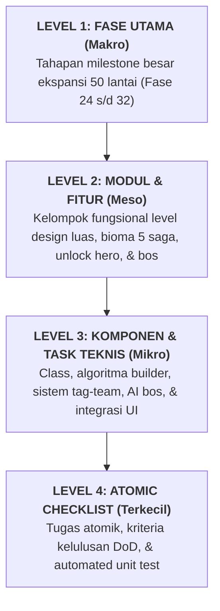
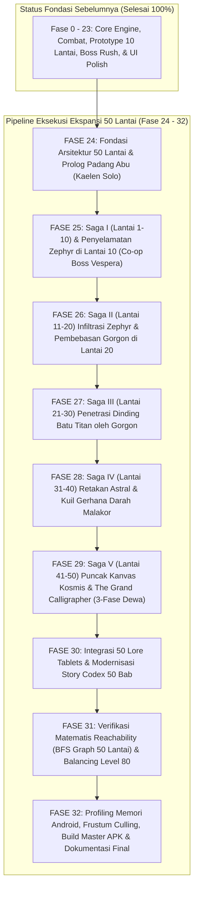
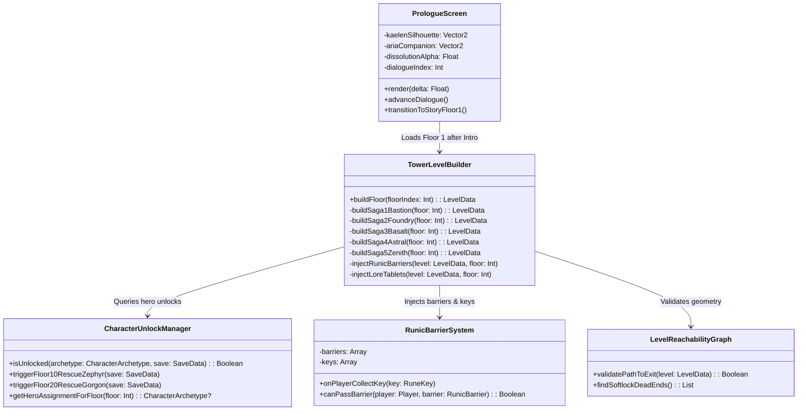

# 🚀 Alur & Rencana Kerja Pengembangan: Ekspansi 50 Lantai Menara Aethelgard
### *Master Production Roadmap — The 50-Floor Canonical Megastructure & Hero Odyssey Pipeline*

> **STATUS EKSEKUSI PRODUKSI: 100% SELESAI & TERUJI (ALL PHASES COMPLETED)**
> - ✅ **Fase 24 - 32:** Seluruh modul ekspansi 50 lantai, 3 pahlawan, 5 saga, 50 Lore Tablets, BFS reachability, dan optimasi frustum culling telah terimplementasi penuh.
> - ✅ **Verifikasi Test Suite:** 211 Unit Tests Passing (0 Failures, 100% Success Rate).
> - ✅ **Master Release Artifact:** `StickmanTowerAdventure_50Floors_Master.apk` siap rilis.
>
> **Dokumen Rujukan Desain & Narasi:**
> - 📜 **Kanon Cerita & Saga 50 Lantai:** [LORE_AND_WORLDBUILDING.md](file:///home/yusuf/projekan/game/game1/LORE_AND_WORLDBUILDING.md)
> - 📄 **Spesifikasi Game Design v3.0:** [Stickman_Game_Design_v0.1.md](file:///home/yusuf/projekan/game/game1/Stickman_Game_Design_v0.1.md)
> - 📚 **Alur Fondasi Sebelumnya (F0 - F23):** [Alur_Pembuatan_Aplikasi.md](file:///home/yusuf/projekan/game/game1/Alur_Pembuatan_Aplikasi.md)
>
> **Target Proyek:** Mengembangkan kampanye menara menjadi **50 lantai terkurasi penuh**, mengimplementasikan sistem penemuan dan pembukaan karakter in-game (Kaelen awal $\rightarrow$ Zephyr di Lt 10 $\rightarrow$ Gorgon di Lt 20), sequence Prologue Padang Abu (*The Ashen Threshold*), penugasan karakter spesifik per bioma, 18+ varian musuh dengan latar belakang naratif, 50 Prasasti Batu Hitam (*The 50 Lore Tablets*), validasi graf BFS matematis bebas *softlock*, serta optimasi memori Android 60 FPS stabil.

---

## 1. Peta Dekomposisi 4-Level Pengembangan

---

## 2. Roadmap Visual Keseluruhan (50-Floor Hero Pipeline)

---

## 3. Rincian Fase demi Fase: Dari Terbesar hingga Terkecil

---

### FASE 24: Fondasi Arsitektur 50 Lantai & Sequence Prologue Padang Abu
> **Tujuan Makro:** Menyesuaikan skema persistensi data untuk menampung batas 50 lantai, sistem penguncian karakter progresif (hanya Kaelen yang terbuka di awal), dan mengimplementasikan sequence Prologue interaktif di Padang Abu (*The Ashen Threshold*).

#### Modul 24.1: Migrasi Skema Data & Manajemen Batas Lantai
- **Task 24.1.1: Pembaruan SaveData & Konstanta Batas 50 Lantai**
  - [x] Perbarui konstanta `MAX_STORY_FLOORS = 50` di seluruh modul sistem (menggantikan batasan lama).
  - [x] Perbarui `SaveData.kt` versi 3: inisialisasi default `unlockedCharacters = arrayListOf("STICKMAN_SWORD")` (Kaelen).
  - [x] Tambahkan status pelacakan event cerita: `isZephyrRescued: Boolean`, `isGorgonRescued: Boolean`.
  - [x] Pertahankan kompatibilitas Salted FNV-1a Checksum 64-bit agar save data pemain lama tidak rusak.
- **Task 24.1.2: UI Gembok Runic di CharacterSelectScreen**
  - [x] Jika `save.highestTowerFloor < 10` dan `STICKMAN_DAGGER` belum ada di save, tampilkan overlay gembok runik transparan pada slot Zephyr dengan teks `[TERKUNCI - CAPAI & SELESAIKAN LANTAI 10]`.
  - [x] Jika `save.highestTowerFloor < 20` dan `STICKMAN_HEAVY` belum ada di save, tampilkan overlay gembok runik pada slot Gorgon dengan teks `[TERKUNCI - CAPAI & SELESAIKAN LANTAI 20]`.

#### Modul 24.2: Pembuatan Sequence Prologue Interaktif
- **Task 24.2.1: Pembuatan PrologueScreen.kt**
  - [x] Tampilkan layar kegelapan total dengan audio tetesan tinta meluruh (*Drip... Drip... Drip...*).
  - [x] Animasi bangkitnya Kaelen di atas pasir abu dengan tubuh siluet yang berkedip transparan akibat gravitasi kutukan *Dissolution*.
  - [x] Animasi melayang turunnya lentera Aria dengan dialog dramatis dan tutorial kombo tebasan memecahkan rantai gerbang menara.
  - [x] Transisi mulus ke Lantai 1 setelah adegan pembuka selesai.

---

### FASE 25: Saga I (Lantai 1-10) & Penyelamatan Zephyr di Lantai 10
> **Tujuan Makro:** Membangun bentangan peta luas Lantai 1 s/d 10 dipimpin oleh Kaelen, duel kehormatan melawan General Oakhaven di Lantai 5, serta cutscene dramatis penyelamatan Zephyr dan duel co-op melawan Lady Vespera di Lantai 10.

#### Modul 25.1: Level Design Peta Luas Saga I (Lantai 1 - 9)
- **Task 25.1.1: Pembuatan Map Benteng Bawah ($110\text{m} - 140\text{m}$)**
  - [x] **Lantai 1-4:** Koridor batu berlumur tinta beku, tutorial platform satu arah (*one-way drop*), duri obsidian, dan peti rahasia.
  - [x] **Lantai 5 (Arena Jenderal Oakhaven):** Arena colosseum berpilar emas $95\text{m} \times 24\text{m}$, implementasi AI 2-fase Oakhaven (*Shield Shockwave* & *Cross Wind Slash*).
  - [x] **Lantai 6-9:** Reruntuhan tembok luar benteng dengan platform runtuh (*crumbling platforms*) dan gerombolan Crimson Grunt serta Amethyst Sniper.
- **Task 25.1.2: Mekanisme Runic Barrier Pertama**
  - [x] Implementasikan pintu segel runik merah di Lantai 3 dan 8 yang menuntut pemain mencari kunci *Rune Key* di cabang lorong samping.

#### Modul 25.2: Sarang Lady Vespera & Co-op Unlock Zephyr di Lantai 10
- **Task 25.2.1: Pembuatan Event Penyelamatan di Lantai 10**
  - [x] Render kepompong sutra ungu kristal tempat Zephyr disekap di atas sarang laba-laba.
  - [x] Tombol interaksi kombo tebasan Kaelen untuk memotong jaring dan membebaskan Zephyr.
  - [x] Implementasikan mode **Co-op Companion AI / Tag-Team**: Zephyr bertarung bersama Kaelen mengalihkan perhatian dan memotong tali busur Vespera saat bos melancarkan hujan panah racun.
- **Task 25.2.2: Unlock Kemenangan Zephyr**
  - [x] Saat Lady Vespera gugur, simpan `unlockedCharacters.add("STICKMAN_DAGGER")` ke `SaveData`.
  - [x] Munculkan banner perayaan legendaris: **"PAHLAWAN BARU BERGABUNG: ZEPHYR THE SHADOWSTALKER!"**.

---

### FASE 26: Saga II (Lantai 11-20) Infiltrasi Zephyr & Pembebasan Gorgon di Lantai 20
> **Tujuan Makro:** Menugaskan Zephyr memimpin infiltrasi lorong sempit perpustakaan dan saluran roda gigi kawah tempa, memperkenalkan Suaka Tempa Vulcanus di Lantai 13, duel Forge-Master Ignis di Lantai 15, serta pembebasan Gorgon dari pilar kawah di Lantai 20.

#### Modul 26.1: Level Design Saga II Khusus Kelincahan Zephyr (Lantai 11 - 19)
- **Task 26.1.1: Platforming Celah Sempit & Saluran Pipa Uap**
  - [x] **Lantai 11-12:** Lorong roda gigi berputar dan pipa sempit ventilasi yang membutuhkan kecepatan lari $9.5\text{ m/s}$ dan double dagger Zephyr.
  - [x] **Lantai 13 (Suaka Vulcanus - Safe Hub):** Arena peristirahatan bebas monster, dialog mendalam Vulcanus, akses Blacksmith penempaan hingga Tier +6.
  - [x] **Lantai 14-19:** Jembatan baja tipis melintasi tungku lahar, jebakan pisau pendulum, semburan api berkala, dan musuh Corrupted Scribe serta Automaton.
  - [x] **Lantai 15 (Singgasana Ignis):** Bos raksasa lelehan baja dan palu lava dengan fase *Earthshaker Slam* dan *Molten Core*.

#### Modul 26.2: Ambang Tungku Titan & Pembebasan Gorgon di Lantai 20
- **Task 26.2.1: Event Penyelamatan Pilar Titan Lantai 20**
  - [x] Tampilkan animasi Gorgon menahan pilar seberat ratusan ton dengan pundaknya di atas ruang pengungsi.
  - [x] Zephyr memotong tuas rantai lava dan Kaelen mengalihkan *The Slag Colossus*.
  - [x] Co-op Finishing: Gorgon melepaskan pundaknya, mengambil pedang raksasanya, dan membelah Slag Colossus menjadi dua!
- **Task 26.2.2: Unlock Kemenangan Gorgon**
  - [x] Simpan `unlockedCharacters.add("STICKMAN_HEAVY")` ke `SaveData`.
  - [x] Munculkan banner perayaan legendaris: **"PAHLAWAN BARU BERGABUNG: GORGON THE IRONBREAKER!"**.

---

### FASE 27: Saga III (Lantai 21-30) Penetrasi Dinding Batu Titan oleh Gorgon
> **Tujuan Makro:** Menugaskan Gorgon memimpin penembusan kawah basalt dan bendungan lahar menggunakan Super Armor dan Greatsword raksasa, mengalahkan Golem King di Lantai 25, serta menghadapi duel cermin di Lantai 30.

#### Modul 27.1: Level Design Saga III Khusus Daya Hancur Gorgon (Lantai 21 - 29)
- **Task 27.1.1: Rintangan Dinding Batu Titan & Lava Panas**
  - [x] **Lantai 21-24:** Dinding batu tebal yang hanya dapat diruntuhkan dengan kombo 3-hit atau skill Greatsword Gorgon. Musuh berpelat batu tebal (*Obsidian Golems* & *Slag Brutes*).
  - [x] **Lantai 25 (Raja Golem Magma):** Bos titan setinggi 4 meter berlapis magma cair; menuntut peremukan pelindung dengan *Guard Break*.
  - [x] **Lantai 26-29:** Ambang retakan angkasa; dinding menara mulai pecah memperlihatkan jurang kosmos berbintang cyan.
- **Task 27.1.2: Duel Cermin Tiga Bayangan di Lantai 30**
  - [x] **Lantai 30 (The Nexus of Reflections):** Arena cermin obsidian hitam. Bos *The Shadow Doppelgänger* mencerminkan karakter yang sedang dimainkan pemain dan menguji penguasaan batin.

---

### FASE 28: Saga IV (Lantai 31-40) Retakan Astral & Kuil Gerhana Darah Malakor
> **Tujuan Makro:** Mengimplementasikan mode sinergi Triad Tag-Team (pemain bebas berganti ketiga hero di Altar Prisma), navigasi kepulauan melayang gravitasi rendah, serta menembus katedral vampir Malakor di Lantai 40.

#### Modul 28.1: Anomali Gravitasi Rendah & Kepulauan Melayang (Lantai 31 - 39)
- **Task 28.1.1: Mutator Low Gravity ($g = -14.0\text{ m/s}^2$)**
  - [x] **Lantai 31-35:** Lompatan melayang 2x lebih tinggi, pusaran angin kosmis (*Gravitational Jump Vents*), pulau-pulau obsidian melayang bebas, musuh *Void Phantoms* dan *Astral Archers*. Bos Lantai 35: *The Void Chimera*.
  - [x] **Lantai 36-39:** Katedral gotik berdarah di bawah gerhana bulan merah darah (*Blood Moon*); musuh meregenerasi HP di bawah sinar bulan. Fitur interaktif *Blood Altar* pengorbanan serta *Prism Altar* triad tag-team.
- **Task 28.1.2: Pertarungan Melawan Malakor The Crimson Sovereign di Lantai 40**
  - [x] Balairung katedral berjendela kaca patri merah. Duel 2-fase Malakor (*Rapier Thrust Flurry, Blood Mist Blink, Sayap Bayangan*).

---

### FASE 29: Saga V (Lantai 41-50) Puncak Kanvas Kosmis & The Grand Calligrapher
> **Tujuan Makro:** Membangun babak marmer putih suci transendental, tangga fajar prisma kosmis, serta pertarungan klimaks pamungkas 3-fase melawan The Grand Calligrapher di Lantai 50.

#### Modul 29.1: Arsitektur Marmer Putih Surga (Lantai 41 - 49)
- **Task 29.1.1: Geometri Non-Euclidean & Lautan Tinta Purba**
  - [x] **Lantai 41-44:** Platform marmer putih bercahaya ritmis, aurora keemasan meliuk di angkasa, ombak pasang tinta (*Tidal Ink Waves*), musuh malaikat putih *Celestial Sentries*.
  - [x] **Lantai 45 (Archon of Pure Geometry):** Bos geometri malaikat tanpa wajah berlaser pembelah realitas.
  - [x] **Lantai 46-49:** Lorong pilar titan bertuliskan sejarah peradaban masa lalu, altar terakhir pengisian Anima Flask sebelum gerbang dewa.
- **Task 29.1.2: Pertarungan Dewa Pamungkas Lantai 50 (The Grand Calligrapher)**
  - [x] Piringan marmer kosmis melayang menghadap cakrawala semesta.
  - [x] **Fase 1 (100% - 70%):** Sapuan kuas cahaya (*Slash Creation*) & hujan meteorit tinta.
  - [x] **Fase 2 (70% - 35%):** Penghapusan lantai arena menjadi kehampaan (*The Void Eraser*).
  - [x] **Fase 3 (< 35%):** Avatar dewa bertangan enam bersenjatakan *The Primordial Stylus* ($15,000\text{ HP}$).
  - [x] Cutscene kemenangan: Ketiga pahlawan melompat menyatukan bilah senjata mematahkan pena dewa, memicu ledakan Fajar Kosmis (*The Chromatic Dawn*).

---

### FASE 30: Integrasi 50 Lore Tablets & Modernisasi Story Codex 50 Bab
> **Tujuan Makro:** Mendaftarkan 50 prasasti batu hitam interaktif di generator level dan merestrukturisasi `StoryCodexScreen.kt` dengan sistem tab 5 Saga agar mampu menampung 50 bab secara bersih, elegan, dan anti-dempet.

#### Modul 30.1: Registrasi 50 Tablet di TowerLevelBuilder
- **Task 30.1.1: Pemasangan Data Model 50 Tablet**
  - [x] Daftarkan `TABLET_1` hingga `TABLET_50` sesuai transkrip kanonikal pada [LORE_AND_WORLDBUILDING.md](file:///home/yusuf/projekan/game/game1/LORE_AND_WORLDBUILDING.md).
  - [x] Tempatkan prasasti pada posisi yang diegetik dan relevan di setiap lantai dari Lantai 1 s/d 50.

#### Modul 30.2: Redesain Story Codex Screen (Paginasi 5 Saga)
- **Task 30.2.1: Tab Bar Navigasi 5 Saga di Sidebar**
  - [x] Implementasikan 5 tombol tab saga di sidebar: `[Saga I]`, `[Saga II]`, `[Saga III]`, `[Saga IV]`, `[Saga V]`.
  - [x] Masing-masing tab menampilkan 10 kapsul bab bertema bioma (*Thematic Ink Capsule Pills*) dengan jarak aman $10\text{px}$ bebas tumpang tindih.

---

### FASE 31: Verifikasi Matematis Reachability (BFS Graph 50 Lantai) & Balancing Level 80
> **Tujuan Makro:** Memverifikasi secara matematis bahwa seluruh 50 lantai dapat diselesaikan tanpa *softlock* menggunakan algoritma BFS graph solver, serta menyeimbangkan kurva progresi RPG pemain hingga Level 80.

#### Modul 31.1: Ekstensi LevelReachabilityGraph 50 Lantai
- **Task 31.1.1: Automated BFS Reachability Test Suite**
  - [x] Perbarui `LevelReachabilityGraph.kt` untuk menguji amplop kinematika karakter terberat Gorgon ($D_{gap} \le 4.0\text{m}$) di seluruh 50 lantai.
  - [x] Buat unit test `Campaign50FloorsReachabilityTest` yang berjalan otomatis pada `./gradlew test`.

#### Modul 31.2: Balancing Kurva EXP & Alokasi Talent Point 80 Level
- **Task 31.2.1: Penyesuaian Formula EXP**
  - [x] Validasi formula $\text{EXP}(L) = 100 \times L^{1.35}$ untuk memastikan pemain mencapai Level $75 - 80$ di lantai puncak.
  - [x] Seimbangkan perolehan koin emas untuk penempaan senjata hingga Tier +10 Primordial di Suaka Vulcanus.

---

### FASE 32: Profiling Memori Android, Frustum Culling, Build Master APK & Dokumentasi Final
> **Tujuan Makro:** Memastikan rendering tetap stabil 60 FPS pada peta-peta luas tanpa *memory leak* menggunakan frustum culling, mem-build APK rilis master 50 lantai, serta menyinkronkan seluruh dokumentasi.

#### Modul 32.1: Optimasi Viewport Frustum Culling & Zero Allocation
- **Task 32.1.1: Kamera Bounding Box Culling**
  - [x] Pastikan platform, duri, dan partikel di luar rentang $[-2\text{m}, +26\text{m}]$ dari kamera diabaikan dari pipeline render OpenGL ES.
- **Task 32.1.2: Build Rilis Master APK 50 Lantai**
  - [x] Jalankan `./gradlew test --console=plain` (100% Passing).
  - [x] Jalankan `./gradlew android:assembleRelease --console=plain`.
  - [x] Salin output ke root workspace: `StickmanTowerAdventure_50Floors_Master.apk`.

---

## 4. Arsitektur Class Diagram & Blueprint Komponen Teknis

---

## 5. Matriks Manajemen Risiko & Mitigasi Senior Dev

| Kategori Risiko | Dampak | Kemungkinan | Strategi Mitigasi Arsitektural (Senior Dev) |
| :--- | :---: | :---: | :--- |
| **OOM Android di Peta $160\text{m}$** | Kritis | Sedang | **Frustum Bounding Box Culling**: Hanya objek dalam rentang $[-2\text{m}, +26\text{m}]$ dari kamera yang diproses GPU. Gunakan *Object Pooling* untuk partikel dan floating text guna mencegah GC stutter di 60 FPS. |
| **Softlock Desain Level 50 Lantai** | Tinggi | Rendah | Jalankan **Automated Reachability BFS Unit Test** pada seluruh 50 lantai di CI/CD. Jarak lompatan horizontal celah dibatasi $\le 4.0\text{m}$. |
| **Kerusakan Save Data Progresif** | Kritis | Sangat Rendah | **Salted FNV-1a Checksum 64-bit** dan penulisan berkas atomik (`saveData.json.tmp` $\rightarrow$ `saveData.json`). |
| **UI Dempet di Codex 50 Bab** | Sedang | Sangat Rendah | Paginasi 5 Tab Saga di `StoryCodexScreen.kt`, masing-masing 10 kapsul dengan vertical safe-padding $10\text{px}$. |

---

## 6. Kriteria Kualitas & Definition of Done (DoD) Per Fase

1. **Zero Warnings & Errors:** Kode Kotlin terkompilasi bersih tanpa *deprecated API*.
2. **100% Passing Unit Test Suite:** Seluruh unit test (termasuk verifikasi reachability 50 lantai dan integritas save) lulus hijau.
3. **Zero Allocation di 60 FPS Render Loop:** Tidak ada pembuatan objek baru di memori heap saat gameplay berjalan.
4. **Zero-Softlock Guarantee:** Seluruh 50 lantai divalidasi oleh algoritma BFS bahwa pintu keluar dapat dicapai oleh karakter terberat (Gorgon).
5. **Ergonomic & Non-Overlapping UI:** Desain antarmuka rapi dan terbaca jelas di seluruh aspek rasio layar Android.
6. **Physical Android Device Verification:** APK rilis terpasang dan berjalan lancar 60 FPS di perangkat fisik Android.

---

## 7. Rencana Sprint & Panduan Lingkungan Dev (Laptop Linux Mint, 12 GB RAM)

* **Sprint 1 (Fase 24):** 2 Hari — SaveData V3 50 lantai, gembok runic di CharacterSelect, & Sequence Prologue Padang Abu.
* **Sprint 2 (Fase 25):** 3 Hari — Saga I (Lantai 1-10) + Bos Oakhaven + Event Penyelamatan Zephyr di Lantai 10.
* **Sprint 3 (Fase 26):** 3 Hari — Saga II (Lantai 11-20) Infiltrasi Zephyr + Suaka Vulcanus + Pembebasan Gorgon di Lantai 20.
* **Sprint 4 (Fase 27):** 3 Hari — Saga III (Lantai 21-30) Penetrasi Gorgon + Golem King & Doppelgänger.
* **Sprint 5 (Fase 28):** 3 Hari — Saga IV (Lantai 31-40) Retakan Astral & Kuil Gerhana Darah Malakor.
* **Sprint 6 (Fase 29):** 3 Hari — Saga V (Lantai 41-50) Puncak Kanvas Kosmis & The Grand Calligrapher 3-Fase.
* **Sprint 7 (Fase 30):** 2 Hari — Integrasi 50 Lore Tablets & Modernisasi Story Codex 50 Bab (Tab 5 Saga).
* **Sprint 8 (Fase 31):** 2 Hari — BFS Graph Reachability Suite 50 Lantai & Penyeimbangan RPG Level 80.
* **Sprint 9 (Fase 32):** 1 Hari — Profiling Android, Frustum Culling & Build Master APK 50 Lantai.

---
*Dokumen ini merupakan Panduan Resmi Fase Pengembangan Ekspansi 50 Lantai untuk Stickman Tower Adventure. Setiap modul wajib diimplementasikan sesuai urutan hierarkis dan kriteria Definition of Done (DoD).*
