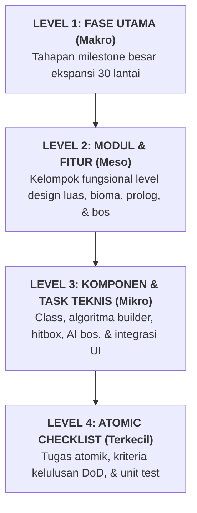
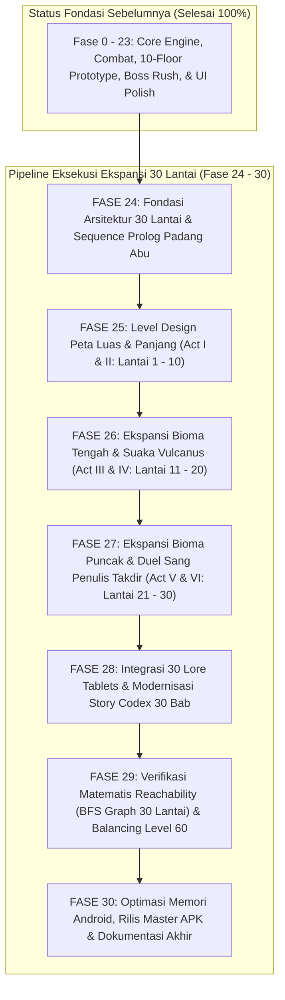

# 🚀 Alur & Rencana Kerja Pengembangan: Ekspansi 30 Lantai Menara Aethelgard
### *Master Production Roadmap — The 30-Floor Megastructure & Explorable Vast Maps*

> **Dokumen Rujukan Desain & Narasi:**
> - 📜 **Kanon Cerita & Saga 30 Lantai:** [LORE_AND_WORLDBUILDING.md](file:///home/yusuf/projekan/game/game1/LORE_AND_WORLDBUILDING.md)
> - 📄 **Spesifikasi Game Design v2.0:** [Stickman_Game_Design_v0.1.md](file:///home/yusuf/projekan/game/game1/Stickman_Game_Design_v0.1.md)
> - 📚 **Alur Fondasi Sebelumnya (F0 - F23):** [Alur_Pembuatan_Aplikasi.md](file:///home/yusuf/projekan/game/game1/Alur_Pembuatan_Aplikasi.md)
>
> **Target Proyek:** Mengembangkan ekspansi kampanye menara dari 10 lantai menjadi **30 lantai terkurasi penuh**, memperluas dimensi map horizontal dan vertikal ($110\text{m} - 160\text{m} \times 22\text{m} - 38\text{m}$), mengimplementasikan sequence Prologue awal yang mendalam, menghadirkan 6 bos legendaris penjaga babak (*Apex Gatekeepers*), 30 Prasasti Batu Hitam (*The 30 Lore Tablets*), serta menjamin bebas *softlock* dengan validasi graf BFS matematis.

---

## 1. Peta Dekomposisi 4-Level Pengembangan

---

## 2. Roadmap Visual Keseluruhan (30-Floor Pipeline)

---

## 3. Rincian Fase demi Fase: Dari Terbesar hingga Terkecil

---

### FASE 24: Fondasi Arsitektur 30 Lantai & Sequence Prologue Padang Abu
> **Tujuan Makro:** Menyesuaikan arsitektur sistem save, logika transisi lantai, dan memperkenalkan sequence Prologue interaktif di luar menara (*The Ashen Threshold*) yang menjelaskan mengapa ksatria harus menjelajahi menara.

#### Modul 24.1: Migrasi Skema Data & Manajemen Batas Lantai
- **Task 24.1.1: Pembaruan SaveData & Konstanta Batas Lantai**
  - [ ] Perbarui konstanta `MAX_STORY_FLOORS = 30` di seluruh modul sistem (menggantikan batasan lama 10 lantai).
  - [ ] Perbarui `SaveData.kt` untuk menyimpan progres hingga Lantai 30, termasuk koleksi 30 tablet dan rekor tiap babak.
  - [ ] Pastikan algoritma checksum 64-bit Salted FNV-1a tetap kompatibel dengan save data versi sebelumnya.
- **Task 24.1.2: Pengujian Migrasi Save State**
  - [ ] Buat unit test `SaveDataMigration30FloorsTest` untuk memvalidasi bahwa pemain dengan progres lama tidak mengalami crash atau kehilangan item.

#### Modul 24.2: Sequence Prologue Interaktif (The Ashen Threshold)
- **Task 24.2.1: Pembuatan Level Prologue Khusus (Floor 0 / Tutorial)**
  - [ ] Buat builder `buildPrologueFloor()` di `TowerLevelBuilder.kt` dengan latar belakang Padang Pasir Abu di luar gerbang menara ($90\text{m} \times 18\text{m}$).
  - [ ] Tambahkan properti visual: patung ksatria yang larut menjadi genangan tinta, badai partikel abu kelabu, dan gerbang menara tertutup rantai purba.
- **Task 24.2.2: Implementasi Naskah Dialog & Lentera Roh Aria**
  - [ ] Integrasikan naskah dialog interaktif Aria saat Kaelen pertama kali terbangun di Padang Abu.
  - [ ] Tambahkan tutorial kinetik di Prolog:
    - *Langkah 1:* Menggerakkan karakter untuk melawan pelarutan tinta (*The Dissolution*).
    - *Langkah 2:* Melakukan tebasan kombo pada rantai gerbang untuk membebaskan jalur masuk.
    - *Langkah 3:* Melompat menembus ambang pintu Lantai 1 dengan suara dentang judul game yang megah.

---

### FASE 25: Level Design Peta Luas & Panjang (Act I & II: Lantai 1 - 10)
> **Tujuan Makro:** Merekonstruksi Lantai 1 s/d 10 menjadi bentangan map luas ($110\text{m} - 150\text{m}$), menghadirkan sistem pintu segel runik, rute bercabang, dan pertarungan klimaks melawan Jenderal Oakhaven (Lt 5) dan Lady Vespera (Lt 10).

#### Modul 25.1: Rekonstruksi Act I — Benteng Bawah (Lantai 1 - 5)
- **Task 25.1.1: Perluasan Skala Map & Rute Bercabang Lantai 1 - 4**
  - [ ] **Lantai 1 (Ambang Besi):** Perluas menjadi $110\text{m} \times 22\text{m}$. Rute atas (menara jaga) vs rute bawah.
  - [ ] **Lantai 2 (Pelataran Duri):** Perluas menjadi $125\text{m} \times 25\text{m}$. Jurang duri panjang dengan platform bertingkat aman.
  - [ ] **Lantai 3 (Gudang Senjata):** Perluas menjadi $130\text{m} \times 28\text{m}$. Implementasi pintu segel *Runic Barrier* pertama yang membutuhkan penemuan *Rune Key* di ruang bawah tanah.
  - [ ] **Lantai 4 (Benteng Runtuh):** Perluas menjadi $140\text{m} \times 30\text{m}$. Platform batu yang runtuh (*crumbling platforms*) dengan lompatan akrobatik beruntun.
- **Task 25.1.2: Penyesuaian Arena Bos Lantai 5 (General Oakhaven)**
  - [ ] Desain arena colosseum megah berukuran $95\text{m} \times 24\text{m}$ berpilar emas.
  - [ ] Kalibrasi ulang stat HP Oakhaven ($850\text{ HP}$) dan AI Enrage Cross Wind Slash.

#### Modul 25.2: Rekonstruksi Act II — Makam Warna & Arsip Amethyst (Lantai 6 - 10)
- **Task 25.2.1: Perluasan Skala Map & Mekanik Miasma Lantai 6 - 9**
  - [ ] **Lantai 6 (Perpustakaan Tinta):** Perluas menjadi $135\text{m} \times 26\text{m}$. Platform rak buku bergerak (*moving shelves*).
  - [ ] **Lantai 7 (Laboratorium Alkimia):** Perluas menjadi $145\text{m} \times 30\text{m}$. Mutator kabut racun *Toxic Miasma* dan zona pembersih *Cleansing Totems*.
  - [ ] **Lantai 8 (Kawah Pelarut):** Perluas menjadi $150\text{m} \times 32\text{m}$. Danau asam tinta hitam dengan jembatan rantai berayun.
  - [ ] **Lantai 9 (Menara Pemburu):** Perluas menjadi $140\text{m} \times 34\text{m}$ bertingkat vertikal tinggi dengan angin dorong horizontal.
- **Task 25.2.2: Penyesuaian Arena Bos Lantai 10 (Lady Vespera)**
  - [ ] Arena sarang kristal ungu berukuran $100\text{m} \times 26\text{m}$.
  - [ ] Kalibrasi stat Lady Vespera ($1,800\text{ HP}$), serangan panah hujan racun, dan balok laser *Void Piercer*.

---

### FASE 26: Ekspansi Bioma Tengah & Suaka Vulcanus (Act III & IV: Lantai 11 - 20)
> **Tujuan Makro:** Membangun 10 lantai baru untuk Bioma Kawah Tempa Vulcanus (Lantai 11-15) dan Retakan Astral Nirbobot (Lantai 16-20), termasuk hub peristirahatan Suaka Vulcanus di Lantai 13.

#### Modul 26.1: Konstruksi Act III — Kawah Tempa & Katakomba Baja (Lantai 11 - 15)
- **Task 26.1.1: Pembuatan Level Map Industri Magma (Lantai 11 - 14)**
  - [ ] **Lantai 11 (Pintu Air Magma):** Map $130\text{m} \times 24\text{m}$ dengan jebakan semburan api berkala (*Flame Jets*).
  - [ ] **Lantai 12 (Labirin Roda Gigi):** Map $155\text{m} \times 32\text{m}$ dengan platform roda gigi berputar berdiameter 10 meter.
  - [ ] **Lantai 13 (Suaka Vulcanus - Hub Safe Zone):** Map $90\text{m} \times 20\text{m}$ bebas monster dengan tungku emas menyala, interaksi dialog ramah Vulcanus & Aria, serta akses penempaan senjata.
  - [ ] **Lantai 14 (Kawah Peleburan Titan):** Map $145\text{m} \times 30\text{m}$ dengan platform baja melayang dan semburan uap pendorong (*thermal lifts*).
- **Task 26.1.2: Pembuatan Bos Lantai 15 (Forge-Master Ignis)**
  - [ ] Desain bos baru: **Forge-Master Ignis (The Slag Colossus)** setinggi 3.5m berlapis pelat baja tembaga ($3,500\text{ HP}$).
  - [ ] Implementasikan serangan palu gempa bumi (*Earthshaker Slam*) dan fase 2 menyerap magma cair (*Molten Core Enrage*).

#### Modul 26.2: Konstruksi Act IV — Retakan Astral Nirbobot (Lantai 16 - 20)
- **Task 26.2.1: Pembuatan Level Map Kosmis Nirbobot (Lantai 16 - 19)**
  - [ ] **Lantai 16 (Tebing Kehampaan):** Map $140\text{m} \times 35\text{m}$ dengan mutator *Low Gravity* ($g = -14.0\text{ m/s}^2$).
  - [ ] **Lantai 17 (Kepulauan Melayang):** Map $160\text{m} \times 38\text{m}$ dengan kepulauan batu mengapung dan pusaran angin gravitasi.
  - [ ] **Lantai 18 (Singularitas Gravitasi):** Map $135\text{m} \times 30\text{m}$ dengan kristal pengubah gravitasi terbalik periodik.
  - [ ] **Lantai 19 (Lorong Cermin Jiwa):** Map $145\text{m} \times 28\text{m}$ dengan dinding cermin kaca hitam yang merefleksikan gerakan pemain.
- **Task 26.2.2: Pembuatan Bos Lantai 20 (The Shadow Doppelgänger)**
  - [ ] Arena cermin hitam datar tanpa batas berukuran $105\text{m} \times 24\text{m}$.
  - [ ] Logika AI cermin: Meniru senjata, kombo, jurus Ultimate, dan tangkisan parry pemain secara presisi ($6,200\text{ HP}$).

---

### FASE 27: Ekspansi Bioma Puncak & Duel Sang Penulis Takdir (Act V & VI: Lantai 21 - 30)
> **Tujuan Makro:** Membangun 10 lantai puncak untuk Bioma Kuil Gerhana Darah (Lantai 21-25) dan Puncak Kanvas Primordial (Lantai 26-30), menghadirkan duel melawan Pangeran Malakor (Lt 25) dan pertarungan pamungkas melawan The Grand Calligrapher 3-Fase (Lt 30).

#### Modul 27.1: Konstruksi Act V — Kuil Gerhana Bulan Merah (Lantai 21 - 25)
- **Task 27.1.1: Pembuatan Level Map Gotik Vampirik (Lantai 21 - 24)**
  - [ ] **Lantai 21 (Gerbang Bulan Darah):** Map $135\text{m} \times 26\text{m}$ dengan mutator regenerasi HP musuh di bawah sinar bulan merah.
  - [ ] **Lantai 22 (Koridor Biara):** Map $150\text{m} \times 30\text{m}$ dengan pisau pendulum raksasa berayun (*Pendulum Blades*).
  - [ ] **Lantai 23 (Altar Pengorbanan):** Map $140\text{m} \times 32\text{m}$ dengan fitur interaktif *Blood Altar* (tukar HP dengan buff lifesteal).
  - [ ] **Lantai 24 (Katakomba Darah):** Map $155\text{m} \times 34\text{m}$ dengan puzzle pintu gerbang segel ganda (*Dual Blood Orbs*).
- **Task 27.1.2: Pembuatan Bos Lantai 25 (Malakor The Crimson Sovereign)**
  - [ ] Arena katedral gotik berjendela kaca patri merah berukuran $110\text{m} \times 28\text{m}$.
  - [ ] Logika AI Malakor: Kecepatan tinggi, rapier thrust flurry, teleportasi kabut darah, lifesteal 20%, dan sayap kelelawar bayangan ($9,800\text{ HP}$).

#### Modul 27.2: Konstruksi Act VI — Puncak Kanvas Primordial (Lantai 26 - 30)
- **Task 27.2.1: Pembuatan Level Map Surga Marmer Putih (Lantai 26 - 29)**
  - [ ] **Lantai 26 (Tangga Cahaya Prisma):** Map $145\text{m} \times 32\text{m}$ dengan platform cahaya ritmis yang muncul-hilang mengikuti tempo musik.
  - [ ] **Lantai 27 (Geometri Temporal):** Map $155\text{m} \times 36\text{m}$ dengan puzzle portal rotasi warna dan musuh pemanipulasi waktu.
  - [ ] **Lantai 28 (Lautan Tinta Purba):** Map $160\text{m} \times 34\text{m}$ dengan jembatan marmer dan gelombang pasang ombak tinta.
  - [ ] **Lantai 29 (Ambang Sang Arsitek):** Map $130\text{m} \times 30\text{m}$ lorong pilar titan dengan gelombang musuh penjaga terakhir.
- **Task 27.2.2: Pembuatan Bos Pamungkas Lantai 30 (The Grand Calligrapher)**
  - [ ] Arena piringan marmer kosmis berukuran $120\text{m} \times 30\text{m}$ menghadap cakrawala Aethelgard.
  - [ ] Implementasikan 3 Fase Pertarungan Dewa:
    - *Fase 1 (100% - 70%):* Sapuan kuas pedang cahaya dan meteorit tinta.
    - *Fase 2 (70% - 35%):* Penghapusan platform arena menjadi kehampaan (*The Void Eraser*).
    - *Fase 3 (< 35%):* Wujud avatar dewa bertangan enam bersenjatakan *The Primordial Stylus* ($16,500\text{ HP}$).
  - [ ] Cutscene interaktif patahnya pena dewa dan ledakan fajar spektrum warna (*The Chromatic Dawn*).

---

### FASE 28: Integrasi 30 Lore Tablets & Modernisasi Story Codex 30 Bab
> **Tujuan Makro:** Mengintegrasikan 30 entri Prasasti Batu Hitam interaktif di setiap lantai, serta memperbarui `StoryCodexScreen.kt` agar mampu menampilkan 30 bab kanonikal dengan mulus, bersih, dan bebas dempet.

#### Modul 28.1: Integrasi 30 Lore Tablets di TowerLevelBuilder
- **Task 28.1.1: Pembuatan Data Model 30 Lore Tablets**
  - [ ] Daftarkan 30 tablet dari `TABLET_1` hingga `TABLET_30` di `TowerLevelBuilder.kt` sesuai transkrip resmi pada [LORE_AND_WORLDBUILDING.md](file:///home/yusuf/projekan/game/game1/LORE_AND_WORLDBUILDING.md).
  - [ ] Posisikan masing-masing tablet pada lokasi yang menantang dan relevan secara lingkungan di setiap lantai.

#### Modul 28.2: Pembaruan Story Codex Screen (Arsitektur 30 Bab)
- **Task 28.2.1: Dukungan Scrolling / Paginasi Bab Sidebar**
  - [ ] Perbarui `StoryCodexScreen.kt` agar sidebar daftar bab mendukung scrolling mulus atau paginasi per babak (Act I s/d VI) untuk menampung 30 bab tanpa tumpang tindih.
  - [ ] Pertahankan *Thematic Ink Capsule Pills* anti-dempet dengan jarak aman $8\text{px}$ dan palet warna tematik per bioma.

---

### FASE 29: Verifikasi Matematis Reachability (BFS Graph 30 Lantai) & Balancing Level 60
> **Tujuan Makro:** Memverifikasi secara matematis bahwa seluruh 30 lantai dapat diselesaikan tanpa *softlock* menggunakan algoritma BFS graph solver, serta menyeimbangkan kurva progresi RPG pemain hingga Level 60.

#### Modul 29.1: Ekstensi LevelReachabilityGraph & Sanity Validator
- **Task 29.1.1: Validasi Matematis 30 Lantai Menara**
  - [ ] Perbarui `LevelReachabilityGraph.kt` untuk menguji ketercapaian portal keluar pada seluruh 30 lantai berdasarkan amplop kinematika karakter ($H_{jump} \approx 4.5$m, $D_{reach} \approx 8.5$m).
  - [ ] Pastikan tidak ada platform buntu yang memerangkap pemain (*Zero Softlock Guarantee*).
- **Task 29.1.2: Unit Test Suite Reachability Otomatis**
  - [ ] Buat unit test `Campaign30FloorsReachabilityTest` yang mengeksekusi validasi 30 lantai secara otomatis pada `./gradlew test`.

#### Modul 29.2: Balancing Kurva RPG & Ekonomi Emas
- **Task 29.2.1: Penyesuaian Formula EXP & Talent Points**
  - [ ] Uji formula $\text{EXP}(L) = 100 \times L^{1.35}$ untuk memastikan pemain mencapai Level $55 - 60$ saat tiba di Lantai 30.
  - [ ] Pastikan perolehan koin emas dari peti dan musuh mencukupi untuk penempaan senjata hingga Tier +10 Primordial di Suaka Vulcanus.

---

### FASE 30: Optimasi Memori Android, Rilis Master APK & Dokumentasi Akhir
> **Tujuan Makro:** Memastikan performa rendering tetap stabil 60 FPS pada peta-peta luas tanpa *memory leak* atau alokasi objek berlebih (*zero allocation in render loop*), serta mem-build APK rilis master 30 lantai.

#### Modul 30.1: Profiling Memori & Kamera Viewport Culling
- **Task 30.1.1: Frustum Culling untuk Peta Panjang**
  - [ ] Pastikan platform, duri, dan partikel di luar bidang pandang kamera viewport tidak di-render (*Frustum Bounding Box Culling*) guna menghemat GPU fillrate di perangkat mobile Android.
- **Task 30.1.2: Build Rilis Master APK**
  - [ ] Jalankan `./gradlew test --console=plain` dan pastikan seluruh test lulus 100%.
  - [ ] Jalankan `./gradlew android:assembleRelease --console=plain` untuk menghasilkan APK rilis master 30 lantai.
  - [ ] Salin file APK ke root workspace: `StickmanTowerAdventure_30Floors_Master.apk`.

---
*Dokumen ini merupakan Panduan Resmi Fase Pengembangan Ekspansi 30 Lantai untuk Stickman Tower Adventure. Setiap modul wajib diimplementasikan sesuai urutan hierarkis dan kriteria Definition of Done (DoD).*
