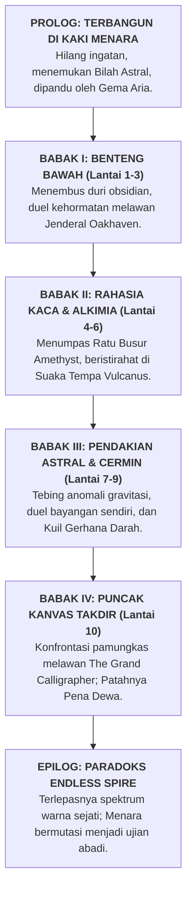

# 📜 KRONIK MENARA BAYANG: ENSIKLOPEDIA & SAGA KANONIKAL AETHELGARD
### *Stickman Tower Adventure — The Grand Chronicle of Aethelgard & The Celestial Spire*

---

```
                                  ▲
                                 / \
                                /   \
                               /  ▲  \
                              /  / \  \
                             /  /   \  \
                            /  /  ▲  \  \
                           /  /__/ \__\  \
                          /   THE SPIRE   \
                         /     OF UMBRA    \
                        /═══════════════════\
                       ║   [ACT IV: APEX]    ║  Floor 10: The Primordial Canvas (The Grand Calligrapher)
                       ║  ═════════════════  ║
                       ║  [ACT III: ASTRAL]  ║  Floor 7 - 9: Fractured Space & Blood Moon Sanctum
                       ║  ═════════════════  ║
                       ║ [ACT II: RUINS]     ║  Floor 4 - 6: Sunken Archives & The Iron Foundry
                       ║  ═════════════════  ║
                       ║ [ACT I: INITIATION] ║  Floor 1 - 3: Lower Bastion & The Tower Guardian
                       ╚═════════════════════╝
                                 ║ ║
                        ═════════╩═╩═════════
                         THE FORGOTTEN EXPANSE
                        (Dunia Kanvas Gelap Purba)
```

---

## 🌌 BAGIAN 1: KOSMOLOGI & LATAR BELAKANG DUNIA (THE COSMOLOGY OF AETHELGARD)

### 1.1 Zaman Keemasan Warna (*The Golden Age of Prismatic Anima*)
Beribu-ribu milenium sebelum waktu mengenal jarum detik atau hitungan mundur, dunia **Aethelgard** adalah bentangan kosmis yang bermandikan keajaiban spektrum warna murni (*Prismatic Anima*). Lautan memancarkan biru safir bercahaya, dedaunan hutan membisikkan zamrud kehidupan, dan kota-kota marmer putih menjulang megah dinaungi langit jingga keemasan.

Di era itu, peradaban fana hidup berdampingan dengan entitas dimensi tinggi yang dikenal sebagai **The Grand Calligraphers (Para Penulis Takdir Purba)**. Para Arsitek ini mengendalikan jalannya takdir alam semesta menggunakan instrumen kosmis bernama **The Primordial Stylus (Pena Takdir Semesta)**. Setiap kelahiran, kematian, penemuan seni, dan gejolak cinta tertulis rapi dalam sebuah gulungan kosmis tanpa akhir yang disebut *The Cosmic Parchment*.

Namun, seiring berjalannya zaman, makhluk hidup fana mulai membangkang. Keberagaman emosi, nafsu berperang, keserakahan kekuasaan, dan ego individualisme menciptakan "noda kotoran" (*Chromatic Discordance*) yang mulai meretakkan keselarasan kanvas para dewa. Para Calligrapher memandang bahwa keanekaragaman warna dan kebebasan berkehendak adalah sumber anarki kosmis yang harus dimusnahkan.

### 1.2 Tragedi Kataklisme Tinta Agung (*The Great Inking*)
Dalam satu malam tanpa rembulan yang kelak dicatat dalam prasasti batu hitam sebagai **The Great Inking (Kataklisme Tinta Agung)**, dewan para Calligrapher mengambil keputusan mutlak: *memurnikan semesta melalui reduksi absolut*.

1. **Penyedotan Spektrum:** Dari langit tertinggi, cawan raksasa berisi *Tinta Primordial Hitam Pekat* ditumpahkan ke seluruh penjuru Aethelgard. Dalam hitungan tarikan napas, warna merah darah, biru samudra, hijau hutan, dan emas mentari terhisap lenyap tanpa sisa.
2. **Kikis Wujud Biologis:** Tubuh biologis berdaging tebal, organ dalam yang rapuh, helaian rambut, pakaian sutra mewah, dan ekspresi wajah seluruh makhluk hidup terkikis dan luruh menjadi cairan pekat.
3. **Kelahiran Siluet Abadi (The Inked Ones / Stickman):** Makhluk hidup yang selamat tidak lenyap ke dalam kematian, melainkan terkompresi secara kinetik menjadi wujud geometris paling murni: garis-garis hitam pekat berkecepatan tinggi yang padat massa, dengan mata bersinar putih tajam—yang kelak dikenal sebagai **Kaum Siluet (The Stickmen)**.

Meskipun rupa luar mereka direduksi menjadi bentuk garis minimalis, pemadatan eksistensial ini justru melipatgandakan daya tahan tubuh mereka. Seluruh kekuatan jiwa (*Anima*) mereka kini terpusat pada satu titik inti bercahaya di dada: **The Anima Core**. Mereka tidak lagi membutuhkan makan atau tidur layaknya makhluk berdaging; mereka hidup murni dari momentum kinetik, tekad bertarung, dan resonansi bilah senjata.

### 1.3 Kutukan Pasak Bumi & Fenomena Penyusutan Jiwa (*The Dissolution*)
Agar kaum siluet tidak mampu memberontak dan meraih kembali puncak langit, para Calligrapher memasang kutukan gravitasi tektonik ekstrem ($g = -25.0\text{ m/s}^2$). Gravitasi ini bukanlah gaya tarik planet biasa, melainkan belenggu spiritual yang sengaja ditarik dari inti kegelapan tanah.

Semakin lama seorang siluet berdiam diri di atas permukaan tanah tanpa bergerak atau bertarung, gravitasi akan memicu fenomena mematikan: **The Dissolution (Penyusutan Jiwa)**.
* Kaki mereka akan mulai meleleh kembali menjadi genangan tinta mati.
* Garis tubuh mereka akan memudar dari hitam pekat menjadi abu-abu transparan.
* Ingatan dan identitas diri mereka akan lenyap ditelan kehampaan.

Satu-satunya cara bagi seorang siluet untuk mempertahankan eksistensinya adalah **terus bergerak, melompat ke tempat tinggi, menari di udara dengan manuver akrobatik, menangkis serangan musuh secara presisi (*Perfect Parry*), dan mendaki The Obsidian Spire (Menara Bayang)** hingga menembus puncak langit tempat sang dewa pencipta bertahta.

---

## 📖 BAGIAN 2: ALUR CERITA LENGKAP DARI AWAL HINGGA AKHIR (THE COMPLETE EPIC ODYSSEY)

Cerita utama *Stickman Tower Adventure* mengikuti perjalanan sang protagonis utama: **The Marked One (Kaelen The Bladeweaver)**, didampingi oleh dua rekan takdirnya, **Zephyr The Shadowstalker** dan **Gorgon The Ironbreaker**.



---

### 2.1 Prolog: Terbangun di Kaki Menara (*The Awakening at the Iron Gate*)
Kaelen membuka matanya di atas hamparan pasir obsidian yang dingin di kaki **The Obsidian Spire**. Angin malam melolong membawa partikel tinta kering. Ia tidak mengingat masa lalunya, namanya sendiri, ataupun siapa dirinya sebelum dunia menjadi hitam-putih. Satu-satunya hal yang ia miliki adalah sebuah rune emas menyala yang terukir di dadanya dan sebuah pedang baja tua yang tertancap di depan gerbang besi raksasa.

Saat jemari siluetnya menyentuh hulu pedang, sebuah pendar cahaya cyan keemasan berputar di sekelilingnya. Suara lembut namun penuh kepedihan menggema di dalam benaknya:
> *"Bangunlah, Pendekar Bernisan Emas... Waktu kita hampir habis. Seluruh saudaramu telah luruh menjadi tinta mati di dasar bumi. Jangan biarkan lilin jiwamu padam di tanah terkutuk ini. Masuklah ke dalam menara. Di sanalah warna dunia kita yang dicuri disembunyikan..."*

Suara itu berasal dari **Aria, Sang Gema Warna Terakhir**—sepercik jiwa murni yang menolak larut ke dalam tinta dan kini bertindak sebagai lentera pemandu bagi para pendaki. Dengan menggenggam bilah bajanya, Kaelen mendorong pintu gerbang obsidian dan melangkah memasuki Lantai 1.

---

### 2.2 Babak I: Ujian Inisiasi di Benteng Bawah (*The Initiation — Lantai 1 s/d 3*)
* **Lantai 1 (Lower Bastion):** Kaelen langsung disambut oleh sisa-sisa garnisun tentara masa lalu: *Crimson Grunts*. Mereka adalah prajurit-prajurit fana yang kehilangan akal sehat saat kataklisme terjadi dan kini bermutasi menjadi monster agresif yang menyerang membabi buta. Di lantai ini, Kaelen mempelajari kembali naluri bertarungnya: memadukan kombo tebasan, meluncurkan sabit angin *Gale Crescent*, dan menangkis serangan musuh dengan *Perfect Parry*. Di samping peti harta pertama, ia membaca prasasti peninggalan legiun masa lalu.
* **Lantai 2 (Spire of Hazards):** Menara menguji ketangkasan platforming sang pendekar. Lantai dasar dipenuhi oleh jurang duri obsidian tajam yang mampu membunuh dalam hitungan detik. Kaelen harus melompati platform bertingkat yang goyah sembari menghindari panah proyektil ungu dari para sniper bayangan di kejauhan.
* **Lantai 3 (Apex Boss Arena — Duel Melawan Jenderal Oakhaven):** 
  Di puncak babak pertama, pintu gerbang menuju lantai atas tertutup segel runik raksasa. Gerbang tersebut dijaga oleh sosok kesatria siluet perkasa setinggi 2.8 meter dengan tanduk emas di helm besinya: **Jenderal Oakhaven (The Tower Guardian)**.
  
  Oakhaven tidak menyerang dengan kebencian, melainkan dengan kehormatan militer kuno. Saat darahnya menyentuh 50%, sang jenderal mengaum kencang, membelah angin dengan tebasan badai ganda (*Wind Slash Enrage*). Ketika Kaelen berhasil menundukkannya dengan tebasan pamungkas, Oakhaven menolak jatuh tersungkur. Ia berlutut dengan satu kaki, menancapkan pedang besarnya ke lantai, dan menyerahkan segel gerbang seraya berbisik:
  > *"Tebasanmu... tajam dan tidak ragu. Kau memiliki bara tekad yang sama dengan ksatria kami sebelum dunia ditenggelamkan ke dalam tinta. Namun dengarkan peringatanku, anak muda: di atas sana, lawan terbesarmu bukanlah monster, melainkan kebenaran yang mengerikan tentang mengapa dunia ini dihancurkan oleh para dewa."*

---

### 2.3 Babak II: Rahasia Kaca Hitam & Logam Abadi (*Secrets of the Ink — Lantai 4 s/d 6*)
* **Lantai 4 (The Sunken Archives):** Pemandangan benteng militer berganti menjadi perpustakaan raksasa yang tenggelam. Dinding-dindingnya tersusun dari kristal kaca hitam *Amethyst*. Di sini, Kaelen menemukan manuskrip rahasia yang mengungkap bahwa para dewa Calligrapher menciptakan *The Great Inking* bukan karena kebetulan, melainkan ketakutan mereka terhadap manusia yang hampir menemukan formula keabadian warna (*The Golden Anima*). Pasukan elit *Amethyst Snipers* berpatroli dengan taktik gerilya mundur (*kiting*) yang mematikan.
* **Lantai 5 (Crucible of Mutations — Konfrontasi The Amethyst Matron):**
  Laboratorium alkimia kuno tempat cairan racun *Toxic Miasma* diproduksi. Di lantai ini, penguasa kawah racun bangkit: **The Amethyst Matron (Sang Ratu Busur Bayang)**. Dengan kecepatan luar biasa, sang Ratu melompat dari platform ke platform, menembakkan hujan 5 panah racun menyebar (*tri-directional spread*) dan menyelimuti arena dengan kabut beracun. Kaelen dipaksa memanfaatkan *Dash I-Frames* dan proyektil jarak jauh untuk menutup celah dan memenggal busur sang ratu.
* **Lantai 6 (The Iron Foundry — Suaka Vulcanus):**
  Setelah pertempuran berdarah di lantai 5, Kaelen tiba di tempat peristirahatan aman: bengkel tempa legendaris milik **Vulcanus Sang Penempa Jiwa**. Di hadapan tungku meteorit emas yang tak pernah padam, Vulcanus menyambut sang pengelana:
  > *"Denting paluku adalah satu-satunya melodi yang menolak tunduk pada keheningan kematian menara ini. Koin emas yang kau kumpulkan dari monster? Itu adalah tetesan cahaya mentari yang dipadatkan oleh darah para pendaki masa lalu. Berikan padaku, kan kutempa bilah bajamu agar sanggup merobek takdir!"*
  Di sini, Kaelen memperkuat senjatanya, meningkatkan attack power, critical strike, dan kecepatan serang sebelum menghadapi babak berikutnya yang jauh lebih brutal.

---

### 2.4 Babak III: Pendakian Astral & Cermin Jiwa (*The Astral Climb — Lantai 7 s/d 9*)
* **Lantai 7 (The Fractured Precipice):** Dinding fisik menara telah hancur terkoyak, memperlihatkan jurang kosmis tanpa batas dengan bintang-bintang mati di kejauhan. Anomali gravitasi rendah (*Low Gravity*) membuat pulau-pulau obsidian melayang di angkasa. Pertarungan beralih menjadi duel akrobatik udara ekstrem melawan monster-monster terbang bersayap tajam.
* **Lantai 8 (The Hall of Echoes — Melawan The Shadow Doppelgänger):**
  Menara mempermainkan psikologis dan ketakutan terdalam sang pendekar. Di balairung kristal cermin hitam ini, bayangan Kaelen memisahkan diri dari kakinya dan menjelma menjadi sosok mandiri: **The Shadow Doppelgänger**. Bayangan ini meniru seluruh arketipe kelas, kombo pedang, animasi parry, dan skill *Bladestorm* dengan presisi sempurna. Kaelen menyadari bahwa ia tidak bisa mengalahkan bayangannya dengan kekuatan kasar; ia harus mengalahkan keraguan batinnya sendiri dengan membaca ritme serangan dan melakukan *Perfect Parry* tepat di saat bayangannya melancarkan tebasan fatal.
* **Lantai 9 (The Blood Moon Sanctum — Teror The Crimson Sovereign):**
  Langit menara terbakar merah darah oleh gerhana kosmis *Vampiric Eclipse*. Di tengah kuil darah berdiri bos ketiga: **The Crimson Sovereign (Pangeran Belati Darah)**—seorang ksatria masa lampau yang mengorbankan pasukannya dan meminum tinta darah demi keabadian. Setiap tusukan belatinya menyedot darah dan memulihkan HP-nya (*Lifesteal 20%*). Kaelen harus bertarung dengan disiplin tinggi, tidak membiarkan satu serangan pun mengenainya seraya memecahkan pertahanan sang pangeran dengan rentetan kombo mematikan.

---

### 2.5 Babak IV: Puncak Kanvas Takdir (*The Primordial Canvas — Lantai 10*)
Lantai 10 bukanlah ruangan batu atau istana berlantai marmer. Ini adalah sebuah platform putih persegi tak terbatas yang melayang di tengah samudra tinta hitam abadi. Di tengah arena, di atas singgasana yang tersusun dari ribuan kuas emas kuno, berdiri penguasa absolut semesta: **The Grand Calligrapher (Sang Penulis Takdir Semesta)**.

Sosok raksasa setinggi 3.4 meter itu mengenakan jubah jubah tinta yang berkibar bagaikan galaksi malam. Di tangan kanannya, ia memegang tongkat pena kosmis bercahaya bintang: *The Primordial Stylus*.
> *"Kau telah mendaki terlalu tinggi, wahai setitik garis hitam yang tersesat... Kau menuntut kembalinya warna, kebebasan, dan nafsu fana. Tidakkah kau mengerti? Warna adalah kutukan yang melahirkan perang, penyakit, dan kehancuran. Dalam tinta hitam dan putih yang sunyi ini, semesta menemukan kedamaian abadinya. Kini, biarkan aku menghapus garis keberadaanmu dari kanvas ini untuk selamanya!"*

Pertarungan pamungkas terjadi dalam 3 fase kosmis legendaris:
1. **Fase I — Garis Monolitik (*Monolithic Inscription*):** Sang Calligrapher memanipulasi gravitasi lantai arena, meluncurkan gelombang pilar tinta hitam dari bawah tanah dan sabit proyektil pemotong ruang.
2. **Fase II — Badai Hujan Tinta (*The Inked Cataclysm — HP < 50%*):** Langit kanvas menghitam pekat. Hujan meteor tinta dan sabit energi radial menghujani seluruh arena. Kecepatan serang sang Calligrapher berlipat ganda disertai teleporasi instan.
3. **Fase III — Nyala Kehendak Emas (*The Golden Anima Eruption*):** Rune di dada Kaelen meledak memancarkan pendaran cahaya keemasan murni. Menggabungkan seluruh ilmu pedang yang ia pelajari dari lantai 1 hingga 9, Kaelen menembus badai tinta, menangkis bilah sang dewa dengan satu denting parry yang mengguncang semesta, dan melompat menebaskan bilah bajanya tepat ke poros pena kosmis!

**KRAAASSSHH!**  
*The Primordial Stylus* terbelah menjadi dua kepingan emas yang hancur. Sang Grand Calligrapher menjerit seraya tubuh bayangannya luruh dan tersedot ke dalam pusaran jurang tinta di bawah platform.

---

### 2.6 Epilog & Paradoks: Pecahnya Realitas Endless Spire (*The Endless Paradox*)
Dengan hancurnya pena penciptaan, belenggu gravitasi bumi lenyap seketika. Dari puncak menara yang retak, jutaan berkas spektrum warna—merah fajar, biru samudra, hijau zamrud, dan emas kemuliaan—meledak ke angkasa, membasuh langit Aethelgard yang telah ribuan tahun membeku dalam kegelapan.

Namun, hancurnya pena dewa membawa konsekuensi metafisika yang tidak terduga: **The Temporal Fracture (Pecahnya Garis Waktu)**.
* Menara Obsidian tidak runtuh; ia justru bertransformasi menjadi gerbang dimensi tak berbatas: **The Endless Spire (Lantai 11 ke atas)**.
* Lantai-lantai di atas lantai 10 bukanlah bangunan fisik materi, melainkan fragmen ingatan menara yang terus berputar secara prosedural dalam sebuah *Infinite Time-Loop*.
* Bahaya-bahaya anomali baru bermunculan: kabut racun *Toxic Miasma*, badai darah *Berserk Surge*, hingga proyeksi bayangan para bos lama yang bangkit kembali dengan kekuatan yang semakin mengerikan setiap kelipatan 5 lantai.

> **Takdir Abadi Sang Pendaki:** Menyadari bahwa kestabilan realitas semesta Aethelgard bergantung pada kehendak juang yang tak pernah padam di dalam menara, Kaelen dan para pendekar siluet memilih untuk tidak turun ke dunia fana. Mereka tetap berada di dalam menara, terus melompat, menebas, dan mendaki Endless Spire tanpa batas. Selama ada bilah pedang yang berayun di puncak menara, kegelapan mutlak takkan pernah sanggup menelan dunia lagi.

---

## 👥 BAGIAN 3: DRAMATIS PERSONAE (PROFIL LENGKAP SELURUH TOKOH)

```
       [KAELEN]                  [ZEPHYR]                  [GORGON]
   The Bladeweaver           The Shadowstalker         The Ironbreaker
"Pedang menuntut darah!"    "Bayangan tak bersuara."   "Baja takkan goyah!"
```

### 3.1 Kaelen The Bladeweaver (Arketipe: BALANCED)
* **Gelar:** Murid Terakhir Aliran Zephyr & Sang Pendekar Bernisan Emas.
* **Senjata:** Bilah Baja Astral (*Runed Broadsword*).
* **Latar Belakang:** Kaelen adalah mantan kapten prajurit pelindung ibukota Aethelgard sebelum *The Great Inking*. Ketika kataklisme terjadi, ia menyegel sebagian jiwanya ke dalam rune emas agar tidak sepenuhnya larut menjadi tinta mati. Ia terbangun di kaki menara tanpa ingatan nama, namun naluri pedangnya tetap secepat kilat.
* **Gaya Bertarung:** Keseimbangan sempurna antara tebasan jarak dekat, proyektil sabit angin pemotong barisan (*Gale Crescent*), tebasan peluncur udara (*Rising Dragon*), dan tusukan kilat (*Dash Strike*). Ultimate miliknya, *Bladestorm*, menciptakan badai tebasan berputar 360 derajat yang mencabik-cabik sekelilingnya.

### 3.2 Zephyr The Shadowstalker (Arketipe: AGILE)
* **Gelar:** Agen Rahasia Ordo Eclipse Creed & Hantu Menara Kaca.
* **Senjata:** Belati Ganda Racun Amethyst (*Dual Venom Daggers*).
* **Latar Belakang:** Lahir dari klan pembunuh bayangan yang beroperasi di lorong-lorong gelap Aethelgard. Saat dunia ditenggelamkan ke dalam tinta, Zephyr justru merasa menemukan habitat aslinya. Tubuh siluetnya lebih ramping dan lentur dibanding petarung lain, memungkinkannya menyelam ke dalam dimensi bayangan selama sepersekian detik untuk menghindari hukum fisika.
* **Gaya Bertarung:** Kecepatan ekstrem, serangan bertubi-tubi penumpuk kombo (*Venom Flurry*), lemparan bintang bayangan beracun (*Shadow Shuriken*), dan teleportasi instan menembus punggung lawan (*Phantom Blink*) yang selalu menghasilkan serangan kritikal 100%.

### 3.3 Gorgon The Ironbreaker (Arketipe: HEAVY)
* **Gelar:** Paladin Batu Meteorit & Sang Penghancur Benteng.
* **Senjata:** Pedang Kolosal Raksasa Bara (*Colossal Obsidian Greatsword*).
* **Latar Belakang:** Ksatria benteng pertahanan terluar kerajaan yang bersumpah untuk melindungi rakyatnya hingga tetes darah penghabisan. Ketika tinta primordial menelan kotanya, Gorgon menolak meletakkan senjatanya. Tekad bajanya begitu pekat sehingga tubuh siluetnya memadat dua kali lebih berat daripada siluet biasa, menjadikannya kebal terhadap efek stagger (*Super Armor*).
* **Gaya Bertarung:** Kekuatan destruktif masif, hentakan gempa tektonik (*Earth Shockwave*), ayunan badai berputar pemecah barisan (*Cyclone Cleave*), dan raungan perang titan (*Titan Roar*) yang memulihkan HP serta mementalkan musuh di dekatnya. Ultimate-nya, *Meteor Cleave*, menghujamkan bilah kolosal dari puncak udara dan memicu gempa vulkanik.

### 3.4 Aria — Sang Gema Warna Terakhir (*The Echo of Chroma*)
* **Wujud:** Sekilas pendaran aura keemasan lembut yang berputar di sekitar patung Checkpoint dan Altar Istirahat.
* **Peran:** Mentor spiritual, narator batin, dan penjaga kewarasan jiwa pemain.
* **Kutipan Filosofis:**
  > *"Mereka merampas merahnya mawar, birunya samudra, dan hangatnya fajar dari kita, saudaraku. Mereka mengira kita hanya garis tanpa rasa. Tunjukkan pada mereka bahwa di balik tubuh siluet ini, ada jiwa yang membakar lebih terang daripada bintang!"*

### 3.5 Vulcanus — Sang Penempa Jiwa (*The Blacksmith of the Void*)
* **Wujud:** Siluet kekar dengan celemek besi tempa tebal, bertempat tinggal di bengkel api abadi Lantai 6.
* **Peran:** Penjaga sistem upgrade senjata di [BlacksmithScreen.kt](file:///home/yusuf/projekan/game/game1/core/src/main/kotlin/com/stickman/tower/screen/BlacksmithScreen.kt).
* **Kutipan Filosofis:**
  > *"Denting paluku adalah satu-satunya irama yang menolak tunduk pada keheningan menara ini. Koin emas yang kau bawa? Itu bukan uang biasa. Itu adalah tetesan cahaya matahari yang dipadatkan oleh para pendaki masa lalu. Berikan padaku, kan kutempa bilah bajamu agar sanggup membelah takdir!"*

---

## 👹 BAGIAN 4: BESTIARY & ENSIKLOPEDIA MONSTER (MINION & BOSS HIERARCHY)

```
                   [THE GRAND CALLIGRAPHER] (Floor 10 - Final Boss)
                                ▲
        [THE CRIMSON SOVEREIGN] ┼ [THE SHADOW DOPPELGANGER]
             (Floor 9)          │         (Floor 8)
                                ▲
                     [THE AMETHYST MATRON] (Floor 5)
                                ▲
                     [THE TOWER GUARDIAN] (Floor 3)
                                ▲
     [Crimson Grunts] ── [Amethyst Snipers] ── [Obsidian Gargoyles]
```

### 4.1 Monster Kroco / Minion (The Corrupted Thralls)

#### 1. Crimson Grunt (Infanteri Pedang Karat)
* **Asal Usul:** Prajurit infanteri garis depan kerajaan Aethelgard yang terjebak dalam kataklisme tinta. Jiwa mereka terkikis habis hingga hanya menyisakan naluri membunuh primitif.
* **Ciri & Kemampuan:** Siluet hitam dengan mata merah menyala, bergerak mendekati pemain secara agresif dan mengayunkan pedang tumpul berkarat. Menyerang dalam kelompok 2 hingga 4 prajurit untuk mengepung pemain.
* **Kelemahan:** Sangat rentan terhadap stun *Perfect Parry* dan serangan peluncur udara *Rising Dragon*.

#### 2. Amethyst Sniper (Pemanah Kristal Bayang)
* **Asal Usul:** Pemburu dan pemanah elit dari klan hutan utara yang tubuhnya menyatu dengan pecahan kristal kaca hitam menara.
* **Ciri & Kemampuan:** Berdiri di atas platform-platform tinggi yang sulit dijangkau. Menembakkan proyektil panah energi ungu berkecepatan 14 m/s. Jika pemain mendekat, mereka melompat mundur untuk menjaga jarak tembak (*kiting tactic*).
* **Kelemahan:** Memiliki pertahanan fisik sangat rendah; satu hantaman *Dash Strike* atau proyektil *Gale Crescent* cukup untuk melumpuhkan mereka seketika.

#### 3. Obsidian Gargoyle (Binatang Buas Langit Menara)
* **Asal Usul:** Patung-patung ornamen pelindung menara yang dihidupkan oleh sisa-sisa sihir Tinta Primordial.
* **Ciri & Kemampuan:** Bersarang di langit-langit lantai tinggi (Lantai 7 ke atas). Menukik tajam dari udara dengan cakar batu obsidian dan melepaskan proyektil sabit angin radial.
* **Kelemahan:** Rentan terhadap serangan vertikal anti-udara dan ultimate beradius luas.

#### 4. Void Crawler (Parasit Jurang Tinta)
* **Asal Usul:** Makhluk mutasi tanpa mata yang lahir langsung dari endapan lumpur tinta mati di lantai-lantai bawah yang lembap.
* **Ciri & Kemampuan:** Merayap cepat di permukaan tanah, mampu melompat tinggi menyergap leher pemain, dan meninggalkan jejak racun yang memperlambat pergerakan (*Slow debuff*).
* **Kelemahan:** Serangan area tanah seperti *Earth Shockwave* milik Gorgon langsung meremukkan mereka.

---

### 4.2 Para Penguasa Menara (The Legendary Bosses)

#### 1. Jenderal Oakhaven — The Tower Guardian (Lantai 3)
* **Identitas:** Panglima tertinggi pelindung gerbang kerajaan yang memilih diubah menjadi siluet abadi agar bisa menguji setiap penantang menara.
* **Spesifikasi Tempur:** HP 450 (Normal) | Senjata: *Runed Greatcleaver*.
* **Fase 1 (Heavy Cleave):** Mengayunkan tebasan horizontal lambat namun berdaya rusak tinggi yang memicu getaran tanah.
* **Fase 2 (Enrage Wind Slash — HP < 50%):** Mengeluarkan auman menggelegar, kecepatan gerak naik +40%, dan mengayunkan pedang beruntun melepaskan 3 gelombang sabit angin pemotong platform.
* **Kutipan Enrage:**
  > *"Segel ini tidak kubuat untuk melindungi menara dari kalian... TAPI UNTUK MELINDUNGI KALIAN DARI KEBIADABAN PUNCAK MENARA! TERIMALAH TEBASAN INI!"*

#### 2. The Amethyst Matron (Lantai 5)
* **Identitas:** Mantan penyihir agung istana yang bereksperimen dengan racun purba untuk mencari penawar Kataklisme Tinta, namun racun tersebut justru merenggut kewarasannya.
* **Spesifikasi Tempur:** HP 650 | Senjata: *Amethyst Recurve Bow*.
* **Fase 1 (Toxic Volley):** Melompat lincah antar platform tinggi sambil menembakkan 3 panah proyektil racun secara menyebar.
* **Fase 2 (Miasma Burst — HP < 50%):** Membanjiri lantai dasar arena dengan kabut racun *Toxic Miasma* yang memberikan damage periodik, memaksa pemain bertarung secara akrobatik murni di atas platform udara sempit.
* **Kutipan Enrage:**
  > *"Hirup racun ini sampai paru-paru siluetmu membusuk! Tak ada seorang pun yang berhak melangkahi makam arsipku!"*

#### 3. The Shadow Doppelgänger (Lantai 8)
* **Identitas:** Manifestasi kutukan cermin kristal Lantai 8 yang menyerap ketakutan, rasa bersalah, dan keraguan batin sang pemain lalu mewujudkannya menjadi musuh nyata.
* **Spesifikasi Tempur:** HP 800 | Senjata: Salinan persis dari senjata pemain saat ini.
* **Pola Tempur:** Memiliki kecerdasan adaptif. Jika pemain menyerang bertubi-tubi, ia akan melakukan *Perfect Parry* dan membalikkan serangan dengan serangan kritikal. Ia juga dapat memicu Ultimate tiruan saat energinya penuh.
* **Kutipan Enrage:**
  > *"Aku adalah keputusasaanmu... Aku adalah setiap langkah ragu yang kau ambil. Kau takkan pernah bisa membunuh bayanganmu sendiri!"*

#### 4. The Crimson Sovereign (Lantai 9)
* **Identitas:** Pangeran tiran yang mengkhianati kerajaannya demi meminum darah abadi saat *The Great Inking* melanda.
* **Spesifikasi Tempur:** HP 1100 | Senjata: *Dual Blood Daggers*.
* **Kemampuan Khusus (Vampiric Lifesteal):** Setiap kali serangannya mengenai pemain, 20% dari damage yang dihasilkan langsung dipulihkan ke HP-nya sendiri.
* **Fase 2 (Blood Eclipse Rush — HP < 50%):** Berubah menjadi gumpalan kabut darah, melakukan *dash* teleportasi beruntun 3 kali, dan melancarkan tebasan silang berkecepatan tinggi.
* **Kutipan Enrage:**
  > *"Darah kalian begitu manis... Menara ini membutuhkan persembahan segar agar gerhana darah tidak pernah berakhir!"*

#### 5. The Grand Calligrapher (Lantai 10 — Final Story Boss)
* **Identitas:** Salah satu dari dewan Arsitek Takdir Purba yang merancang Kataklisme Tinta dan penguasa puncak *The Primordial Canvas*.
* **Spesifikasi Tempur:** HP 2000 | Senjata: *The Primordial Stylus*.
* **Fase 1 (Cosmic Geometry):** Memunculkan pilar-pilar tinta dari lantai dan menembakkan proyektil sabit kosmis pemotong ruang.
* **Fase 2 (The Shattered Canvas — HP < 50%):** Mematikan penerangan arena, menurunkan hujan meteor tinta pekat, dan melancarkan serangan cambuk gravitasi yang menarik paksa pemain ke arahnya.
* **Fase 3 (Anima Desperation — HP < 20%):** Memancarkan gelombang repulsi omni-directional beruntun dan menembakkan laser kosmis yang membelah arena.
* **Kutipan Enrage:**
  > *"KAU HANYALAH TINTA KOTOR DI ATAS KERTASKU! LENYAPLAH KEMBALI KE DALAM KETIADAAN ABADI!"*

---

## 📜 BAGIAN 5: PRASASTI BATU HITAM LENGKAP (THE LORE TABLETS I - X)

Di setiap sudut tersembunyi tiap lantai, terpahat prasasti batu hitam peninggalan para ksatria masa lalu yang mendokumentasikan tragedi menara:

* **Tablet I (Lantai 1 — Samping Peti Harta Awal):**
  > *"Hari ke-47. Kami tiba di gerbang bawah dengan 100 prajurit terbaik. Tubuh kami telah menghitam, jari-jari menyatu menjadi garis padat. Makanan tak lagi berasa, namun pedang terasa seratus kali lebih ringan. Jika catatan ini kau temukan, ketahuilah: jangan pernah berhenti bergerak saat berada di atas platform."*
* **Tablet II (Lantai 2 — Di Bawah Jurang Duri):**
  > *"Kutukan gravitasi ini bukan dari bumi, melainkan dari langit. Para dewa tidak ingin kita terbang. Mereka memasang duri-duri obsidian ini agar darah kita kembali menyuburkan tanah."*
* **Tablet III (Lantai 3 — Gerbang Hakim Oakhaven):**
  > *"Jenderal Oakhaven berdiri di sini bukan untuk menghalangi kita mencari kebenaran, melainkan menguji apakah jiwa kita cukup tegar menanggung kepedihan di lantai atas. Hormatilah bilah pedangnya."*
* **Tablet IV (Lantai 4 — Meja Perpustakaan Kaca Hitam):**
  > *"Mereka menyebut kami monster karena kami menggunakan panah amethyst dari kejauhan. Tapi mereka tidak mengerti: mendekati bilah pedang di menara ini berarti kematian. Kami menyegel diri dalam ruang arsip ini untuk mencari penawar racun tinta... namun tinta itu sendiri telah menjadi darah kami."*
* **Tablet V (Lantai 5 — Dinding Kawah Alkimia):**
  > *"Racun Miasma ini tidak membunuh tubuh, melainkan melarutkan tekad. Jika kau menghirupnya terlalu lama, kau akan melupakan untuk apa kau mendaki menara ini."*
* **Tablet VI (Lantai 6 — Altar Bengkel Vulcanus):**
  > *"Besi meteorit ini adalah satu-satunya benda di semesta yang tidak mempan terhadap Tinta Primordial. Selama apinya menyala, harapan manusia untuk merebut kembali warna takkan pernah padam."*
* **Tablet VII (Lantai 7 — Tebing Angkasa Retak):**
  > *"Di luar dinding ini tidak ada langit biru. Hanya ada jurang kosmis tanpa batas. Kita tidak sedang mendaki menara di atas tanah... kita sedang memanjat keluar dari penjara dimensi para dewa!"*
* **Tablet VIII (Lantai 8 — Depan Cermin Ilusi):**
  > *"Musuh paling berbahaya di puncak menara bukanlah dewa, melainkan dirimu sendiri yang menyerah pada keputusasaan. Ketika kau melihat bayanganmu mengayunkan pedang yang sama, jangan menunduk. Lakukan parry tepat saat kilatan matanya menyala!"*
* **Tablet IX (Lantai 9 — Altar Kuil Gerhana):**
  > *"Pangeran kami telah meminum tinta darah. Ia abadi, namun jiwanya telah membusuk. Kematian di ujung pedangmu adalah anugerah terindah yang bisa kau berikan padanya."*
* **Tablet X (Lantai 10 — Ambang Kanvas Takdir):**
  > *"Jika kau membaca tulisan ini, berarti kau telah tiba di hadapan Sang Penulis Takdir. Ingatlah satu hal: pena mereka memang menuliskan takdir kita di masa lalu, tapi pedang kita yang akan menentukan masa depan!"*

---

## 🛡️ BAGIAN 6: HARMONI MEKANIK KODE DAN NARASI KANONIKAL

| Mekanik Kode LibGDX | Representasi dalam Kanon Cerita |
| :--- | :--- |
| **Pemisahan Hitbox & Hurtbox** ([Hitbox.kt](file:///home/yusuf/projekan/game/game1/core/src/main/kotlin/com/stickman/tower/combat/Hitbox.kt) & [Hurtbox.kt](file:///home/yusuf/projekan/game/game1/core/src/main/kotlin/com/stickman/tower/combat/Hurtbox.kt)) | Jiwa siluet memproyeksikan aura energi kinetik pemotong di luar batas tubuh fisiknya saat mengayunkan senjata, melukai musuh sebelum bilah menyentuh tubuh. |
| **Hitstop 80ms saat Perfect Parry** ([ParryTest.kt](file:///home/yusuf/projekan/game/game1/core/src/test/kotlin/com/stickman/tower/combat/ParryTest.kt)) | Benturan dua bilah obsidian berkecepatan tinggi sesaat meretakkan kontinuitas waktu lokal, membekukan realitas selama 80 milidetik sebelum memantulkan serangan lawan. |
| **Pohon Bakat Terkunci Level** ([TalentManager.kt](file:///home/yusuf/projekan/game/game1/core/src/main/kotlin/com/stickman/tower/talent/TalentManager.kt)) | Jiwa siluet membutuhkan konsentrasi *Anima* yang semakin padat agar sanggup menampung kekuatan sub-class tanpa meledakkan wujud siluet mereka sendiri. |
| **Checksum & Sanitasi SaveData** ([SaveData.kt](file:///home/yusuf/projekan/game/game1/core/src/main/kotlin/com/stickman/tower/rpg/SaveData.kt)) | Kutukan menara terus mencoba menghapus ingatan para pendaki (*Memory Dissolution*). Checksum 63-bit adalah representasi *Segel Memori Abadi Vulcanus* agar jiwa pemain tidak terhapus saat gugur dan kembali ke checkpoint. |
| **Susunan Tombol Busur Melengkung** ([VirtualController.kt](file:///home/yusuf/projekan/game/game1/core/src/main/kotlin/com/stickman/tower/input/VirtualController.kt)) | Postur bela diri rahasia *Shadow Martial Stance*: tangan dominan berporos pada serangan utama (Attack), sementara jari-jari memancarkan energi magis ke orbit melengkung di sekelilingnya untuk memicu 3 Active Skill dan pelepasan segel Ultimate. |

---

## 🏺 BAGIAN 7: MITOLOGI RELIK KUNO & BENDA PUSAKA (THE CODEX OF RELICS & ANCIENT HEIRLOOMS)

Sebelum *The Great Inking* menghapus warna dari Aethelgard, para kaisar, archmage, dan penempa legendaris menciptakan artefak suci yang mampu menampung percikan murni *Prismatic Anima*. Ketika dunia diratakan menjadi hitam dan putih, artefak-artefak ini tidak musnah; mereka membatu dan terlempar ke sudut-sudut rahasia Menara Obsidian. Para pendaki yang menemukan peti harta karun dapat menyerap resonansi pusaka ini selama pendakian berlangsung ([RelicType.kt](file:///home/yusuf/projekan/game/game1/core/src/main/kotlin/com/stickman/tower/relic/RelicType.kt)).

### 7.1 Vampiric Fang (Taring Sang Pangeran Darah)
* **Klasifikasi Relik:** `VAMPIRIC_FANG` | Simbol Rune: 🩸
* **Efek Mekanik:** Memulihkan 5% Max HP setiap kali pemain menumbangkan musuh.
* **Kisah & Asal Usul:**
  Taring obsidian ini dipatahkan dari belati seremonial milik *The Crimson Sovereign* saat ia masih menjadi komandan pelindung gerbang barat Aethelgard. Konon, taring ini ditempa dari meteorit merah darah yang jatuh di Danau Rubicund. Saat kataklisme tinta menelan bentengnya, sang pangeran menolak membiarkan pasukannya mati sia-sia. Dalam keputusasaan gila, ia menusukkan taring ini ke jantungnya sendiri, mengikat jiwanya pada hukum lintah kosmis: meminum esensi kinetik dari setiap nyawa yang ia renggut. Ketika seorang pendaki memegang relik ini, taring tersebut berdenyut seirama dengan detak jantungnya, menarik kabut merah sisa jiwa musuh yang terbunuh untuk menambal retakan pada tubuh siluet sang pendekar.
* **Kutipan Kitab Kuno:**
  > *"Jangan pernah meminum darah musuhmu dengan rasa haus kekuasaan, melainkan minumlah dengan duka seorang pengelana yang bersumpah untuk bertahan hidup satu tarikan nafas lebih lama."*

### 7.2 Thunder Charm (Jimat Murka Badai Zephyr)
* **Klasifikasi Relik:** `THUNDER_CHARM` | Simbol Rune: ⚡
* **Efek Mekanik:** Menyambar musuh terdekat dengan petir 30 DMG setiap kali kombo serangan mencapai kelipatan 10x.
* **Kisah & Asal Usul:**
  Sebuah lempengan perak bertatahkan kristal safir yang pernah digantungkan di panji perang *Ordo Zephyros*. Para pendekar aliran pedang badai percaya bahwa ritme serangan yang tidak terputus adalah doa pemanggil petir para dewa langit. Ketika seorang pendekar mampu melancarkan 10 tebasan berturut-turut tanpa jeda, gesekan kinetik antara bilah pedang dan udara menara memicu resonansi elektrostatik purba. Udara di sekeliling bilah berderak, dan kilatan petir cyan murni melesat dari langit-langit menara, menghanguskan musuh terdekat menjadi abu tinta.
* **Kutipan Kitab Kuno:**
  > *"Satu tebasan adalah niat. Tiga tebasan adalah tarian. Sepuluh tebasan adalah murka langit yang menuntut kembali keadilannya."*

### 7.3 Wings of Hermes (Sayap Bulu Emas Sang Utusan Langit)
* **Klasifikasi Relik:** `WINGS_OF_HERMES` | Simbol Rune: 🪶
* **Efek Mekanik:** Menganugerahkan kemampuan *Triple Jump* (melompat 3 kali berturut-turut di udara).
* **Kisah & Asal Usul:**
  Sisa bulu sayap yang diawetkan dari burung pelindung kuil langit *Hermes of the Astral Winds*. Ketika para Calligrapher memasang kutukan gravitasi $g = -28.0\text{ m/s}^2$ ke seluruh permukaan bumi untuk mengurung umat manusia di tanah, burung-burung astral menolak jatuh. Mereka terbang menembus pusaran tinta hitam pekat hingga sayap mereka terbakar dan rontok. Setiap bulu yang tersisa membawa memori perlawanan terhadap gravitasi. Saat pendaki menyematkan bulu ini ke pinggangnya, hukum gravitasi ketiga terdistorsi sesaat, memungkinkan sang pendekar menginjak udara kosong untuk melompat ketiga kalinya ke platform tertinggi yang sebelumnya dianggap mustahil dicapai.
* **Kutipan Kitab Kuno:**
  > *"Gravitasi adalah rantai yang dipasang oleh dewa penakut. Terbangkan jiwamu, walau sayapmu terbuat dari sisa debu."*

### 7.4 Hourglass of Chronos (Jam Pasir Fraktur Temporal)
* **Klasifikasi Relik:** `CHRONOS_HOURGLASS` | Simbol Rune: ⏳
* **Efek Mekanik:** Mempercepat pendinginan (Cooldown Reduction) seluruh Active Skill dan Dash sebesar 25%.
* **Kisah & Asal Usul:**
  Ditemukan di reruntuhan jam matahari raksasa Lantai 10, jam pasir ini berisi butiran debu emas yang mengalir terbalik dari bawah ke atas. Ketika *The Primordial Stylus* membelah realitas semesta, garis waktu Aethelgard retak berkeping-keping. Debu di dalam jam pasir ini adalah serpihan detik yang tercecer dari masa lalu. Bagi pendaki yang membawa artefak ini, aliran waktu di sekitarnya melambat 25%, memungkinkan otot siluet mereka memulihkan energi jurus dan manuver *Dash Roll* jauh lebih cepat daripada musuh-musuh di sekitarnya.
* **Kutipan Kitab Kuno:**
  > *"Waktu bukanlah sungai yang mengalir searah. Bagi mereka yang menggenggam pedang tanpa ragu, waktu adalah ombak yang dapat dibalikkan."*

---

## 🥋 BAGIAN 8: KANONIKAL SUB-CLASS & FILOSOFI BELA DIRI BAYANG (THE MARTIAL DISCIPLINES)

Dalam [TalentManager.kt](file:///home/yusuf/projekan/game/game1/core/src/main/kotlin/com/stickman/tower/talent/TalentManager.kt) dan [SubClass.kt](file:///home/yusuf/projekan/game/game1/core/src/main/kotlin/com/stickman/tower/talent/SubClass.kt), setiap arketipe karakter dapat mengambil spesialisasi jalan pedang (*Martial Discipline*). Pilihan sub-class ini mencerminkan bagaimana sang pendekar merespons trauma eksistensial *The Great Inking*.

```
       [BALANCED ARHETYPE]        [AGILE ARCHETYPE]         [HEAVY ARCHETYPE]
         /           \              /           \             /           \
   [BERSERKER]   [GUARDIAN]  [SHADOW STALKER] [VENOMANCER] [ARCHMAGE]   [SPELLBLADE]
  "Amukan Darah" "Perisai Jiwa" "Belati Senyap" "Racun Kaca" "Sihir Kehancuran" "Badai Petir"
```

### 8.1 Disiplin Arketipe Seimbang (Balanced Blade)
1. **Berserker (Aliran Darah & Amukan Kinetik):**
   * *Filosofi:* Memeluk kepedihan sebagai bahan bakar kehancuran. Kaum Berserker menolak mati; saat darah mereka kritis, *Anima Core* di dada mereka berdenyut semakin kencang, melipatgandakan kecepatan tebasan dan membuka bakat sakti *Undying Will*—menahan pukulan maut satu kali per lantai.
   * *Mantra Aliran:* *"Darahku mungkin menetes, tapi setiap tetesnya adalah bara yang akan membakar habis istana para dewa!"*
2. **Guardian (Aliran Benteng Obsidian & Kehormatan Vulcanus):**
   * *Filosofi:* Menjadi dinding pemisah antara kehampaan dan peradaban. Pendekar Guardian mempelajari seni pertahanan mutlak, memproyeksikan perisai *Aegis Stance* yang kebal terhadap efek pentalan (*Super Armor*), serta menyerap daya benturan *Perfect Parry* untuk memulihkan 15% HP (*Counter Fortitude*).
   * *Mantra Aliran:* *"Batu karang tak pernah berlutut pada deburan ombak. Selama perisaiku tegak, takdir takkan sanggup merobohkanku!"*

### 8.2 Disiplin Arketipe Lincah (Shadow Daggers)
1. **Shadow Stalker (Aliran Pembunuh Bayangan Ordo Eclipse):**
   * *Filosofi:* Menjadi satu dengan kegelapan mutlak menara. Mereka tidak pernah menyerang dari arah depan yang tertebak; mereka meluncur di celah bayangan musuh (*Phantom Blink*) dan menusukkan belati tepat ke simpul saraf Anima musuh untuk menghasilkan serangan kritikal 220% (*Lethal Precision*).
   * *Mantra Aliran:* *"Kau takkan pernah bisa membunuh apa yang tidak bisa kau lihat. Aku adalah hembusan angin terakhir sebelum lehermu terbelah."*
2. **Venomancer (Aliran Alkimiawan Racun Kristal Amethyst):**
   * *Filosofi:* Memanfaatkan racun *Toxic Miasma* peninggalan *The Amethyst Matron* yang disuling menjadi racun pembusuk tinta (*Toxic Blade*). Setiap tusukan belati menanamkan tumpukan racun korosif yang meremukkan pertahanan lawan dan memperlambat langkah gerak mereka.
   * *Mantra Aliran:* *"Pedang tajam hanya membunuh tubuh; racunku membusukkan kehendak jiwa hingga musuh memohon kematian."*

### 8.3 Disiplin Arketipe Berat (Titan Juggernaut)
1. **Archmage (Aliran Manipulator Anima & Ruang Kosmis):**
   * *Filosofi:* Mengubah massa pedang raksasa menjadi antena penyerap frekuensi kosmis. Mereka mempersingkat jeda cooldown jurus hingga 30% (*Arcane Conduit*) dan menyelimuti tubuh batu mereka dengan *Mana Shield*, menyerap sepertiga damage musuh menggunakan cadangan energi Ultimate.
   * *Mantra Aliran:* *"Kata-kata para dewa tertulis dalam gravitasi dan bintang. Dengarkan lantunan manaku, dan lihatlah bagaimana semesta tunduk pada kehendakku!"*
2. **Spellblade (Aliran Penguasa Badai Elemental):**
   * *Filosofi:* Memadukan hantaman pedang raksasa dengan letupan api meteorit dan sengatan petir badai. Setiap tebasan kolosal melepaskan percikan partikel api yang memicu ledakan radial di medan tempur.
   * *Mantra Aliran:* *"Baja dingin hanyalah logam mati; percikan api jiwakulah yang memberinya nyawa untuk membelah cakrawala!"*

---

## 🗺️ BAGIAN 9: PANDUAN ATMOSFER & SENSORIS LANTAI (SENSORY WORLD ATLAS)

Dalam tradisi Narrative Architecture, setiap lantai Menara Obsidian bukan sekadar arena platforming, melainkan sebuah babak ekologis yang menceritakan fase kehancuran Aethelgard melalui panca indera:

```
[LANTAI 1-3: MILITARY ARCHIVES] ──> Dingin, bau karat, lolongan angin jurang, batu bata hitam kasar.
[LANTAI 4-6: FORGOTTEN SCIENCE]  ──> Suara dengung kristal ungu, uap belerang tempaan, lantai kaca rapuh.
[LANTAI 7-9: VOID HORIZON]       ──> Keheningan hampa udara, pendaran nebula merah darah, bayangan berbisik.
[LANTAI 10: PRIMORDIAL INCEPTION]──> Putih menyilaukan, tetesan tinta bergaung tak terbatas, lantai mutlak.
[LANTAI 11+: THE ENDLESS SPIRE]  ──> Realitas yang terdistorsi, distorsi gelombang suara, paradoks waktu.
```

### 9.1 Lantai 1: Gerbang Keheningan Beku (*The Cold Vestibule*)
* **Palet Visual:** Hitam arang (`#0F141C`), abu-abu batu nisan (`#2C3540`), dan pendaran emas redup patung Checkpoint Aria.
* **Atmosfer & Partikel:** Debu-debu tinta kering melayang perlahan bagaikan salju hitam. Angin malam berdesir di sela-sela celah gerbang besi raksasa yang retak.
* **Soundscape:** Denting bilah pedang tua berkarat yang diseret di atas lantai batu, ketukan langkah kaki siluet yang padat dan bergema di lorong kosong.
* **Makna Naratif:** Tempat kelahiran kembali. Kesadaran fana yang baru terlempar ke dalam bentuk siluet merasakan dinginnya dunia tanpa warna untuk pertama kali.

### 9.2 Lantai 2: Labirin Duri Berbisik (*The Whispering Spikes*)
* **Palet Visual:** Obsidian kelam dengan kilau merah darah tua pada ujung-ujung paku duri (`#7A1F2D`).
* **Atmosfer & Partikel:** Percikan darah hitam para pendaki masa lalu yang telah membatu menjadi kristal tajam. Platform kayu dan batu berderit rapuh saat dipijak.
* **Soundscape:** Gemeretak rantai besi tua yang menggantung di langit-langit menara, desisan proyektil panah sniper amethyst yang membelah udara dingin.
* **Makna Naratif:** Realitas kematian. Menara memberi tahu sang pendekar bahwa satu kesalahan langkah akan mengembalikannya menjadi genangan tinta mati di dasar jurang.

### 9.3 Lantai 3: Balairung Kehormatan Oakhaven (*The Guardian's Bastion*)
* **Palet Visual:** Megah dan khidmat. Pilar-pilar marmer hitam dengan ukiran relief singa emas kerajaan Aethelgard kuno.
* **Atmosfer & Partikel:** Percikan api obor seremonial biru safir yang tidak pernah padam, debu emas berkilauan di sekitar arena duel bos.
* **Soundscape:** Hantaman pedang raksasa *Runed Greatcleaver* yang menggetarkan fondasi menara, auman perang sang Jenderal yang memantul di kubah batu.
* **Makna Naratif:** Benteng terakhir martabat ksatria fana. Pertarungan di sini bukanlah tentang kebencian monster, melainkan estafet tanggung jawab antara penjaga tua yang lelah dan penerus takdir yang baru bangkit.

### 9.4 Lantai 4: Arsip Kaca Hitam yang Tenggelam (*The Submerged Crystal Library*)
* **Palet Visual:** Kristal ungu amethyst tembus pandang (`#4A2D6E`), lemari buku raksasa berlapis kaca hitam setinggi 12 meter.
* **Atmosfer & Partikel:** Serpihan kaca kristal melayang bercahaya saat terkena proyektil panah, aroma debu kertas manuskrip kuno yang terendam cairan pengawet tinta.
* **Soundscape:** Dengungan harmonik frekuensi tinggi dari kristal amethyst, gesekan tali busur sutra pemanah bayangan yang bersembunyi di rak-rak buku atas.
* **Makna Naratif:** Tempat terlarang di mana para dewa menyembunyikan kebenaran tentang formula *Golden Anima*. Pengetahuan yang terlalu berbahaya bagi kaum fana.

### 9.5 Lantai 5: Kawah Alkimia Miasma (*The Cauldron of Miasma*)
* **Palet Visual:** Hijau zamrud beracun (`#1B4D3E`) bercampur ungu lebam (`#6B2D5C`).
* **Atmosfer & Partikel:** Gelembung-gelembung gas asam meletup dari kolam lantai dasar, kabut racun tebal membatasi jarak pandang vertikal.
* **Soundscape:** Desisan uap asam yang mendidih, tawa histeris *The Amethyst Matron* yang melompat di antara pipa-pipa penyulingan kaca.
* **Makna Naratif:** Keputusasaan intelektual. Tragedi para ilmuwan istana yang mencoba menciptakan vaksin penawar tinta, namun justru terjerumus menjadi monster mutasi akibat racun yang mereka racik sendiri.

### 9.6 Lantai 6: Suaka Tempa Meteorit Vulcanus (*The Undying Forge*)
* **Palet Visual:** Hangat dan membakar. Cahaya jingga menyala (`#E67E22`) dari tungku meteorit emas, percikan api kuning keemasan.
* **Atmosfer & Partikel:** Udara panas bergelombang (*heat distortion*), aroma belerang dan besi tempa panas, partikel arang emas melayang santai.
* **Soundscape:** Denting palu gada Vulcanus yang menghantam paron baja dengan irama ketukan 4/4 yang tenang, desisan air saat pedang yang baru ditempa dicelupkan ke pendingin.
* **Makna Naratif:** Titik balik moral. Satu-satunya oasis keselamatan di tengah menara terkutuk, di mana sang pendekar dapat bernafas, memperbaiki bilah pedang yang retak, dan mengingat kembali mengapa ia bertarung.

### 9.7 Lantai 7: Tebing Angkasa Hampa Gravitasi (*The Fractured Precipice*)
* **Palet Visual:** Langit kosmis biru dongker (`#0A0E17`) bertabur debu nebula perak dan bintang-bintang yang hancur berkeping-keping.
* **Atmosfer & Partikel:** Pulau-pulau batu obsidian melayang tanpa bobot, partikel gravitasi berpendar biru cyan meluncur ke atas melawan arah jatuh.
* **Soundscape:** Hening mutlak ruang hampa yang sesekali dipecahkan oleh pekikan tajam sayap cakar *Obsidian Gargoyles* yang menukik menembus angin astral.
* **Makna Naratif:** Terbukanya tabir ilusi. Pemain menyadari bahwa menara ini bukan sekadar bangunan fisik di atas tanah, melainkan pilar penyangga dimensi yang menembus kubah langit para dewa.

### 9.8 Lantai 8: Balairung Cermin Ilusi Batin (*The Hall of Echoes*)
* **Palet Visual:** Monokrom kontras ekstrem. Cermin kristal obsidian mengkilap tanpa noda yang memantulkan bayangan pemain secara sempurna ke segala arah.
* **Atmosfer & Partikel:** Aura kabut hitam bayangan mengepul dari lantai cermin, pendaran mata merah menyala pada pantulan cermin.
* **Soundscape:** Suara detak jantung pemain yang diperbesar sepuluh kali lipat, bisikan keraguan batin ("Kau akan gagal", "Menyerahlah", "Kau hanya goresan tinta"), denting parry yang persis meniru timing pemain.
* **Makna Naratif:** Ujian psikologis eksistensial. Menara memaksa sang pendekar menghadapi ketakutan terbesarnya: bahwa perjuangannya sia-sia dan ia hanyalah boneka yang ditakdirkan mati.

### 9.9 Lantai 9: Kuil Gerhana Darah (*The Blood Moon Sanctum*)
* **Palet Visual:** Merah delima menyala (`#8B0000`), dinaungi bola gerhana bulan hitam berbingkai cincin api darah kosmis.
* **Atmosfer & Partikel:** Tetesan cairan merah kental menetes dari langit-langit kuil, kabut merah darah menyelimuti lantai altar.
* **Soundscape:** Ratapan paduan suara gaib kuno, desing belati kembar *The Crimson Sovereign* yang membelah udara dengan kecepatan teleportasi bayangan.
* **Makna Naratif:** Bahaya dari keabadian palsu. Menunjukkan nasib mengenaskan dari mereka yang memilih tunduk pada kutukan tinta darah demi menghindari kematian fana.

### 9.10 Lantai 10: Puncak Kanvas Takdir (*The Primordial Canvas*)
* **Palet Visual:** Putih mutlak menyilaukan (`#F5F5FA`) berpadu dengan garis-garis kaligrafi hitam sempurna (`#050508`).
* **Atmosfer & Partikel:** Tetesan tinta emas cair mengambang di udara bebas gravitasi, kanvas putih tanpa batas yang meregang hingga batas pandang semesta.
* **Soundscape:** Suara goresan pena raksasa di atas perkamen kosmis yang berdesir seperti petir halilintar, dengungan gelombang suara kosmis berfrekuensi 432 Hz yang meremukkan gendang telinga.
* **Makna Naratif:** Konfrontasi takdir. Pertemuan antara Sang Pencipta yang arogan dan ciptaan yang memberontak demi merebut hak atas kebebasan berkehendak dan warna kehidupan.

---

## 🎭 BAGIAN 10: NASKAH DRAMATIK KANONIKAL & SKENARIO DIALOG BOS (THE COMPLETE DRAMATIC SCREENPLAY)

Berikut adalah transkripsi naskah dramatik teatrikal penuh yang menjadi dasar pertunjukan narasi dalam [StoryDialogue.kt](file:///home/yusuf/projekan/game/game1/core/src/main/kotlin/com/stickman/tower/world/StoryDialogue.kt) dan [StoryCodexScreen.kt](file:///home/yusuf/projekan/game/game1/core/src/main/kotlin/com/stickman/tower/screen/StoryCodexScreen.kt):

### Adegan 1: Panggilan Sang Gema di Gerbang Bawah
**Lokasi:** Gerbang Besi Menara Obsidian (Lantai 1)  
**Karakter:** KAELEN (Pendekar Siluet), ARIA (Sang Gema Warna)

> **KAELEN** *(memandangi kedua tangannya yang kini berupa garis hitam pekat, suaranya bergetar)*  
> "Tubuhku... apa yang terjadi pada jemariku? Di mana pakaian sutraku? Di mana wajahku?!"
>
> **ARIA** *(muncul sebagai gumpalan cahaya cyan keemasan yang menari di udara)*  
> "Jangan melihat ke bawah, Kaelen. Jika kau memandangi kakimu terlalu lama, tanah terkutuk ini akan menelanmu kembali menjadi genangan tinta mati."
>
> **KAELEN** *(mencabut pedang baja tua dari tanah)*  
> "Siapa kau? Dan mengapa kau memanggil namaku?"
>
> **ARIA**  
> "Aku adalah sisa kenangan terakhir tentang fajar yang hangat. Nama adalah hal pertama yang dicuri oleh para Calligrapher saat mereka menumpahkan tinta ke langit kita. Tapi di dalam dadamu, bara itu masih menyala. Masuklah ke dalam menara, Pendekar. Di puncaknya, pena dewa yang mencuri warnamu sedang menunggumu!"

---

### Adegan 2: Duel Kehormatan Sang Penjaga Gerbang
**Lokasi:** Gerbang Hakim Oakhaven (Lantai 3)  
**Karakter:** KAELEN, JENDERAL OAKHAVEN

> **JENDERAL OAKHAVEN** *(berdiri tegak di depan segel runik raksasa, pedang besarnya menancap di lantai)*  
> "Berhenti di situ, siluet muda. Langkahmu tergesa-gesa bagaikan anak panah tanpa busur."
>
> **KAELEN**  
> "Buka segel ini, Jenderal. Aku tidak berniat menumpahkan darah sesama siluet yang selamat."
>
> **JENDERAL OAKHAVEN** *(terkekeh dingin, kilatan emas menyala di rongga matanya)*  
> "Selamat? Kau menyebut hidup terkutuk sebagai garis hitam tanpa rasa ini sebagai 'selamat'? Anak muda, aku berdiri di sini selama tiga ratus tahun bukan untuk melindungi menara dari kalian... TAPI UNTUK MELINDUNGI KALIAN DARI KEBENARAN YANG MENGERIKAN DI PUNCAK SANA!"
>
> *(Oakhaven mencabut pedang besarnya, memicu gelombang angin kencang)*
>
> **JENDERAL OAKHAVEN**  
> "Angkat pedangmu! Tunjukkan padaku apakah tekad jiwamu sanggup menanggung kepedihan para dewa!"

---

### Adegan 3: Percakapan di Hadapan Paron Abadi
**Lokasi:** Bengkel Tempa Vulcanus (Lantai 6)  
**Karakter:** KAELEN, VULCANUS SANG PENEMPA JIWA

> **VULCANUS** *(memukul paron baja dengan palu godam raksasa, dentingan bergaung suci)*  
> **KLAAANG! KLAAANG!**  
> "Taruh bilah bajamu di atas paron ini, Kaelen. Aku bisa mencium bau asam Miasma dari lantai 5 yang mengikis ketajaman pedangmu."
>
> **KAELEN** *(meletakkan pedangnya yang retak di atas paron panas)*  
> "Mengapa kau tetap berada di sini, Vulcanus? Di lantai bawah, monster saling mencabik. Di lantai atas, ruang dan waktu telah hancur."
>
> **VULCANUS** *(menyeka keringat bara dari kening siluetnya)*  
> "Karena seseorang harus tetap memegang palu saat semesta memilih berlutut, bocah. Para dewa mengira mereka bisa menghapus eksistensi kita hanya dengan mengubah wujud kita menjadi garis hitam. Tapi mereka lupa satu hal: baja yang ditempa di tengah kobaran api paling panas adalah baja yang kelak sanggup mematahkan pena penciptanya sendiri. Pegang kembali pedangmu. Sekarang, ia telah bernyawa!"

---

### Adegan 4: Konfrontasi Cermin Jiwa
**Lokasi:** Balairung Cermin Ilusi (Lantai 8)  
**Karakter:** KAELEN, THE SHADOW DOPPELGÄNGER

> **SHADOW DOPPELGÄNGER** *(melangkah keluar dari cermin kristal hitam, menggenggam pedang yang sama)*  
> "Kau terlihat lelah, kapten... Berapa banyak saudaramu yang telah kau tebas untuk tiba di lantai ini?"
>
> **KAELEN** *(mengambil kuda-kuda pedang)*  
> "Kau hanya ilusi tipuan menara! Enyahlah dari jalanku!"
>
> **SHADOW DOPPELGÄNGER** *(tersenyum sinis, suaranya menggema dari dalam tengkorak Kaelen)*  
> "Ilusi? Aku adalah penyesalanmu yang terkubur. Ingatkah kau malam saat kataklisme melanda? Kau menyegel jiwamu sendiri ke dalam rune emas dan membiarkan seluruh anak buahmu luruh menjadi lumpur tinta di gerbang kota! Kau bukan pahlawan, Kaelen. Kau hanyalah pengecut yang takut mati!"
>
> **KAELEN** *(menarik nafas dalam, memejamkan mata sesaat lalu membuka matanya yang kini memancarkan cahaya putih murni)*  
> "Aku memang gagal menyelamatkan mereka di masa lalu... Tapi kematian mereka takkan kusia-siakan dengan menyerah pada bayangan busuk sepertimu. Majulah!"

---

### Adegan 5: Patahnya Pena Dewa di Kanvas Takdir
**Lokasi:** Singgasana Primordial (Lantai 10)  
**Karakter:** KAELEN, THE GRAND CALLIGRAPHER

> **THE GRAND CALLIGRAPHER** *(mengambang megah di atas kanvas putih, memutar The Primordial Stylus)*  
> "Luar biasa. Seekor semut tinta berhasil merangkak hingga ke meja kerja tuannya. Apa yang kau cari di puncak takdir ini, wahai makhluk buatan?"
>
> **KAELEN**  
> "Kembalikan warna dunia kami! Kembalikan langit biru, hangatnya mentari, dan hak kami untuk bernafas sebagai manusia seutuhnya!"
>
> **THE GRAND CALLIGRAPHER** *(tertawa dingin, suaranya bergaung bagai gempa kosmis)*  
> "Betapa piciknya pikiran fana. Warna adalah racun yang melahirkan ego, keserakahan, dan kehancuran perang. Dalam kesunyian hitam dan putih ini, tidak ada lagi perbedaan kasta, tidak ada lagi rasa lapar, dan tidak ada lagi kematian biologis. Aku telah menganugerahkan keabadian yang damai kepadamu!"
>
> **KAELEN** *(mengacungkan bilah bajanya yang berselimutkan api keemasan murni)*  
> "Keabadian tanpa rasa bukanlah kedamaian... ITU ADALAH KUBURAN MASSAL! Jika takdir kami harus ditulis dengan tinta kehampaanmu, maka dengan pedang ini, AKU AKAN MEROBEK KANVASMU!"
>
> *(Kaelen melompat menerjang badai kosmis, melancarkan tebasan pamungkas Bladestorm yang membelah The Primordial Stylus menjadi dua kepingan hancur)*

---

## 🔤 BAGIAN 11: LINGUISTIK RUNIK, FALSAFAH TINTA & RITUAL SILUET

### 11.1 Bahasa Garis (*The Linear Script of Aethelgard*)
Kaum Siluet tidak lagi menggunakan alfabet fonetik biologis yang rumit. Komunikasi tertulis mereka disederhanakan menjadi rangkaian garis geometris berarah yang dipahat pada batu hitam:
* `─` (Horizontal Tunggal): Ketenangan, platform berpijak, gencatan senjata.
* `│` (Vertikal Tunggal): Ketinggian, pendakian menara, tantangan duel satu lawan satu.
* `▲` (Segitiga Puncak): Tempat suci para dewa, singgasana Calligrapher, bahaya maut.
* `◈` (Belah Ketupat Bersinar): Inti Anima, peti pusaka, kebangkitan warna.
* `✕` (Silang Ganda): Peringatan jurang duri, kematian abadi (*Dissolution hazard*).

### 11.2 Falsafah "Bilah Sebelum Nafas" (*The Code of the Moving Silhouette*)
Doktrin bela diri yang diwariskan secara turun-temurun oleh para penyintas kataklisme:
1. **Keheningan adalah Kematian:** Berdiam diri terlalu lama di atas tanah berarti menyerahkan diri pada pelarutan jiwa. Bergeraklah, melompatlah, dan kuasai udara.
2. **Presisi di Atas Tenaga:** Kekuatan kasar tidak ada artinya di hadapan hukum fisika menara. Satu tangkisan tepat waktu (*Perfect Parry*) lebih berharga daripada seribu ayunan pedang membabi buta.
3. **Baja Sebagai Penjaga Jiwa:** Tubuhmu hanyalah garis tinta, namun senjatamu adalah pemancar niat jiwamu. Rawatlah senjatamu di tungku Vulcanus bagaikan merawat detak jantungmu sendiri.

### 11.3 Ritual Pemakaman Debu Tinta (*The Dissolution Vigil*)
Ketika seorang pejuang siluet gugur dan tidak sanggup kembali ke checkpoint, tubuhnya tidak membusuk menjadi bangkai. Garis tubuhnya retak dan hancur menjadi serpihan debu tinta hitam kering. Pejuang yang masih hidup akan mengumpulkan debu tersebut ke dalam kendi tembikar kecil, membawanya mendaki satu lantai lebih tinggi, lalu meniupkannya ke arah angin jurang kosmis seraya melantunkan doa kuno:
> *"Terbanglah bersama angin astral, saudaraku. Debumu kini bebas dari gravitasi tanah. Di puncak menara, warnamu kan bersinar kembali."*

---

## 👹 BAGIAN 12: BESTIARIUM KANONIKAL & JURNAL EKOLOGI TINTA (THE INKED BESTIARY)

*Diringkas dari "Catatan Lapangan Ekspedisi Sayap Patah" oleh Cendekiawan Aurelius dan Kapten Valerius dari Legiun Pertama Aethelgard.*

```
               [KORUPSI TINTA PURBA / PRIMORDIAL DROSS]
                                  │
         ┌────────────────────────┼────────────────────────┐
         ▼                        ▼                        ▼
  [CRIMSON GRUNT]        [OBSIDIAN KNIGHT]        [AMETHYST SNIPER]
  Naluri Amuk Murni       Pertahanan Monolit       Kaca Beracun Jarak Jauh
  Serangan Cakar Liar     Perisai Pemantul         Gerilya Kiting & Miasma
```

### 12.1 Crimson Grunt (*Prajurit Tinta Buas*)
* **Klasifikasi:** *Inked Abomination / Terdistorsi Akut*
* **Habitat:** Lantai 1 s/d 3 (Benteng Bawah & Jurang Duri)
* **Karakteristik Fisik:** Sosok siluet dengan garis tubuh berombak tak beraturan, mata menyala merah crimson menyengat. Tangan kanannya bermutasi menjadi cakar tinta bergerigi setajam obsidian.
* **Catatan Lapangan Cendekiawan Aurelius:**
  > *"Mereka adalah saudara-saudara kita yang kehilangan kewarasan saat The Great Inking melanda. Ketika otak biologis mereka tertekan menjadi garis hitam, ingatan tentang keluarga dan martabat manusia terhapus, menyisakan satu-satunya naluri binatang: lapar akan kinetika. Mereka berlari membabi buta tanpa memperhitungkan keselamatan diri. Satu tebasan pembuka yang tepat akan memutus sumbu gravitasi mereka dan membubarkan tubuh mereka menjadi kabut hitam."*
* **Nasihat Tempur Kapten Valerius:**
  > *"Jangan menangkis cakar mereka terlalu awal; tunggu hingga siluet mereka condong ke depan dalam animasi ayunan. Satu Perfect Parry akan membanting mereka ke tanah selama 1.5 detik."*

### 12.2 Obsidian Shield Knight (*Ksatria Perisai Batu Hitam*)
* **Klasifikasi:** *Garrison Automaton / Sisa Tentara Penjaga*
* **Habitat:** Lantai 4, 7, dan Koridor Pertahanan Elit
* **Karakteristik Fisik:** Siluet jangkung berpostur tegap mengenakan lempengan perisai obsidian setinggi 2 meter di tangan kirinya. Menggenggam gada berduri pendek di tangan kanan.
* **Catatan Lapangan Cendekiawan Aurelius:**
  > *"Ksatria-ksatria ini tidak kehilangan akal budi karena panik, melainkan karena sumpah militer abadi. Saat para dewa menumpahkan tinta, Legiun Obsidian memilih untuk mengunci perisai mereka dan bersumpah menjaga lorong menara selamanya. Perisai mereka memadatkan partikel tinta menjadi batuan sekeras intan—baja tertajam sekalipun akan memantul jika dihantamkan dari depan."*
* **Nasihat Tempur Kapten Valerius:**
  > *"Menyerang perisai mereka dari depan adalah tindakan bunuh diri. Lompatlah melompati kepala mereka (cross-up), atau gunakan tebasan ketiga dari kombo pedangmu untuk menghancurkan kuda-kuda perisai mereka (Guard Break), lalu serang punggung mereka dengan Backstab fatal!"*

### 12.3 Amethyst Sniper (*Pemanah Kaca Ungu*)
* **Klasifikasi:** *Alchemical Wraith / Penenun Kristal Racun*
* **Habitat:** Lantai 2, 4, 5, dan 7 (Platform Tinggi & Langit-langit Menara)
* **Karakteristik Fisik:** Siluet ramping lincah berselubungkan kabut keunguan. Membawa busur panjang yang dirangkai dari pecahan kaca kristal Amethyst kuno.
* **Catatan Lapangan Cendekiawan Aurelius:**
  > *"Sebelum kataklisme, para sarjana di The Sunken Archives mencoba menciptakan vaksin penawar tinta dari ekstrak kristal ungu. Eksperimen itu gagal total; kristal tersebut justru mengkristalkan paru-paru mereka. Kini, mereka tidak bisa bernafas tanpa kabut racun Miasma. Mereka memanjat ke platform tertinggi dan melepaskan panah racun dari jarak jauh untuk mencegah siapapun mendekati arsip rahasia mereka."*
* **Nasihat Tempur Kapten Valerius:**
  > *"Mereka sangat pengecut. Begitu kau mendekat dalam jarak dua langkah, mereka akan melompat mundur (kiting). Kunci pergerakan mereka dengan Gale Crescent atau lemparan Shuriken, lalu tutup jarak menggunakan Dash I-Frames untuk memenggal busur mereka."*

### 12.4 Shadow Phantom / Flying Wraith (*Hantu Cakar Astral*)
* **Klasifikasi:** *Astral Anomaly / Jiwa Mengambang*
* **Habitat:** Lantai 7 s/d 9 (Tebing Angkasa & Kuil Gerhana)
* **Karakteristik Fisik:** Siluet tanpa kaki berwujud bayangan melayang dengan sepasang sayap tinta compang-camping dan sepasang cakar melengkung tajam.
* **Catatan Lapangan Cendekiawan Aurelius:**
  > *"Ketika menara retak dan menembus ruang hampa astral, gravitasi melemah. Jiwa-jiwa pendaki yang tewas di jurang kosmis tidak pernah menyentuh tanah, sehingga tubuh mereka tidak pernah terlarut sepenuhnya. Mereka terombang-ambing di antara angin bintang, membenci siapapun yang masih memiliki kaki untuk berpijak."*
* **Nasihat Tempur Kapten Valerius:**
  > *"Gunakan lompatan tinggi di zona Low Gravity lantai 7. Tebas mereka di udara menggunakan teknik Rising Dragon atau kombo aerial juggle sebelum mereka menukik ke bawah."*

---

## 💍 BAGIAN 13: ANTOLOGI SASTRA RELIK KUNO & INSKRIPSI EPIGRAF (RELIC EPIGRAPHS)

*Teks epigraf puitis yang terpahat pada kotak relik kuno peninggalan era sebelum The Great Inking.*

```
╔══════════════════════════════════════════════════════════════════════════════════╗
║                    EMPAT PUSAKA AGUNG PENENTANG KANVAS                           ║
║                                                                                  ║
║   [VAMPIRIC FANG]         [THUNDER CHARM]        [WINGS OF HERMES]  [CHRONOS]   ║
║   Darah Sang Pangeran    Pijar Halilintar       Keringanan Hampa    Keping Detik ║
║   Lifesteal +15%         Petir Rantai 25 DMG    Kecepatan Gerak     Waktu Lambat ║
╚══════════════════════════════════════════════════════════════════════════════════╝
```

### 13.1 Vampiric Fang (*Taring Darah Sang Pangeran*)
* **Tipe Item:** Relik Roguelite Pasif ([RelicType.VAMPIRIC_FANG](file:///home/yusuf/projekan/game/game1/core/src/main/kotlin/com/stickman/tower/relic/RelicType.kt))
* **Efek Mekanik:** Setiap tebasan yang mendarat memulihkan 15% damage sebagai HP.
* **Epigraf Sastra Pahat Besi:**
  > *"Ketika seratus prajuritku merangkak di lantai kuil bermandikan tinta maut,  
  > Kuambil belati terlarang, kurobek nadiku sendiri di hadapan rembulan ungu.  
  > 'Minumlah!' seruku pada takdir, 'Jadikan darah kami abadi,  
  > Sekalipun kami harus mengunyah nyawa musuh kami untuk tetap berdiri!'  
  > Kini taring ini menuntut persembahan yang sama:  
  > Lukai mereka, atau biarkan tubuh bayangmu mengering menjadi abu."*  
  > — **Pangeran Valtheor, Catatan Altar Gerhana Darah (Tahun ke-3 Pasca-Tinta)**

### 13.2 Thunder Charm (*Jimat Badai Ordo Zephyros*)
* **Tipe Item:** Relik Roguelite Pasif ([RelicType.THUNDER_CHARM](file:///home/yusuf/projekan/game/game1/core/src/main/kotlin/com/stickman/tower/relic/RelicType.kt))
* **Efek Mekanik:** 25% peluang memicu sengatan petir radial berdaya hancur 25 damage listrik saat mendaratkan tebasan.
* **Epigraf Sastra Pahat Besi:**
  > *"Tinta adalah cairan; dan cairan gemetar di hadapan kilat.  
  > Saat para dewa mengira mereka telah membungkam langit Aethelgard,  
  > Para rahib Zephyros menjebak halilintar terakhir ke dalam permata topaz hitam.  
  > Genggam jimat ini erat di hulu pedangmu:  
  > Biarkan setiap benturan bilah bajamu melolongkan guntur,  
  > Membakar urat-urat tinta musuh hingga menyala terang dalam gelapnya malam."*  
  > — **Kidung Rahib Zephyros, Kuil Puncak Awan**

### 13.3 Wings of Hermes (*Bulu Sayap Utusan Kosmis*)
* **Tipe Item:** Relik Roguelite Pasif ([RelicType.WINGS_OF_HERMES](file:///home/yusuf/projekan/game/game1/core/src/main/kotlin/com/stickman/tower/relic/RelicType.kt))
* **Efek Mekanik:** Meningkatkan kecepatan gerak sebesar +25% dan kelincahan manuver di udara.
* **Epigraf Sastra Pahat Besi:**
  > *"Gravitasi bukanlah hukum alam; ia adalah rantai besi yang dipasang tiran.  
  > Siapa bilang garis siluet harus merangkak di atas lantai batu?  
  > Ambil sehelai bulu sayap utusan langit ini,  
  > Selipkan di antara celah tumit bayanganmu.  
  > Rasakan bagaimana bumi melolong memanggilmu kembali ke lumpur,  
  > Namun kakimu telah menari bebas di atas kepala para raksasa."*  
  > — **Prasasti Penjelajah Icarus, Tepi Tebing Retak Lantai 7**

### 13.4 Chronos Hourglass (*Jam Pasir Pelambat Waktu*)
* **Tipe Item:** Relik Roguelite Pasif ([RelicType.CHRONOS_HOURGLASS](file:///home/yusuf/projekan/game/game1/core/src/main/kotlin/com/stickman/tower/relic/RelicType.kt))
* **Efek Mekanik:** Mengurangi kecepatan proyektil musuh sebesar 30% dan memperpanjang jendela Perfect Parry.
* **Epigraf Sastra Pahat Besi:**
  > *"Satu butir pasir jatuh: seorang ksatria terlahir.  
  > Butir pasir kedua jatuh: bilah pedang diayunkan.  
  > Butir pasir ketiga membeku di udara: takdir menahan nafasnya.  
  > Para dewa menulis waktu dengan pena yang tak kenal ampun,  
  > Namun dalam serpihan kaca jam ini, detak jarum semesta dapat kau paksa bertekuk lutut.  
  > Tataplah mata musuhmu dalam gerak lambat,  
  > Dan tusukkan baja kebenaran tepat di sela tarikan napas mereka."*  
  > — **Wasiat Alkemis Kronologis Lantai 10**

---

## 🎭 BAGIAN 14: MATRIKS BARK PERCAKAPAN TEMPUR (IN-COMBAT DIALOGUE BARKS)

*Skrip seruan tempur dan suara batin karakter yang terpicu saat pertarungan intensif.*

```
                  [KONDISI TEMPUR PEMAIN]
                             │
     ┌───────────────────────┼───────────────────────┐
     ▼                       ▼                       ▼
 [HP < 20% DISKUSI]     [PERFECT PARRY]        [ULTIMATE UNLEASHED]
 "Garisku menipis!"     "Denting penolakan!"   "Bilah membelah kanvas!"
```

### 14.1 Seruan Darurat Saat Integritas Jiwa Kritis (HP < 20% / Near Dissolution)
* **Kaelen The Bladeweaver:**
  * *"Tubuhku... kakiku mulai larut! Tidak, aku belum boleh menjadi tinta mati!"*
  * *"Baja ini masih di tanganku. Selama pedang ini utuh, jiwaku takkan padam!"*
  * *"Aria... pinjamkan aku lentera cahayamu sekali lagi!"*
* **Zephyr The Shadowstalker:**
  * *"Kerapatanku memudar... Terlalu lambat! Aku harus bergerak lebih cepat dari maut!"*
  * *"Hanya goresan tipis... Belatiku masih sanggup merobek satu jantung lagi!"*
* **Gorgon The Ironbreaker:**
  * *"Retakan di pelat besiku... HAH! Kalian butuh palu dewa untuk benar-benar meremukkanku!"*
  * *"Berdirilah, Gorgon! Gunung batu tidak pernah tunduk pada tumpahan tinta!"*

### 14.2 Seruan Kemenangan Usai Menangkis Sempurna (Perfect Parry Deflect Voice Lines)
* **Saat Menangkis Tebasan Bos:**
  * *"Terlalu lambat!"*
  * *"Bilahmu terbaca!"*
  * *"Patahkan kuda-kudamu!"*
  * *"Denting ini adalah vonis matimu!"*
* **Efek Refleksi Batin Protagonis:**
  * *(Saat layar membeku dalam Hitstop 80ms)*: *"Di titik henti ini... semesta berputar di bawah komandoku."*

### 14.3 Teriakan Jurus Pamungkas (Ultimate Unleashed Chants)
* **Kaelen — Bladestorm 360°:**
  > *"Dari ketiadaan garis, kembali ke pusaran badai! ROBEKLAH KANVAS KEGELAPAN INI! BLADESTORM!"*
* **Zephyr — Phantom Flurry:**
  > *"Bayangan mendahului wujud, racun mendahului jeritan! LENYAPLAH DALAM SERIBU TUSUKAN!"*
* **Gorgon — Meteor Cleave:**
  > *"Bumi runtuh, langit terbelah! HANTAMAN METEOR PENGHANCUR TAKDIR!"*

### 14.4 Kalimat Terakhir Para Bos Saat Menemui Ajal (Boss Dying Barks)
1. **Jenderal Oakhaven (Lantai 3):**
   > *"Tebasan yang indah... Pintu gerbang... kini menjadi milikmu, anak muda. Buktikan... bahwa sumpah ksatria kita tidak sia-sia..."* *(Berlutut dan memudar menjadi abu emas)*
2. **The Amethyst Matron (Lantai 5):**
   > *"Busurku... patah. Panah racun ini... akhirnya membasahi dadaku sendiri... Kebebasan... betapa indahnya rasa sakit ini..."* *(Luruh menjadi kristal ungu yang berserak)*
3. **The Shadow Doppelgänger (Lantai 8):**
   > *"Kau... berhasil menepis keraguanmu sendiri... Namun ingatlah, Kaelen... jika kau ragu sedetik saja di hadapan Sang Penulis... aku akan kembali dari bayanganmu..."* *(Tersenyum dan menyatu kembali ke tumit Kaelen)*
4. **The Crimson Sovereign (Lantai 9):**
   > *"Darahku... dingin. Gerhana ini padam... Ribuan tahun meminum rasa sakit orang lain... akhirnya aku bisa tertidur dalam damai..."* *(Menutup mata seraya belati darahnya hancur)*
5. **The Grand Calligrapher (Lantai 10):**
   > *"TIDAK MUNGKIN! Bagaimana mungkin segores tinta ciptaanku... sanggup mematahkan pena penciptanya?! Kanvas ini... warnanya... MELEDAK KEMBALI—AAAAARRRGH!"* *(Tersedot ke pusaran kosmis)*

---

## 📜 BAGIAN 15: MANUSKRIP PENUH 10 PRASASTI BATU HITAM (THE UNABRIDGED 10 LORE TABLETS)

*Transkripsi puitis kanonikal dari kesepuluh prasasti batu hitam obsidian yang terpahat di sudut tersembunyi setiap lantai The Obsidian Spire, sebagaimana tersimpan di [TowerLevelBuilder.kt](file:///home/yusuf/projekan/game/game1/core/src/main/kotlin/com/stickman/tower/world/TowerLevelBuilder.kt).*

### 📜 Tablet I: Catatan Hari ke-47 (Lantai 1 — Lower Bastion)
> **Inskripsi Koordinat:** Sektor Gerbang Bawah (Posisi $X=14.0$, $Y=5.4$)  
> **Penulis:** Kapten Valerius dari Legiun Pertama  
>
> *"Hari ke-47. Kami tiba di gerbang bawah dengan seratus prajurit terbaik bangsa. Tubuh kami telah menghitam, jemari tangan kami menyatu menjadi garis padat tak beruas. Makanan tak lagi memiliki rasa di lidah kami, namun pedang baja tua ini terasa seratus kali lebih ringan dan mematikan di genggaman. Jika catatan ini kau temukan, wahai pengelana masa depan, pasang telingamu baik-baik: jangan pernah berhenti bergerak saat berada di atas platform. Di tanah ini, diam adalah awal dari pembubaran abadi."*

### 📜 Tablet II: Catatan Para Pendaki (Lantai 2 — Spire of Hazards)
> **Inskripsi Koordinat:** Teras Jurang Duri Obsidian (Posisi $X=12.0$, $Y=5.6$)  
> **Penulis:** Pendaki Tak Dikenal dari Ordo Elang  
>
> *"Kutukan gravitasi yang mencabik lututmu ini bukanlah tarikan dari inti bumi, melainkan rantai spiritual yang sengaja diturunkan dari singgasana langit. Para dewa tidak ingin kita terbang bebas. Mereka memasang duri-duri obsidian hitam ini agar darah kita kembali menyuburkan tanah yang telah mati. Jangan pernah ragu saat melangkah di antara platform yang goyah: hanya mereka yang terus bergerak yang kan sanggup melihat fajar di puncak menara."*

### 📜 Tablet III: Gerbang Hakim Oakhaven (Lantai 3 — Boss Hall)
> **Inskripsi Koordinat:** Di Depan Singgasana Ksatria Tanduk Emas (Posisi $X=1.8$, $Y=1.2$)  
> **Penulis:** Ajudan Garnisun Benteng Bawah  
>
> *"Jenderal Oakhaven berdiri di ambang gerbang ini bukan karena kebencian, bukan pula untuk menghalangi kita mencari kebenaran. Ia berdiri sebagai batu ujian terakhir: memastikan bahwa jiwa yang melangkah ke lantai atas cukup tegar untuk menanggung kepedihan rahasia para dewa. Hormatilah bilah pedangnya. Jika kau harus membunuhnya, lakukan dengan tebasan yang bersih tanpa keraguan."*

### 📜 Tablet IV: Kutukan Sang Penulis (Lantai 4 — The Sunken Archives)
> **Inskripsi Koordinat:** Rak Manuskrip Kristal Amethyst (Posisi $X=14.2$, $Y=5.6$)  
> **Penulis:** Cendekiawan Alkimia Kaca Ungu  
>
> *"Mereka menyebut kami monster tak berbelas kasihan karena kami menghujani para pendaki dengan panah amethyst dari kejauhan. Tapi mereka yang memegang pedang tidak pernah mengerti: mendekati bilah di menara terkutuk ini adalah kepastian mati. Kami menyegel diri dalam ruang arsip kaca ini selama ratusan tahun demi meracik penawar racun Tinta Primordial... namun tinta itu sendiri telah meresap dan menjadi darah kami. Maafkan kami, saudaraku."*

### 📜 Tablet V: Dinding Kawah Alkimia (Lantai 5 — Crucible of Mutations)
> **Inskripsi Koordinat:** Kawah Miasma Beracun (Posisi $X=1.8$, $Y=1.2$)  
> **Penulis:** Murid Terakhir Sang Ratu Busur  
>
> *"Racun Miasma ungu yang mendidih di kawah ini tidak membunuh dagingmu—sebab kita tidak lagi memiliki daging berdosa. Racun ini dirancang khusus untuk melarutkan tekad dan cita-citamu. Jika kau menghirup uapnya terlalu lama, kau akan melupakan wajah kekasihmu, melupakan warna langit biru, dan melupakan untuk apa kau mendaki menara ini. Kalahkan Sang Ratu sebelum kabut ini mencuri namamu!"*

### 📜 Tablet VI: Wasiat Sang Penempa (Lantai 6 — The Iron Foundry)
> **Inskripsi Koordinat:** Paron Meteorit Suaka Vulcanus (Posisi $X=8.8$, $Y=2.0$)  
> **Penulis:** Vulcanus Sang Penempa Jiwa  
>
> *"Besi meteorit emas yang terbakar di tungkuku adalah satu-satunya materi di semesta ini yang tidak mempan terhadap korupsi Tinta Primordial. Koin-koin emas yang kau pungut dari bangkai monster? Itu bukanlah uang logam biasa; itu adalah tetesan cahaya mentari yang dipadatkan oleh kehendak juang para pendaki yang gugur sebelummu. Berikan padaku, kan kutempa bilah bajamu. Selama denting paluku masih bergaung, harapan manusia untuk merebut kembali warna takkan pernah padam!"*

### 📜 Tablet VII: Tebing Angkasa Retak (Lantai 7 — The Fractured Precipice)
> **Inskripsi Koordinat:** Ambang Jurang Kosmis Nir-Gravitasi (Posisi $X=5.0$, $Y=3.2$)  
> **Penulis:** Penjelajah Dimensi Astral  
>
> *"Lihatlah ke luar celah dinding yang hancur ini... Tidak ada langit biru, tidak ada cakrawala bumi. Hanya ada jurang kosmis tanpa batas dengan bintang-bintang mati yang membeku. Sadarilah kebenaran yang mengerikan ini: kita tidak sedang mendaki menara batu di atas tanah air kita... kita sedang memanjat keluar dari sangkar dimensi yang dibangun para dewa untuk memenjarakan jiwa kita!"*

### 📜 Tablet VIII: Paradoks Menara Abadi (Lantai 8 — The Hall of Echoes)
> **Inskripsi Koordinat:** Depan Cermin Kristal Obsidian Gelap (Posisi $X=10.5$, $Y=4.8$)  
> **Penulis:** Pendekar Bayangan Tanpa Nama  
>
> *"Musuh paling berbahaya di lantai puncak menara ini bukanlah monster berkepala seribu, bukan pula dewa yang bertahta di langit. Musuh terbesarmu adalah dirimu sendiri yang menyerah pada keputusasaan dan rasa bersalah. Ketika kau menatap cermin dan melihat bayanganmu sendiri mengayunkan pedang yang sama, jangan menundukkan pandanganmu! Tatap matanya, dan lakukan Perfect Parry tepat saat kilatan matanya menyala terang!"*

### 📜 Tablet IX: Altar Kuil Gerhana (Lantai 9 — The Blood Moon Sanctum)
> **Inskripsi Koordinat:** Altar Marmer Berlumur Darah (Posisi $X=1.8$, $Y=1.2$)  
> **Penulis:** Mantan Kesatria Pengawal Pangeran Valtheor  
>
> *"Pangeran kami telah meminum tinta darah terlarang. Tubuhnya memang menjadi abadi di bawah gerhana vampirik ini, namun akal budinya telah membusuk menjadi rasa lapar yang tak pernah kenyang. Jangan biarkan air matamu menetes untuknya. Tebaskan pedangmu tanpa ragu! Kematian di ujung bilah bajamu adalah hadiah terindah dan belas kasihan terakhir yang bisa kau berikan kepada pangeran kami."*

### 📜 Tablet X: Ambang Kanvas Takdir (Lantai 10 — The Primordial Canvas)
> **Inskripsi Koordinat:** Tangga Marmer Putih Depan Singgasana Dewa (Posisi $X=2.0$, $Y=1.3$)  
> **Penulis:** Aria Sang Gema Warna Terakhir  
>
> *"Jika matamu sanggup membaca prasasti terakhir ini, berarti kakimu telah berpijak di hadapan Sang Penulis Takdir Semesta. Genggam erat hulu pedangmu, wahai saudaraku. Ingatlah satu hal yang abadi ini: pena mereka memang menuliskan takdir kehancuran kita di masa lalu, tapi dengan pedang, darah, dan tekad kita di lantai inilah KITA YANG AKAN MENULISKAN MASA DEPAN!"*

---

*Dokumen Kronik Kanonikal Aethelgard ini resmi disahkan oleh Lead Writer & Narrative Director untuk [Stickman Tower Adventure](file:///home/yusuf/projekan/game/game1/README.md).*


