# 📜 KRONIK MENARA BAYANG: ENSIKLOPEDIA & SAGA KANONIKAL AETHELGARD (EDISI MASTER 30 LANTAI)
### *Stickman Tower Adventure — The Grand 30-Floor Chronicle of Aethelgard & The Celestial Spire*

---

```
                                      ▲
                                     / \
                                    /   \
                                   /  ▲  \
                                  /  / \  \
                                 /  /   \  \
                                /  /  ▲  \  \
                               /  /__/ \__\  \
                              /   THE CELESTIAL \
                             /    CHRONO-SPIRE   \
                            /═════════════════════\
                           ║ [ACT VI: ZENITH]      ║  Lantai 26 - 30: The Primordial Canvas (The Grand Calligrapher)
                           ║ ═════════════════════ ║
                           ║ [ACT V: ECLIPSE]      ║  Lantai 21 - 25: The Sanguine Cloisters (Malakor The Crimson Sovereign)
                           ║ ═════════════════════ ║
                           ║ [ACT IV: ASTRAL RIFT] ║  Lantai 16 - 20: The Shattered Precipice (The Shadow Doppelgänger)
                           ║ ═════════════════════ ║
                           ║ [ACT III: FOUNDRY]    ║  Lantai 11 - 15: The Subterranean Forge (Forge-Master Ignis & Vulcanus)
                           ║ ═════════════════════ ║
                           ║ [ACT II: CRYPTS]      ║  Lantai 6 - 10: Crypts of Lost Chroma (Lady Vespera The Amethyst Matron)
                           ║ ═════════════════════ ║
                           ║ [ACT I: INITIATION]   ║  Lantai 1 - 5: The Lower Bastion (General Oakhaven The Iron Vanguard)
                           ╚═══════════════════════╝
                                     ║ ║
                            ═════════╩═╩═════════
                             THE ASHEN THRESHOLD
                           (Latar Awal & Padang Abu)
```

---

## 🌌 BAGIAN 1: KOSMOLOGI, ASAL-USUL TRAGEDI, & ALASAN PENDAKIAN

### 1.1 Zaman Keemasan Spektrum Murni (*The Golden Age of Prismatic Anima*)
Beribu-ribu milenium sebelum dunia mengenal keheningan hitam dan putih, dunia **Aethelgard** adalah bentangan kosmis yang bermandikan keajaiban spektrum warna murni (*Prismatic Anima*). Lautan memancarkan biru safir bercahaya, pegunungan bermahkotakan zamrud kehidupan, dan kota-kota marmer putih menjulang megah dinaungi langit jingga keemasan.

Di era itu, peradaban fana hidup berdampingan dengan entitas dimensi tinggi yang dikenal sebagai **The Grand Calligraphers (Para Penulis Takdir Purba)**. Para Arsitek ini mengendalikan jalannya takdir alam semesta menggunakan instrumen kosmis bernama **The Primordial Stylus (Pena Takdir Semesta)**. Setiap kelahiran, kematian, karya seni, peradaban, dan gejolak cinta tertulis rapi dalam sebuah gulungan kosmis tanpa akhir yang disebut *The Cosmic Parchment*.

Namun, seiring berjalannya zaman, makhluk hidup fana mulai membangkang. Keberagaman emosi, nafsu berperang, keserakahan kekuasaan, dan ego individualisme menciptakan "noda kotoran" (*Chromatic Discordance*) yang mulai meretakkan keselarasan kanvas para dewa. Para Calligrapher memandang bahwa keanekaragaman warna dan kebebasan berkehendak adalah sumber anarki kosmis yang mengotori karya suci mereka.

### 1.2 Tragedi Kataklisme Tinta Agung (*The Great Inking*)
Dalam satu malam tanpa rembulan yang kelak dicatat dalam prasasti batu hitam sebagai **The Great Inking (Kataklisme Tinta Agung)**, dewan tertinggi para Calligrapher mengambil keputusan mutlak: *memurnikan semesta melalui reduksi absolut*.

1. **Penyedotan Spektrum Warna:** Dari langit tertinggi, sebuah cawan kosmis raksasa berisi *Tinta Primordial Hitam Pekat* ditumpahkan ke seluruh penjuru Aethelgard. Dalam hitungan tarikan napas, warna merah darah, biru samudra, hijau hutan, dan emas mentari terhisap lenyap tanpa sisa ke dalam puncak menara.
2. **Kikis Wujud Biologis:** Tubuh biologis berdaging tebal, organ dalam yang rapuh, helaian rambut, pakaian sutra mewah, dan ekspresi wajah seluruh makhluk hidup terkikis dan luruh menjadi cairan pekat.
3. **Kelahiran Siluet Abadi (The Inked Ones / Stickman):** Makhluk hidup yang selamat tidak lenyap ke dalam kematian, melainkan terkompresi secara kinetik menjadi wujud geometris paling murni: garis-garis hitam pekat berkecepatan tinggi yang padat massa, dengan mata bersinar putih tajam—yang kelak dikenal sebagai **Kaum Siluet (The Stickmen)**.

Meskipun rupa luar mereka direduksi menjadi bentuk garis minimalis, pemadatan eksistensial ini justru melipatgandakan daya tahan fisik dan kecepatan kinetik mereka. Seluruh kekuatan jiwa (*Anima*) mereka kini terpusat pada satu titik inti bercahaya di dada: **The Anima Core**. Mereka tidak lagi membutuhkan makan atau tidur layaknya makhluk berdaging; mereka hidup murni dari momentum kinetik, tekad bertarung, dan resonansi bilah senjata.

### 1.3 Kutukan Pasak Bumi & Fenomena Pelarutan Jiwa (*The Dissolution Phenomenon*)
Agar kaum siluet tidak mampu memberontak dan merebut kembali spektrum warna mereka, para Calligrapher menancapkan pasak kutukan gravitasi tektonik ekstrem ($g = -28.0\text{ m/s}^2$) di luar menara. Gravitasi ini bukanlah gaya tarik planet biasa, melainkan belenggu spiritual yang sengaja ditarik dari inti kegelapan tanah.

Semakin lama seorang siluet berdiam diri di atas permukaan tanah bumi tanpa bergerak atau bertarung, gravitasi akan memicu fenomena mematikan yang disebut **The Dissolution (Pelarutan Jiwa)**:
* Kaki mereka akan mulai meleleh kembali menjadi genangan tinta mati yang diserap oleh tanah.
* Garis tubuh mereka akan memudar dari hitam pekat menjadi abu-abu transparan.
* Ingatan, cita-cita, dan identitas diri mereka akan terhapus ditelan kehampaan total.
* Jutaan rakyat Aethelgard yang berpasrah diri telah musnah menjadi danau tinta hitam tak bernyawa di dataran rendah *The Forgotten Expanse*.

### 1.4 Mengapa Harus Mendaki Menara? (*The Existential Imperative*)
**The Celestial Chrono-Spire (Menara Bayang)** adalah satu-satunya anomali arsitektur di seluruh semesta Aethelgard di mana kutukan *The Dissolution* dapat dilawan. Menara ini berdiri tegak menembus 30 lapisan realitas, bertindak sebagai jangkar kosmis yang menyedot dan menimbun seluruh spektrum warna dunia.

Hanya ada satu cara untuk menyelamatkan peradaban Aethelgard dari kemusnahan permanen:
1. **Melawan Gravitasi Pelarutan:** Seorang pendekar siluet harus terus bergerak, melompat, menangkis serangan musuh (*Perfect Parry*), dan memanjat menara setinggi **30 lantai terkurasi**.
2. **Membebaskan Segel 6 Babak:** Setiap 5 lantai disegel oleh seorang Penjaga Gerbang (*Apex Gatekeeper*). Menumbangkan mereka akan meretakkan segel bioma dan mengembalikan resonansi jiwa para ksatria.
3. **Merebut Pena Takdir di Lantai 30:** Di puncak Lantai 30 bertahta *The Grand Calligrapher*. Hanya dengan mengalahkannya dan merebut atau mematahkan *The Primordial Stylus*, cawan tinta dewa akan pecah, memicu ledakan fajar kosmis (*The Great Restoration*) yang akan membasuh dunia dengan warna-warni aslinya dan membebaskan jiwa seluruh makhluk dari wujud siluet terkutuk.

---

## 🎬 BAGIAN 2: PROLOG LENGKAP & AWAL MULA PERJALANAN (THE PROLOGUE SCENARIO)

### 2.1 Sinopsis Pembuka: "Malam Ketika Garis Pertama Ditarik"
Prolog game dimulai bukan di dalam menara yang megah, melainkan di **The Ashen Threshold (Padang Pasir Abu)** di luar gerbang menara. 

Layar terbuka dalam kegelapan total, hanya terdengar tetesan tinta yang jatuh ke atas permukaan air yang membeku:
*Drip... Drip... Drip...*

Tiba-tiba, sebuah kilatan cahaya cyan keemasan membelah kegelapan. Sebuah tangan siluet hitam pekat menggapai udara. Kamera mundur memperlihatkan sesosok ksatria siluet yang terkapar di atas pasir abu: **Kaelen The Bladeweaver**.

Di sekeliling Kaelen, terhampar ribuan tubuh siluet lain yang tidak lagi bergerak. Secara perlahan dan mengerikan, tubuh rekan-rekan prajuritnya mulai memudar, garis hitam mereka meleleh menjadi tetesan cairan tinta yang tersedot ke celah-celah retakan tanah. Mereka mengalami *The Dissolution*.

Di samping Kaelen, tertancap sebuah pedang baja bermotif rune kuno (*Runed Broadsword*) yang masih bergetar. Saat tangan Kaelen menyentuh hulu pedang, sebuah bola cahaya lembut seukuran kepalan tangan melayang turun dari kabut abu: **Aria, Sang Gema Warna Terakhir**.

### 2.2 Naskah Dialog Prologue Interaktif (*Prologue Cutscene Script*)

```
[SCENE START: THE ASHEN THRESHOLD - KAKI MENARA OBSIDIAN]
(Suasana sunyi mencekam. Angin melolong membawa partikel tinta kering. 
Di latar belakang, siluet Menara 30 Lantai menjulang mengerikan menembus awan badai hitam.)

ARIA (Bisikan gema lembut, bergetar menahan tangis):
"Buka matamu, Ksatria... Kumohon, jangan biarkan lilin jiwamu padam di tanah terkutuk ini."

KAELEN (Berusaha bangkit, tubuh siluetnya goyah dan berkedip transparan):
"Di mana... aku? Mengapa... tanganku... hanya berupa garis hitam? Di mana warna dunia ini?!"

ARIA:
"Dunia kita telah mati, Kaelen. Para Penulis Takdir menumpahkan Tinta Pemurnian. Daging kita dikikis, warna kita dirampas, dan ingatan ribuan tahun dikompresi menjadi bayangan. Teman-temanmu... mereka yang berhenti melangkah telah larut menjadi tinta mati."

(Kamera menyorot siluet prajurit di dekat kaki Kaelen yang lenyap menjadi kubangan hitam.)

KAELEN (Menggenggam erat hulu pedangnya, Anima Core di dadanya berpendar emas menyala):
"Larut menjadi tinta? Tidak. Aku merasakan detak di dadaku. Jiwaku menolak tunduk pada kehampaan ini!"

ARIA (Terbang berputar di atas pedang Kaelen, memancarkan lingkaran perlindungan):
"Itu adalah Anima Core—bara api kehendak bebas terakhir di semesta Aethelgard. Tapi gravitasi pasak bumi ini sedang menarikmu ke dasar kepunahan. Lihat ke depanmu!"

(Kamera mengarah ke Gerbang Besi Raksasa berukir 30 lingkaran runik di hadapan mereka.)

ARIA:
"Itulah The Celestial Chrono-Spire. Tiga puluh strata realitas yang memenjarakan seluruh warna dunia kita. Di lantai tertingginya, sang dewa memegang Pena Takdir. Selama pena itu menulis, kutukan ini abadi. Masuklah, Kaelen! Daki tiga puluh lantai itu! Tebas setiap keraguan, rebut kembali warna dunia kita, atau saksikan seluruh ciptaan musnah dalam genangan tinta selamanya!"

KAELEN:
"Tiga puluh lantai... Sekalipun menara ini menusuk surga dan meremukkan tulang bajaku, aku tidak akan berhenti melompat. Bimbing langkahku, Aria. Kita mulai pendakian ini sekarang!"

(Kaelen menebaskan pedangnya memecahkan rantai gerbang luar. 
Pintu gerbang terbuka dengan debuman titan. Kaelen melompat menembus ambang pintu.
JUDUL GAME MELEDAK DI LAYAR: STICKMAN TOWER ADVENTURE: THE CHRONO-SPIRE OF AETHELGARD)
[SCENE END]
```

---

## 🗺️ BAGIAN 3: KRONIK LENGKAP 30 LANTAI MENARA (THE 30-FLOOR GRAND ODYSSEY)

Menara terbagi dalam **6 Babak Agung (6 Grand Acts)**, di mana masing-masing babak memuat 5 lantai dengan karakteristik bioma unik, mekanik platforming khusus, ekologi musuh yang berevolusi, dan pertarungan bos klimaks.

```mermaid
graph TD
    subgraph Act1["ACT I: BENTENG BAWAH (Lantai 1 - 5)"]
        F1["L1: Gerbang Besi Purba"] --> F2["L2: Lorong Duri Obsidian"]
        F2 --> F3["L3: Barak Prajurit Terinfeksi"]
        F3 --> F4["L4: Dinding Pertahanan Runtuh"]
        F4 --> F5["L5: Balairung Jenderal Oakhaven (BOS 1)"]
    end
    subgraph Act2["ACT II: MAKAM WARNA & ARSIP AMETHYST (Lantai 6 - 10)"]
        F5 --> F6["L6: Perpustakaan Kristal Ungu"]
        F6 --> F7["L7: Laboratorium Alkimia Miasma"]
        F7 --> F8["L8: Kawah Cairan Pelarut"]
        F8 --> F9["L9: Menara Pengawas Sniper"]
        F9 --> F10["L10: Sarang Lady Vespera (BOS 2)"]
    end
    subgraph Act3["ACT III: KAWAH TEMPA & KATAKOMBA BAJA (Lantai 11 - 15)"]
        F10 --> F11["L11: Pintu Air Magma Hitam"]
        F11 --> F12["L12: Koridor Roda Gigi Berputar"]
        F12 --> F13["L13: Suaka Tempa Vulcanus (Rest Zone)"]
        F13 --> F14["L14: Tungku Alkimia Titan"]
        F14 --> F15["L15: Singgasana Forge-Master Ignis (BOS 3)"]
    end
    subgraph Act4["ACT IV: RETAKAN ASTRAL NIRBOBOT (Lantai 16 - 20)"]
        F15 --> F16["L16: Tebing Ruang Terkoyak"]
        F16 --> F17["L17: Labirin Kepulauan Melayang"]
        F17 --> F18["L18: Celah Anomali Gravitasi"]
        F18 --> F19["L19: Lorong Cermin Hitam"]
        F19 --> F20["L20: Arena The Shadow Doppelgänger (BOS 4)"]
    end
    subgraph Act5["ACT V: KUIL GERHANA DARAH (Lantai 21 - 25)"]
        F20 --> F21["L21: Gerbang Bulan Merah"]
        F21 --> F22["L22: Koridor Biara Berdarah"]
        F22 --> F23["L23: Altar Pengorbanan Anima"]
        F23 --> F24["L24: Katakomba Darah Abadi"]
        F24 --> F25["L25: Istana Malakor Sang Raja Darah (BOS 5)"]
    end
    subgraph Act6["ACT VI: PUNCAK KANVAS PRIMORDIAL (Lantai 26 - 30)"]
        F25 --> F26["L26: Tangga Cahaya Prisma"]
        F26 --> F27["L27: Balairung Geometri Temporal"]
        F27 --> F28["L28: Lautan Tinta Penciptaan"]
        F28 --> F29["L29: Pintu Gerbang Sang Arsitek"]
        F29 --> F30["L30: Singgasana The Grand Calligrapher (BOS 6 PAMUNGKAS)"]
    end
```



---

### 3.1 BABAK I: BENTENG BAWAH & GARNISUN TERKUBUR (LANTAI 1 S/D 5)
*Bioma: Reruntuhan benteng militer masa lalu berbatu obsidian gelap, pilar patah, rantai titan menggantung, dan bendera kerajaan Aethelgard yang sobek.*

* **Lantai 1 (The Iron Threshold - Ambang Besi):**
  * *Dimensi Map:* $110\text{m} \times 22\text{m}$ (Panjang & Eksploratif).
  * *Lingkungan:* Pintu gerbang utama benteng bawah. Lantai batu bata hitam berlumur tinta beku.
  * *Mekanik & Bahaya:* Tutorial kombo dasar 3-hit, lompatan bertingkat aman, 1 platform satu arah (*one-way drop-down*), 1 peti harta tersembunyi di atas menara jaga kiri.
  * *Musuh:* *Crimson Grunt* (Prajurit infanteri bersenjatakan pedang tumpul).
  * *Prasasti:* [Tablet I: Ratapan Batalion Pertama].

* **Lantai 2 (The Bastion Courtyard - Pelataran Duri):**
  * *Dimensi Map:* $125\text{m} \times 25\text{m}$.
  * *Lingkungan:* Halaman dalam benteng yang retak dihantam meteorit tinta. Jurang duri obsidian terhampar di sepanjang lantai dasar.
  * *Mekanik & Bahaya:* Navigasi platform vertikal, rute alternatif atas vs bawah. Duri membunuh instan jika jatuh tanpa perhitungan.
  * *Musuh:* *Crimson Grunt* & kemunculan perdana *Amethyst Sniper* di platform tinggi yang menembakkan panah busur ungu.
  * *Prasasti:* [Tablet II: Hukum Pelarutan Kinetik].

* **Lantai 3 (The Sunken Armory - Gudang Senjata Terkubur):**
  * *Dimensi Map:* $130\text{m} \times 28\text{m}$.
  * *Lingkungan:* Ruang penyimpanan senjata kerajaan masa lampau. Tumpukan tameng rusak dan pedang berkarat.
  * *Mekanik & Bahaya:* Mekanisme *Runic Barrier Door*—pemain harus menjelajahi cabang lorong bawah tanah untuk menemukan *Rune Key* sebelum pintu keluar terbuka.
  * *Musuh:* Pasukan gabungan Grunt dan Sniper yang berpatroli secara bergerombol.
  * *Prasasti:* [Tablet III: Misteri Tinta dan Daging].

* **Lantai 4 (The Collapsing Ramparts - Benteng yang Runtuh):**
  * *Dimensi Map:* $140\text{m} \times 30\text{m}$.
  * *Lingkungan:* Tembok luar benteng yang menghadap jurang badai abu. Platform-platform batu mulai retak dan runtuh 1.5 detik setelah diinjak (*Crumbling Platforms*).
  * *Mekanik & Bahaya:* Ujian ketangkasan manuver akrobatik udara, *Dodge Roll* di udara, dan lompatan beruntun tanpa jeda.
  * *Musuh:* *Crimson Berserker*—prajurit elit bertubuh besar dengan ayunan kapak lambat namun menghasilkan daya hancur luar biasa.
  * *Prasasti:* [Tablet IV: Sumpah Ksatria Oakhaven].

* **Lantai 5 (The Grand Gate of Oakhaven - Duel Jenderal Penjaga Menara):**
  * *Dimensi Map:* $95\text{m} \times 24\text{m}$ (Arena Bos Colosseum Berpilar Emas).
  * *Lingkungan:* Gerbang transit babak pertama yang megah. Karpet merah pudar menuju takhta batu.
  * *BOS UTAMA:* **General Oakhaven (The Iron Vanguard)** — Ksatria siluet raksasa setinggi 2.8m berhelm tanduk emas.
    * *Fase 1 (100% - 50% HP):* Hentakan perisai gempa (*Shield Shockwave*), tusukan tombak kilat, lompatan membanting tanah.
    * *Fase 2 (Enrage < 50% HP):* Mengaum membelah langit, melepaskan bilah pedang angin ganda beruntun (*Cross Wind Slash*). Kecepatan gerak meningkat 40%.
    * *Kematian Terhormat:* Saat kalah, Oakhaven menancapkan pedangnya ke tanah, menyerahkan *Segel Kunci Bioma Kaca*, dan memperingatkan Kaelen akan kebenaran kelam para dewa.
  * *Prasasti:* [Tablet V: Wasiat Jenderal Tak Bernisan].

---

### 3.2 BABAK II: MAKAM WARNA & ARSIP AMETHYST (LANTAI 6 S/D 10)
*Bioma: Perpustakaan raksasa yang tenggelam di bawah kristal ungu Amethyst. Buku-buku manuskrip melayang, wadah kaca alkimia bocor mengeluarkan cairan racun hijau toska (*Toxic Miasma*).*

* **Lantai 6 (The Sunken Archives - Perpustakaan Tinta Hitam):**
  * *Dimensi Map:* $135\text{m} \times 26\text{m}$.
  * *Lingkungan:* Rak buku setinggi 15 meter yang membentang horizontal. Lembaran kertas takdir bertebaran di udara.
  * *Mekanik & Bahaya:* Platform rak buku bergerak secara horizontal (*Moving Platforms*). Menginjak cairan racun di lantai dasar menimbulkan status *Poison DoT* (3 damage per detik).
  * *Musuh:* *Corrupted Scribe* (Penyihir siluet bertongkat yang melemparkan proyektil orb tinta pelacak).
  * *Prasasti:* [Tablet VI: Noda Keberagaman Jiwa].

* **Lantai 7 (The Alchemical Chambers - Laboratorium Miasma):**
  * *Dimensi Map:* $145\text{m} \times 30\text{m}$.
  * *Lingkungan:* Ruang eksperimen alkimia tempat dewa memisahkan pigmen warna dari darah fana. Tangki kaca raksasa berisi zat hijau berpendar.
  * *Mekanik & Bahaya:* Mutator lingkungan *Toxic Miasma*—kabut beracun muncul secara berkala, memaksa pemain berlindung di dalam gelembung aura suci (*Cleansing Totems*).
  * *Musuh:* *Amethyst Stalker*—pembunuh bayangan yang mampu berkamuflase transparan dan menusuk dari belakang.
  * *Prasasti:* [Tablet VII: Resep Pemurnian Mutlak].

* **Lantai 8 (The Crucible of Dissolution - Kawah Pelarut):**
  * *Dimensi Map:* $150\text{m} \times 32\text{m}$.
  * *Lingkungan:* Danau asam tinta hitam mendidih. Satu-satunya jalan melintas adalah jembatan platform rantai berayun.
  * *Mekanik & Bahaya:* Rantai berayun dengan momentum fisika, pilar uap asam yang menyembur dari bawah secara bergantian.
  * *Musuh:* Gerombolan *Venom Spitters* dan *Corrupted Scribes*.
  * *Prasasti:* [Tablet VIII: Jeritan dari Kawah Amethyst].

* **Lantai 9 (The Spire of Whispers - Menara Pemburu Bayang):**
  * *Dimensi Map:* $140\text{m} \times 34\text{m}$ (Vertikal & Bertingkat Tinggi).
  * *Lingkungan:* Tangga spiral kristal ungu tanpa dinding penahan. Angin kencang mendorong karakter saat melompat.
  * *Mekanik & Bahaya:* Platform sempit melayang dengan formasi sniper di segala penjuru. Ujian tangkisan *Perfect Parry* terhadap panah proyektil beruntun.
  * *Musuh:* Pasukan elit penembak runduk *Amethyst Snipers* berbusur ganda.
  * *Prasasti:* [Tablet IX: Janji Sang Ratu Busur].

* **Lantai 10 (The Violet Sanctum - Sarang Lady Vespera):**
  * *Dimensi Map:* $100\text{m} \times 26\text{m}$ (Arena Melengkung Berbatu Kristal).
  * *Lingkungan:* Sarang sarang laba-laba sutra kaca tempat ratu ordo pemanah bertahta.
  * *BOS UTAMA:* **Lady Vespera (The Amethyst Matron)** — Pemburu siluet bertopeng sutra ungu dengan busur komposit raksasa.
    * *Fase 1 (100% - 60% HP):* Mobilitas tinggi, menembakkan 3 anak panah menyebar (*Tri-Shot*), menembakkan panah ke langit yang turun sebagai hujan panah racun (*Arrow Rain*).
    * *Fase 2 (Enrage < 60% HP):* Berteleportasi di atas pilar kristal, arena terendam kabut beracun, meluncurkan panah laser ungu penembus pertahanan (*Void Piercer Beam*).
    * *Kekalahan:* Busurnya hancur berkeping-keping menjadi debu kristal ungu, membuka gerbang menuju Kawah Tempa Vulcanus.
  * *Prasasti:* [Tablet X: Elegi Ratu yang Dikhianati].

---

### 3.3 BABAK III: KAWAH TEMPA & KATAKOMBA BAJA (LANTAI 11 S/D 15)
*Bioma: Kawasan industri bawah tanah kuno berarsitektur tembaga dan besi tempa. Pipa-pipa uap bertekanan tinggi, tungku magma hitam membara, roda gigi raksasa yang berderit, dan suara denting palu abadi.*

* **Lantai 11 (The Slag Conduit - Pintu Air Magma Hitam):**
  * *Dimensi Map:* $130\text{m} \times 24\text{m}$.
  * *Lingkungan:* Kanal pengaliran cairan logam hitam mendidih.
  * *Mekanik & Bahaya:* Semburan api berkala dari pipa dinding (*Flame Jets*), tuas mekanik untuk menutup bendungan lahar.
  * *Musuh:* *Obsidian Golem*—makhluk siluet berarmor batu tebal yang kebal stagger kecuali di-parry dengan tepat.
  * *Prasasti:* [Tablet XI: Nyala Api yang Menolak Dingin].

* **Lantai 12 (The Clockwork Labyrinth - Labirin Roda Gigi):**
  * *Dimensi Map:* $155\text{m} \times 32\text{m}$.
  * *Lingkungan:* Ruang mesin raksasa tempat roda gigi berdiameter 10 meter berputar tanpa henti.
  * *Mekanik & Bahaya:* Berjalan di atas permukaan roda gigi yang berputar; salah melangkah akan menjepit karakter ke dinding gerigi tajam.
  * *Musuh:* *Clockwork Automaton*—robot penjaga bersenjatakan gergaji putar berkecepatan tinggi.
  * *Prasasti:* [Tablet XII: Detak Jantung Mekanikal Menara].

* **Lantai 13 (The Sanctuary of Vulcanus - Suaka Penempa Jiwa):**
  * *Dimensi Map:* $90\text{m} \times 20\text{m}$ (SAFE ZONE / HUB PERISTIRAHATAN).
  * *Lingkungan:* Bengkel tempa legendaris milik **Vulcanus**. Api tungku emas menyala damai, tidak ada monster yang berani mendekat.
  * *Fitur Interaktif:*
    * Interaksi dialog lore mendalam dengan Vulcanus dan Aria.
    * Akses gratis ke *Blacksmith Forge* (Penempaan senjata tingkat lanjut, socketing rune).
    * Restorasi penuh HP dan pengisian ulang Anima Flask.
    * Penyerahan koin emas kuno dan artefak untuk membuka formula bakat rahasia.
  * *Prasasti:* [Tablet XIII: Catatan Harian Vulcanus Sang Pembangkang].

* **Lantai 14 (The Smelting Pits - Kawah Peleburan Titan):**
  * *Dimensi Map:* $145\text{m} \times 30\text{m}$.
  * *Lingkungan:* Jembatan baja tipis melintasi tungku peleburan bijih bintang.
  * *Mekanik & Bahaya:* Percikan lava hitam yang memantul ke platform, uap panas yang mendorong karakter ke atas layaknya *thermal lift*.
  * *Musuh:* Pasukan elit Automaton dan Obsidian Golem berpelindung tameng magma.
  * *Prasasti:* [Tablet XIV: Resep Bintang Vulcanus].

* **Lantai 15 (The Core Foundry - Singgasana Forge-Master Ignis):**
  * *Dimensi Map:* $110\text{m} \times 26\text{m}$ (Arena Landasan Tempa Raksasa).
  * *Lingkungan:* Ruang inti pembakaran menara. Landasan tempa raksasa dikelilingi kolam lava.
  * *BOS UTAMA:* **Forge-Master Ignis (The Slag Colossus)** — Raksasa siluet berlapiskan pelat baja tembaga setinggi 3.5m dengan palu godam menyala.
    * *Fase 1 (100% - 50% HP):* Hantaman palu gempa (*Earthshaker Slam*), memanggil gelombang kejut magma radial, ayunan horizontal 360 derajat.
    * *Fase 2 (Enrage < 50% HP):* Menyerap lava ke dalam tubuhnya, berubah menjadi makhluk berapi membara (*Molten Core*), memanggil hujan terak baja cair dari langit-langit.
    * *Kekalahan:* Tubuh bajanya mendingin dan retak menjadi batu hitam, melepaskan gelombang dingin yang membuka jalan menuju Retakan Astral.
  * *Prasasti:* [Tablet XV: Api Terakhir Sebelum Kebekuan].

---

### 3.4 BABAK IV: RETAKAN ASTRAL NIRBOBOT (LANTAI 16 S/D 20)
*Bioma: Dimensi luar angkasa terkoyak. Dinding fisik menara telah hancur lebur, memperlihatkan jurang kosmis tanpa batas dengan bintang-bintang mati berwarna cyan pudar. Anomali gravitasi rendah membuat batu-batu obsidian melayang bebas di udara.*

* **Lantai 16 (The Shattered Precipice - Tebing Kehampaan):**
  * *Dimensi Map:* $140\text{m} \times 35\text{m}$.
  * *Lingkungan:* Jalur tebing curam di tepi menara yang pecah menghadap kosmos.
  * *Mekanik & Bahaya:* Mutator *Low Gravity* ($g = -14.0\text{ m/s}^2$)—karakter dapat melompat 2x lebih tinggi dan melayang lebih lama di udara.
  * *Musuh:* *Void Phantom*—monster terbang bertentakel tinta yang menyerang dari sudut buta di udara.
  * *Prasasti:* [Tablet XVI: Dimensi di Balik Kanvas].

* **Lantai 17 (The Floating Archipelago - Kepulauan Batu Melayang):**
  * *Dimensi Map:* $160\text{m} \times 38\text{m}$ (Sangat Luas & Non-Linear).
  * *Lingkungan:* Ratusan pulau batu obsidian melayang bebas di angkasa luar menara.
  * *Mekanik & Bahaya:* Platforming lompatan jauh dengan bantuan pusaran angin kosmis (*Gravitational Jump Vents*). Dua rute penjelajahan terpisah menuju peti relik langka.
  * *Musuh:* *Void Phantoms* & *Astral Archers* yang menembakkan proyektil panah bintang berkecepatan tinggi.
  * *Prasasti:* [Tablet XVII: Catatan Penerbangan Burung Gagak].

* **Lantai 18 (The Gravitational Singularity - Celah Gravitasi Terbalik):**
  * *Dimensi Map:* $135\text{m} \times 30\text{m}$.
  * *Lingkungan:* Koridor anomali tempat hukum fisika berputarbalik secara periodik.
  * *Mekanik & Bahaya:* Kristal gravitasi yang membalikkan gaya tarik ke atas (*Gravity Inversion Zones*) selama 4 detik sebelum normal kembali.
  * *Musuh:* Pasukan bayangan astral bersenjatakan sabit dimensi.
  * *Prasasti:* [Tablet XVIII: Memutarbalikkan Takdir].

* **Lantai 19 (The Hall of Shattered Mirrors - Lorong Cermin Jiwa):**
  * *Dimensi Map:* $145\text{m} \times 28\text{m}$.
  * *Lingkungan:* Dinding lorong tersusun dari cermin kaca hitam yang merefleksikan gerakan pemain secara terbalik.
  * *Mekanik & Bahaya:* Ilusi bayangan palsu yang meniru langkah pemain; beberapa cermin dapat meledak memunculkan jebakan tinta.
  * *Musuh:* *Echo Stalkers*—klon bayangan yang meniru jurus-jurus dasar karakter.
  * *Prasasti:* [Tablet XIX: Wajah Sejati di Dalam Cermin].

* **Lantai 20 (The Nexus of Reflections - Duel Melawan Bayangan Diri Sendiri):**
  * *Dimensi Map:* $105\text{m} \times 24\text{m}$ (Arena Cermin Datar Hitam Sempurna).
  * *Lingkungan:* Permukaan lantai berupa cermin obsidian hitam tanpa batas, memantulkan langit kosmis berbintang cyan.
  * *BOS UTAMA:* **The Shadow Doppelgänger (The Echo of Despair)** — Manifestasi wujud fisik dari seluruh keraguan, ketakutan, dan trauma Kaelen.
    * *Cermin Sempurna:* Doppelgänger menggunakan arketipe, senjata, dan jurus yang persis sama dengan yang dipakai pemain (jika pemain Balanced, bos memakai Gale Crescent dan Rising Dragon; jika Agile, bos memakai Phantom Blink dan Venom Flurry).
    * *Counter Mastery:* Bos mampu melakukan *Perfect Parry* terhadap serangan pemain jika kombo ditekan secara sembrono tanpa variasi.
    * *Kemenangan Jiwa:* Kaelen hanya bisa menang dengan mematahkan ritme serangannya sendiri dan melakukan *Parry* saat sang bayangan melancarkan jurus pamungkas. Kloning melebur kembali ke dalam tubuh Kaelen, menggandakan kekuatan Anima Core-nya.
  * *Prasasti:* [Tablet XX: Berdamai dengan Bayangan].

---

### 3.5 BABAK V: KUIL GERHANA BULAN MERAH (LANTAI 21 S/D 25)
*Bioma: Kuil suci berarsitektur katedral gotik hitam bermandikan cahaya gerhana bulan merah darah (*Blood Moon Eclipse*). Tirai beludru robek, patung-patung malaikat bertaring, genangan darah tinta murni, dan atmosfer kultus vampirik yang mencekam.*

* **Lantai 21 (The Blood Moon Gate - Gerbang Bulan Darah):**
  * *Dimensi Map:* $135\text{m} \times 26\text{m}$.
  * *Lingkungan:* Tangga marmer katedral yang basah oleh tetesan embun merah darah.
  * *Mekanik & Bahaya:* Mutator lingkungan *Vampiric Moon*—musuh meregenerasi HP sebesar 1% per detik saat berada di bawah sinar bulan merah langsung. Pemain harus memancing pertarungan di bawah bayangan pilar.
  * *Musuh:* *Sanguine Zealot* (Kultus fanatik bersenjatakan belati beracun merah).
  * *Prasasti:* [Tablet XXI: Asal Usul Tinta Darah].

* **Lantai 22 (The Cloisters of Torment - Koridor Biara Berdarah):**
  * *Dimensi Map:* $150\text{m} \times 30\text{m}$.
  * *Lingkungan:* Lorong bertiang ganda dengan guci-guci abu para martir.
  * *Mekanik & Bahaya:* Jebakan pisau pendulum raksasa yang berayun memotong lorong (*Pendulum Blades*). Ruang rahasia di balik dinding semu berlumur darah.
  * *Musuh:* *Crimson Vampire Bats* & *Sanguine Knights* berperisai salib terbalik.
  * *Prasasti:* [Tablet XXII: Perjanjian Rahasia Pangeran Malakor].

* **Lantai 23 (The Altar of Sanguine Sacrifice - Altar Pengorbanan Anima):**
  * *Dimensi Map:* $140\text{m} \times 32\text{m}$.
  * *Lingkungan:* Altar darah kuno tempat para bangsawan Aethelgard mempersembahkan nyawa rakyat jelata demi meloloskan diri dari kepunahan.
  * *Mekanik & Bahaya:* Fitur interaktif *Blood Altar*: Pemain dapat memilih untuk mengorbankan 30% Max HP sementara untuk mendapatkan buff *Bloodlust (+25% ATK, +15% Lifesteal)* hingga akhir lantai.
  * *Musuh:* Gerombolan *Blood Ghouls* yang bangkit dari kolam darah jika altar disentuh.
  * *Prasasti:* [Tablet XXIII: Dosa Para Bangsawan].

* **Lantai 24 (The Crypt of the Sanguine Lords - Katakomba Darah Abadi):**
  * *Dimensi Map:* $155\text{m} \times 34\text{m}$.
  * *Lingkungan:* Makam bawah tanah para raja terdahulu yang membangkang. Peti-peti marmer berukir relief pertempuran dewa.
  * *Mekanik & Bahaya:* Pintu segel ganda yang membutuhkan 2 kunci darah (*Blood Orbs*) dari dua sudut makam yang terjaga ketat oleh monster elit.
  * *Musuh:* *Bloodblade Executioner*—ksatria algojo raksasa berpedang eksekusi dua tangan.
  * *Prasasti:* [Tablet XXIV: Darah Takkan Pernah Menghapus Tinta].

* **Lantai 25 (The Throne of Eclipse - Istana Malakor Sang Raja Darah):**
  * *Dimensi Map:* $110\text{m} \times 28\text{m}$ (Balairung Katedral Berjendela Kaca Patri Merah).
  * *Lingkungan:* Singgasana tengkorak obsidian di bawah jendela katedral raksasa yang memperlihatkan bulan merah darah bersinar terang.
  * *BOS UTAMA:* **Malakor The Crimson Sovereign (Pangeran Darah Abadi)** — Ksatria siluet bangsawan berjubah merah menyala dengan dual rapier darah.
    * *Fase 1 (100% - 50% HP):* Kecepatan tusukan luar biasa (*Rapier Thrust Flurry*), teleportasi berkabut darah (*Blood Mist Blink*), setiap serangannya memiliki *Lifesteal 20%* memulihkan HP-nya.
    * *Fase 2 (Enrage < 50% HP):* Mengembangkan sayap kelelawar bayangan raksasa, melayang di udara meluncurkan ratusan proyektil darah tajam (*Blood Needle Storm*), arena tertutup kabut merah pekat.
    * *Kekalahan:* Malakor tersungkur di depan takhtanya seraya tertawa pedih: *"Kau kira kau bisa menang melawan dewa di atas sana, bocah garis? Kau hanyalah coretan yang akan dihapus..."*
  * *Prasasti:* [Tablet XXV: Pengakuan Terakhir Sang Pangeran].

---

### 3.6 BABAK VI: PUNCAK KANVAS PRIMORDIAL (LANTAI 26 S/D 30)
*Bioma: Arsitektur kosmis transendental. Marmer putih suci murni, aurora prisma emas meliuk-liuk di angkasa, lantai kaca bercahaya, dan lautan tinta murni asal-usul semesta. Musik berubah menjadi paduan suara gregorian sakral yang megah.*

* **Lantai 26 (The Prismatic Ascent - Tangga Cahaya Prisma):**
  * *Dimensi Map:* $145\text{m} \times 32\text{m}$.
  * *Lingkungan:* Tangga marmer putih yang melayang di atas awan keemasan. Warna-warna spektrum kuno (merah, biru, hijau, emas) mulai berkedip-kedip di udara.
  * *Mekanik & Bahaya:* Platform cahaya yang muncul dan hilang mengikuti ritme tempo musik (*Rhythmic Light Platforms*).
  * *Musuh:* *Celestial Sentry* (Penjaga surga siluet putih berpedang cahaya).
  * *Prasasti:* [Tablet XXVI: Kilau Warna yang Terasing].

* **Lantai 27 (The Geometric Nexus - Balairung Geometri Temporal):**
  * *Dimensi Map:* $155\text{m} \times 36\text{m}$.
  * *Lingkungan:* Ruang dimensi non-Euclidean di mana platform berputar dalam sudut 45 derajat dan gravitasi bergeser secara lokal.
  * *Mekanik & Bahaya:* Ujian pemahaman orientasi ruang, teleportasi antar portal warna runik (Portal Biru -> Kuning -> Merah).
  * *Musuh:* *Temporal Archons*—makhluk geometri yang mampu memanipulasi waktu (memperlambat gerakan pemain dalam radius tertentu / *Time Slow Bubble*).
  * *Prasasti:* [Tablet XXVII: Persamaan Matematika Takdir].

* **Lantai 28 (The Ocean of Creation - Lautan Tinta Purba):**
  * *Dimensi Map:* $160\text{m} \times 34\text{m}$.
  * *Lingkungan:* Jembatan marmer tunggal yang melintasi samudra tinta kosmis tempat seluruh semesta digambar.
  * *Mekanik & Bahaya:* Gelombang ombak tinta raksasa (*Tidal Ink Waves*) yang menyapu jembatan secara berkala; pemain harus berpegangan pada pilar pengait untuk menghindari tersapu ke jurang.
  * *Musuh:* *Primordial Shadows*—monster murni yang terbentuk dari tetesan cairan penciptaan.
  * *Prasasti:* [Tablet XXVIII: Rahasia Pena Dewa].

* **Lantai 29 (The Gate of the Architect - Ambang Takdir Mutlak):**
  * *Dimensi Map:* $130\text{m} \times 30\text{m}$.
  * *Lingkungan:* Lorong pilar raksasa setinggi 50 meter yang diukir dengan sejarah seluruh peradaban yang pernah diciptakan dan dihapus oleh sang dewa.
  * *Mekanik & Bahaya:* Ujian pamungkas platforming dan pertarungan gelombang monster elit penutup. Tempat peristirahatan terakhir sebelum gerbang bos pamungkas.
  * *Musuh:* Seluruh varian prajurit terkuat (Infanteri Elit, Sniper Ganda, Automaton, dan Golem Magma).
  * *Prasasti:* [Tablet XXIX: Pesan Terakhir Aria].

* **Lantai 30 (The Primordial Canvas - Puncak Kanvas Sang Penulis Takdir):**
  * *Dimensi Map:* $120\text{m} \times 30\text{m}$ (Arena Melayang di Atas Seluruh Alam Semesta Aethelgard).
  * *Lingkungan:* Piringan marmer putih mengapung di stratosfer kosmis. Di tengah arena melayang sebuah pena bulu emas raksasa yang terus menulis garis takdir: **The Primordial Stylus**. Di belakangnya bertahta dewa pencipta.
  * *BOS PAMUNGKAS SEJATI:* **The Grand Calligrapher (Sang Penulis Takdir Semesta)**.
    * *Fase 1: The Divine Brushstrokes (100% - 70% HP):* Sang dewa menggerakkan pena raksasanya, menggambar garis pedang cahaya di udara (*Slash Creation*), menghujani arena dengan tinta meteorit, dan memanggil ilusi prajurit siluet masa lalu.
    * *Fase 2: The Cosmic Eraser (70% - 35% HP):* Dewa murka dan menggunakan "Karet Penghapus Takdir" (*The Void Eraser*). Bagian lantai arena dihapus menjadi kehampaan, memaksa pemain bertarung di atas platform cahaya yang semakin sempit seraya menghindari laser penghapus eksistensi.
    * *Fase 3: The Chromatic Cataclysm (< 35% HP):* Seluruh spektrum warna yang terperangkap bergolak. Arena dipenuhi anomali elemen acak (api, petir, racun, gravitasi terbalik). Sang dewa turun langsung ke arena dengan avatar siluet bertangan enam bersenjatakan pena takdir. Pemain harus menggunakan seluruh keahlian kombo, *Dodge Roll*, dan *Perfect Parry* untuk menangkis 6 serangan beruntun dewa.
  * *Klimaks & Patahnya Pena Dewa:* 
    Ketika HP sang Calligrapher mencapai 0, Kaelen melompat ke udara, memusatkan seluruh sisa Anima Core di dadanya, dan menghantamkan bilah bajanya tepat ke batang *The Primordial Stylus*.
    *KRAAAAKKK!*
    Pena dewa terbelah dua. Suara jeritan kosmis menggema di seluruh semesta.
  * *Prasasti:* [Tablet XXX: Bab Baru Kanvas Merdeka].

---

## 📜 BAGIAN 4: TRANSKRIP 30 PRASASTI BATU HITAM KUNO (THE 30 LORE TABLETS)

Di setiap lantai dari Lantai 1 hingga Lantai 30, tertancap sebuah prasasti batu obsidian hitam kuno (*The Lore Tablet*) yang memuat serpihan sejarah dan rekaman audio pemikiran para tokoh masa lampau:

| No | Lokasi | Judul Tablet | Isi Transkrip Prasasti Kanonikal |
| :---: | :---: | :--- | :--- |
| **I** | Lt 1 | *Catatan Hari ke-47* | "Hari ke-47. Kami tiba di gerbang bawah dengan seratus ksatria terbaik. Tubuh kami telah menghitam, jari-jari menyatu menjadi garis padat. Makanan tak lagi berasa, namun pedang terasa seratus kali lebih ringan. Jangan pernah berhenti bergerak saat berada di atas platform." |
| **II** | Lt 2 | *Hukum Pelarutan Kinetik* | "Bumi ini lapar. Bukan lapar akan daging, melainkan momentum. Berdirilah diam selama satu tarikan napas, dan kau akan melihat kakimu mencair menjadi genangan tinta. Menara ini satu-satunya tempat di mana gravitasi pembunuh itu bisa ditundukkan." |
| **III** | Lt 3 | *Misteri Tinta dan Daging* | "Apakah wujud garis ini kutukan, ataukah evolusi paksa? Kami tidak lagi berdarah merah. Jiwa kami kini disimpan di dalam intan bercahaya di dada. Selama bara itu menyala, bilah pedang kami takkan pernah patah." |
| **IV** | Lt 4 | *Sumpah Ksatria Oakhaven* | "Sang Jenderal berdiri di gerbang atas. Ia tahu para dewa telah meninggalkan kita, namun ia menolak melarikan diri. 'Jika tugasku menjaga pintu ini hingga langit runtuh,' katanya, 'maka hanya ksatria yang lebih tajam dari pedangku yang boleh melangkah lewat.'" |
| **V** | Lt 5 | *Wasiat Jenderal Tak Bernisan* | "Kepada siapa pun yang mengalahkanku: jangan kau ratapi kejatuhanku. Aku telah lama mati sejak hari warna-warni semesta direnggut. Lanjutkan pendakianmu. Lawan terbesarmu di atas sana bukanlah monster, melainkan kebenaran." |
| **VI** | Lt 6 | *Noda Keberagaman Jiwa* | "Para Calligrapher menganggap emosi kita sebagai kotoran kanvas. Cinta, kebencian, seni, puisi—semuanya dianggap anarki yang mengotori keselarasan takdir. Karena itulah mereka menumpahkan tinta hitam: agar semesta seragam dalam keheningan." |
| **VII** | Lt 7 | *Resep Pemurnian Mutlak* | "Mereka memisahkan pigmen warna dari darah makhluk hidup. Biru lautan disimpan di lantai atas, merah keberanian disegel di kuil gerhana, dan emas mentari dijadikan mahkota sang pencipta. Kita diwarisi sisa ampas: kegelapan tanpa rupa." |
| **VIII** | Lt 8 | *Jeritan dari Kawah Amethyst* | "Jangan hirup uap hijau ini! Miasma ini adalah cairan yang melarutkan sisa-sisa ingatan masa kecilmu. Jika kau lupa nama ibumu, kau akan menjadi seperti pemburu bertopeng yang berpatroli di lorong ini." |
| **IX** | Lt 9 | *Janji Sang Ratu Busur* | "Lady Vespera bersumpah melindungi arsip ini. Ia percaya bahwa jika manusia lupa akan sejarah mereka, kepunahan kita akan menjadi sempurna. Tragisnya, racun menara telah memakan akal sehatnya sendiri." |
| **X** | Lt 10 | *Elegi Ratu yang Dikhianati* | "Tali busurku putus, dan bersama itu, hilanglah ilusi pelindungku. Wahai pendaki, jika kau bertemu Vulcanus di atas sana, katakan padanya bahwa nyala api tempaannya adalah satu-satunya kehangatan yang kurindukan..." |
| **XI** | Lt 11 | *Nyala Api yang Menolak Dingin* | "Kawah tempa ini didirikan bukan untuk membuat senjata para dewa, melainkan untuk menjaga agar jiwa manusia tidak membeku menjadi batu hitam. Panaskan bilah bajamu, kawan. Dinginnya menara ini membunuh lebih cepat dari pedang." |
| **XII** | Lt 12 | *Detak Jantung Mekanikal* | "Roda-roda gigi ini berputar mengikuti jam kosmis semesta. Setiap detik yang berdentang di lantai 12 adalah satu abad waktu fana yang terhapus di dunia bawah. Waktu di sini tidak mengalir, melainkan digiling." |
| **XIII** | Lt 13 | *Buku Harian Vulcanus* | "Hari ke-10,420. Seorang pendekar muda kembali lewat. Matanya bersinar putih tajam. Aku menolak membiarkannya mati sia-sia. Selama tungkuku menyala, logam meteorit ini akan kujadikan zirah perlawanan bagi siapa pun yang berani mendaki." |
| **XIV** | Lt 14 | *Resep Bintang Vulcanus* | "Campurkan serpihan batu bintang dengan koin emas yang kau jarah dari monster. Emas itu bukan uang dewa; itu adalah butiran cahaya mentari yang dipadatkan oleh darah pengorbanan para martir." |
| **XV** | Lt 15 | *Api Terakhir Sebelum Kebekuan* | "Ignis adalah murid terbaikku sebelum ia meminum terak baja cair demi keabadian. Ia menjadi raksasa tanpa rasa sakit, tapi juga tanpa jiwa. Kalahkan dia dengan belas kasihan pedangmu." |
| **XVI** | Lt 16 | *Dimensi di Balik Kanvas* | "Dinding menara pecah di sini. Lihatlah ke luar: tidak ada langit, tidak ada tanah. Hanya bentangan ruang kosong di mana bintang-bintang mati berlayar tanpa tujuan. Kita sedang berada di tepi realitas." |
| **XVII** | Lt 17 | *Catatan Burung Gagak Astral* | "Gravitasi kehilangan gigitannya di kepulauan melayang ini. Melompatlah tanpa takut, tapi waspadai angin kehampaan. Sekali kau terlempar ke jurang kosmis, kau akan jatuh selamanya melintasi ketiadaan." |
| **XVIII** | Lt 18 | *Memutarbalikkan Takdir* | "Jika dewa mampu menuliskan takdirmu jatuh, kau pun mampu menuliskan langkahmu melayang ke atas. Singularitas ini adalah bukti bahwa hukum sang pencipta memiliki cacat logika." |
| **XIX** | Lt 19 | *Wajah Sejati di Dalam Cermin* | "Siapakah dirimu saat seluruh daging dan paras wajahmu dilucuti? Apakah kau ksatria mulia, ataukah pembunuh berdarah dingin yang haus bertahan hidup? Cermin di lantai ini tidak memantulkan bayangan, melainkan dosamu." |
| **XX** | Lt 20 | *Berdamai dengan Bayangan* | "Jangan lawan bayanganmu dengan amarah, sebab ia memakan amarahmu untuk tumbuh lebih kuat. Peluklah ketakutanmu, akui kelemahanmu, dan tebaslah keraguan itu dengan kepastian batin." |
| **XXI** | Lt 21 | *Asal Usul Tinta Darah* | "Bulan merah ini bukan satelit langit, melainkan luka menganga di kubah semesta yang terus meneteskan darah para dewa minor yang dibantai saat awal penciptaan." |
| **XXII** | Lt 22 | *Perjanjian Pangeran Malakor* | "Malakor menawarkan darah pasukannya agar ia diizinkan hidup sebagai penguasa kuil ini. Keabadiannya dibayar dengan penderitaan seribu jiwa yang kini menjadi kelelawar pemburu di atap katedral." |
| **XXIII** | Lt 23 | *Dosa Para Bangsawan* | "Di atas altar ini, orang-orang kaya Aethelgard menjual sanak saudara mereka demi seteguk air keabadian. Mereka mengira mereka selamat, namun mereka hanya menjadi budak darah bagi pangeran terkutuk." |
| **XXIV** | Lt 24 | *Darah Takkan Pernah Menghapus Tinta* | "Kalian mengorbankan segalanya demi keabadian daging, namun lihatlah diri kalian sekarang: haus darah abadi yang tak pernah terpuaskan. Hanya baja dingin yang mampu membebaskan kalian." |
| **XXV** | Lt 25 | *Pengakuan Terakhir Sang Pangeran* | "Dua puluh lima lantai telah kau lewati, anak muda. Di atas sana, kau tidak lagi menghadapi mantan manusia. Kau melangkah ke wilayah tempat para dewa bermain dengan kuas takdir. Persiapkan jiwamu." |
| **XXVI** | Lt 26 | *Kilau Warna yang Terasing* | "Aku melihatnya! Merah mawar, biru langit, hijau zamrud! Warna-warna itu terperangkap di dalam pilar-pilar marmer putih ini! Mereka masih hidup, mereka berbisik memanggil nama kita!" |
| **XXVII** | Lt 27 | *Persamaan Geometri Takdir* | "Setiap garis hidupmu telah dihitung dengan rumus matematika kosmis. Tapi kau berhasil mencapai lantai 27. Kau adalah anomali bilangan pecahan yang merusak hitungan mutlak sang pencipta." |
| **XXVIII** | Lt 28 | *Lautan Tinta Purba* | "Di sinilah cawan itu diisi ulang. Dari samudra hitam pekat ini, dewa mencelupkan penanya untuk menggambar takdir galaksi baru dan menghapus galaksi lama. Seluruh eksistensi kita hanyalah setitik tinta di samudra ini." |
| **XXIX** | Lt 29 | *Pesan Terakhir Aria* | "Kaelen... jika kau membaca ini sebelum melangkah ke gerbang akhir: ketahuilah bahwa aku bangga pernah membimbingmu. Jangan ragu. Sekalipun dunia ini fana dan penuh derita, kebebasan bernafas dan memilih warna hidup sendiri bernilai jauh lebih mulia daripada keabadian dalam kanvas dewa." |
| **XXX** | Lt 30 | *Bab Baru Kanvas Merdeka* | "Pena telah patah. Tinta suci telah tumpah. Fajar kosmis merekah di langit Aethelgard. Mulai detik ini, tidak ada dewa yang menuliskan takdir kita. Kita adalah pelukis dari kanvas hidup kita sendiri." |

---

## 👥 BAGIAN 5: DRAMATIS PERSONAE & PROFIL TOKOH KANONIKAL

### 5.1 Tiga Pendekar Siluet Terpilih (Playable Champions)

#### 1. Kaelen The Bladeweaver (Arketipe: BALANCED)
* **Gelar:** *Sang Penenun Bilah Badai & Pewaris Bara Emas*
* **Latar Belakang:** Kapten pengawal kerajaan Aethelgard sebelum *The Great Inking*. Ia memimpin legiun terakhir di gerbang benteng saat kataklisme terjadi. Dagingnya luruh saat melindungi anak-anak kota marmer, mengompresi tekad perlindungannya menjadi sebuah *Anima Core* berwarna emas matahari.
* **Senjata:** *Runed Broadsword* — Pedang pusaka kerajaan berbilah lebar yang dialiri rune angin purba.
* **Filosofi Bertarung:** *"Pedang yang tidak diayunkan adalah beban tak berguna. Menara ini meminta kepastian darah, bukan keraguan batin."*

#### 2. Zephyr The Shadowstalker (Arketipe: AGILE)
* **Gelar:** *Hantu Belati Malam & Sang Pembelah Desir*
* **Latar Belakang:** Agen intelijen rahasia dari Ordo Eclipse Creed yang beroperasi di lorong-lorong bayang kota kuno. Saat kataklisme terjadi, ketangkasan refleksnya memungkinkan tubuhnya terkompresi menjadi wujud siluet paling ramping dan aerodinamis.
* **Senjata:** *Dual Venom Daggers* — Sepasang belati obsidian tipis bermata racun korosif.
* **Filosofi Bertarung:** *"Bayangan tidak membunuh dengan otot perkasa, melainkan dengan presisi waktu. Setiap celah di zirah musuh adalah undangan menuju kematian."*

#### 3. Gorgon The Ironbreaker (Arketipe: HEAVY)
* **Gelar:** *Benteng Berbaja Hitam & Sang Penghancur Runtuhan*
* **Latar Belakang:** Paladin garis depan dari Ordo Benteng Titan. Di masa lalu, ia terkenal mampu menahan reruntuhan gerbang benteng seberat 50 ton seorang diri demi evakuasi warga. Wujud siluetnya mempertahankan massa tubuh terpadat, memberikannya ketahanan alami terhadap *stagger* (*Super Armor*).
* **Senjata:** *Colossal Obsidian Greatsword* — Pedang raksasa setinggi 2.2 meter berbahan batu meteorit hitam murni.
* **Filosofi Bertarung:** *"Baja tidak mengenal rasa takut. Menara ini akan runtuh di bawah telapak kakiku sebelum tamengku retak!"*

---

### 5.2 Sekutu Jiwa & Pemandu Perjalanan

#### 1. Aria, Sang Gema Warna Terakhir (*Aria, The Last Chromatic Echo*)
* **Peran:** Pemandu spiritual protagonis, narator cutscene, dan lentera perlindungan jiwa.
* **Wujud:** Bola cahaya pendar cyan keemasan seukuran kepalan tangan yang melayang di dekat bahu karakter.
* **Karakter:** Lembut, setia, menyimpan kepedihan mendalam atas runtuhnya dunia, namun memiliki keteguhan tekad yang tak tergoyahkan. Ia bertindak sebagai pemandu peta, penerjemah prasasti batu hitam kuno, dan penyemangat saat karakter terluka parah.

#### 2. Vulcanus Sang Penempa Jiwa (*Vulcanus The Soul-Smith*)
* **Peran:** Master Blacksmith legendaris di Lantai 13 (Suaka Tempa).
* **Wujud:** Siluet raksasa berotot kawat dengan apron kulit naga purba, memegang palu tempa bercahaya magma.
* **Karakter:** Kasar, terus terang, bersuara menggelegar layaknya denting palu di landasan tempa, namun memiliki rasa hormat tak terhingga kepada para pendaki yang pantang menyerah. Ia membenci para Calligrapher karena memadamkan api kehidupan bumi.

---

---

## 🎭 BAGIAN 7: NASKAH LAKON LENGKAP ENAM DUEL BOS & SUAKA TEMPA (THE CINEMATIC ENCOUNTER SCRIPTS)

Berikut adalah naskah drama sinematik resmi untuk interaksi di lantai-lantai kunci menara:

### 7.1 Duel Babak I: Pertarungan Kehormatan (Lantai 5 - Balairung Jenderal Oakhaven)
```
[SCENE START: LANTAI 5 - THE IRON CORONATION HALL]
(Lantai marmer retak. Spanduk kerajaan Aethelgard yang koyak berlumur jelaga hitam.
Jenderal Oakhaven berdiri tegak memunggungi gerbang, kedua tangannya bertumpu pada perisai titan.)

OAKHAVEN (Suara berwibawa, berat seperti derak batu gunung):
"Langkah kakimu bergema terlalu riang untuk seseorang yang berjalan menuju kuburnya, anak muda."

KAELEN (Menghunus Runed Broadsword, bilahnya berpendar emas):
"Aku datang bukan untuk mati, Jenderal. Aku datang untuk meruntuhkan gerbang ini dan merebut kembali apa yang dicuri para dewa."

OAKHAVEN (Membalikkan badan perlahan, helm tanduk emasnya memancarkan sorot mata putih tajam):
"Merebut kembali? Keberanian yang naif. Aku melihat seribu ksatria sepertimu melompat ke jurang kepunahan. Menara ini tidak menguji keberanian; ia menghancurkan setiap ilusi tentang harapan. Buktikan padaku bahwa tekadmu lebih keras dari baja zirahku!"

(Oakhaven menghantamkan perisainya ke tanah. Gempa radial mengguncang arena!)
[BATTLE ENGAGE: GENERAL OAKHAVEN]

[DEFEAT CUTSCENE: HP OAKHAVEN = 0]
(Oakhaven bertumpu pada satu lututnya. Armor bajanya retak mengeluarkan kepulan uap emas.)

OAKHAVEN (Tersenyum getir di balik helmnya):
"Bagus... Tebasanmu memiliki jiwa... bukan sekadar amarah buta. Ambillah Segel Gerbang Kaca ini. Dan ingatlah, Kaelen: di atas sana, akal budimu akan diuji lebih kejam daripada ototmu..."

(Tubuh Oakhaven membeku menjadi patung batu perunggu mulia yang menopang pilar gerbang.)
[SCENE END]
```

### 7.2 Duel Babak II: Keputusasaan Penjaga Arsip (Lantai 10 - Sarang Lady Vespera)
```
[SCENE START: LANTAI 10 - THE VIOLET SANCTUM]
(Pilar kristal ungu Amethyst menjulang. Lembaran kertas manuskrip melayang di udara yang dipenuhi kabut hijau toska beracun.
Lady Vespera berdiri anggun di atas jembatan jaring laba-laba kaca, membidikkan busur ganda.)

VESPERA (Tawa berbisik yang dingin dan bergaung):
"Lagi-lagi bayangan yang mengira dirinya masih manusia. Mengapa kau bersikeras mengingat namamu, Ksatria? Tidakkah kau tahu bahwa melupakan adalah berkah terbesar di menara ini?"

ARIA (Terbang di depan Kaelen, memancarkan perisai pendar cahaya):
"Vespera! Kau adalah pelindung ilmu pengetahuan Aethelgard! Mengapa kau membiarkan racun menara menenggelamkan jiwamu?!"

VESPERA (Sorot matanya berkilat ungu buas):
"Ilmu pengetahuan? Sejarah? Semuanya sampah di hadapan Pena Dewa! Mereka menghapus kita dengan sekali sapuan kuas! Jika kita ditakdirkan menjadi noda, maka biar kuukir namamu di atas panah beracunku!"

[BATTLE ENGAGE: LADY VESPERA]

[DEFEAT CUTSCENE: HP VESPERA = 0]
(Busur ganda Vespera patah menjadi debu kristal. Kabut hijau beracun memudar tersapu angin bersih.)

VESPERA (Jatuh terduduk, tatapannya kembali jernih seraya menatap langit-langit kristal):
"Ah... Rasa sakit ini... adalah ingatan. Dinginnya embun fajar... tawa anak-anak di perpustakaan ibu kota... Terima kasih telah mematahkan ilusiku. Jika kau bertemu Vulcanus... katakan... api tempaannya... tak pernah padam di hatiku..."

(Vespera melebur menjadi kelopak bunga lavender bercahaya yang menuntun Kaelen ke lubang palka kawah tempa.)
[SCENE END]
```

### 7.3 Pertemuan Suaka Jiwa: Dialog Vulcanus Sang Penempa (Lantai 13)
```
[SCENE START: LANTAI 13 - THE SANCTUARY OF VULCANUS]
(Suasana berubah hangat dan tenang. Gemuruh denting palu di atas landasan tempa berirama konstan.
Vulcanus menyeka keringat jelaga di dahinya seraya meletakkan palu godam raksasa.)

VULCANUS (Mata berbinar magma menatap Kaelen):
"Demi api abadi! Seorang siluet hidup berhasil lolos dari racun Vespera? Mendekatlah ke tungku, bocah. Kau tampak seperti benang wol yang hampir putus tertiup angin."

KAELEN:
"Lady Vespera menitipkan pesan untukmu, Master Vulcanus. Ia berkata nyala api tempaanmu adalah kehangatan terakhir yang ia rindukan."

VULCANUS (Terhenyak sesaat, lalu menghela napas panjang hingga bara api berkobar):
"Vespera... Wanita keras kepala itu akhirnya beristirahat. Dengar, Kaelen: di menara celaka ini, para dewa mencuri warna kita, tetapi mereka lupa satu hal. Mereka tidak bisa mencuri panasnya bara baja dan detak palu perjuangan kita! Bawa senjatamu kemari. Aku akan menempanya dengan serpihan meteorit bintang. Selama kau terus mengayunkannya, garis tubuhmu takkan pernah memudar!"

ARIA:
"Kami tidak akan mengecewakanmu, Vulcanus."

VULCANUS:
"Pergilah! Di lantai 15, muridku Ignis telah tersesat meminum cairan terak baja. Hancurkan zirah batunya. Jangan biarkan dia menderita sebagai boneka mesin!"
[SCENE END]
```

### 7.4 Duel Babak III: Hancurnya Mesin Tanpa Hati (Lantai 15 - Singgasana Forge-Master Ignis)
```
[SCENE START: LANTAI 15 - THE CORE FOUNDRY]
(Lava hitam bergolak di bawah jeruji besi. Ignis berdiri di tengah kawah, tubuhnya berupa raksasa lelehan baja dan batu obsidian.)

IGNIS (Suara logam bergesekan parau):
"Baja adalah kebenaran mutlak. Daging membusuk. Warna memudar. Hanya logam yang abadi dalam panasnya penciptaan!"

KAELEN:
"Kau menukar jiwamu demi cangkang kosong, Ignis. Gurumu Vulcanus menangisi kejatuhanmu!"

IGNIS (Mengaum seraya mengangkat palu lava raksasa):
"Vulcanus lemah! Ia terikat pada kenangan masa lalu! Jadilah abu di bawah landasanku!"

[BATTLE ENGAGE: FORGE-MASTER IGNIS]

[DEFEAT CUTSCENE: HP IGNIS = 0]
(Tubuh lava Ignis mendingin dengan cepat, retak-retak menjadi batu hitam yang membeku.)

IGNIS (Berbisik lemah saat kepalanya terkulai):
"Dingin... Api di dadaku... akhirnya padam. Guru... maafkan kebodohanku..."
[SCENE END]
```

### 7.5 Duel Babak IV: Cermin Batin Kehampaan (Lantai 20 - Singgasana Doppelgänger)
```
[SCENE START: LANTAI 20 - THE NEXUS OF REFLECTIONS]
(Permukaan lantai berupa cermin hitam tanpa batas di bawah bintang-bintang cyan kosmis.
Sosok bayangan yang persis menyerupai Kaelen melangkah keluar dari dalam cermin.)

DOPPELGÄNGER (Suara bergema ganda, mencerminkan ketakutan terdalam Kaelen):
"Kau telah mendaki sejauh ini, Kaelen. Tapi untuk apa? Untuk melihat dirimu yang sebenarnya? Kau gagal melindungi kotamu. Kau membiarkan jutaan orang larut dalam tinta. Kau hanyalah stickman yang dihantui rasa bersalah!"

KAELEN (Menatap lurus ke dalam mata bayangannya):
"Benar. Aku gagal di masa lalu. Aku dihantui oleh setiap wajah yang lenyap. Tapi rasa bersalah itulah yang membuatku tetap berdiri. Karena aku menolak melupakan mereka, pedang ini tidak akan pernah menyerah!"

DOPPELGÄNGER (Mencabut bilah pedang hitam berkilau):
"Maka buktikanlah pada dirimu sendiri!"

[BATTLE ENGAGE: THE SHADOW DOPPELGÄNGER]

[DEFEAT CUTSCENE: HP DOPPELGÄNGER = 0]
(Doppelgänger menjatuhkan pedangnya, tersenyum damai, dan mengulurkan tangannya menyentuh dada Kaelen.)

DOPPELGÄNGER:
"Bagus. Kau telah menerima bayanganmu sendiri. Kini, jiwamu utuh..."
(Bayangan itu melebur menjadi satu dengan Anima Core Kaelen, memancarkan kilau emas yang membakar kabut kosmis.)
[SCENE END]
```

### 7.6 Duel Babak V: Tragedi Darah Sang Bangsawan (Lantai 25 - Istana Malakor)
```
[SCENE START: LANTAI 25 - THE THRONE OF ECLIPSE]
(Cahaya bulan merah darah menerangi katedral gotik. Pangeran Malakor duduk angkuh di atas singgasana tengkorak sambil menyesap cawan berisi tinta darah.)

MALAKOR:
"Seorang rakyat jelata berhasil menembus kuil suciku. Sungguh pemandangan yang menghibur. Tidakkah kau menyukai aroma darah di sini, pendekar garis? Ini adalah satu-satunya warna yang tersisa di semesta: merah kemegahan!"

KAELEN:
"Warna merah itu adalah darah rakyat yang kau korbankan, Malakor. Kau bukan raja; kau hanyalah lintah yang bersembunyi dari para dewa!"

MALAKOR (Melompat turun dengan seringai taring tajam, menghunus dua rapier berdarah):
"Di dunia tanpa warna ini, yang memangsa adalah yang bertahan hidup! Persembahkan Anima Core-mu untuk jamuan malamku!"

[BATTLE ENGAGE: MALAKOR THE CRIMSON SOVEREIGN]

[DEFEAT CUTSCENE: HP MALAKOR = 0]
(Malakor tersungkur di tangga singgasana, jubah merahnya compang-camping.)

MALAKOR (Muntah tinta merah pekat):
"Mustahil... Dihancurkan oleh siluet jelata... Nikmatilah kemenangan sesaatmu, Kaelen. Di atas sana... sang Arsitek sedang menunggumu dengan kuas penghapusnya..."
[SCENE END]
```

### 7.7 Duel Pamungkas Babak VI: Meruntuhkan Takdir Dewa (Lantai 30 - Puncak Kanvas Primordial)
```
[SCENE START: LANTAI 30 - THE PRIMORDIAL CANVAS]
(Piringan marmer putih mengambang di puncak kosmos. The Grand Calligrapher melayang di atas pena raksasa The Primordial Stylus.)

THE GRAND CALLIGRAPHER (Suara gemuruh multi-dimensi, dingin tanpa emosi):
"Anomali kecil. Sebuah garis acak yang menolak tunduk pada harmoni kanvas. Mengapa kau merusak kesucian kanvas ini dengan pertumpahan darah?"

KAELEN (Berdiri di tepi marmer, jubah siluetnya berkibar diterpa angin fajar):
"Kesucian? Kau menyebut perampasan warna, pembunuhan miliaran jiwa, dan perbudakan garis ini sebagai kesucian?! Kami bukan noda di atas kertumu. Kami adalah makhluk yang memiliki kehendak bebas!"

THE GRAND CALLIGRAPHER:
"Kehendak bebas adalah sumber kekacauan. Keberagaman warna melahirkan perang dan derita. Kanvas ini harus putih, dan garis kalian harus seragam dalam keheningan mutlak. Biarkan kuas ini menghapus eksistensimu dari lembaran takdir!"

[BATTLE ENGAGE: THE GRAND CALLIGRAPHER (3 FASE)]

[VICTORY CLIMAX: HP CALLIGRAPHER = 0]
(Kaelen melompat menembus meteorit tinta dan laser penghapus void. Dengan lompatan setinggi 15 meter, ia memusatkan seluruh Anima Core ke ujung pedangnya.)

KAELEN:
"Ini untuk Aethelgard! UNTUK KANVAS KAMI SENDIRI!"

(Bilah pedang Kaelen menghantam tepat di tengah batang The Primordial Stylus.)
*KRAAAAAAAKKKKKKK!*
(Pena dewa terbelah dua. Cawan tinta meledak. Langit memancarkan fajar prisma warna-warni yang membutakan layar.)

THE GRAND CALLIGRAPHER (Memudar perlahan ke dalam cahaya):
"Pena itu... telah patah. Takdir kini... berada di tangan kalian yang fana..."
[SCENE END]
```

---

## 🗺️ BAGIAN 8: STRUKTUR SAGA QUEST UTAMA (THE GRAND HEXALOGY OF QUESTS)

Sistem quest diatur dalam 6 Babak Misi Utama (*Main Quests*) yang tercatat di dalam [QuestManager.kt](file:///home/yusuf/projekan/game/game1/core/src/main/kotlin/com/stickman/tower/quest/QuestManager.kt):

| Kode Quest | Nama Misi Utama | Rentang Lantai | Objektif Kunci | Hadiah Relik Unik |
| :--- | :--- | :---: | :--- | :--- |
| **MQ-01** | *The Iron Vanguard's Oath* | Lt 1 - 5 | Telusuri benteng bawah, temukan 3 prasasti kuno, dan kalahkan General Oakhaven di gerbang atas. | *Iron Crest of Oakhaven* (+15% Defense, Super Armor saat menyerang). |
| **MQ-02** | *The Poisoned Chronicle* | Lt 6 - 10 | Selamatkan arsip pengetahuan dari kabut Miasma dan hancurkan busur Lady Vespera. | *Amethyst Quiver* (+20% Critical Chance, panah proyektil menembus musuh). |
| **MQ-03** | *The Spark of the Forge-Master*| Lt 11 - 15 | Kunjungi Suaka Vulcanus di Lt 13, tempa senjata ke Tier +5, dan bebaskan jiwa Forge-Master Ignis. | *Vulcan's Molten Core* (Serangan memicu ledakan api 25% Splash Damage). |
| **MQ-04** | *The Mirror of Broken Truths* | Lt 16 - 20 | Navigasi kepulauan melayang gravitasi rendah dan kalahkan bayangan batin di arena cermin. | *Prismatic Prism* (Dodge roll meninggalkan klon bayangan yang mengecoh musuh). |
| **MQ-05** | *The Sanguine Penance* | Lt 21 - 25 | Taklukkan katedral gotik di bawah bulan merah darah dan akhiri tirani Pangeran Malakor. | *Vampiric Sovereign Cloak* (+15% Lifesteal permanen, kebal kutukan regenerasi musuh). |
| **MQ-06** | *The Calligrapher's Erasure* | Lt 26 - 30 | Panjat tangga cahaya prisma kosmis dan patahkan The Primordial Stylus di puncak menara. | *Cosmic Quill Fragment* (+35% ATK, serangan memunculkan bilah cahaya fajar). |

---

## 🏛️ BAGIAN 9: KOMPENDIUM FAKSI & ORDO DUNIA AETHELGARD

1. **The Inked Vanguard (Legiun Garis Pelopor):**
   * Sisa-sisa ksatria pelindung kerajaan Aethelgard yang dipimpin oleh Kaelen. Berkomitmen menolak kepunahan dan terus mendaki menara demi membebaskan rakyat jelata.
2. **The Amethyst Keepers (Para Penjaga Arsip Ungu):**
   * Ordo cendekiawan dan pemanah runduk yang dahulu bertugas mencatat sejarah dunia di lantai 6-10. Tragedi telah meracuni akal mereka hingga mereka membunuh siapa saja yang mencoba mendekati arsip.
3. **The Slag Legion & Guild Vulcanus (Persaudaraan Tempa):**
   * Para pandai besi dan automaton pekerja yang menguasai lantai 11-15. Terbagi antara pengikut setia Vulcanus (yang ingin membantu para pendaki) dan boneka baja Ignis (yang menyembah mesin perang abadi).
4. **The Astral Wanderers (Pengelana Celah Kehampaan):**
   * Makhluk-makhluk spektral dan bayangan yang terperangkap di retakan gravitasi lantai 16-20. Mereka hidup di antara ada dan tiada, mencerminkan keraguan jiwa para pendaki.
5. **The Sanguine Aristocracy (Kaum Bangsawan Darah):**
   * Para pangeran dan ksatria egois yang menjual kemanusiaan mereka di lantai 21-25. Meminum darah fana demi mempertahankan warna merah di tengah lautan hitam.
6. **The Calligrapher's Archons (Dewan Penjaga Pena Semesta):**
   * Entitas malaikat geometri suci di lantai 26-30 yang diciptakan murni untuk melayani kehendak sang arsitek dewa dan menghapus ketidaksempurnaan kosmis.

---

## 💎 BAGIAN 10: ENSIKLOPEDIA RELIK PURBA 30 LANTAI (ANCIENT RELICS)

Pemain dapat mengoleksi relik-relik pasif legendaris yang tersebar di peti rahasia sepanjang 30 lantai:

1. **Tears of the Prismatic Goddess (Lantai 2 Secret Room):** Memulihkan 2 HP setiap kali berhasil mendaratkan kombo 3-hit.
2. **Boots of Zephyros (Lantai 4 Upper Rampart):** Menambah tinggi lompatan sebesar $+15\%$ dan kecepatan lari $+1.2\text{ m/s}$.
3. **Miasma Filter Mask (Lantai 7 Alchemical Vault):** Kebal terhadap efek racun kabut hijau di Babak II.
4. **Clockwork Spring (Lantai 12 Gear Hub):** Mengurangi seluruh cooldown skill aktif sebesar $20\%$.
5. **Obsidian Anvil Shard (Lantai 14 Smelting Cache):** Meningkatkan efektivitas penempaan senjata di Blacksmith sebesar $+10\%$.
6. **Astral Feather (Lantai 17 Floating Isle Vault):** Memungkinkan karakter melakukan *Double Jump* di udara.
7. **Mirror of the Doppelgänger (Lantai 19 Hidden Reflection):** Parry sukses memantulkan proyektil musuh kembali ke penembaknya dengan damage ganda.
8. **Blood Chalice (Lantai 22 Vampire Crypt):** Meningkatkan damage sebesar $+1\%$ untuk setiap $2\%$ HP yang hilang.
9. **Crown of the Blood Moon (Lantai 24 Royal Sarcophagus):** Critical hits memicu ledakan berdarah area ($120\%$ weapon damage).
10. **Aegis of the White Marble (Lantai 27 Geometric Chamber):** Menciptakan perisai pelindung yang menyerap 1 kali serangan musuh setiap 25 detik.
11. **Tide-Caller Conch (Lantai 28 Ocean of Creation):** Kebal terhadap efek dorongan ombak tinta dan angin kosmis.
12. **The Broken Stylus Nib (Lantai 30 Victory Reward):** Mengubah seluruh efek partikel pedang menjadi spektrum pelangi menyala dengan damage $+25\%$.

---

## 🌅 BAGIAN 11: EPILOG KANONIKAL & PARADOKS ENDLESS SPIRE

### 11.1 Ledakan Fajar Kosmis (*The Chromatic Dawn*)
Ketika *The Primordial Stylus* patah berkeping-keping di Lantai 30, cawan tinta dewa meledak menjadi jutaan berkas spektrum cahaya murni:
* Warna merah fajar merebak memeluk cakrawala.
* Biru safir membasuh samudra yang selama ribuan tahun membeku hitam.
* Hijau kehidupan meletup menumbuhkan kembali rerimbunan hutan di dataran rendah *The Forgotten Expanse*.
* Danau-danau tinta hitam menguap menjadi awan putih yang menurunkan hujan bening penyuci.

Rakyat Aethelgard yang selamat mulai merasakan daging biologis dan kehangatan darah mengalir kembali ke dalam urat nadi mereka. Wujud siluet mereka perlahan bermutasi kembali menjadi manusia seutuhnya.

### 11.2 Paradoks Ruang-Waktu: Terbukanya Endless Spire (Lantai 31+)
Namun, patahnya pena dewa pencipta memicu anomali metafisika yang tak terduga: **The Temporal Fracture (Retakan Waktu Kosmis)**.

Menara Obsidian tidak runtuh bersama sang dewa. Sebaliknya, 30 lantai yang telah ditaklukkan kini terpatri menjadi pilar kestabilan semesta, sementara puncak lantai 30 membuka portal dimensi rekursif tanpa akhir: **The Endless Chrono-Spire (Lantai 31 ke atas)**.

Lantai-lantai di atas lantai 30 bukanlah lantai fisik nyata, melainkan rekaman ingatan masa lalu menara yang berputar dalam sebuah *Infinite Time-Loop* yang dipenuhi oleh mutator anomali yang semakin ganas.

Kaelen dan para pendekar siluet menyadari bahwa kestabilan realitas warna Aethelgard bergantung pada kehendak juang yang terus menyala di dalam menara. Mereka memilih untuk tetap berada di perbatasan dimensi ini: terus melompat, menebas, dan mendaki *Endless Spire* demi memastikan bahwa kegelapan mutlak takkan pernah mampu menenggelamkan dunia Aethelgard lagi.

---
*Dokumen ini merupakan Kanon Master Narrative v2.0 resmi untuk proyek Stickman Tower Adventure. Seluruh aset dialog, naskah suara, deskripsi level, dan desain gameplay wajib berpedoman pada kronik ini.*
