# 📜 KRONIK MENARA BAYANG: ENSIKLOPEDIA & SAGA KANONIKAL AETHELGARD (EDISI MASTER 50 LANTAI)
### *Stickman Tower Adventure — The Grand 50-Floor Canonical Odyssey of Aethelgard & The Triad of Dawn*

---

```
                                      ▲
                                     / \
                                    /   \
                                   /  ▲  \
                                  /  / \  \
                                 /  /   \  \
                                /  /  ▲  \  \
                               /  /__/ \__\  \
                              /   THE CELESTIAL \
                             /    CHRONO-SPIRE   \
                            /═════════════════════\
                           ║ [SAGA V: ZENITH & ECLIPSE] ║  Lantai 41 - 50: The Celestial Canvas (The Grand Calligrapher)
                           ║ ══════════════════════════ ║  Pahlawan: The Triad of Dawn (Kaelen, Zephyr, Gorgon)
                           ║ [SAGA IV: THE ASTRAL RIFT] ║  Lantai 31 - 40: The Shattered Precipice (Malakor & Doppelgänger)
                           ║ ══════════════════════════ ║  Pahlawan: Tri-Hero Tactical Tag-Team
                           ║ [SAGA III: BASALT FOUNDRY] ║  Lantai 21 - 30: The Gilded Foundry (The Slag Titan & Ignis)
                           ║ ══════════════════════════ ║  Pahlawan Utama: GORGON THE IRONBREAKER (Heavy Breaker)
                           ║ [SAGA II: SUNKEN ARCHIVES] ║  Lantai 11 - 20: Crypts of Lost Chroma (Lady Vespera)
                           ║ ══════════════════════════ ║  Pahlawan Utama: ZEPHYR THE SHADOWSTALKER (Agile Infiltrator)
                           ║ [SAGA I: THE LOWER BASTION]║  Lantai 1 - 10: The Iron Threshold (General Oakhaven)
                           ║ ══════════════════════════ ║  Pahlawan Awal: KAELEN THE BLADEWEAVER (Balanced Vanguard)
                           ╚════════════════════════════╝
                                     ║   ║
                            ═════════╩═══╩═════════
                             THE ASHEN THRESHOLD
                           (Latar Awal & Padang Abu)
```

---

## 🌌 BAGIAN 1: KOSMOLOGI, ASAL-USUL TRAGEDI, & ALASAN PENDAKIAN

### 1.1 Zaman Keemasan Spektrum Murni (*The Golden Age of Prismatic Anima*)
Beribu-ribu milenium sebelum dunia mengenal keheningan hitam dan putih, dunia **Aethelgard** adalah bentangan kosmis yang bermandikan keajaiban spektrum warna murni (*Prismatic Anima*). Lautan memancarkan biru safir bercahaya, pegunungan bermahkotakan zamrud kehidupan, dan kota-kota marmer putih menjulang megah dinaungi langit jingga keemasan.

Di era itu, peradaban fana hidup berdampingan dengan entitas dimensi tinggi yang dikenal sebagai **The Grand Calligraphers (Para Penulis Takdir Purba)**. Para Arsitek ini mengendalikan jalannya takdir alam semesta menggunakan instrumen kosmis bernama **The Primordial Stylus (Pena Takdir Semesta)**. Setiap kelahiran, kematian, karya seni, peradaban, dan gejolak cinta tertulis rapi dalam gulungan kosmis tanpa akhir yang disebut *The Cosmic Parchment*.

Namun, seiring berjalannya zaman, makhluk fana mulai membangkang. Keberagaman emosi, nafsu berperang, keserakahan, dan ego individualisme menciptakan "noda kotoran" (*Chromatic Discordance*) yang mulai meretakkan keselarasan kanvas para dewa. Para Calligrapher memandang bahwa keanekaragaman warna dan kebebasan berkehendak adalah sumber anarki kosmis yang mengotori karya suci mereka.

### 1.2 Tragedi Kataklisme Tinta Agung (*The Great Inking*)
Dalam satu malam tanpa rembulan yang kelak dicatat dalam prasasti batu hitam sebagai **The Great Inking (Kataklisme Tinta Agung)**, dewan tertinggi para Calligrapher mengambil keputusan mutlak: *memurnikan semesta melalui reduksi absolut*.

1. **Penyedotan Spektrum Warna:** Dari langit tertinggi, sebuah cawan kosmis raksasa berisi *Tinta Primordial Hitam Pekat* ditumpahkan ke seluruh penjuru Aethelgard. Dalam hitungan tarikan napas, warna merah darah, biru samudra, hijau hutan, dan emas mentari terhisap lenyap tanpa sisa ke dalam puncak menara.
2. **Kikis Wujud Biologis:** Tubuh biologis berdaging tebal, organ dalam yang rapuh, helaian rambut, pakaian sutra mewah, dan ekspresi wajah seluruh makhluk hidup terkikis dan luruh menjadi cairan pekat.
3. **Kelahiran Siluet Abadi (The Inked Ones / Stickman):** Makhluk hidup yang selamat tidak lenyap ke dalam kematian, melainkan terkompresi secara kinetik menjadi wujud geometris paling murni: garis-garis hitam pekat berkecepatan tinggi yang padat massa, dengan mata bersinar putih tajam—yang kelak dikenal sebagai **Kaum Siluet (The Stickmen)**.

Meskipun rupa luar mereka direduksi menjadi bentuk garis minimalis, pemadatan eksistensial ini justru melipatgandakan daya tahan fisik dan kecepatan kinetik mereka. Seluruh kekuatan jiwa (*Anima*) mereka kini terpusat pada satu titik inti bercahaya di dada: **The Anima Core**. Mereka tidak lagi membutuhkan makan atau tidur layaknya makhluk berdaging; mereka hidup murni dari momentum kinetik, tekad bertarung, dan resonansi bilah senjata.

### 1.3 Kutukan Pasak Bumi & Fenomena Pelarutan Jiwa (*The Dissolution Phenomenon*)
Agar kaum siluet tidak mampu memberontak dan merebut kembali spektrum warna mereka, para Calligrapher menancapkan pasak kutukan gravitasi tektonik ekstrem ($g = -28.0\text{ m/s}^2$) di luar menara. Gravitasi ini bukanlah gaya tarik planet biasa, melainkan belenggu spiritual yang sengaja ditarik dari inti kegelapan tanah.

Semakin lama seorang siluet berdiam diri di atas permukaan tanah bumi tanpa bergerak atau bertarung, gravitasi akan memicu fenomena mematikan yang disebut **The Dissolution (Pelarutan Jiwa)**:
* Kaki mereka akan mulai meleleh kembali menjadi genangan tinta mati yang diserap oleh tanah.
* Garis tubuh mereka akan memudar dari hitam pekat menjadi abu-abu transparan.
* Ingatan, cita-cita, dan identitas diri mereka akan terhapus ditelan kehampaan total.
* Jutaan rakyat Aethelgard yang berpasrah diri telah musnah menjadi danau tinta hitam tak bernyawa di dataran rendah *The Forgotten Expanse*.

### 1.4 Mengapa Harus Mendaki Menara? (*The Existential Imperative*)
**The Celestial Chrono-Spire (Menara Bayang)** adalah satu-satunya anomali arsitektur di seluruh semesta Aethelgard di mana kutukan *The Dissolution* dapat dilawan. Menara ini berdiri tegak menembus **50 lapisan realitas**, bertindak sebagai jangkar kosmis yang menyedot dan menimbun seluruh spektrum warna dunia.

Hanya ada satu cara untuk menyelamatkan peradaban Aethelgard dari kemusnahan permanen:
1. **Melawan Gravitasi Pelarutan:** Seorang pendekar siluet harus terus bergerak, melompat, menangkis serangan musuh (*Perfect Parry*), dan memanjat menara setinggi **50 lantai terkurasi**.
2. **Menemukan & Menyatukan Tiga Ksatria Takdir (The Triad of Dawn):** Kaelen, Zephyr, dan Gorgon harus saling membebaskan dari belenggu menara. Masing-masing memiliki peran mekanik dan filosofis unik untuk menaklukkan lantai-lantai spesifik.
3. **Merebut Pena Takdir di Lantai 50:** Di puncak Lantai 50 bertahta *The Grand Calligrapher*. Hanya dengan mengalahkannya dan mematahkan *The Primordial Stylus*, cawan tinta dewa akan pecah, memicu ledakan fajar kosmis (*The Great Restoration*) yang akan membasuh dunia dengan warna-warni aslinya dan membebaskan jiwa seluruh makhluk dari wujud siluet terkutuk.

---

## 🎬 BAGIAN 2: PROLOG LENGKAP & AWAL MULA PERJALANAN (THE PROLOGUE SCENARIO)

### 2.1 Sinopsis Pembuka: "Malam Ketika Garis Pertama Ditarik"
Prolog game dimulai di **The Ashen Threshold (Padang Pasir Abu)** di luar gerbang menara. 

Layar terbuka dalam kegelapan total, hanya terdengar tetesan tinta yang jatuh ke atas permukaan air yang membeku:
*Drip... Drip... Drip...*

Tiba-tiba, sebuah kilatan cahaya cyan keemasan membelah kegelapan. Sebuah tangan siluet hitam pekat menggapai udara. Kamera mundur memperlihatkan sesosok ksatria siluet yang terkapar di atas pasir abu: **Kaelen The Bladeweaver**.

Di sekeliling Kaelen, terhampar ribuan tubuh siluet lain yang tidak lagi bergerak. Secara perlahan dan mengerikan, tubuh rekan-rekan prajuritnya mulai memudar, garis hitam mereka meleleh menjadi tetesan cairan tinta yang tersedot ke celah retakan tanah (*The Dissolution*).

Di samping Kaelen, tertancap sebuah pedang baja bermotif rune kuno (*Runed Broadsword*) yang masih bergetar. Saat tangan Kaelen menyentuh hulu pedang, sebuah bola cahaya lembut seukuran kepalan tangan melayang turun dari kabut abu: **Aria, Sang Gema Warna Terakhir**.

### 2.2 Naskah Dialog Prologue Interaktif
```
[SCENE START: THE ASHEN THRESHOLD - KAKI MENARA OBSIDIAN]
(Suasana sunyi mencekam. Angin melolong membawa partikel abu hitam.
Di latar belakang, siluet Menara 50 Lantai menjulang mengerikan menembus awan badai hitam.)

ARIA (Bisikan gema lembut, bergetar menahan tangis):
"Buka matamu, Ksatria... Kumohon, jangan biarkan lilin jiwamu padam di tanah terkutuk ini."

KAELEN (Berusaha bangkit, tubuh siluetnya goyah dan berkedip transparan):
"Di mana... aku? Mengapa... tanganku... hanya berupa garis hitam? Di mana warna dunia ini?!"

ARIA:
"Dunia kita telah mati, Kaelen. Para Penulis Takdir menumpahkan Tinta Pemurnian. Daging kita dikikis, warna kita dirampas, dan ingatan ribuan tahun dikompresi menjadi bayangan. Teman-temanmu... mereka yang berhenti melangkah telah larut menjadi tinta mati."

(Kamera menyorot siluet prajurit di dekat kaki Kaelen yang lenyap menjadi kubangan hitam.)

KAELEN (Menggenggam erat hulu pedangnya, Anima Core di dadanya berpendar emas menyala):
"Larut menjadi tinta? Tidak. Aku merasakan detak di dadaku. Jiwaku menolak tunduk pada kehampaan ini!"

ARIA (Terbang berputar di atas pedang Kaelen, memancarkan lingkaran perlindungan):
"Itu adalah Anima Core—bara api kehendak bebas terakhir di semesta Aethelgard. Tapi gravitasi pasak bumi ini sedang menarikmu ke dasar kepunahan. Lihat ke depanmu!"

(Kamera mengarah ke Gerbang Besi Raksasa berukir 50 lingkaran runik di hadapan mereka.)

ARIA:
"Itulah The Celestial Chrono-Spire. Lima puluh strata realitas yang memenjarakan seluruh warna dunia kita. Di lantai tertingginya, sang dewa memegang Pena Takdir. Selama pena itu menulis, kutukan ini abadi. Masuklah, Kaelen! Daki lima puluh lantai itu! Tebas setiap keraguan, rebut kembali warna dunia kita, atau saksikan seluruh ciptaan musnah dalam genangan tinta selamanya!"

KAELEN:
"Lima puluh lantai... Sekalipun menara ini menusuk surga dan meremukkan tulang bajaku, aku tidak akan berhenti melompat. Bimbing langkahku, Aria. Kita mulai pendakian ini sekarang!"

(Kaelen menebaskan pedangnya memecahkan rantai gerbang luar.
Pintu gerbang terbuka dengan debuman titan. Kaelen melompat menembus ambang pintu.
JUDUL GAME MELEDAK DI LAYAR: STICKMAN TOWER ADVENTURE: THE CHRONO-SPIRE OF AETHELGARD)
[SCENE END]
```

---

## 👥 BAGIAN 3: ALUR PEMBUKAAN & HUBUNGAN KETIGA KARAKTER UTAMA (THE HERO ODYSSEY)

Game ini tidak memberikan seluruh karakter sejak awal. Ketiga pahlawan memiliki latar belakang, kepribadian, alasan pendakian, serta peran mekanik yang terintegrasi secara ludonaratif:

```mermaid
flowchart TD
    subgraph Start["AWAL GAME (Prolog s/d Lantai 10)"]
        Kaelen["<b>KAELEN THE BLADEWEAVER (Playable Sejak Awal)</b><br/>Peran: Balanced Vanguard<br/>Tugas: Membuka gerbang benteng bawah & mempelajari dasar kombo"]
    end

    subgraph Floor10["LANTAI 10: PERTEMUAN PERTAMA (Sarang Lady Vespera)"]
        Boss10["BOS: Lady Vespera The Amethyst Matron"]
        RescueZ["<b>Momen Penyelamatan Zephyr</b><br/>Kaelen memotong kepompong racun yang membelenggu Zephyr"]
        CoopZ["<b>Co-op Tag-Team Finish:</b><br/>Zephyr memotong busur Vespera, Kaelen menghantam intinya"]
        UnlockZ["<b>ZEPHYR THE SHADOWSTALKER RESMI UNLOCKED!</b>"]
    end

    subgraph Act2["LANTAI 11 - 20 (Arsip & Saluran Roda Gigi)"]
        LeadZ["<b>ZEPHYR MEMIMPIN PENDAKIAN</b><br/>Peran: Agile Infiltrator (Speed 9.5 m/s, Double Daggers)<br/>Tugas: Menyusup ke lorong sempit, mematikan tuas uap beracun & melompati pendulum"]
    end

    subgraph Floor20["LANTAI 20: PERTEMUAN KEDUA (Ambang Tungku Titan)"]
        Boss20["BOS: The Slag Colossus (Ignis' Creation)"]
        RescueG["<b>Momen Penyelamatan Gorgon</b><br/>Gorgon menahan pilar titan agar magma tidak menimbun ruang pengungsi"]
        CoopG["<b>Co-op Triad Finish:</b><br/>Zephyr memotong rantai lava, Kaelen mengalihkan perhatian, Gorgon membelah Slag Colossus"]
        UnlockG["<b>GORGON THE IRONBREAKER RESMI UNLOCKED!</b>"]
    end

    subgraph Act3["LANTAI 21 - 30 (Kawah Tempa & Jurang Basalt)"]
        LeadG["<b>GORGON MEMIMPIN PENDAKIAN</b><br/>Peran: Heavy Breaker (Super Armor, Greatsword Colossal)<br/>Tugas: Memecahkan dinding batu tebal, menahan semburan lava & menghancurkan perisai titan"]
    end

    subgraph Act45["LANTAI 31 - 50 (Astral Rift, Blood Eclipse & Zenith)"]
        Triad["<b>THE TRIAD OF DAWN (Sinergi 3 Karakter Penuh)</b><br/>Pemain bebas berganti karakter secara real-time / di Altar Prisma<br/>Tugas: Menghadapi Malakor, Doppelgänger, dan The Grand Calligrapher 3-Fase"]
    end

    Start --> Floor10
    Kaelen --> Boss10 --> RescueZ --> CoopZ --> UnlockZ
    UnlockZ --> Act2
    LeadZ --> Floor20
    Floor20 --> Boss20 --> RescueG --> CoopG --> UnlockG
    UnlockG --> Act3
    LeadG --> Act45
```



---

### 3.1 Profil Mendalam Karakter Playable & Misi Khusus Tiap Lantai

#### 1. Kaelen The Bladeweaver (Playable: Lantai 1 s/d 50)
* **Gelar:** *Sang Penenun Bilah Badai & Pewaris Bara Emas*
* **Arketipe:** BALANCED (Speed $7.5\text{ m/s}$, Jump $11.5\text{ m/s}$, ATK 1.00x, DEF +0).
* **Senjata:** *Runed Broadsword* (Bilah baja lebar beraliran rune angin purba).
* **Latar Belakang:** Kapten pengawal kerajaan Aethelgard yang memimpin batalion terakhir saat *The Great Inking*. Dagingnya terkikis saat melindungi anak-anak kota marmer, mengompresi tekad perlindungannya menjadi Anima Core berwarna emas matahari.
* **Tugas & Misi Khusus (Lantai 1 - 10):**
  * Kaelen adalah lambang harapan dan disiplin militer. Ia ditugaskan memimpin penembusan lapis pertahanan Benteng Bawah (*The Lower Bastion*).
  * Menghadapi mantan komandannya sendiri, **General Oakhaven** di Lantai 5, dalam duel kehormatan pedang untuk membuktikan kelayakannya mendaki menara.

#### 2. Zephyr The Shadowstalker (Unlocked di Lantai 10; Playable: Lantai 11 s/d 50)
* **Gelar:** *Hantu Belati Malam & Sang Pembelah Desir*
* **Arketipe:** AGILE (Speed $9.5\text{ m/s}$, Jump $12.2\text{ m/s}$, ATK 0.85x, DEF -1.0, CRIT Base 23%).
* **Senjata:** *Dual Venom Daggers* (Sepasang belati obsidian tipis bermata racun korosif).
* **Kisah Penemuan di Lantai 10:**
  * Zephyr adalah agen mata-mata dari ordo rahasia *Eclipse Creed*. Sebelum Kaelen terbangun di Padang Abu, Zephyr telah lebih dahulu menyusup ke dalam menara untuk mencuri gulungan peta lantai dewa.
  * Namun di Lantai 10 (*The Violet Sanctum*), ia disergap oleh Lady Vespera, dilumpuhkan oleh racun kabut ungu, dan diikat dalam kepompong sutra kristal di atas sarang laba-laba raksasa.
  * Kaelen tiba tepat waktu memotong kepompong tersebut. Saat Lady Vespera meluncurkan hujan panah racun, Zephyr menggunakan sisa tenaganya untuk menangkis anak panah yang mengarah ke Kaelen. Keduanya bekerja sama menumbangkan Vespera.
* **Tugas & Misi Khusus (Lantai 11 - 20):**
  * Saluran pipa uap beracun, lorong sempit roda gigi, dan platform berputar di Lantai 11-20 mustahil dilewati oleh ksatria berzirah berat.
  * Zephyr memimpin babak ini dengan kelincahannya ($9.5\text{ m/s}$), mematikan tuas-tuas uap panas dari celah sempit ventilasi, dan menembus formasi penembak runduk *Amethyst Snipers*.

#### 3. Gorgon The Ironbreaker (Unlocked di Lantai 20; Playable: Lantai 21 s/d 50)
* **Gelar:** *Benteng Berbaja Hitam & Sang Penghancur Runtuhan*
* **Arketipe:** HEAVY (Speed $5.8\text{ m/s}$, Jump $10.8\text{ m/s}$, ATK 1.55x, DEF +3.5 Super Armor, CRIT 6%).
* **Senjata:** *Colossal Obsidian Greatsword* (Pedang raksasa setinggi 2.2 meter berbahan meteorit hitam murni).
* **Kisah Penemuan di Lantai 20:**
  * Gorgon adalah paladin terkuat dari *Titan Bastion*. Saat kataklisme terjadi, ia menggiring ribuan warga sipil yang selamat ke ruang bunker perlindungan di bawah kawah tempa lantai 20.
  * Namun, pilar penopang kawah tempa retak dihantam gempa magma. Demi mencegah langit-langit runtuh dan menimpa para pengungsi di bawahnya, Gorgon menahan pilar seberat ratusan ton tersebut menggunakan pundak dan pedang raksasanya selama bertahun-tahun tanpa henti!
  * Saat Kaelen dan Zephyr tiba di Lantai 20, mereka mendapati Gorgon sedang sekarat diserang oleh *The Slag Colossus*.
  * Zephyr dengan lincah memanjat tubuh monster untuk merusak intinya, Kaelen menahan hantaman palu raksasa, sementara mereka berdua memotong tuas hidrolik penahan pilar sehingga struktur terkunci secara otomatis. Bebas dari beban pilar, Gorgon mengaum melepaskan murka bajanya, melompat dan membelah Slag Colossus menjadi dua!
* **Tugas & Misi Khusus (Lantai 21 - 30):**
  * Kawah lahar hitam, pintu gerbang lelehan magma, dan dinding batu titan di Lantai 21-30 membutuhkan kekuatan destruktif masif.
  * Gorgon memimpin barisan dengan *Super Armor*-nya, memecahkan tameng tebal pasukan ksatria batu, dan membuka jalan bagi Kaelen dan Zephyr.

---

## 🗺️ BAGIAN 4: KRONIK LENGKAP 50 LANTAI MENARA (THE 50-FLOOR GRAND SAGA)

Menara terbagi dalam **5 Babak Besar (5 Grand Sagas / 10 Sub-Acts)** dengan karakteristik unik:

| Saga | Rentang Lantai | Nama Bioma / Zona | Panjang Map | Pahlawan Terdepan | Bos Kunci |
| :--- | :---: | :--- | :---: | :---: | :--- |
| **Prolog** | Intro | The Ashen Threshold | $90\text{m}$ | Kaelen (Solo) | Tutorial & Bangkitnya Anima |
| **SAGA I** | **1 - 10** | The Lower Bastion & Sunken Garrison | $110\text{m} - 140\text{m}$ | **Kaelen The Bladeweaver** | **Lt 5: General Oakhaven**<br/>**Lt 10: Lady Vespera (Unlock Zephyr)** |
| **SAGA II** | **11 - 20** | The Sunken Archives & Clockwork Foundry | $130\text{m} - 155\text{m}$ | **Zephyr The Shadowstalker** | **Lt 13: Suaka Vulcanus (Hub Safe)**<br/>**Lt 15: Forge-Master Ignis**<br/>**Lt 20: The Slag Colossus (Unlock Gorgon)** |
| **SAGA III**| **21 - 30** | The Gilded Catacombs & Basalt Chasm | $135\text{m} - 160\text{m}$ | **Gorgon The Ironbreaker** | **Lt 25: The Molten Golem King**<br/>**Lt 30: The Shadow Doppelgänger** |
| **SAGA IV** | **31 - 40** | The Astral Abyss & Hall of Broken Mirrors | $140\text{m} - 160\text{m}$ | **Triad Tag-Team (Kaelen, Zephyr, Gorgon)**| **Lt 35: The Void Chimera**<br/>**Lt 40: Malakor The Crimson Sovereign** |
| **SAGA V**  | **41 - 50** | The Celestial Canvas & Primordial Zenith | $130\text{m} - 160\text{m}$ | **The Triad of Dawn (Sinergi 3 Hero)** | **Lt 45: Archon of Pure Geometry**<br/>**Lt 50: The Grand Calligrapher (Final 3-Phase)** |
| **Endgame** | **51+** | The Endless Chrono-Spire | Prosedural | Bebas Pilih | Infinite Time-Loop & Boss Rush |

---

## 👾 BAGIAN 5: BESTIARIUM LENGKAP DENGAN ASAL-USUL LORE SETIAP MUSUH

Setiap monster di dalam menara bukanlah makhluk liar tanpa akal, melainkan mantan penduduk Aethelgard yang terdistorsi oleh tinta dewa:

1. **Crimson Grunt (Lantai 1 - 10):**
   * *Lore Asal-Usul:* Mantan prajurit infanteri kerajaan Aethelgard. Terlalu lama berdiam diri di tanah luar menara membuat gravitasi *Dissolution* melarutkan akal sehat dan ingatan mereka, menyisakan naluri bertarung hewani yang dipandu perintah segel gerbang.
2. **Amethyst Sniper (Lantai 6 - 20):**
   * *Lore Asal-Usul:* Korps pemanah elit pengawal Lady Vespera. Mata biologis mereka terbakar oleh asap kristal ungu beracun, digantikan oleh lensa pendar amethyst yang hanya mampu mendeteksi getaran langkah pendaki di atas platform.
3. **Crimson Berserker (Lantai 3 - 10):**
   * *Lore Asal-Usul:* Pengawal kehormatan Jenderal Oakhaven yang meminum ramuan logam lebur hitam demi mendapatkan tubuh baja tebal agar mampu melindungi sang jenderal dari kepunahan.
4. **Corrupted Scribe (Lantai 11 - 20):**
   * *Lore Asal-Usul:* Cendekiawan perpustakaan agung yang mencoba membaca naskah takdir para dewa secara langsung. Pikiran mereka meledak oleh persamaan kosmis, mengubah darah mereka menjadi cairan tinta hitam yang mampu menembakkan proyektil sihir pelacak.
5. **Amethyst Stalker (Lantai 11 - 20):**
   * *Lore Asal-Usul:* Mantan rekan mata-mata Zephyr dari Ordo Eclipse Creed yang tertangkap dan dicuci otaknya oleh racun Vespera, kini menjadi pembunuh bayangan yang menusuk dari belakang.
6. **Venom Spitter (Lantai 11 - 20):**
   * *Lore Asal-Usul:* Hewan peliharaan perpustakaan yang bermutasi akibat meminum limbah cairan pelarut ingatan di kawah bawah tanah.
7. **Obsidian Golem (Lantai 21 - 30):**
   * *Lore Asal-Usul:* Penjaga pintu air lava yang diciptakan oleh Vulcanus berabad-abad silam menggunakan batu meteorit hitam. Setelah kataklisme, intinya terkorupsi oleh perintah mutlak menara.
8. **Clockwork Automaton (Lantai 15 - 25):**
   * *Lore Asal-Usul:* Robot pekerja perbengkelan baja Ignis yang terus memutar gergaji dadanya secara membabi buta karena jam pengendali waktu menara macet di detik kehancuran.
9. **Slag Brute (Lantai 21 - 30):**
   * *Lore Asal-Usul:* Ksatria pengawal Gorgon yang gagal diselamatkan dan terkubur hidup-hidup di dalam terak baja mendidih, bermutasi menjadi monster bertubuh magma padat.
10. **Void Phantom (Lantai 31 - 40):**
    * *Lore Asal-Usul:* Sisa-sisa jiwa para pendaki masa lalu yang terlempar ke luar dinding menara pada babak tanpa bobot. Tubuh mereka membeku di ruang hampa udara dan menjadi hantu gentayangan pemangsa momentum.
11. **Astral Archer (Lantai 31 - 40):**
    * *Lore Asal-Usul:* Pemanah kosmis yang menunggangi pulau-pulau batu melayang, menembakkan panah berbahan serpihan bintang mati berkecepatan $18\text{ m/s}$.
12. **Echo Stalker (Lantai 31 - 40):**
    * *Lore Asal-Usul:* Klon ilusi yang dipantulkan oleh cermin obsidian hitam lantai 35-39. Mereka meniru jurus-jurus karakter dan menantang batin pendaki.
13. **Sanguine Zealot (Lantai 41 - 45):**
    * *Lore Asal-Usul:* Kaum bangsawan Aethelgard yang meminum darah rakyat jelata demi mempertahankan warna merah di bawah perlindungan Pangeran Malakor.
14. **Crimson Vampire Bat (Lantai 41 - 45):**
    * *Lore Asal-Usul:* Arwah anak-anak bangsawan yang dikorbankan di atas altar darah dan menjelma menjadi pemburu bersayap kelelawar pemangsa HP.
15. **Bloodblade Knight (Lantai 41 - 45):**
    * *Lore Asal-Usul:* Algojo katedral gotik bersenjatakan pedang eksekusi dua tangan yang dilapisi karat darah ribuan martir.
16. **Celestial Sentry (Lantai 46 - 49):**
    * *Lore Asal-Usul:* Prajurit siluet putih suci yang digambar langsung oleh kuas dewa untuk bertindak sebagai antibodi kanvas kosmis.
17. **Temporal Archon (Lantai 46 - 49):**
    * *Lore Asal-Usul:* Malaikat geometri tanpa wajah yang mengendalikan jam waktu dewa, mampu memperlambat gerakan siapa pun yang mendekati tahta pencipta.
18. **Primordial Shadow (Lantai 46 - 50):**
    * *Lore Asal-Usul:* Tetesan cairan tinta murni dari ujung pena *The Primordial Stylus* yang hidup dan memiliki kehendak purba untuk menelan segala bentuk kehidupan.

---

## 📜 BAGIAN 6: TRANSKRIP LENGKAP 50 PRASASTI BATU HITAM KUNO (THE 50 LORE TABLETS)

Di setiap lantai dari Lantai 1 hingga Lantai 50 tertancap sebuah prasasti batu obsidian hitam kuno (*The Lore Tablet*):

| No | Lokasi | Judul Tablet | Isi Transkrip Prasasti Kanonikal |
| :---: | :---: | :--- | :--- |
| **I** | Lt 1 | *Panggilan Abu* | "Hari ke-1. Seratus prajurit tiba di gerbang bawah. Garis tubuh kami terasa ringan, namun pedang tak lagi bergetar oleh detak jantung fana. Jangan pernah berhenti melangkah saat menara memanggil." |
| **II** | Lt 2 | *Hukum Pelarutan Kinetik* | "Bumi luar menara telah menjadi kuburan lapar. Berhentilah bergerak selama satu helaan napas, dan kakimu akan meleleh menjadi tinta hitam. Menara ini satu-satunya tempat di mana gravitasi pembunuh itu bisa ditundukkan." |
| **III** | Lt 3 | *Misteri Tinta dan Daging* | "Apakah wujud siluet ini sebuah kutukan, ataukah pemadatan eksistensial paksa? Selama bara Anima Core di dada menyala, bilah bajamu takkan pernah mengenal rasa lelah." |
| **IV** | Lt 4 | *Sumpah Ksatria Oakhaven* | "Sang Jenderal berdiri di gerbang atas. Ia tahu dewa telah mengutuk peradaban ini, namun ia menolak melarikan diri. 'Jika tugasku menjaga gerbang ini,' katanya, 'maka hanya ksatria yang lebih tajam dari pedangku yang boleh lewat.'" |
| **V** | Lt 5 | *Wasiat Jenderal Tak Bernisan* | "Kepada siapa pun yang mengalahkanku: jangan kau ratapi kejatuhanku. Aku telah lama mati sejak hari warna-warni semesta direnggut. Bawa Segel Kaca ini, dan temukan kawan-kawanmu di atas sana." |
| **VI** | Lt 6 | *Noda Keberagaman Jiwa* | "Para Calligrapher memandang emosi kita sebagai kotoran kanvas. Cinta, kebencian, seni, puisi—semuanya dianggap anarki yang mengotori keselarasan takdir. Karena itulah mereka menumpahkan tinta hitam." |
| **VII** | Lt 7 | *Resep Pemurnian Mutlak* | "Mereka memisahkan pigmen warna dari darah makhluk hidup. Biru lautan disimpan di lantai atas, merah keberanian disegel di kuil gerhana, dan emas mentari dijadikan mahkota sang pencipta. Kita diwarisi sisa ampas: kegelapan tanpa rupa." |
| **VIII** | Lt 8 | *Jeritan dari Kawah Amethyst* | "Jangan hirup uap hijau ini! Miasma ini adalah cairan yang melarutkan sisa-sisa ingatan masa kecilmu. Jika kau lupa nama ibumu, kau akan menjadi seperti pemburu bertopeng yang berpatroli di lorong ini." |
| **IX** | Lt 9 | *Janji Sang Ratu Busur* | "Lady Vespera bersumpah melindungi arsip ini. Ia percaya bahwa jika manusia lupa akan sejarah mereka, kepunahan kita akan menjadi sempurna. Tragisnya, racun menara telah memakan akal sehatnya sendiri." |
| **X** | Lt 10 | *Elegi Ratu yang Dikhianati* | "Tali busurku putus, dan bersama itu, hilanglah ilusi pelindungku. Wahai Kaelen, bawa serta Zephyr. Kelincahan belatinya adalah kunci untuk menembus lorong-lorong mesin Vulcanus di lantai atas..." |
| **XI** | Lt 11 | *Jejak Sang Penyusup Malam* | "Catatan Zephyr: Aku berhasil menembus ventilasi lantai 11. Di bawah sini, roda-roda gigi raksasa berputar tanpa pelumas. Ksatria berzirah berat takkan pernah muat lewat sini. Aku harus mematikan katup uap utama sebelum Kaelen menyusul." |
| **XII** | Lt 12 | *Detak Jantung Mekanikal* | "Roda-roda gigi ini berputar mengikuti jam kosmis semesta. Setiap detik yang berdentang di lantai 12 adalah satu abad waktu fana yang terhapus di dunia bawah. Waktu di sini tidak mengalir, melainkan digiling." |
| **XIII** | Lt 13 | *Buku Harian Vulcanus* | "Hari ke-10,420. Dua siluet muda tiba di suakaku: seorang pendekar berpedang dan seorang gadis bertopeng belati. Aku menolak membiarkan mereka mati sia-sia. Tungkuku akan menempa bilah mereka dengan serpihan meteorit bintang." |
| **XIV** | Lt 14 | *Resep Bintang Vulcanus* | "Campurkan serpihan batu bintang dengan koin emas yang kau jarah dari monster. Emas itu bukan uang dewa; itu adalah butiran cahaya mentari yang dipadatkan oleh darah pengorbanan para martir." |
| **XV** | Lt 15 | *Api Terakhir Sebelum Kebekuan* | "Ignis adalah murid terbaikku sebelum ia meminum terak baja cair demi keabadian. Ia menjadi raksasa tanpa rasa sakit, tapi juga tanpa jiwa. Bebaskan dia dengan belas kasihan pedangmu." |
| **XVI** | Lt 16 | *Uap Bertekanan Tinggi* | "Tekanan uap di lantai 16 mampu menghancurkan zirah besi. Hanya mereka yang mampu meluncur dengan refleks kilat yang dapat melompati pipa-pipa panas ini." |
| **XVII** | Lt 17 | *Jeritan di Bawah Kawah* | "Di bawah lantai kawah ini, ribuan warga bersembunyi di dalam bunker. Di atas kepala mereka, pilar titan menopang jutaan ton batu. Seorang raksasa sedang menahannya seorang diri... bertahanlah, Gorgon!" |
| **XVIII**| Lt 18 | *Rantai Baja yang Merah Membara* | "Rantai-rantai ini mengikat katup lahar. Jika tidak ada yang memotongnya dari tiga sudut secara bersamaan, pilar lantai 20 akan roboh menimpa para pengungsi." |
| **XIX** | Lt 19 | *Keteguhan Paladin Terakhir* | "Pundakku remuk, namun jika aku melangkah mundur satu jengkal saja, dunia di bawah kakiku akan musnah. Datanglah, siapa pun yang masih memiliki pedang... bantulah aku mengunci pilar ini!" |
| **XX** | Lt 20 | *Patahnya Rantai Beban* | "Kaelen mengalihkan monster, Zephyr memotong tuas, dan Gorgon membelah raksasa terak. Tiga pahlawan kini berdiri bersama. Gerbang kawah tempa telah terbuka, menuju bentangan basalt dan langit retak!" |
| **XXI** | Lt 21 | *Langkah Raksasa Berbaja* | "Catatan Gorgon: Pedang raksasaku kini memimpin barisan. Di lantai 21, dinding-dinding batu basalt ini terlalu tebal untuk ditebas pedang biasa. Biarkan palu dan otot bajaku meremukkan jalan untuk kita bertiga." |
| **XXII**| Lt 22 | *Kawah Basalt Hitam* | "Batu basalt di sini membeku dari lahar purba. Musuh-musuh di lantai ini dilapisi pelat batu tebal. Serangan ringan hanya akan memantul; hanya hantaman berkekuatan titan yang mampu memecahkan pertahanan mereka." |
| **XXIII**| Lt 23 | *Bendungan Lahar Emas* | "Di balik bendungan ini mengalir pigmen warna kuning mentari yang disaring dari padang pasir Aethelgard. Panasnya mampu melelehkan siluet biasa dalam sekejap." |
| **XXIV**| Lt 24 | *Sarkofagus Para Martir Batu* | "Di sini bersemayam para paladin Titan Bastion yang gugur. Pedang raksasa mereka ditancapkan sebagai nisan. Gorgon memberi hormat pada saudara-saudaranya sebelum melangkah maju." |
| **XXV** | Lt 25 | *Raja Golem Magma* | "Makhluk ini terbentuk dari lahar yang menolak dingin. Hancurkan intinya dengan kombinasi serangan cepat Zephyr di punggung dan tebasan pemecah perisai Gorgon di dada." |
| **XXVI**| Lt 26 | *Ambang Retakan Angkasa* | "Dinding batu mulai retak digantikan oleh pemandangan kosmos hitam berbintang cyan. Udara menipis, gravitasi mulai berfluktuasi secara liar." |
| **XXVII**| Lt 27 | *Hembusan Angin Bintang* | "Angin kosmis melolong menembus celah menara. Lompatan pemain kini melayang lebih tinggi, namun satu kesalahan langkah akan melemparkanmu ke jurang kehampaan." |
| **XXVIII**| Lt 28 | *Jembatan Meteorit* | "Platform di lantai ini berupa bongkahan meteorit yang melayang bebas. Bergeraklah serempak; momentum tiga pahlawan adalah penyeimbang gravitasi di sini." |
| **XXIX**| Lt 29 | *Pusaran Gravitasi Terbalik* | "Lantai menjadi langit, langit menjadi jurang. Hukum fisika dewa berputarbalik. Kaelen memimpin langkah dengan keyakinan batin yang teguh." |
| **XXX** | Lt 30 | *Duel Cermin Tiga Bayangan* | "Di lantai 30 berdiri cermin jiwa. Ketiga pahlawan harus menghadapi bayangan keraguan mereka masing-masing: rasa bersalah Kaelen, trauma Zephyr, dan beban keputusasaan Gorgon. Menanglah atas dirimu sendiri!" |
| **XXXI**| Lt 31 | *Dimensi di Balik Kanvas* | "Dinding menara lenyap total di sini. Kita melangkah di atas jembatan cahaya yang melayang di ruang hampa antar-galaksi. Realitas sedang diuji." |
| **XXXII**| Lt 32 | *Kepulauan Batu Melayang* | "Pulau-pulau batu obsidian melayang bebas di angkasa. Zephyr melompat dengan lincah membuka portal warna, sementara Gorgon dan Kaelen bersiap menyambut serbuan monster terbang." |
| **XXXIII**| Lt 33 | *Labirin Singularitas* | "Ruang melengkung pada sudut 90 derajat. Waktu melambat saat proyektil musuh mendekat. Manfaatkan Perfect Parry untuk memantulkan hukum waktu dewa." |
| **XXXIV**| Lt 34 | *Gema Suara Orang Mati* | "Angin kosmis membawa bisikan jutaan jiwa yang telah larut di bumi bawah: 'Teruslah mendaki... jangan biarkan kematian kami sia-sia...'" |
| **XXXV**| Lt 35 | *Chimera Kehampaan* | "Monster raksasa bertentakel bintang menjaga gerbang menuju kuil gerhana. Hancurkan ketiga kepalanya dengan keahlian khas masing-masing pahlawan." |
| **XXXVI**| Lt 36 | *Ambang Katedral Gotik* | "Cahaya cyan kosmis perlahan memerah. Di kejauhan, kubah katedral gotik hitam menjulang di bawah gerhana bulan merah darah." |
| **XXXVII**| Lt 37 | *Koridor Beludru Merah* | "Tirai beludru katedral basah oleh tetesan darah. Musuh di lantai ini meregenerasi luka mereka di bawah sinar bulan merah. Pancing mereka ke bayangan pilar!" |
| **XXXVIII**| Lt 38 | *Altar Pengorbanan Anima* | "Di atas altar ini para bangsawan menjual rakyat jelata demi keabadian daging. Darah mereka kini menuntut balas pada siapa pun yang lewat." |
| **XXXIX**| Lt 39 | *Katakomba Darah Abadi* | "Peti-peti marmer berlumur darah terbuka. Pasukan algojo bertaring bangkit. Gorgon menahan ayunan kapak eksekusi, Zephyr menusuk jantung mereka dari bayang-bayang." |
| **XL** | Lt 40 | *Runtuhnya Takhta Pangeran Darah* | "Malakor tersungkur di depan takhtanya seraya memuntahkan tinta merah: 'Kalian kira kalian menang? Di atas lantai 40... para dewa tidak lagi bermain dengan darah... mereka bermain dengan hukum penciptaan!'" |
| **XLI** | Lt 41 | *Tangga Marmer Putih Suci* | "Cahaya merah darah memudar, digantikan oleh kilau marmer putih bersih dan aurora keemasan. Warna-warna spektrum kuno mulai berbisik di udara menara." |
| **XLII**| Lt 42 | *Pilar-Pilar Spektrum Purba* | "Di dalam pilar marmer ini terperangkap warna biru samudra dan hijau hutan. Anima Core ketiga pahlawan beresonansi menciptakan perisai fajar pelindung." |
| **XLIII**| Lt 43 | *Geometri Non-Euclidean* | "Platform melayang dalam koordinat matematika empat dimensi. Pemain harus memecahkan puzzle rotasi warna primer untuk membuka gerbang surga." |
| **XLIV**| Lt 44 | *Lautan Tinta Penciptaan* | "Di bawah jembatan marmer terhampar samudra tinta hitam murni tempat seluruh galaksi digambar. Ombak pasang tinta menyapu berkala; berpeganglah pada pilar iman!" |
| **XLV** | Lt 45 | *Malaikat Geometri Suci* | "Archon tanpa wajah menghadang. Serangannya berupa garis laser putih pemotong realitas. Zephyr melesat menembus celah laser sementara Kaelen dan Gorgon meruntuhkan intinya." |
| **XLVI**| Lt 46 | *Tangga Fajar Kosmis* | "Setiap anak tangga yang diinjak memancarkan nada musik sakral. Menara berguncang menyambut kedatangan tiga ksatria fana di depan singgasana dewa." |
| **XLVII**| Lt 47 | *Ruang Tunggu Para Arsitek* | "Lukisan-lukisan sejarah seluruh peradaban yang pernah diciptakan dan dihapus terpampang di dinding pilar setinggi seratus meter. Kita bukan peradaban pertama yang dihancurkan." |
| **XLVIII**| Lt 48 | *Ambang Kanvas Primordial* | "Aria memancarkan cahaya pendar terangnya: 'Kaelen, Zephyr, Gorgon... saat kalian melangkah menembus pintu ini, tidak ada lagi jalan kembali. Takdir seluruh Aethelgard ada di tangan kalian.'" |
| **XLIX**| Lt 49 | *Sumpah Triad of Dawn* | "Ketiga pahlawan menyatukan bilah senjata mereka di ambang gerbang emas: 'Demi warna yang dirampas, demi jiwa yang larut, demi fajar yang merdeka: hari ini, dewa takdir akan jatuh!'" |
| **L** | Lt 50 | *Patahnya Pena Takdir Semesta* | "Bilah pedang Kaelen, belati Zephyr, dan godam Gorgon menghantam tepat di tengah batang The Primordial Stylus. KRAAAAKKK! Pena terbelah dua. Cawan tinta meledak. Fajar kosmis merekah. Kita bukan lagi coretan dewa; kita adalah pelukis dari hidup kita sendiri!" |

---

## 🎭 BAGIAN 7: NASKAH DRAMA SINEMATIK RESMI KUNCI PERJALANAN (THE CINEMATIC SCRIPTS)

### 7.1 Momen Penyelamatan Zephyr di Lantai 10 (*The Violet Sanctum*)
```
[SCENE START: LANTAI 10 - SARANG LADY VESPERA]
(Kabut hijau beracun memenuhi sarang kristal ungu. Di tengah ruangan, sebuah kepompong sutra ungu menggantung di atas jurang duri kaca.
Di dalamnya, siluet ramping bertopeng belati bergetar menahan racun: ZEPHYR.)

VESPERA (Tertawa dingin di atas pilar kristal):
"Penyusup kecilmu ini sangat lincah, Kapten Kaelen. Tapi racun Amethyst telah membakar urat nadinya. Dalam beberapa detik, ia akan larut menjadi abu ungu!"

KAELEN (Menghunus Runed Broadsword):
"Lepaskan dia, Vespera! Menara ini bukan makam untuk prajurit yang setia pada tanah airnya!"

(Kaelen melompat, menebaskan pedangnya memotong jaring kepompong. 
Zephyr jatuh ke pelukan Kaelen, batuk mengeluarkan tinta ungu. Kaelen menyematkan kristal penawar di dadanya.)

ZEPHYR (Membuka matanya yang berkilat cyan tajam, mencengkeram belatinya):
"Kau... Kapten pengawal kerajaan? Hmph... datang terlambat seperti biasa."

KAELEN:
"Masih sempat bercanda? Berdirilah. Mari kita selesaikan ratu beracun ini bersama!"

ZEPHYR (Melompat ke samping Kaelen dalam posisi tempur akrobatik):
"Tebas busur besarnya saat ia membidik. Aku akan mengurus jaring di belakangnya!"

[CO-OP BOSS BATTLE ENGAGE: LADY VESPERA]
(Kaelen menangkis panah laser Vespera dengan pedangnya, sementara Zephyr meluncur cepat di bawah kaki sang ratu, menebas urat busurnya hingga putus berkeping-keping!)

VESPERA (Gugur seraya tersenyum damai):
"Bagus... kalian berdua... saling melengkapi... lanjutkan pendakian ini..."
[ZEPHYR THE SHADOWSTALKER RESMI BERGABUNG SEBAGAI PLAYABLE HERO!]
[SCENE END]
```

### 7.2 Momen Pembebasan Gorgon di Lantai 20 (*The Molten Forge Threshold*)
```
[SCENE START: LANTAI 20 - AMBANG TUNGKU TITAN]
(Lava hitam bergolak. Pilar batu raksasa seberat ratusan ton retak di tengah gempa.
Di bawah pilar tersebut, sesosok siluet raksasa berotot baja menahan beban pilar dengan pundak dan pedang raksasanya: GORGON.
Keringat uap panas mengepul dari tubuhnya. Di hadapannya, The Slag Colossus bersiap menghantamkan palu lava ke dada Gorgon.)

GORGON (Mengaum parau menahan sakit):
"Tidak... selama aku bernafas... pilar ini takkan runtuh menimpa anak-anak di bawah sana!"

(Tiba-tiba, bayangan kilat meluncur memotong rantai lava pengikat pilar: ZEPHYR!
Di saat yang sama, KAELEN melompat menghantamkan bilah anginnya ke lengan Slag Colossus, membelokkan arah palu lava!)

KAELEN:
"Gorgon! Kunci hidrolik darurat telah terpasang! Lepaskan pilar itu sekarang!"

GORGON (Melihat pilar terkunci pada bantalan mekanik baja, melepaskan pundaknya, mengambil nafas dalam):
"Kaelen? Zephyr?! Demi baja Aethelgard... kalian hidup?!"

ZEPHYR (Melompat ke bahu Gorgon seraya memutar belatinya):
"Simpan rasa harumu untuk nanti, raksasa! Monster lava di depanmu belum mati!"

GORGON (Mencabut Colossal Greatsword dari lantai, aura Super Armor emas meledak dari tubuhnya):
"HAAAAARRRGGHHH! Sekarang giliran bajaku yang berbicara!"

[CO-OP BOSS BATTLE ENGAGE: THE SLAG COLOSSUS]
(Gorgon menghantamkan pedang raksasanya membelah monster lava menjadi dua dalam ledakan batuan spektakuler!)
[GORGON THE IRONBREAKER RESMI BERGABUNG SEBAGAI PLAYABLE HERO!]
[SCENE END]
```

---

## 🌅 BAGIAN 8: EPILOG KANONIKAL & PARADOKS ENDLESS SPIRE (LANTAI 51+)

### 8.1 Ledakan Fajar Spektrum Kosmis (*The Chromatic Dawn*)
Ketika ketiga bilah senjata Kaelen, Zephyr, dan Gorgon menghancurkan *The Primordial Stylus* di Lantai 50, cawan tinta dewa pencipta meledak menjadi jutaan berkas spektrum cahaya murni:
* Merah fajar merebak memeluk cakrawala peradaban.
* Biru safir membasuh samudra yang selama ribuan tahun membeku hitam pekat.
* Hijau kehidupan meletup menumbuhkan kembali rerimbunan pohon di padang abu *The Forgotten Expanse*.
* Danau-danau tinta hitam menguap menjadi awan putih yang menurunkan hujan bening penyuci.

Rakyat Aethelgard yang bersembunyi di bunker lantai 20 dan mereka yang bertahan di dataran rendah mulai merasakan daging biologis, warna kulit, dan kehangatan darah mengalir kembali ke dalam urat nadi mereka. Wujud siluet mereka perlahan bermutasi kembali menjadi manusia seutuhnya yang berkehendak bebas.

### 8.2 Paradoks Ruang-Waktu: Terbukanya Endless Spire (Lantai 51+)
Namun, patahnya pena takdir semesta memicu anomali metafisika: **The Temporal Fracture (Retakan Waktu Kosmis)**.

Menara 50 lantai yang telah ditaklukkan terpatri abadi menjadi pilar penopang realitas dunia. Sementara itu, puncak Lantai 50 membuka portal dimensi rekursif tanpa batas: **The Endless Chrono-Spire (Lantai 51 ke atas)**.

Di lantai 51 ke atas, lantai-lantai tersebut merupakan rekaman memori menara masa lalu yang berputar dalam *Infinite Time-Loop* dengan mutator anomali ekstrem.

Kaelen, Zephyr, dan Gorgon menyadari bahwa kestabilan fajar warna Aethelgard membutuhkan kehendak juang yang terus membara di perbatasan dimensi ini. Mereka berdiri bersama sebagai **The Triad of Dawn**, siap menjelajahi *Endless Spire* demi memastikan bahwa kegelapan tirani para dewa takkan pernah mampu menenggelamkan dunia Aethelgard lagi.

---
*Dokumen ini merupakan Kanon Master Narrative v3.0 resmi untuk proyek Stickman Tower Adventure (Edisi 50 Lantai). Seluruh aset dialog, naskah suara, deskripsi level, dan desain gameplay wajib berpedoman pada kronik ini.*
