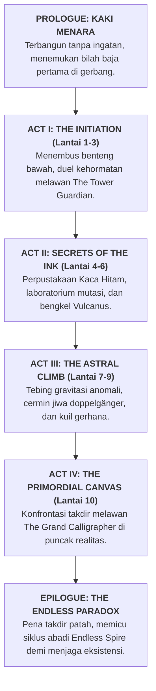

# 📜 KRONIK MENARA BAYANG: SAGA CERITA & WORLDBUILDING KANONIKAL
### *Stickman Tower Adventure — The Grand Chronicle of Aethelgard & The 10-Floor Odyssey*

---

```
                                  ▲
                                 / \
                                /   \
                               /  ▲  \
                              /  / \  \
                             /  /   \  \
                            /  /  ▲  \  \
                           /  /__/ \__\  \
                          /   THE SPIRE   \
                         /     OF UMBRA    \
                        /═══════════════════\
                       ║   [ACT IV: APEX]    ║  Floor 10: The Primordial Canvas (Final Boss)
                       ║  ═════════════════  ║
                       ║  [ACT III: ASTRAL]  ║  Floor 7 - 9: Fractured Space & Blood Moon
                       ║  ═════════════════  ║
                       ║ [ACT II: RUINS]     ║  Floor 4 - 6: Sunken Archives & Iron Foundry
                       ║  ═════════════════  ║
                       ║ [ACT I: INITIATION] ║  Floor 1 - 3: Lower Bastion & The Guardian
                       ╚═════════════════════╝
                                 ║ ║
                        ═════════╩═╩═════════
                         THE FORGOTTEN EXPANSE
                         (Dunia Kanvas Gelap)
```

---

## 🌌 BAGIAN 1: KOSMOLOGI & LATAR BELAKANG DUNIA (THE COSMOLOGY)

### 1.1 Tragedi Peristiwa Tinta Agung (*The Great Inking*)
Sebelum waktu mengenal hitungan mundur, dunia **Aethelgard** adalah bentangan kosmis yang makmur, bermandikan miliaran spektrum warna, seni arsitektur megah, dan daging fana yang bernyawa. Namun, para penguasa dimensi yang dikenal sebagai **The Grand Calligraphers (Para Penulis Takdir Purba)** menganggap bahwa keberagaman warna dan emosi fana adalah sumber kekacauan kosmis yang tidak berujung.

Dalam satu malam tanpa fajar yang kelak dicatat dalam prasasti batu hitam sebagai **The Great Inking (Kataklisme Tinta Agung)**, para Arsitek menumpahkan cawan *Tinta Primordial* ke atas seluruh semesta.
* Seluruh spektrum warna terhisap lenyap.
* Daging fana, organ dalam, ornamen pakaian mewah, dan rupa fisik makhluk hidup luruh dan terkikis.
* Yang tersisa hanyalah wujud siluet paling murni: garis-garis hitam pekat bercahaya batin yang padat kinetik—yang kelak dikenal sebagai **The Inked Ones (Kaum Stickman)**.

Walaupun rupa luar mereka direduksi menjadi bentuk siluet garis yang minimalis, pemadatan ini justru mengkristalkan kehendak jiwa (*Anima*) mereka menjadi luar biasa tajam. Refleks, daya tahan benturan, dan kecepatan gerak kaum siluet melampaui segala hukum biologis makhluk masa lalu.

### 1.2 Kutukan Pasak Bumi (*The Cosmic Tether / Terrestrial Gravity*)
Di dunia siluet, gravitasi ($g = -25.0\text{ m/s}^2$) bukanlah sekadar gaya tarik massa planet, melainkan belenggu spiritual yang sengaja dipasang para Calligrapher untuk mengunci kaum siluet di dasar dunia agar tidak mampu meraih langit. Semakin lama seorang siluet berdiam di atas tanah, jiwanya akan memudar mengalami fenomena **The Dissolution (Penyusutan Jiwa)**—luruh kembali menjadi tinta mati yang tak bernyawa.

Satu-satunya jalan untuk membebaskan jiwa dari kelenyapan abadi adalah dengan melawan gravitasi: melompat tinggi, menari di udara, membelokkan benturan maut melalui *Perfect Parry*, dan **mendaki The Obsidian Spire** hingga mencapai lantai tertinggi tempat pena penciptaan bersemayam.

---

## 📖 BAGIAN 2: ALUR CERITA UTAMA (THE MAIN STORYLINE ARC)

Cerita utama *Stickman Tower Adventure* berpusat pada perjalanan **The Marked One (Sang Siluet Bernisan Emas)**—seorang pengelana siluet tanpa ingatan masa lalu yang terbangun di kaki menara dengan ukiran rune bercahaya di dadanya.



### Babak I: Ujian Inisiasi (*The Initiation — Lantai 1 s/d 3*)
Sang protagonis mendengar bisikan angin yang berhembus dari celah pintu gerbang obsidian menara. Suara itu berasal dari **Aria, Sang Gema Warna Terakhir**—seberkas lentera jiwa yang menolak mati. Aria membimbing sang pengelana memasuki lantai dasar menara.

Di **Lantai 1 (*Lower Bastion*)**, protagonis berhadapan dengan *Crimson Grunts*, jiwa-jiwa prajurit gagal yang kehilangan akal sehat dan terobsesi dengan pertumpahan darah. Di **Lantai 2 (*Spire of Hazards*)**, sang pengelana membuktikan ketangkasan fisiknya dengan menaklukkan tebing duri obsidian yang mematikan.

Perjalanan Babak I berpuncak di **Lantai 3 (*Apex Boss Arena*)**. Di sana, pintu gerbang tertutup rapat dan dijaga oleh **Jenderal Oakhaven (The Tower Guardian)**. Oakhaven menguji tekad sang protagonis dalam duel berdarah 2-fase. Ketika Oakhaven tumbang, alih-alih mati dengan dendam, ia berlutut dan menyerahkan kunci segel menara atas seraya berbisik:
> *"Kau memiliki mata yang sama dengan ksatria kami di masa lampau... Namun waspadalah, anakku. Di atas sana, musuhmu bukanlah monster, melainkan kebenaran yang mengerikan tentang mengapa dunia ini ditenggelamkan ke dalam tinta."*

### Babak II: Rahasia Tinta & Logam Abadi (*Secrets of the Ink — Lantai 4 s/d 6*)
Memasuki lantai 4, atmosfer menara berubah drastis dari benteng batu militer menjadi reruntuhan peradaban magis yang misterius.
* Di **Lantai 4 (*The Sunken Archives*)**, protagonis menemukan manuskrip kaca hitam peninggalan para cendekiawan *Amethyst Weavers*. Dari sini terungkap bahwa para arsitek kosmis menara sengaja membuang warna dunia karena takut pada "Warna Emas Pemberontakan" (*The Golden Anima*).
* Di **Lantai 5 (*The Crucible of Mutations*)**, protagonis harus melintasi laboratorium raksasa tempat racun *Toxic Miasma* dan medan listrik *Berserk Surge* pertama kali diciptakan sebagai senjata pemusnah massal. Di sini ia dihadang oleh bos kedua: **The Amethyst Matron (Sang Ratu Busur Bayang)**.
* Di **Lantai 6 (*The Iron Foundry*)**, protagonis tiba di tempat peristirahatan aman: bengkel tempa legendaris milik **Vulcanus**. Di hadapan tungku bara emas, Vulcanus menempa ulang senjata sang pengelana dan mengungkap bahwa relik-relik di dalam peti menara adalah milik pahlawan masa lalu yang gagal.

### Babak III: Pendakian Astral & Cermin Jiwa (*The Astral Climb — Lantai 7 s/d 9*)
Menara tingkat atas tidak lagi memiliki dinding fisik yang utuh. Dinding-dindingnya telah pecah menghadap jurang kosmis tanpa batas dengan bintang-bintang mati di kejauhan.
* Di **Lantai 7 (*The Fractured Precipice*)**, anomali gravitasi (*Low Gravity*) membuat pulau-pulau obsidian melayang di udara. Pertempuran beralih menjadi akrobatik udara melawan kawanan pemanah sihir bayangan.
* Di **Lantai 8 (*The Hall of Echoes*)**, menara mempermainkan psikologis protagonis. Di balairung kristal hitam ini, sang pengelana harus berhadapan dengan **The Shadow Doppelgänger**—manifestasi bayangan dari ketakutan, keraguan, dan arketipe kelas dirinya sendiri yang menggunakan kombo, parry, dan ultimate yang identik.
* Di **Lantai 9 (*The Blood Moon Sanctum*)**, langit menara terbakar oleh fenomena *Vampiric Eclipse*. Ruangan ini dipimpin oleh bos ketiga: **The Crimson Sovereign (Pangeran Belati Darah)**—seorang ksatria masa lampau yang menyerahkan kewarasannya demi keabadian darah. Mengalahkannya adalah syarat mutlak untuk membuka portal tangga surga menuju Lantai 10.

### Babak IV: Puncak Kanvas Takdir (*The Primordial Canvas — Lantai 10*)
Lantai 10 bukanlah ruangan batu, melainkan sebuah platform marmer putih tak berbatas yang melayang di tengah samudra tinta hitam pekat. Di tengah altar, berdiri sosok raksasa bermantel jubah tinta dengan pena raksasa bertakhtakan bintang: **The Grand Calligrapher (Sang Penulis Takdir)**.

Sang Calligrapher menyatakan bahwa kemanusiaan dan kehendak bebas adalah noda yang merusak keheningan kanvas semesta. Pertarungan pamungkas terjadi dalam 3 fase kosmis:
1. *Fase Garis Statis:* Sang Calligrapher memanipulasi platforming dan gravitasi arena.
2. *Fase Hujan Tinta:* Hujan proyektil sabit dan meteorit tinta membanjiri lantai arena.
3. *Fase Kehendak Emas:* Tubuh sang protagonis memancarkan cahaya emas murni, memadukan seluruh skill sub-class dan parry untuk menembus pertahanan mutlak sang pencipta.

Dengan tebasan terakhir yang membelah udara, pena sang Calligrapher terbelah dua. Cahaya warna-warni yang terkunci selama ribuan tahun mulai merebak keluar dari retakan menara!

---

## 🗼 BAGIAN 3: HIERARKI LENGKAP 10 LANTAI CERITA (THE 10-FLOOR ODYSSEY)

Berikut adalah cetak biru detail dari kesepuluh lantai yang membentuk kampanye cerita penuh (*Story Campaign*):

```
┌──────┬───────────────────────────────┬─────────────────────────┬────────────────────────────────────────────┐
│ Flr. │ Nama Lantai & Domain          │ Bahaya & Rintangan      │ Pertemuan Penting & Boss                   │
├──────┼───────────────────────────────┼─────────────────────────┼────────────────────────────────────────────┤
│ **1**│ **Lower Bastion**             │ Duri dasar, platform    │ Inisiasi; 2 Melee Grunts, 1 Ranged Sniper. │
│      │ *(Gerbang Karang Hitam)*      │ bertingkat 1.6m.        │ Peti: Koin Emas Awal & Checkpoint.         │
├──────┼───────────────────────────────┼─────────────────────────┼────────────────────────────────────────────┤
│ **2**│ **Spire of Hazards**          │ Jurang duri obsidian,   │ Panjatan vertikal; 4 musuh kombinasi.      │
│      │ *(Tebing Duri Mengambang)*    │ tangga satu arah goyah. │ Peti Puncak: *Wings of Hermes*.            │
├──────┼───────────────────────────────┼─────────────────────────┼────────────────────────────────────────────┤
│ **3**│ **Apex Boss Arena**           │ Platform udara sempit,  │ **BOSS 1: The Tower Guardian (Oakhaven)**  │
│      │ *(Balairung Sang Hakim)*      │ arena tertutup sakral.  │ 2 Fase: Heavy Cleave & Wind Slash Enrage.  │
├──────┼───────────────────────────────┼─────────────────────────┼────────────────────────────────────────────┤
│ **4**│ **The Sunken Archives**       │ Perangkap proyektil     │ Pengenalan lore manuskrip; Pasukan elit    │
│      │ *(Perpustakaan Kaca Hitam)*   │ dinding, celah sempit.  │ Amethyst Weaver berkemampuan kiting.       │
├──────┼───────────────────────────────┼─────────────────────────┼────────────────────────────────────────────┤
│ **5**│ **Crucible of Mutations**     │ Asap Toxic Miasma &     │ **BOSS 2: The Amethyst Matron**            │
│      │ *(Kawah Alkimia Anomali)*     │ jebakan petir lantai.   │ Ratu panah proyektil multi-arah & racun.   │
├──────┼───────────────────────────────┼─────────────────────────┼────────────────────────────────────────────┤
│ **6**│ **The Iron Foundry**          │ Percikan lahar obsidian,│ **Sanctuary Vulcanus (The Blacksmith)**;   │
│      │ *(Bengkel Bara Jiwa)*         │ lift mekanik bergerak.  │ Tempat tempa senjata & Peti Relik Kuat.    │
├──────┼───────────────────────────────┼─────────────────────────┼────────────────────────────────────────────┤
│ **7**│ **The Fractured Precipice**   │ Gravitasi rendah (-35%),│ Pertempuran akrobatik udara; musuh penembak│
│      │ *(Tebing Gravitasi Retak)*    │ platform hancur lepas.  │ jitu dengan jangkauan pandang 12 meter.    │
├──────┼───────────────────────────────┼─────────────────────────┼────────────────────────────────────────────┤
│ **8**│ **The Hall of Echoes**        │ Cermin ilusi optik,     │ **MINI-BOSS: The Shadow Doppelgänger**     │
│      │ *(Balairung Gema Bayangan)*   │ platform tembus pandang.│ Meniru arketipe & kombo pemain secara pas. │
├──────┼───────────────────────────────┼─────────────────────────┼────────────────────────────────────────────┤
│ **9**│ **The Blood Moon Sanctum**    │ Lantai kutukan vampirik,│ **BOSS 3: The Crimson Sovereign**          │
│      │ *(Kuil Gerhana Darah)*        │ musuh beregenerasi HP.  │ Kesatria belati merah dengan lifesteal 20%.│
├──────┼───────────────────────────────┼─────────────────────────┼────────────────────────────────────────────┤
│**10**│ **The Primordial Canvas**     │ Medan hampa tak terbatas│ **FINAL STORY BOSS: The Grand Calligrapher**│
│      │ *(Puncak Kanvas Takdir)*      │ fluktuasi realitas.     │ Hakim pencipta semesta; Patahnya Pena Dewa.│
└──────┴───────────────────────────────┴─────────────────────────┴────────────────────────────────────────────┘
```

---

## ♾️ BAGIAN 4: PARADOKS ENDLESS SPIRE (THE POST-GAME LORE)

Salah satu pertanyaan naratif terbesar adalah: **Mengapa setelah bos Lantai 10 dikalahkan, pemain masih bisa memasuki mode Endless Spire tanpa batas?**

### Misteri Pecahnya Pena Takdir (*The Shattered Stylus*)
Ketika Sang Penulis Takdir tumbang di Lantai 10, pena emasnya (*The Primordial Stylus*) patah berkeping-keping. Patahnya pena tersebut tidak langsung menghancurkan menara, melainkan **meretakkan kontinuitas ruang dan waktu (The Temporal Fracture)**.

* Puncak Menara terbuka menuju dimensi tak bertepi: **The Endless Spire**.
* Lantai 11, 20, 50, 100, hingga tak terhingga bukanlah bangunan fisik nyata, melainkan gema ingatan menara yang berulang secara prosedural dalam sebuah *Infinite Timeloop*.
* Setiap kali pemain menapaki lantai Endless, menara merakit kembali dirinya menggunakan serpihan anomali mutator: kadang berkabut racun (*Toxic Miasma*), kadang memicu adrenalin darah (*Berserk Surge*), atau menghadirkan kembali bayangan sang Tower Guardian setiap kelipatan 5 lantai sebagai ujian abadi.

> **Tujuan Hakiki Sang Pendaki:** Sang pendekar siluet memilih untuk terus mendaki menara tanpa henti. Selama ada bilah pedang yang berayun dan kaki yang melompat di dalam Endless Spire, stabilitas realitas semesta Aethelgard akan terus terjaga dari kepunahan mutlak.

---

## 👥 BAGIAN 5: TOKOH-TOKOH PENTING & FRAGMEN DIALOG (DRAMATIS PERSONAE)

```
       [ARIA]                   [VULCANUS]                 [OAKHAVEN]
   Lentera Warna            Sang Penempa Jiwa           Tower Guardian
 "Ingatlah warnamu..."     "Bawa emas menara!"      "Buktikan tekadmu!"
```

### 5.1 Aria — Sang Gema Warna Terakhir (*The Echo of Chroma*)
* **Wujud:** Sekilas pendar cahaya keemasan redup yang berputar di sekitar patung Checkpoint dan Altar Istirahat.
* **Peran:** Narator batin dan pemberi petunjuk bagi pemain.
* **Kutipan Dialog:**
  > *"Mereka merampas merahnya mawar, birunya samudra, dan hangatnya fajar dari kita, saudaraku. Mereka mengira kita hanya garis tanpa rasa. Tunjukkan pada mereka bahwa di balik tubuh siluet ini, ada jiwa yang membakar lebih terang daripada bintang."*

### 5.2 Vulcanus — Sang Penempa Jiwa (*The Blacksmith of the Void*)
* **Wujud:** Siluet kekar bertelanjang dada dengan celemek besi tebal, selalu memegang palu meteorit di depan tungku emas Lantai 6.
* **Peran:** Mengelola sistem upgrade senjata di [BlacksmithScreen.kt](file:///home/yusuf/projekan/game/game1/core/src/main/kotlin/com/stickman/tower/screen/BlacksmithScreen.kt).
* **Kutipan Dialog:**
  > *"Denting paluku adalah satu-satunya irama yang menolak tunduk pada keheningan menara ini. Koin emas yang kau bawa? Itu bukan uang biasa. Itu adalah tetesan cahaya matahari yang dipadatkan oleh para pendaki masa lalu. Berikan padaku, kan kutempa bilah bajamu agar sanggup membelah takdir!"*

### 5.3 Jenderal Oakhaven — The Tower Guardian
* **Wujud:** Sosok kesatria raksasa 2.8 meter bertanduk emas dengan jubah compang-camping di [BossEnemy.kt](file:///home/yusuf/projekan/game/game1/core/src/main/kotlin/com/stickman/tower/enemy/BossEnemy.kt).
* **Peran:** Bos pelindung gerbang Lantai 3.
* **Kutipan Dialog (Saat HP < 50% / Enrage Roar):**
  > *"Cukup bermain-main! Segel ini tidak kubuat untuk melindungi menara dari kalian... TAPI UNTUK MELINDUNGI KALIAN DARI KEBIADABAN PUNCAK MENARA! TERIMALAH TEBASAN ANGIN INI!"*

---

## 📜 BAGIAN 6: PRASASTI BATU HITAM (THE LORE TABLETS)

Di berbagai sudut tersembunyi tiap lantai, pemain dapat menemukan prasasti kuno (*Inscriptions*) yang menceritakan serpihan rahasia menara:

#### Tablet I (Ditemukan di Lantai 1 — Samping Peti Harta):
> *"Hari ke-47. Kami tiba di gerbang bawah dengan 100 prajurit terbaik. Tubuh kami telah menghitam, jari-jari kami menyatu menjadi garis padat. Makanan tak lagi berasa, namun pedang terasa seratus kali lebih ringan. Jika catatan ini kau temukan, ketahuilah: jangan pernah berhenti bergerak saat berada di atas platform."*

#### Tablet IV (Ditemukan di Lantai 4 — Meja Perpustakaan Kaca):
> *"Mereka menyebut kami monster karena kami menggunakan panah amethyst dari kejauhan. Tapi mereka tidak mengerti: mendekati bilah pedang di menara ini berarti kematian. Kami menyegel diri dalam ruang arsip ini untuk mencari penawar racun tinta... namun tinta itu sendiri telah menjadi darah kami."*

#### Tablet VIII (Ditemukan di Lantai 8 — Depan Cermin Bayangan):
> *"Musuh paling berbahaya di puncak menara bukanlah dewa, melainkan dirimu sendiri yang menyerah pada keputusasaan. Ketika kau melihat bayanganmu mengayunkan pedang yang sama, jangan menunduk. Lakukan parry tepat saat kilatan matanya menyala!"*

---

## 🛡️ BAGIAN 7: HARMONI ANTARA MEKANIK KODE DAN NARASI CERITA

Dokumen lore ini secara presisi menjalin setiap baris logika kode Kotlin yang ada di repositori ke dalam kanon cerita yang kohesif:

1. **Kenapa Hitbox dan Hurtbox Terpisah? ([Hitbox.kt](file:///home/yusuf/projekan/game/game1/core/src/main/kotlin/com/stickman/tower/combat/Hitbox.kt) & [Hurtbox.kt](file:///home/yusuf/projekan/game/game1/core/src/main/kotlin/com/stickman/tower/combat/Hurtbox.kt))**
   * *Dalam Lore:* Jiwa siluet memproyeksikan "aura pemotong" di luar batas fisik tubuh mereka saat mengayunkan senjata, menciptakan gelombang kinetik yang melukai musuh sebelum bilah menyentuh daging.
2. **Kenapa ada Hitstop 80ms saat Perfect Parry? ([ParryTest.kt](file:///home/yusuf/projekan/game/game1/core/src/test/kotlin/com/stickman/tower/combat/ParryTest.kt))**
   * *Dalam Lore:* Benturan dua bilah obsidian berkecepatan tinggi sesaat merusak aliran waktu di sekitar titik temu, membekukan realitas selama 80 milidetik sebelum memantulkan musuh.
3. **Kenapa Talent Tree Terkunci Berdasarkan Level? ([TalentManager.kt](file:///home/yusuf/projekan/game/game1/core/src/main/kotlin/com/stickman/tower/talent/TalentManager.kt))**
   * *Dalam Lore:* Jiwa siluet membutuhkan konsentrasi *Anima* yang semakin padat agar sanggup menampung kekuatan sub-class tanpa meledakkan wujud siluet mereka sendiri.
4. **Kenapa Save Data Memiliki Checksum Anti-Korupsi? ([SaveData.kt](file:///home/yusuf/projekan/game/game1/core/src/main/kotlin/com/stickman/tower/rpg/SaveData.kt))**
   * *Dalam Lore:* Kutukan menara terus mencoba menghapus ingatan dan riwayat para pendaki (*Memory Erasure*). Checksum 63-bit adalah representasi dari "Segel Memori Abadi" yang dipasang oleh Vulcanus agar jiwa pemain tidak terhapus saat gugur dan kembali ke checkpoint.
5. **Kenapa Tombol Aksi Tersusun Melengkung Mengitari Tombol Attack? ([VirtualController.kt](file:///home/yusuf/projekan/game/game1/core/src/main/kotlin/com/stickman/tower/input/VirtualController.kt))**
   * *Dalam Lore:* Pola tarung para pendekar bayangan (*Shadow Martial Stance*) mewajibkan tangan dominan berporos pada bilah utama (tombol Attack), sementara jari-jari memancarkan energi magis ke orbit melengkung di sekelilingnya untuk memicu seni rahasia (3 Skill Aktif) dan pelepasan segel kosmis (Ultimate).

---

## ⚔️ BAGIAN 8: KANON TIGA ARKETIPE PENDAKI & SISTEM MULTI-SKILL UNIK

Menara Bayang hanya mengizinkan tiga garis keturunan pendekar siluet untuk menantang takdir. Sesuai dengan pembaharuan mekanik kontrol busur melengkung (*Arc Skill Array* yang terinspirasi dari gaya tarung aksi klasik seperti *Shadow Fight* dan *League of Stickman*), setiap karakter kini memiliki **3 Active Skills + 1 Ultimate Power** yang sepenuhnya unik dan berbeda secara mekanik maupun filosofi tarung:

```
               [SKILL 2 (Amber/Flame)]  [SKILL 1 (Cyan/Wind)]
                    \                       /
 [ULTIMATE (Gold)] ───●                   ●
         |             \                 /
  [SKILL 3 (Purple)] ───●               ● ── [DODGE / DASH]
                          \           /
                           ( ATTACK )
                          /           \
                  [JUMP] ●             ●
```

### 8.1 Kaelen The Bladeweaver (Arketipe: BALANCED)
* **Gelar:** Pendekar Pedang Badai & Murid Terakhir Aliran Zephyr.
* **Senjata Utama:** Bilah Pedang Baja Astral (*Runed Broadsword*).
* **Filosofi Bertarung:** Keseimbangan sempurna antara tebasan jarak dekat, proyektil angin pemotong barisan musuh, dan manuver udara pembuka kombo.
* **Gudang Kemampuan Khusus:**
  1. **Skill 1 — Gale Crescent** *(Tombol U / Cooldown 6.0s):*
     * *Mekanik:* Mengayunkan bilah pedang horizontal dan meluncurkan proyektil sabit angin bercahaya cyan berkecepatan 18 m/s yang menembus barisan musuh sejauh 20 meter.
     * *Lore:* Konsentrasi udara tipis menara yang dipadatkan oleh ayunan pedang Kaelen, membelah pertahanan perisai musuh dari jarak aman.
  2. **Skill 2 — Rising Dragon** *(Tombol I / Cooldown 7.0s):*
     * *Mekanik:* Menebas ke atas secara vertikal seraya melesat tinggi ke udara ($v_y = +11.5\text{ m/s}$), mengangkat (*launch*) musuh ke udara untuk transisi *aerial juggle combo*.
     * *Lore:* Meniru gerakan naga angin yang memecahkan gravitasi menara, membuka celah fatal pada titik lemah leher lawan.
  3. **Skill 3 — Dash Strike** *(Tombol O / Cooldown 5.0s):*
     * *Mekanik:* Menerjang lurus ke depan dengan kecepatan kilat ($v_x = 22.0\text{ m/s}$) sambil menusukkan ujung pedang, memberikan efek stun dan damage penetrasi garis lurus.
     * *Lore:* Teknik tusukan tombak rahasia dari benteng Oakhaven yang mengubah bobot tubuh penggunanya menjadi seringan bulu.
  4. **Ultimate — Bladestorm** *(Tombol P / 100 Energy):*
     * *Mekanik:* Berputar kencang melepaskan badai pedang 360 derajat radial beradius 3.6 meter yang mencabik-cabik seluruh musuh di sekitarnya.

### 8.2 Zephyr The Shadowstalker (Arketipe: AGILE)
* **Gelar:** Pembunuh Bayangan Ordo Eclipse Creed.
* **Senjata Utama:** Belati Ganda Racun Bulan (*Dual Amethyst Daggers*).
* **Filosofi Bertarung:** Kecepatan ekstrem, serangan bertubi-tubi penumpuk kombo hit, dan mobilitas teleportasi yang menembus punggung lawan.
* **Gudang Kemampuan Khusus:**
  1. **Skill 1 — Shadow Shuriken** *(Tombol U / Cooldown 5.0s):*
     * *Mekanik:* Melemparkan 3 proyektil bintang bayangan ungu secara menyebar (*tri-directional fan spread*) dengan kecepatan kilat 24 m/s.
     * *Lore:* Ditempa dari pecahan cermin kristal lantai 8 yang diresapi racun laba-laba tinta, melumpuhkan koordinasi gerak musuh.
  2. **Skill 2 — Venom Flurry** *(Tombol I / Cooldown 6.0s):*
     * *Mekanik:* Melancarkan rentetan tusukan beruntun 4-hit ke depan dalam 0.3 detik dengan multiplier critical damage tinggi.
     * *Lore:* Seni bela diri ordo pembunuh bayangan yang menyasar pembuluh nadi lawan sebelum mereka menyadari adanya serangan.
  3. **Skill 3 — Phantom Blink** *(Tombol O / Cooldown 4.5s):*
     * *Mekanik:* Melakukan teleportasi instan 4.5 meter menembus musuh dan mendarat tepat di belakang punggung mereka disertai tebasan kritis garansi 100%.
     * *Lore:* Menghapus eksistensi fisik sesaat dengan menyelam ke dalam dimensi tinta, muncul kembali di titik buta lawan.
  4. **Ultimate — Phantom Flurry** *(Tombol P / 80 Energy):*
     * *Mekanik:* Menghilang dari layar dan memunculkan ilusi siluet bayangan dari segala arah yang menghujani musuh dalam pusaran serangan kilat.

### 8.3 Gorgon The Ironbreaker (Arketipe: HEAVY)
* **Gelar:** Sang Penghancur Benteng & Paladin Batu Meteorit.
* **Senjata Utama:** Pedang Kolosal Raksasa Bara (*Colossal Obsidian Greatsword*).
* **Filosofi Bertarung:** Daya hancur masif, pertahanan tak tergoyahkan (*Super Armor*), regenerasi mandiri, dan penguasaan area tanah (*Crowd Control*).
* **Gudang Kemampuan Khusus:**
  1. **Skill 1 — Earth Shockwave** *(Tombol U / Cooldown 8.0s):*
     * *Mekanik:* Menghantamkan ujung pedang kolosal ke tanah, memancarkan gelombang kejut batu berapi berdimensi $1.4\text{m} \times 1.1\text{m}$ yang merayap di tanah dan mementalkan musuh.
     * *Lore:* Meminjam getaran tektonik dari perut bumi menara untuk meruntuhkan pijakan musuh yang berlindung di balik perisai.
  2. **Skill 2 — Cyclone Cleave** *(Tombol I / Cooldown 7.5s):*
     * *Mekanik:* Mengayunkan Greatsword dalam putaran horizontal 360 derajat sambil maju ke depan, menciptakan pusaran api yang melibas semua musuh di sekelilingnya.
     * *Lore:* Momentum ayunan senjata seberat 80 kg yang tak dapat dihentikan oleh tebasan biasa, menghancurkan formasi musuh berkelompok.
  3. **Skill 3 — Titan Roar** *(Tombol O / Cooldown 10.0s):*
     * *Mekanik:* Mengeluarkan raungan perang titan yang memulihkan +15% Max HP seketika dan melepaskan ledakan repulsi radial yang menghempaskan musuh di dekatnya sejauh 14 meter.
     * *Lore:* Teriakan perlawanan kaum raksasa masa purba yang menolak tunduk pada kematian, membakar kembali sisa-sisa semangat juang dalam jiwa.
  4. **Ultimate — Meteor Cleave** *(Tombol P / 120 Energy):*
     * *Mekanik:* Melompat ke puncak udara dan menghujamkan bilah meteorit berapi ke tanah, memicu gempa kataklismik yang menghanguskan arena.

---
*Dokumen ini merupakan kanon resmi lore, narasi cerita utama, dan worldbuilding komprehensif untuk [Stickman Tower Adventure](file:///home/yusuf/projekan/game/game1/README.md).*
