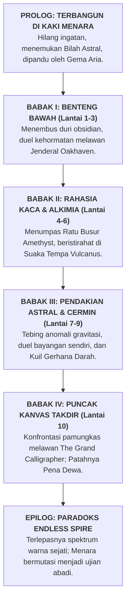

# 📜 KRONIK MENARA BAYANG: ENSIKLOPEDIA & SAGA KANONIKAL AETHELGARD
### *Stickman Tower Adventure — The Grand Chronicle of Aethelgard & The Celestial Spire*

---

```
                                  ▲
                                 / \
                                /   \
                               /  ▲  \
                              /  / \  \
                             /  /   \  \
                            /  /  ▲  \  \
                           /  /__/ \__\  \
                          /   THE SPIRE   \
                         /     OF UMBRA    \
                        /═══════════════════\
                       ║   [ACT IV: APEX]    ║  Floor 10: The Primordial Canvas (The Grand Calligrapher)
                       ║  ═════════════════  ║
                       ║  [ACT III: ASTRAL]  ║  Floor 7 - 9: Fractured Space & Blood Moon Sanctum
                       ║  ═════════════════  ║
                       ║ [ACT II: RUINS]     ║  Floor 4 - 6: Sunken Archives & The Iron Foundry
                       ║  ═════════════════  ║
                       ║ [ACT I: INITIATION] ║  Floor 1 - 3: Lower Bastion & The Tower Guardian
                       ╚═════════════════════╝
                                 ║ ║
                        ═════════╩═╩═════════
                         THE FORGOTTEN EXPANSE
                        (Dunia Kanvas Gelap Purba)
```

---

## 🌌 BAGIAN 1: KOSMOLOGI & LATAR BELAKANG DUNIA (THE COSMOLOGY OF AETHELGARD)

### 1.1 Zaman Keemasan Warna (*The Golden Age of Prismatic Anima*)
Beribu-ribu milenium sebelum waktu mengenal jarum detik atau hitungan mundur, dunia **Aethelgard** adalah bentangan kosmis yang bermandikan keajaiban spektrum warna murni (*Prismatic Anima*). Lautan memancarkan biru safir bercahaya, dedaunan hutan membisikkan zamrud kehidupan, dan kota-kota marmer putih menjulang megah dinaungi langit jingga keemasan.

Di era itu, peradaban fana hidup berdampingan dengan entitas dimensi tinggi yang dikenal sebagai **The Grand Calligraphers (Para Penulis Takdir Purba)**. Para Arsitek ini mengendalikan jalannya takdir alam semesta menggunakan instrumen kosmis bernama **The Primordial Stylus (Pena Takdir Semesta)**. Setiap kelahiran, kematian, penemuan seni, dan gejolak cinta tertulis rapi dalam sebuah gulungan kosmis tanpa akhir yang disebut *The Cosmic Parchment*.

Namun, seiring berjalannya zaman, makhluk hidup fana mulai membangkang. Keberagaman emosi, nafsu berperang, keserakahan kekuasaan, dan ego individualisme menciptakan "noda kotoran" (*Chromatic Discordance*) yang mulai meretakkan keselarasan kanvas para dewa. Para Calligrapher memandang bahwa keanekaragaman warna dan kebebasan berkehendak adalah sumber anarki kosmis yang harus dimusnahkan.

### 1.2 Tragedi Kataklisme Tinta Agung (*The Great Inking*)
Dalam satu malam tanpa rembulan yang kelak dicatat dalam prasasti batu hitam sebagai **The Great Inking (Kataklisme Tinta Agung)**, dewan para Calligrapher mengambil keputusan mutlak: *memurnikan semesta melalui reduksi absolut*.

1. **Penyedotan Spektrum:** Dari langit tertinggi, cawan raksasa berisi *Tinta Primordial Hitam Pekat* ditumpahkan ke seluruh penjuru Aethelgard. Dalam hitungan tarikan napas, warna merah darah, biru samudra, hijau hutan, dan emas mentari terhisap lenyap tanpa sisa.
2. **Kikis Wujud Biologis:** Tubuh biologis berdaging tebal, organ dalam yang rapuh, helaian rambut, pakaian sutra mewah, dan ekspresi wajah seluruh makhluk hidup terkikis dan luruh menjadi cairan pekat.
3. **Kelahiran Siluet Abadi (The Inked Ones / Stickman):** Makhluk hidup yang selamat tidak lenyap ke dalam kematian, melainkan terkompresi secara kinetik menjadi wujud geometris paling murni: garis-garis hitam pekat berkecepatan tinggi yang padat massa, dengan mata bersinar putih tajam—yang kelak dikenal sebagai **Kaum Siluet (The Stickmen)**.

Meskipun rupa luar mereka direduksi menjadi bentuk garis minimalis, pemadatan eksistensial ini justru melipatgandakan daya tahan tubuh mereka. Seluruh kekuatan jiwa (*Anima*) mereka kini terpusat pada satu titik inti bercahaya di dada: **The Anima Core**. Mereka tidak lagi membutuhkan makan atau tidur layaknya makhluk berdaging; mereka hidup murni dari momentum kinetik, tekad bertarung, dan resonansi bilah senjata.

### 1.3 Kutukan Pasak Bumi & Fenomena Penyusutan Jiwa (*The Dissolution*)
Agar kaum siluet tidak mampu memberontak dan meraih kembali puncak langit, para Calligrapher memasang kutukan gravitasi tektonik ekstrem ($g = -25.0\text{ m/s}^2$). Gravitasi ini bukanlah gaya tarik planet biasa, melainkan belenggu spiritual yang sengaja ditarik dari inti kegelapan tanah.

Semakin lama seorang siluet berdiam diri di atas permukaan tanah tanpa bergerak atau bertarung, gravitasi akan memicu fenomena mematikan: **The Dissolution (Penyusutan Jiwa)**.
* Kaki mereka akan mulai meleleh kembali menjadi genangan tinta mati.
* Garis tubuh mereka akan memudar dari hitam pekat menjadi abu-abu transparan.
* Ingatan dan identitas diri mereka akan lenyap ditelan kehampaan.

Satu-satunya cara bagi seorang siluet untuk mempertahankan eksistensinya adalah **terus bergerak, melompat ke tempat tinggi, menari di udara dengan manuver akrobatik, menangkis serangan musuh secara presisi (*Perfect Parry*), dan mendaki The Obsidian Spire (Menara Bayang)** hingga menembus puncak langit tempat sang dewa pencipta bertahta.

---

## 📖 BAGIAN 2: ALUR CERITA LENGKAP DARI AWAL HINGGA AKHIR (THE COMPLETE EPIC ODYSSEY)

Cerita utama *Stickman Tower Adventure* mengikuti perjalanan sang protagonis utama: **The Marked One (Kaelen The Bladeweaver)**, didampingi oleh dua rekan takdirnya, **Zephyr The Shadowstalker** dan **Gorgon The Ironbreaker**.



---

### 2.1 Prolog: Terbangun di Kaki Menara (*The Awakening at the Iron Gate*)
Kaelen membuka matanya di atas hamparan pasir obsidian yang dingin di kaki **The Obsidian Spire**. Angin malam melolong membawa partikel tinta kering. Ia tidak mengingat masa lalunya, namanya sendiri, ataupun siapa dirinya sebelum dunia menjadi hitam-putih. Satu-satunya hal yang ia miliki adalah sebuah rune emas menyala yang terukir di dadanya dan sebuah pedang baja tua yang tertancap di depan gerbang besi raksasa.

Saat jemari siluetnya menyentuh hulu pedang, sebuah pendar cahaya cyan keemasan berputar di sekelilingnya. Suara lembut namun penuh kepedihan menggema di dalam benaknya:
> *"Bangunlah, Pendekar Bernisan Emas... Waktu kita hampir habis. Seluruh saudaramu telah luruh menjadi tinta mati di dasar bumi. Jangan biarkan lilin jiwamu padam di tanah terkutuk ini. Masuklah ke dalam menara. Di sanalah warna dunia kita yang dicuri disembunyikan..."*

Suara itu berasal dari **Aria, Sang Gema Warna Terakhir**—sepercik jiwa murni yang menolak larut ke dalam tinta dan kini bertindak sebagai lentera pemandu bagi para pendaki. Dengan menggenggam bilah bajanya, Kaelen mendorong pintu gerbang obsidian dan melangkah memasuki Lantai 1.

---

### 2.2 Babak I: Ujian Inisiasi di Benteng Bawah (*The Initiation — Lantai 1 s/d 3*)
* **Lantai 1 (Lower Bastion):** Kaelen langsung disambut oleh sisa-sisa garnisun tentara masa lalu: *Crimson Grunts*. Mereka adalah prajurit-prajurit fana yang kehilangan akal sehat saat kataklisme terjadi dan kini bermutasi menjadi monster agresif yang menyerang membabi buta. Di lantai ini, Kaelen mempelajari kembali naluri bertarungnya: memadukan kombo tebasan, meluncurkan sabit angin *Gale Crescent*, dan menangkis serangan musuh dengan *Perfect Parry*. Di samping peti harta pertama, ia membaca prasasti peninggalan legiun masa lalu.
* **Lantai 2 (Spire of Hazards):** Menara menguji ketangkasan platforming sang pendekar. Lantai dasar dipenuhi oleh jurang duri obsidian tajam yang mampu membunuh dalam hitungan detik. Kaelen harus melompati platform bertingkat yang goyah sembari menghindari panah proyektil ungu dari para sniper bayangan di kejauhan.
* **Lantai 3 (Apex Boss Arena — Duel Melawan Jenderal Oakhaven):** 
  Di puncak babak pertama, pintu gerbang menuju lantai atas tertutup segel runik raksasa. Gerbang tersebut dijaga oleh sosok kesatria siluet perkasa setinggi 2.8 meter dengan tanduk emas di helm besinya: **Jenderal Oakhaven (The Tower Guardian)**.
  
  Oakhaven tidak menyerang dengan kebencian, melainkan dengan kehormatan militer kuno. Saat darahnya menyentuh 50%, sang jenderal mengaum kencang, membelah angin dengan tebasan badai ganda (*Wind Slash Enrage*). Ketika Kaelen berhasil menundukkannya dengan tebasan pamungkas, Oakhaven menolak jatuh tersungkur. Ia berlutut dengan satu kaki, menancapkan pedang besarnya ke lantai, dan menyerahkan segel gerbang seraya berbisik:
  > *"Tebasanmu... tajam dan tidak ragu. Kau memiliki bara tekad yang sama dengan ksatria kami sebelum dunia ditenggelamkan ke dalam tinta. Namun dengarkan peringatanku, anak muda: di atas sana, lawan terbesarmu bukanlah monster, melainkan kebenaran yang mengerikan tentang mengapa dunia ini dihancurkan oleh para dewa."*

---

### 2.3 Babak II: Rahasia Kaca Hitam & Logam Abadi (*Secrets of the Ink — Lantai 4 s/d 6*)
* **Lantai 4 (The Sunken Archives):** Pemandangan benteng militer berganti menjadi perpustakaan raksasa yang tenggelam. Dinding-dindingnya tersusun dari kristal kaca hitam *Amethyst*. Di sini, Kaelen menemukan manuskrip rahasia yang mengungkap bahwa para dewa Calligrapher menciptakan *The Great Inking* bukan karena kebetulan, melainkan ketakutan mereka terhadap manusia yang hampir menemukan formula keabadian warna (*The Golden Anima*). Pasukan elit *Amethyst Snipers* berpatroli dengan taktik gerilya mundur (*kiting*) yang mematikan.
* **Lantai 5 (Crucible of Mutations — Konfrontasi The Amethyst Matron):**
  Laboratorium alkimia kuno tempat cairan racun *Toxic Miasma* diproduksi. Di lantai ini, penguasa kawah racun bangkit: **The Amethyst Matron (Sang Ratu Busur Bayang)**. Dengan kecepatan luar biasa, sang Ratu melompat dari platform ke platform, menembakkan hujan 5 panah racun menyebar (*tri-directional spread*) dan menyelimuti arena dengan kabut beracun. Kaelen dipaksa memanfaatkan *Dash I-Frames* dan proyektil jarak jauh untuk menutup celah dan memenggal busur sang ratu.
* **Lantai 6 (The Iron Foundry — Suaka Vulcanus):**
  Setelah pertempuran berdarah di lantai 5, Kaelen tiba di tempat peristirahatan aman: bengkel tempa legendaris milik **Vulcanus Sang Penempa Jiwa**. Di hadapan tungku meteorit emas yang tak pernah padam, Vulcanus menyambut sang pengelana:
  > *"Denting paluku adalah satu-satunya melodi yang menolak tunduk pada keheningan kematian menara ini. Koin emas yang kau kumpulkan dari monster? Itu adalah tetesan cahaya mentari yang dipadatkan oleh darah para pendaki masa lalu. Berikan padaku, kan kutempa bilah bajamu agar sanggup merobek takdir!"*
  Di sini, Kaelen memperkuat senjatanya, meningkatkan attack power, critical strike, dan kecepatan serang sebelum menghadapi babak berikutnya yang jauh lebih brutal.

---

### 2.4 Babak III: Pendakian Astral & Cermin Jiwa (*The Astral Climb — Lantai 7 s/d 9*)
* **Lantai 7 (The Fractured Precipice):** Dinding fisik menara telah hancur terkoyak, memperlihatkan jurang kosmis tanpa batas dengan bintang-bintang mati di kejauhan. Anomali gravitasi rendah (*Low Gravity*) membuat pulau-pulau obsidian melayang di angkasa. Pertarungan beralih menjadi duel akrobatik udara ekstrem melawan monster-monster terbang bersayap tajam.
* **Lantai 8 (The Hall of Echoes — Melawan The Shadow Doppelgänger):**
  Menara mempermainkan psikologis dan ketakutan terdalam sang pendekar. Di balairung kristal cermin hitam ini, bayangan Kaelen memisahkan diri dari kakinya dan menjelma menjadi sosok mandiri: **The Shadow Doppelgänger**. Bayangan ini meniru seluruh arketipe kelas, kombo pedang, animasi parry, dan skill *Bladestorm* dengan presisi sempurna. Kaelen menyadari bahwa ia tidak bisa mengalahkan bayangannya dengan kekuatan kasar; ia harus mengalahkan keraguan batinnya sendiri dengan membaca ritme serangan dan melakukan *Perfect Parry* tepat di saat bayangannya melancarkan tebasan fatal.
* **Lantai 9 (The Blood Moon Sanctum — Teror The Crimson Sovereign):**
  Langit menara terbakar merah darah oleh gerhana kosmis *Vampiric Eclipse*. Di tengah kuil darah berdiri bos ketiga: **The Crimson Sovereign (Pangeran Belati Darah)**—seorang ksatria masa lampau yang mengorbankan pasukannya dan meminum tinta darah demi keabadian. Setiap tusukan belatinya menyedot darah dan memulihkan HP-nya (*Lifesteal 20%*). Kaelen harus bertarung dengan disiplin tinggi, tidak membiarkan satu serangan pun mengenainya seraya memecahkan pertahanan sang pangeran dengan rentetan kombo mematikan.

---

### 2.5 Babak IV: Puncak Kanvas Takdir (*The Primordial Canvas — Lantai 10*)
Lantai 10 bukanlah ruangan batu atau istana berlantai marmer. Ini adalah sebuah platform putih persegi tak terbatas yang melayang di tengah samudra tinta hitam abadi. Di tengah arena, di atas singgasana yang tersusun dari ribuan kuas emas kuno, berdiri penguasa absolut semesta: **The Grand Calligrapher (Sang Penulis Takdir Semesta)**.

Sosok raksasa setinggi 3.4 meter itu mengenakan jubah jubah tinta yang berkibar bagaikan galaksi malam. Di tangan kanannya, ia memegang tongkat pena kosmis bercahaya bintang: *The Primordial Stylus*.
> *"Kau telah mendaki terlalu tinggi, wahai setitik garis hitam yang tersesat... Kau menuntut kembalinya warna, kebebasan, dan nafsu fana. Tidakkah kau mengerti? Warna adalah kutukan yang melahirkan perang, penyakit, dan kehancuran. Dalam tinta hitam dan putih yang sunyi ini, semesta menemukan kedamaian abadinya. Kini, biarkan aku menghapus garis keberadaanmu dari kanvas ini untuk selamanya!"*

Pertarungan pamungkas terjadi dalam 3 fase kosmis legendaris:
1. **Fase I — Garis Monolitik (*Monolithic Inscription*):** Sang Calligrapher memanipulasi gravitasi lantai arena, meluncurkan gelombang pilar tinta hitam dari bawah tanah dan sabit proyektil pemotong ruang.
2. **Fase II — Badai Hujan Tinta (*The Inked Cataclysm — HP < 50%*):** Langit kanvas menghitam pekat. Hujan meteor tinta dan sabit energi radial menghujani seluruh arena. Kecepatan serang sang Calligrapher berlipat ganda disertai teleporasi instan.
3. **Fase III — Nyala Kehendak Emas (*The Golden Anima Eruption*):** Rune di dada Kaelen meledak memancarkan pendaran cahaya keemasan murni. Menggabungkan seluruh ilmu pedang yang ia pelajari dari lantai 1 hingga 9, Kaelen menembus badai tinta, menangkis bilah sang dewa dengan satu denting parry yang mengguncang semesta, dan melompat menebaskan bilah bajanya tepat ke poros pena kosmis!

**KRAAASSSHH!**  
*The Primordial Stylus* terbelah menjadi dua kepingan emas yang hancur. Sang Grand Calligrapher menjerit seraya tubuh bayangannya luruh dan tersedot ke dalam pusaran jurang tinta di bawah platform.

---

### 2.6 Epilog & Paradoks: Pecahnya Realitas Endless Spire (*The Endless Paradox*)
Dengan hancurnya pena penciptaan, belenggu gravitasi bumi lenyap seketika. Dari puncak menara yang retak, jutaan berkas spektrum warna—merah fajar, biru samudra, hijau zamrud, dan emas kemuliaan—meledak ke angkasa, membasuh langit Aethelgard yang telah ribuan tahun membeku dalam kegelapan.

Namun, hancurnya pena dewa membawa konsekuensi metafisika yang tidak terduga: **The Temporal Fracture (Pecahnya Garis Waktu)**.
* Menara Obsidian tidak runtuh; ia justru bertransformasi menjadi gerbang dimensi tak berbatas: **The Endless Spire (Lantai 11 ke atas)**.
* Lantai-lantai di atas lantai 10 bukanlah bangunan fisik materi, melainkan fragmen ingatan menara yang terus berputar secara prosedural dalam sebuah *Infinite Time-Loop*.
* Bahaya-bahaya anomali baru bermunculan: kabut racun *Toxic Miasma*, badai darah *Berserk Surge*, hingga proyeksi bayangan para bos lama yang bangkit kembali dengan kekuatan yang semakin mengerikan setiap kelipatan 5 lantai.

> **Takdir Abadi Sang Pendaki:** Menyadari bahwa kestabilan realitas semesta Aethelgard bergantung pada kehendak juang yang tak pernah padam di dalam menara, Kaelen dan para pendekar siluet memilih untuk tidak turun ke dunia fana. Mereka tetap berada di dalam menara, terus melompat, menebas, dan mendaki Endless Spire tanpa batas. Selama ada bilah pedang yang berayun di puncak menara, kegelapan mutlak takkan pernah sanggup menelan dunia lagi.

---

## 👥 BAGIAN 3: DRAMATIS PERSONAE (PROFIL LENGKAP SELURUH TOKOH)

```
       [KAELEN]                  [ZEPHYR]                  [GORGON]
   The Bladeweaver           The Shadowstalker         The Ironbreaker
"Pedang menuntut darah!"    "Bayangan tak bersuara."   "Baja takkan goyah!"
```

### 3.1 Kaelen The Bladeweaver (Arketipe: BALANCED)
* **Gelar:** Murid Terakhir Aliran Zephyr & Sang Pendekar Bernisan Emas.
* **Senjata:** Bilah Baja Astral (*Runed Broadsword*).
* **Latar Belakang:** Kaelen adalah mantan kapten prajurit pelindung ibukota Aethelgard sebelum *The Great Inking*. Ketika kataklisme terjadi, ia menyegel sebagian jiwanya ke dalam rune emas agar tidak sepenuhnya larut menjadi tinta mati. Ia terbangun di kaki menara tanpa ingatan nama, namun naluri pedangnya tetap secepat kilat.
* **Gaya Bertarung:** Keseimbangan sempurna antara tebasan jarak dekat, proyektil sabit angin pemotong barisan (*Gale Crescent*), tebasan peluncur udara (*Rising Dragon*), dan tusukan kilat (*Dash Strike*). Ultimate miliknya, *Bladestorm*, menciptakan badai tebasan berputar 360 derajat yang mencabik-cabik sekelilingnya.

### 3.2 Zephyr The Shadowstalker (Arketipe: AGILE)
* **Gelar:** Agen Rahasia Ordo Eclipse Creed & Hantu Menara Kaca.
* **Senjata:** Belati Ganda Racun Amethyst (*Dual Venom Daggers*).
* **Latar Belakang:** Lahir dari klan pembunuh bayangan yang beroperasi di lorong-lorong gelap Aethelgard. Saat dunia ditenggelamkan ke dalam tinta, Zephyr justru merasa menemukan habitat aslinya. Tubuh siluetnya lebih ramping dan lentur dibanding petarung lain, memungkinkannya menyelam ke dalam dimensi bayangan selama sepersekian detik untuk menghindari hukum fisika.
* **Gaya Bertarung:** Kecepatan ekstrem, serangan bertubi-tubi penumpuk kombo (*Venom Flurry*), lemparan bintang bayangan beracun (*Shadow Shuriken*), dan teleportasi instan menembus punggung lawan (*Phantom Blink*) yang selalu menghasilkan serangan kritikal 100%.

### 3.3 Gorgon The Ironbreaker (Arketipe: HEAVY)
* **Gelar:** Paladin Batu Meteorit & Sang Penghancur Benteng.
* **Senjata:** Pedang Kolosal Raksasa Bara (*Colossal Obsidian Greatsword*).
* **Latar Belakang:** Ksatria benteng pertahanan terluar kerajaan yang bersumpah untuk melindungi rakyatnya hingga tetes darah penghabisan. Ketika tinta primordial menelan kotanya, Gorgon menolak meletakkan senjatanya. Tekad bajanya begitu pekat sehingga tubuh siluetnya memadat dua kali lebih berat daripada siluet biasa, menjadikannya kebal terhadap efek stagger (*Super Armor*).
* **Gaya Bertarung:** Kekuatan destruktif masif, hentakan gempa tektonik (*Earth Shockwave*), ayunan badai berputar pemecah barisan (*Cyclone Cleave*), dan raungan perang titan (*Titan Roar*) yang memulihkan HP serta mementalkan musuh di dekatnya. Ultimate-nya, *Meteor Cleave*, menghujamkan bilah kolosal dari puncak udara dan memicu gempa vulkanik.

### 3.4 Aria — Sang Gema Warna Terakhir (*The Echo of Chroma*)
* **Wujud:** Sekilas pendaran aura keemasan lembut yang berputar di sekitar patung Checkpoint dan Altar Istirahat.
* **Peran:** Mentor spiritual, narator batin, dan penjaga kewarasan jiwa pemain.
* **Kutipan Filosofis:**
  > *"Mereka merampas merahnya mawar, birunya samudra, dan hangatnya fajar dari kita, saudaraku. Mereka mengira kita hanya garis tanpa rasa. Tunjukkan pada mereka bahwa di balik tubuh siluet ini, ada jiwa yang membakar lebih terang daripada bintang!"*

### 3.5 Vulcanus — Sang Penempa Jiwa (*The Blacksmith of the Void*)
* **Wujud:** Siluet kekar dengan celemek besi tempa tebal, bertempat tinggal di bengkel api abadi Lantai 6.
* **Peran:** Penjaga sistem upgrade senjata di [BlacksmithScreen.kt](file:///home/yusuf/projekan/game/game1/core/src/main/kotlin/com/stickman/tower/screen/BlacksmithScreen.kt).
* **Kutipan Filosofis:**
  > *"Denting paluku adalah satu-satunya irama yang menolak tunduk pada keheningan menara ini. Koin emas yang kau bawa? Itu bukan uang biasa. Itu adalah tetesan cahaya matahari yang dipadatkan oleh para pendaki masa lalu. Berikan padaku, kan kutempa bilah bajamu agar sanggup membelah takdir!"*

---

## 👹 BAGIAN 4: BESTIARY & ENSIKLOPEDIA MONSTER (MINION & BOSS HIERARCHY)

```
                   [THE GRAND CALLIGRAPHER] (Floor 10 - Final Boss)
                                ▲
        [THE CRIMSON SOVEREIGN] ┼ [THE SHADOW DOPPELGANGER]
             (Floor 9)          │         (Floor 8)
                                ▲
                     [THE AMETHYST MATRON] (Floor 5)
                                ▲
                     [THE TOWER GUARDIAN] (Floor 3)
                                ▲
     [Crimson Grunts] ── [Amethyst Snipers] ── [Obsidian Gargoyles]
```

### 4.1 Monster Kroco / Minion (The Corrupted Thralls)

#### 1. Crimson Grunt (Infanteri Pedang Karat)
* **Asal Usul:** Prajurit infanteri garis depan kerajaan Aethelgard yang terjebak dalam kataklisme tinta. Jiwa mereka terkikis habis hingga hanya menyisakan naluri membunuh primitif.
* **Ciri & Kemampuan:** Siluet hitam dengan mata merah menyala, bergerak mendekati pemain secara agresif dan mengayunkan pedang tumpul berkarat. Menyerang dalam kelompok 2 hingga 4 prajurit untuk mengepung pemain.
* **Kelemahan:** Sangat rentan terhadap stun *Perfect Parry* dan serangan peluncur udara *Rising Dragon*.

#### 2. Amethyst Sniper (Pemanah Kristal Bayang)
* **Asal Usul:** Pemburu dan pemanah elit dari klan hutan utara yang tubuhnya menyatu dengan pecahan kristal kaca hitam menara.
* **Ciri & Kemampuan:** Berdiri di atas platform-platform tinggi yang sulit dijangkau. Menembakkan proyektil panah energi ungu berkecepatan 14 m/s. Jika pemain mendekat, mereka melompat mundur untuk menjaga jarak tembak (*kiting tactic*).
* **Kelemahan:** Memiliki pertahanan fisik sangat rendah; satu hantaman *Dash Strike* atau proyektil *Gale Crescent* cukup untuk melumpuhkan mereka seketika.

#### 3. Obsidian Gargoyle (Binatang Buas Langit Menara)
* **Asal Usul:** Patung-patung ornamen pelindung menara yang dihidupkan oleh sisa-sisa sihir Tinta Primordial.
* **Ciri & Kemampuan:** Bersarang di langit-langit lantai tinggi (Lantai 7 ke atas). Menukik tajam dari udara dengan cakar batu obsidian dan melepaskan proyektil sabit angin radial.
* **Kelemahan:** Rentan terhadap serangan vertikal anti-udara dan ultimate beradius luas.

#### 4. Void Crawler (Parasit Jurang Tinta)
* **Asal Usul:** Makhluk mutasi tanpa mata yang lahir langsung dari endapan lumpur tinta mati di lantai-lantai bawah yang lembap.
* **Ciri & Kemampuan:** Merayap cepat di permukaan tanah, mampu melompat tinggi menyergap leher pemain, dan meninggalkan jejak racun yang memperlambat pergerakan (*Slow debuff*).
* **Kelemahan:** Serangan area tanah seperti *Earth Shockwave* milik Gorgon langsung meremukkan mereka.

---

### 4.2 Para Penguasa Menara (The Legendary Bosses)

#### 1. Jenderal Oakhaven — The Tower Guardian (Lantai 3)
* **Identitas:** Panglima tertinggi pelindung gerbang kerajaan yang memilih diubah menjadi siluet abadi agar bisa menguji setiap penantang menara.
* **Spesifikasi Tempur:** HP 450 (Normal) | Senjata: *Runed Greatcleaver*.
* **Fase 1 (Heavy Cleave):** Mengayunkan tebasan horizontal lambat namun berdaya rusak tinggi yang memicu getaran tanah.
* **Fase 2 (Enrage Wind Slash — HP < 50%):** Mengeluarkan auman menggelegar, kecepatan gerak naik +40%, dan mengayunkan pedang beruntun melepaskan 3 gelombang sabit angin pemotong platform.
* **Kutipan Enrage:**
  > *"Segel ini tidak kubuat untuk melindungi menara dari kalian... TAPI UNTUK MELINDUNGI KALIAN DARI KEBIADABAN PUNCAK MENARA! TERIMALAH TEBASAN INI!"*

#### 2. The Amethyst Matron (Lantai 5)
* **Identitas:** Mantan penyihir agung istana yang bereksperimen dengan racun purba untuk mencari penawar Kataklisme Tinta, namun racun tersebut justru merenggut kewarasannya.
* **Spesifikasi Tempur:** HP 650 | Senjata: *Amethyst Recurve Bow*.
* **Fase 1 (Toxic Volley):** Melompat lincah antar platform tinggi sambil menembakkan 3 panah proyektil racun secara menyebar.
* **Fase 2 (Miasma Burst — HP < 50%):** Membanjiri lantai dasar arena dengan kabut racun *Toxic Miasma* yang memberikan damage periodik, memaksa pemain bertarung secara akrobatik murni di atas platform udara sempit.
* **Kutipan Enrage:**
  > *"Hirup racun ini sampai paru-paru siluetmu membusuk! Tak ada seorang pun yang berhak melangkahi makam arsipku!"*

#### 3. The Shadow Doppelgänger (Lantai 8)
* **Identitas:** Manifestasi kutukan cermin kristal Lantai 8 yang menyerap ketakutan, rasa bersalah, dan keraguan batin sang pemain lalu mewujudkannya menjadi musuh nyata.
* **Spesifikasi Tempur:** HP 800 | Senjata: Salinan persis dari senjata pemain saat ini.
* **Pola Tempur:** Memiliki kecerdasan adaptif. Jika pemain menyerang bertubi-tubi, ia akan melakukan *Perfect Parry* dan membalikkan serangan dengan serangan kritikal. Ia juga dapat memicu Ultimate tiruan saat energinya penuh.
* **Kutipan Enrage:**
  > *"Aku adalah keputusasaanmu... Aku adalah setiap langkah ragu yang kau ambil. Kau takkan pernah bisa membunuh bayanganmu sendiri!"*

#### 4. The Crimson Sovereign (Lantai 9)
* **Identitas:** Pangeran tiran yang mengkhianati kerajaannya demi meminum darah abadi saat *The Great Inking* melanda.
* **Spesifikasi Tempur:** HP 1100 | Senjata: *Dual Blood Daggers*.
* **Kemampuan Khusus (Vampiric Lifesteal):** Setiap kali serangannya mengenai pemain, 20% dari damage yang dihasilkan langsung dipulihkan ke HP-nya sendiri.
* **Fase 2 (Blood Eclipse Rush — HP < 50%):** Berubah menjadi gumpalan kabut darah, melakukan *dash* teleportasi beruntun 3 kali, dan melancarkan tebasan silang berkecepatan tinggi.
* **Kutipan Enrage:**
  > *"Darah kalian begitu manis... Menara ini membutuhkan persembahan segar agar gerhana darah tidak pernah berakhir!"*

#### 5. The Grand Calligrapher (Lantai 10 — Final Story Boss)
* **Identitas:** Salah satu dari dewan Arsitek Takdir Purba yang merancang Kataklisme Tinta dan penguasa puncak *The Primordial Canvas*.
* **Spesifikasi Tempur:** HP 2000 | Senjata: *The Primordial Stylus*.
* **Fase 1 (Cosmic Geometry):** Memunculkan pilar-pilar tinta dari lantai dan menembakkan proyektil sabit kosmis pemotong ruang.
* **Fase 2 (The Shattered Canvas — HP < 50%):** Mematikan penerangan arena, menurunkan hujan meteor tinta pekat, dan melancarkan serangan cambuk gravitasi yang menarik paksa pemain ke arahnya.
* **Fase 3 (Anima Desperation — HP < 20%):** Memancarkan gelombang repulsi omni-directional beruntun dan menembakkan laser kosmis yang membelah arena.
* **Kutipan Enrage:**
  > *"KAU HANYALAH TINTA KOTOR DI ATAS KERTASKU! LENYAPLAH KEMBALI KE DALAM KETIADAAN ABADI!"*

---

## 📜 BAGIAN 5: PRASASTI BATU HITAM LENGKAP (THE LORE TABLETS I - X)

Di setiap sudut tersembunyi tiap lantai, terpahat prasasti batu hitam peninggalan para ksatria masa lalu yang mendokumentasikan tragedi menara:

* **Tablet I (Lantai 1 — Samping Peti Harta Awal):**
  > *"Hari ke-47. Kami tiba di gerbang bawah dengan 100 prajurit terbaik. Tubuh kami telah menghitam, jari-jari menyatu menjadi garis padat. Makanan tak lagi berasa, namun pedang terasa seratus kali lebih ringan. Jika catatan ini kau temukan, ketahuilah: jangan pernah berhenti bergerak saat berada di atas platform."*
* **Tablet II (Lantai 2 — Di Bawah Jurang Duri):**
  > *"Kutukan gravitasi ini bukan dari bumi, melainkan dari langit. Para dewa tidak ingin kita terbang. Mereka memasang duri-duri obsidian ini agar darah kita kembali menyuburkan tanah."*
* **Tablet III (Lantai 3 — Gerbang Hakim Oakhaven):**
  > *"Jenderal Oakhaven berdiri di sini bukan untuk menghalangi kita mencari kebenaran, melainkan menguji apakah jiwa kita cukup tegar menanggung kepedihan di lantai atas. Hormatilah bilah pedangnya."*
* **Tablet IV (Lantai 4 — Meja Perpustakaan Kaca Hitam):**
  > *"Mereka menyebut kami monster karena kami menggunakan panah amethyst dari kejauhan. Tapi mereka tidak mengerti: mendekati bilah pedang di menara ini berarti kematian. Kami menyegel diri dalam ruang arsip ini untuk mencari penawar racun tinta... namun tinta itu sendiri telah menjadi darah kami."*
* **Tablet V (Lantai 5 — Dinding Kawah Alkimia):**
  > *"Racun Miasma ini tidak membunuh tubuh, melainkan melarutkan tekad. Jika kau menghirupnya terlalu lama, kau akan melupakan untuk apa kau mendaki menara ini."*
* **Tablet VI (Lantai 6 — Altar Bengkel Vulcanus):**
  > *"Besi meteorit ini adalah satu-satunya benda di semesta yang tidak mempan terhadap Tinta Primordial. Selama apinya menyala, harapan manusia untuk merebut kembali warna takkan pernah padam."*
* **Tablet VII (Lantai 7 — Tebing Angkasa Retak):**
  > *"Di luar dinding ini tidak ada langit biru. Hanya ada jurang kosmis tanpa batas. Kita tidak sedang mendaki menara di atas tanah... kita sedang memanjat keluar dari penjara dimensi para dewa!"*
* **Tablet VIII (Lantai 8 — Depan Cermin Ilusi):**
  > *"Musuh paling berbahaya di puncak menara bukanlah dewa, melainkan dirimu sendiri yang menyerah pada keputusasaan. Ketika kau melihat bayanganmu mengayunkan pedang yang sama, jangan menunduk. Lakukan parry tepat saat kilatan matanya menyala!"*
* **Tablet IX (Lantai 9 — Altar Kuil Gerhana):**
  > *"Pangeran kami telah meminum tinta darah. Ia abadi, namun jiwanya telah membusuk. Kematian di ujung pedangmu adalah anugerah terindah yang bisa kau berikan padanya."*
* **Tablet X (Lantai 10 — Ambang Kanvas Takdir):**
  > *"Jika kau membaca tulisan ini, berarti kau telah tiba di hadapan Sang Penulis Takdir. Ingatlah satu hal: pena mereka memang menuliskan takdir kita di masa lalu, tapi pedang kita yang akan menentukan masa depan!"*

---

## 🛡️ BAGIAN 6: HARMONI MEKANIK KODE DAN NARASI KANONIKAL

| Mekanik Kode LibGDX | Representasi dalam Kanon Cerita |
| :--- | :--- |
| **Pemisahan Hitbox & Hurtbox** ([Hitbox.kt](file:///home/yusuf/projekan/game/game1/core/src/main/kotlin/com/stickman/tower/combat/Hitbox.kt) & [Hurtbox.kt](file:///home/yusuf/projekan/game/game1/core/src/main/kotlin/com/stickman/tower/combat/Hurtbox.kt)) | Jiwa siluet memproyeksikan aura energi kinetik pemotong di luar batas tubuh fisiknya saat mengayunkan senjata, melukai musuh sebelum bilah menyentuh tubuh. |
| **Hitstop 80ms saat Perfect Parry** ([ParryTest.kt](file:///home/yusuf/projekan/game/game1/core/src/test/kotlin/com/stickman/tower/combat/ParryTest.kt)) | Benturan dua bilah obsidian berkecepatan tinggi sesaat meretakkan kontinuitas waktu lokal, membekukan realitas selama 80 milidetik sebelum memantulkan serangan lawan. |
| **Pohon Bakat Terkunci Level** ([TalentManager.kt](file:///home/yusuf/projekan/game/game1/core/src/main/kotlin/com/stickman/tower/talent/TalentManager.kt)) | Jiwa siluet membutuhkan konsentrasi *Anima* yang semakin padat agar sanggup menampung kekuatan sub-class tanpa meledakkan wujud siluet mereka sendiri. |
| **Checksum & Sanitasi SaveData** ([SaveData.kt](file:///home/yusuf/projekan/game/game1/core/src/main/kotlin/com/stickman/tower/rpg/SaveData.kt)) | Kutukan menara terus mencoba menghapus ingatan para pendaki (*Memory Dissolution*). Checksum 63-bit adalah representasi *Segel Memori Abadi Vulcanus* agar jiwa pemain tidak terhapus saat gugur dan kembali ke checkpoint. |
| **Susunan Tombol Busur Melengkung** ([VirtualController.kt](file:///home/yusuf/projekan/game/game1/core/src/main/kotlin/com/stickman/tower/input/VirtualController.kt)) | Postur bela diri rahasia *Shadow Martial Stance*: tangan dominan berporos pada serangan utama (Attack), sementara jari-jari memancarkan energi magis ke orbit melengkung di sekelilingnya untuk memicu 3 Active Skill dan pelepasan segel Ultimate. |

---
*Dokumen ini merupakan kanon resmi lore, narasi cerita utama, ensiklopedia monster, dan worldbuilding komprehensif untuk [Stickman Tower Adventure](file:///home/yusuf/projekan/game/game1/README.md).*
