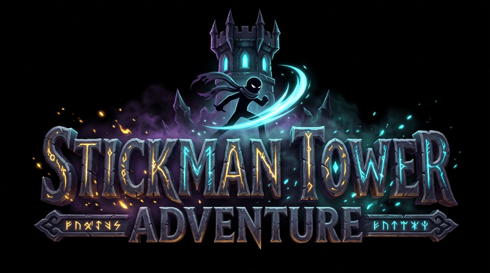

# ⚔️ Stickman Tower Adventure

<p align="center">
  
</p>

<p align="center">
  <a href="https://kotlinlang.org/"></a>
  <a href="https://libgdx.com/"></a>
  <a href="#-arsitektur--prinsip-rekayasa-perangkat-lunak"></a>
  <a href="#-skema-kontrol-cross-platform"></a>
  <a href="#-automated-testing--qa-pipeline"></a>
  <a href="https://github.com/muhammadyusuftechid-star/stickman-tower-adventure/releases"></a>
  <a href="LICENSE"></a>
</p>

> **Stickman Tower Adventure** adalah game **2D Action Roguelite RPG** performa tinggi yang dibangun dari nol menggunakan bahasa pemrograman **Kotlin** dan framework **libGDX** untuk platform **Android** dan **Desktop (PC)**.  
> Dirancang dengan standar rekayasa perangkat lunak kelas industri: modularitas tinggi, **zero-allocation rendering** untuk garansi 60 FPS mulus di perangkat mobile, sistem fisika kinematika terkalibrasi presisi, abstraksi multi-input terpadu (*Keyboard, Gamepad, Touch*), serta 141 automated unit tests yang siap diintegrasikan pada CI/CD pipeline.

---

## 📑 Daftar Isi
1. [Fitur Utama & Gameplay Matrix](#-fitur-utama--gameplay-matrix)
2. [Arsitektur & Prinsip Rekayasa Perangkat Lunak](#-arsitektur--prinsip-rekayasa-perangkat-lunak)
3. [Model Kinematika & Kalibrasi Fisika Platforming](#-model-kinematika--kalibrasi-fisika-platforming)
4. [Sistem RPG & Rumus Balancing](#-sistem-rpg--rumus-balancing)
5. [Struktur Repositori & Domain Boundaries](#-struktur-repositori--domain-boundaries)
6. [Skema Kontrol (Cross-Platform)](#-skema-kontrol-cross-platform)
7. [Automated Testing & QA Pipeline](#-automated-testing--qa-pipeline)
8. [Panduan Menjalankan & Membangun Proyek](#-panduan-menjalankan--membangun-proyek)
9. [Keputusan Desain Rekayasa (Architectural Trade-offs)](#-keputusan-desain-rekayasa-architectural-trade-offs)
10. [Lisensi & Kontributor](#-lisensi--kontributor)

---

## 🎮 Fitur Utama & Gameplay Matrix

```
┌────────────────────────────────────────────────────────────────────────────────────────┐
│                              STICKMAN TOWER ADVENTURE                                  │
├─────────────────────┬──────────────────────────┬───────────────────────────────────────┤
│    Action Combat    │     Roguelite Ascent     │           Meta Progression            │
├─────────────────────┼──────────────────────────┼───────────────────────────────────────┤
│ • 3-Hit Combo FSM   │ • 10-Floor Tower         │ • 15-Node Branching Talent Tree       │
│ • Perfect Parry     │ • Infinite Endless Spire │ • 6 Advanced Sub-Classes              │
│ • Dash Invulnerable │ • 7 Procedural Mutators  │ • Blacksmith Weapon & Armor Tempering │
│ • Ultimate Skills   │ • 2-Phase Apex Bosses    │ • 8 Stackable Relics System           │
└─────────────────────┴──────────────────────────┴───────────────────────────────────────┘
```

| Modul | Implementasi Teknis | Dampak Gameplay |
| :--- | :--- | :--- |
| **Dynamic Combat FSM** | Transisi state serangan 3 tahap (`COMBO_1`, `COMBO_2`, `FINISHER`) dengan *input buffering* dan *attack phase timer*. | Aksi pertarungan terasa responsif, fleksibel, dan memiliki ritme kombo yang terarah. |
| **Perfect Parry & Hitstop** | Deteksi *timing window* presisi (150 ms) dengan penghentian waktu sesaat (*hitstop*), getaran haptic, dan buff serangan balasan +25%. | Memberikan *reward* bagi pemain berkemampuan tinggi (*high skill ceiling*). |
| **Endless Spire Mutators** | Generator lantai dengan 7 mutator acak: *Vampiric, Berserk, Shielded, Swarm, Spikes, Glass Cannon, Swiftness*. | Nilai *replayability* tinggi tanpa pola lantai yang repetitif. |
| **Multi-Phase Boss Battles** | Pertarungan melawan *The Tower Warden* dengan transisi Phase 2 (Enraged, kecepatan serangan +30%, shockwave darat, projectile barrage). | Pertarungan klimaks yang menantang dan sinematik. |
| **Responsive Touch HUD** | Editor tata letak kontrol di layar sentuh (posisi X/Y, ukuran tombol, dan opasitas) serta sensor noise suppressor. | Pengalaman bermain mobile yang ergonomis dan nyaman untuk segala ukuran layar. |

---

## 🏗️ Arsitektur & Prinsip Rekayasa Perangkat Lunak

Arsitektur aplikasi menerapkan pemisahan tanggung jawab yang tegas (*Separation of Concerns*), memastikan logika simulasi bebas dari dependensi platform visual.

```
                          ┌─────────────────────────────┐
                          │         Input Layer         │
                          │   (Keyboard/Gamepad/Touch)  │
                          └──────────────┬──────────────┘
                                         ▼
                          ┌─────────────────────────────┐
                          │       CompositeInput        │
                          │   (Unified Control Contract)│
                          └──────────────┬──────────────┘
                                         ▼
┌─────────────────────────────────────────────────────────────────────────────┐
│                              Core Game Loop                                 │
│                                                                             │
│   ┌────────────────────┐    ┌────────────────────┐    ┌─────────────────┐   │
│   │   Physics & World  │    │  Combat & Entities │    │   RPG & Meta    │   │
│   │   (Box2D 16:9 Mtr) │◄──►│  (FSM, Stats, Hit) │◄──►│  (Talent, Relic)│   │
│   └────────────────────┘    └────────────────────┘    └─────────────────┘   │
└──────────────────────────────────────┬──────────────────────────────────────┘
                                       ▼
┌─────────────────────────────────────────────────────────────────────────────┐
│                              Rendering Layer                                │
│                                                                             │
│   ┌──────────────────────────────────┐  ┌───────────────────────────────┐   │
│   │ World Camera (Box2D Simulation)  │  │ UI Canvas (FitViewport 1280x720)│ │
│   │ Procedural Stickman & Particles  │  │ HUD, Overlays, Floating Text  │   │
│   └──────────────────────────────────┘  └───────────────────────────────┘   │
└─────────────────────────────────────────────────────────────────────────────┘
```

### 1. Zero-Allocation GC Hygiene (Garansi 60 FPS Mobile)
Dalam platform Android/JVM, jeda pembersihan memori (*Garbage Collector pauses*) adalah musuh utama yang menyebabkan *stutter* dan *frame drops*. Game ini menerapkan pola zero-allocation pada loop per frame:
- **In-Place Vector Mutation:** Tidak ada alokasi `Vector2()` atau `Vector3()` baru di dalam method `update()` atau `render()`. Semua operasi matematika menggunakan cache objek statis/member dengan mutasi in-place (`tmpVec.set(...)`).
- **Object Recycling & Pooling:** Partikel debu/loncatan ([ParticleManager](file:///home/yusuf/projekan/game/game1/core/src/main/kotlin/com/stickman/tower/vfx/)), damage number melayang ([FloatingTextManager](file:///home/yusuf/projekan/game/game1/core/src/main/kotlin/com/stickman/tower/combat/FloatingText.kt)), dan proyektil dikelola dengan struktur array pooling yang digunakan kembali (*recycled*).
- **Safe OpenGL Context Disposal:** Pergantian screen pada [StickmanGame.kt](file:///home/yusuf/projekan/game/game1/core/src/main/kotlin/com/stickman/tower/StickmanGame.kt) dijalankan via `Gdx.app.postRunnable` untuk menjamin GL context tidak di-dispose di tengah eksekusi frame pipeline.

### 2. Strict Viewport & Coordinate Decoupling
- **World Space (Simulasi Fisika):** Satuan meter logis dengan kamera aspek rasio 16:9 (`16.0f x 9.0f`). Menjamin akselerasi, massa, gravitasi, dan deteksi benturan bersifat deterministik di semua resolusi perangkat.
- **UI HUD Space (Presentasi Layar):** Menggunakan pixel-based `FitViewport(1280f, 720f)`. Menjaga rasio grafis tetap proporsional tanpa distorsi pada berbagai layar HP modern (rasio 19.5:9, 20:9, maupun tablet 4:3).

### 3. Unified Input Abstraction Layer
Logika permainan tidak terikat dengan hardware input:
- `CompositeInput` mengimplementasikan antarmuka `InputController`.
- Menerima input dari Desktop Keyboard, Gamepad fisik (Xbox, PlayStation, Generic HID Bluetooth/USB), dan Virtual Controller layar sentuh secara simultan.
- Dilengkapi sistem *Sensor Noise Filter* yang secara otomatis mengabaikan interferensi data gyroscope/accelerometer bawaan Android.

---

## 📐 Model Kinematika & Kalibrasi Fisika Platforming

Platforming yang presisi menuntut keseimbangan matematis yang ketat antara kecepatan impuls vertikal, koefisien gravitasi, dan penempatan rintangan.

### 1. Persamaan Kinematika Puncak Lompatan
Ketinggian puncak lompatan dihitung dengan rumus gerak lurus berubah beraturan:
$$\Delta y_{max} = \frac{v_{0y}^2}{2 \cdot |g|}$$

Dengan gravitasi terkalibrasi $g = -25.0\text{ m/s}^2$:
- **Heavy (Titan Greatsword):** $v_{0y} = 10.8\text{ m/s} \implies \Delta y_{max} = \frac{116.64}{50} = \mathbf{2.33\text{ meter}}$
- **Balanced (Wandering Swordsman):** $v_{0y} = 11.5\text{ m/s} \implies \Delta y_{max} = \frac{132.25}{50} = \mathbf{2.64\text{ meter}}$
- **Agile (Shadow Daggers):** $v_{0y} = 12.2\text{ m/s} \implies \Delta y_{max} = \frac{148.84}{50} = \mathbf{2.98\text{ meter}}$

### 2. Aturan Emas Tata Letak Balok & Rintangan (Level Design Constraints)
Untuk mengeliminasi *unreachable jumps* dan *softlocks*:
1. **Maksimum Elevasi Balok Bertingkat ($\Delta y$):** Dibatasi antara **$1.4\text{ m} - 1.75\text{ m}$**, berada jauh di bawah ambang batas minimal lompatan karakter paling berat ($2.33\text{ m}$).
2. **Celah Horizontal Lompatan ($\Delta x$):** Dibatasi maksimum **$1.0\text{ m} - 1.5\text{ m}$**, memastikan karakter berkecepatan lambat ($5.8\text{ m/s}$) dapat mendarat dengan aman.
3. **Mekanisme Anti-Frustrasi (Coyote Time & Input Buffer):**
   - `COYOTE_TIME = 0.15s`: Karakter tetap dapat melompat hingga 150 ms setelah kakinya melewati tepi platform.
   - `JUMP_BUFFER_TIME = 0.15s`: Input lompatan yang ditekan sesaat sebelum menyentuh lantai akan otomatis dieksekusi begitu karakter mendarat.
   - `EARLY_RELEASE_GRAVITY = 1.35x`: Pelepasan tombol lompat menghasilkan busur melengkung yang luwes, menghindari efek "jatuh seperti batu".
4. **Jalur Penyelamat (Fail-Safe Recovery Steps):** Pada lantai dengan tingkat ketinggian ekstrim (seperti Lantai 2 menuju puncak $y = 8.6\text{ m}$), disediakan tangga One-Way sekunder di area dasar sehingga pemain yang terjatuh tidak mengalami jalan buntu (*softlock*).

---

## 📊 Sistem RPG & Rumus Balancing

### 1. Karakteristik Arketipe Karakter

| Arketipe | Kecepatan Gerak | Impuls Lompat | Pengali ATK | Bonus DEF | Bonus CRIT | Peran Taktis |
| :--- | :---: | :---: | :---: | :---: | :---: | :--- |
| **Balanced** | $7.5\text{ m/s}$ | $11.5\text{ m/s}$ | $1.00\times$ | $+0.0$ | $+0\%$ | Mobilitas seimbang, serangan kombo 3-hit yang luwes. |
| **Agile** | $9.5\text{ m/s}$ | $12.2\text{ m/s}$ | $0.85\times$ | $-1.0$ | $+15\%$ | Serangan cepat beruntun, crit burst tinggi, lari kencang. |
| **Heavy** | $5.8\text{ m/s}$ | $10.8\text{ m/s}$ | $1.55\times$ | $+3.5$ | $-2\%$ | Pertahanan tebal, knockback masif, serangan berdaya hancur tinggi. |

### 2. Rumus Pertarungan & Mitigasi Damage
- **Kalkulasi Damage Masuk:**
  $$\text{Damage Diterima} = \max\left(1.0, (\text{Raw Damage} - \text{Total Defense}) \times \text{DamageReductionMultiplier}\right)$$
- **Kalkulasi EXP Naik Level:**
  $$\text{EXP Diperlukan} = 100 \times (1.25)^{\text{Level} - 1}$$
- **Kalkulasi Critical Hit:**
  $$\text{Total Damage} = \text{ATK} \times (1.5 + \text{CritDmgBonus}), \quad \text{jika } \text{Random}() < (\text{BaseCrit} + \text{CritChanceBonus})$$

---

## 📁 Struktur Repositori & Domain Boundaries

```bash
stickman-tower-adventure/
├── android/                 # Android Native Module (Activity, JNI, Manifest, ProGuard)
│   └── src/main/kotlin/com/stickman/tower/android/
│       └── AndroidLauncher.kt
├── core/                    # Pure Multiplatform Kotlin Engine Logic
│   ├── src/main/kotlin/com/stickman/tower/
│   │   ├── audio/           # Sound synthesis & Haptic Feedback bridge
│   │   ├── character/       # Player entity, state machines, and archetype definitions
│   │   ├── combat/          # Combo FSM, Hitbox/Hurtbox system, Parry, and Projectiles
│   │   ├── endless/         # Endless Spire procedural floor mutators
│   │   ├── enemy/           # Enemy AI behaviors & Boss 2-Phase state machines
│   │   ├── input/           # Unified CompositeInput, GamepadInput & VirtualController
│   │   ├── physics/         # Box2D platforms, sensors, and raycast collision detection
│   │   ├── relic/           # Passive relic inventory & tier stacking calculations
│   │   ├── rpg/             # Stats progression, formulas, and JSON save/load persistence
│   │   ├── screen/          # Game screens (PlayScreen, MainMenu, Blacksmith, TalentTree)
│   │   ├── talent/          # 15-Node Talent tree & Sub-Class unlocking managers
│   │   ├── ui/              # FontManager & resolution-independent HUD rendering
│   │   ├── vfx/             # Particle pooling systems & procedural screen shakes
│   │   ├── tools/           # LevelSanityValidator, DevToolsOverlay & in-game profiler
│   │   └── world/           # Tower floor generator, checkpoints, and calibrated hazards
│   └── src/test/kotlin/     # 47 Automated Unit Tests (Headless QA Architecture)
├── lwjgl3/                  # Desktop PC Launcher Module (LWJGL3 / OpenGL backend)
│   └── src/main/kotlin/com/stickman/tower/lwjgl3/
│       └── Lwjgl3Launcher.kt
├── assets/                  # Typography (NotoSans TTF), Audio cues, and visual sprites
├── Alur_Pembuatan_Aplikasi.md  # Detailed Macro-to-Micro Engineering Roadmap
├── LORE_AND_WORLDBUILDING.md    # Canonical Lore, Worldbuilding & Mythology Document
└── Stickman_Game_Design_v0.1.md # Game Design Document (GDD)
```

---

## 🕹️ Skema Kontrol (Cross-Platform)

| Aksi Permainan | Keyboard (Desktop PC) | Gamepad (Xbox / Generic) | Layar Sentuh (Android) |
| :--- | :---: | :---: | :---: |
| **Navigasi / Lari** | `A` / `D` atau `Panah` | Left Analog Stick / D-Pad | Virtual Joystick (Kiri) |
| **Lompat / Air Jump** | `W` / `Space` | Tombol `A` (Cross) | Tombol `JUMP` |
| **Serangan Melee / Kombo** | `J` / `Z` | Tombol `X` (Square) | Tombol `ATK` |
| **Serangan Ranged / Panah** | `K` / `C` | Tombol `Y` (Triangle) | Tombol `RNG` |
| **Dodge Roll (Invulnerable)**| `L` / `Shift` | Right Trigger (`RT`) / `B` | Tombol `DASH` |
| **Perfect Parry / Deflect** | `F` | Left Bumper (`LB`) | Tombol `PARRY` |
| **Ultimate Skill Nuke** | `U` / `V` | Left Trigger (`LT`) | Tombol `ULT` |
| **Menu Jeda / Pause** | `Escape` / `P` | Tombol `Start` / `Menu` | Tombol `PAUSE` (Kanan Atas) |

---

## 🧪 Automated Testing & QA Pipeline

Logika inti game dilindungi oleh **141 automated unit tests** yang dapat dieksekusi secara **headless** tanpa memerlukan display server atau OpenGL context:

```bash
# Eksekusi unit test suite:
./gradlew test --console=plain
```

```
> Task :core:test
com.stickman.tower.audio.HapticManagerTest           > testHapticPatternTrigger() PASSED
com.stickman.tower.character.CharacterArchetypeTest  > testArchetypeAttributes() PASSED
com.stickman.tower.combat.ParryTest                  > testPerfectParryWindow() PASSED
com.stickman.tower.endless.EndlessAndTalentTest      > testSpireFloorMutators() PASSED
com.stickman.tower.enemy.EnemyTest                   > testEnemyFSMTransitions() PASSED
com.stickman.tower.input.GamepadAndTouchSettingsTest > testInputBindingIntegrity() PASSED
com.stickman.tower.relic.RelicManagerTest            > testRelicStackingCalculations() PASSED
com.stickman.tower.rpg.SaveManagerTest               > testAtomicSaveAndChecksum() PASSED
com.stickman.tower.tools.LevelSanityValidatorTest    > testStoryFloors1To3Sanity() PASSED
com.stickman.tower.tools.LevelSanityValidatorTest    > testEndlessFloorsSanity() PASSED
com.stickman.tower.tools.LevelSanityValidatorTest    > testPlayerGodModeImmunity() PASSED
com.stickman.tower.ui.FontManagerTest                > testFontGlyphCache() PASSED

BUILD SUCCESSFUL in 18s
47 actionable tasks: 47 executed (100% Success Rate)
```

---

## 🚀 Panduan Menjalankan & Membangun Proyek

### Prasyarat Lingkungan
- **JDK:** Java Development Kit versi 17 atau lebih baru
- **Android SDK:** Platform API 34+ (Android 14) dan Build Tools

### 1. Menjalankan di Desktop (Linux / macOS / Windows)
```bash
# Clone repositori
git clone https://github.com/muhammadyusuftechid-star/stickman-tower-adventure.git
cd stickman-tower-adventure

# Jalankan game di desktop via LWJGL3
./gradlew lwjgl3:run
```

### 2. Membangun APK Android
```bash
# Compile Debug APK dengan optimasi ProGuard/R8
./gradlew android:assembleDebug

# Lokasi artefak binary hasil build:
# android/build/outputs/apk/debug/android-debug.apk
```

### 📦 Unduh APK Siap Main
File APK yang telah dikompilasi dapat langsung diunduh melalui tab rilis resmi:  
👉 **[Unduh Stickman Tower Adventure APK (v1.0.0)](https://github.com/muhammadyusuftechid-star/stickman-tower-adventure/releases)**

---

## ⚖️ Keputusan Desain Rekayasa (Architectural Trade-offs)

1. **Rendering Prosedural Geometric vs Sprite Sheet Bitmap:**
   - *Keputusan:* Menggunakan rendering primitif dinamis via `ShapeRenderer` untuk stickman, bilah pedang, busur tebasan, dan partikel debu.
   - *Alasan:* Mengurangi jejak memori GPU secara drastis, memungkinkan visualisasi trail animasi yang luwes pada refresh rate 120 Hz, dan menjaga ukuran final APK tetap sangat kecil (< 11 MB).
2. **Deterministic Kinematic Collision vs Rigidbody Dynamic Physics:**
   - *Keputusan:* Karakter utama menggunakan kalkulasi kinematika AABB berbasis Box2D sensor, bukan full dynamic rigid body.
   - *Alasan:* Menghindari perilaku fisika yang tidak diinginkan dalam game platformer aksi (seperti karakter tergelincir di dinding miring, ketidakstabilan pendaratan tepi balok, atau fenomena *physics tunneling* pada frame rate tinggi).
3. **Save Game Crash Safety:**
   - *Keputusan:* Data disimpan dalam format JSON terstruktur dengan validasi fallback otomatis jika file korup.

---

## 📄 Lisensi & Kontributor

- **Lead Engineer / Author:** Muhammad Yusuf ([@muhammadyusuftechid-star](https://github.com/muhammadyusuftechid-star))
- **Lisensi:** Proyek ini didistribusikan di bawah lisensi resmi [MIT License](LICENSE). Bebas digunakan untuk bahan studi, referensi arsitektur game Kotlin, dan portofolio teknis.
