# Stickman Tower Adventure — Game Design Document (GDD) v2.0
### *Master Production & 30-Floor Canonical Campaign Edition*

> **Status Dokumen:** Master Production Locked (v2.0 Canon)  
> **Judul Game:** Stickman Tower Adventure: The Chrono-Spire of Aethelgard  
> **Genre:** 2D Side-Scrolling Action RPG Platformer & Hack-and-Slash Megastructure Odyssey  
> **Target Platform:** Android (Mobile Native) & Desktop (LWJGL3 PC Testbed)  
> **Bahasa Pemrograman:** Kotlin  
> **Framework Engine:** libGDX (OpenGL ES 2.0 / FreeType / Virtual Controller)  
> **Arsitektur Save:** Version 2 Normalized Schema dengan 64-bit Salted FNV-1a Checksum  
> **Dokumen Terkait:** [LORE_AND_WORLDBUILDING.md](file:///home/yusuf/projekan/game/game1/LORE_AND_WORLDBUILDING.md), [README.md](file:///home/yusuf/projekan/game/game1/README.md), [Alur_Pengembangan_Ekspansi_30_Lantai.md](file:///home/yusuf/projekan/game/game1/Alur_Pengembangan_Ekspansi_30_Lantai.md)

---

## 1. Visi Permainan & Pilar Ludonaratif (Game Vision & Narrative Pillars)

### 1.1 Konsep Inti (The Core Premise)
*Stickman Tower Adventure* menggabungkan aksi pertarungan jarak dekat real-time (*hack-and-slash*) berkecepatan tinggi, navigasi platforming presisi, dan kedalaman sistem RPG dalam dunia fantasi gelap yang tereduksi menjadi hitam dan putih pasca-tragedi kosmis *The Great Inking*. 

Pemain mengendalikan pendekar siluet garis hitam berinti jiwa (*Anima Core*) yang terbangun di **The Ashen Threshold (Padang Abu Luar Menara)**, dipandu oleh **Aria (Sang Gema Terakhir)** untuk mendaki **The Celestial Chrono-Spire (Menara Bayang)** setinggi **30 lantai kampanye cerita utama**, menumbangkan 6 bos legendaris penjaga babak (*Apex Gatekeepers*), menguak rahasia hilangnya spektrum warna melalui 30 Prasasti Batu Hitam (*The 30 Lore Tablets*), dan menembus batas waktu ke dalam dimensi *Endless Spire* (Lantai 31 ke atas).

```
[PROLOG: PADANG ABU] ──> [PENDAKIAN 30 LANTAI LUAS] ──> [KOMBO & PARRY] ──> [TEMPA VULCANUS] ──> [PATAHKAN PENA DEWA]
         ▲                                                                                                    │
         └────────────────────────── [ENDLESS CHRONO-SPIRE: LANTAI 31+] ◄─────────────────────────────────────┘
```

### 1.2 Enam Pilar Utama Desain (The Six Design Pillars)
1. **Kinetic Defiance (Perlawanan Kinetik Terhadap Pelarutan Jiwa):**
   Mekanik pertarungan menuntut aksi tanpa henti. Berdiam diri terlalu lama di tanah memicu kutukan gravitasi tektonik ($g = -28.0\text{ m/s}^2$). Pemain harus terus melompat, melakukan *dodge roll*, menangkis serangan secara presisi (*Perfect Parry* jendela 120ms), dan melancarkan kombo 3-hit untuk mempertahankan integritas siluet tubuhnya dari fenomena *The Dissolution*.
2. **Precision Combat & Impact Juiciness:**
   Pertarungan yang memuaskan dan berbobot (*juicy*): pemisahan ketat antara [Hitbox.kt](file:///home/yusuf/projekan/game/game1/core/src/main/kotlin/com/stickman/tower/combat/Hitbox.kt) dan [Hurtbox.kt](file:///home/yusuf/projekan/game/game1/core/src/main/kotlin/com/stickman/tower/combat/Hurtbox.kt), *Hitstop Micro-Freeze* 80 milidetik saat parry sukses, getaran haptic Android, percikan partikel neon sparks, dan angka melayang (*Floating Damage Text*).
3. **Vast Explorable Level Design (Peta Luas, Panjang & Non-Linear):**
   Setiap lantai bukan lagi koridor satu arah sempit, melainkan bentangan terstruktur sepanjang **$110\text{m} - 160\text{m}$ horizontal** dengan elevasi vertikal bertingkat **$22\text{m} - 38\text{m}$**. Mengintegrasikan pintu gerbang segel runik (*Runic Barrier Doors*), kunci runik tersembunyi (*Rune Keys*), ruang brankas rahasia (*Secret Vaults*), dan jalan pintas vertikal (*Gravitational Vents / One-Way Platforms*).
4. **Deep RPG Progression & 60-Level Growth Curve:**
   EXP leveling hingga Level 60, alokasi poin bakat di [TalentManager.kt](file:///home/yusuf/projekan/game/game1/core/src/main/kotlin/com/stickman/tower/talent/TalentManager.kt), penempaan senjata di Suaka Vulcanus Lantai 13 ([BlacksmithScreen.kt](file:///home/yusuf/projekan/game/game1/core/src/main/kotlin/com/stickman/tower/screen/BlacksmithScreen.kt)), serta 6 spesialisasi Sub-Class unik (*Berserker, Guardian, Shadow Stalker, Venomancer, Archmage, Spellblade*).
5. **Roguelite Run Adaptation (Sistem Relik & Mutator Bioma):**
   Setiap pendakian menawarkan variasi relik acak di [RelicType.kt](file:///home/yusuf/projekan/game/game1/core/src/main/kotlin/com/stickman/tower/relic/RelicType.kt) (*Vampiric Fang, Thunder Charm, Wings of Hermes, Hourglass of Chronos*) dan anomali mutator lingkungan bioma (*Toxic Miasma, Low Gravity, Berserk Surge, Vampire Moon, Time Distortion*).
6. **Harmoni Total Narasi & Kode (Ludonarrative Integration):**
   Cerita tidak disajikan sebagai teks tempelan, melainkan terpatri di dalam arsitektur kode: Prolog interaktif di Padang Abu, *Story Codex Screen* 30 bab, 30 Prasasti Batu Hitam interaktif di lantai, dan dialog filosofis NPC Aria serta Vulcanus.

---

## 2. Struktur Arsitektur 30 Lantai (The 30-Floor World & Level Design)

### 2.1 Pembagian 6 Babak Agung (The Six Grand Acts)

| Babak (Act) | Lantai | Nama Bioma / Zona | Panjang Map | Vertikalitas | Bos Utama / Fitur Kunci |
| :--- | :---: | :--- | :---: | :---: | :--- |
| **Prolog** | **Intro** | The Ashen Threshold (Padang Abu) | $90\text{m}$ | $18\text{m}$ | Cutscene Bangkitnya Kaelen & Lentera Aria |
| **ACT I** | **1 - 5** | The Lower Bastion & Sunken Garrison | $110\text{m} - 140\text{m}$ | $22\text{m} - 30\text{m}$ | **Lt 5: General Oakhaven (The Iron Vanguard)** |
| **ACT II** | **6 - 10** | Crypts of Lost Chroma & Sunken Archives | $135\text{m} - 150\text{m}$ | $26\text{m} - 34\text{m}$ | **Lt 10: Lady Vespera (The Amethyst Matron)** |
| **ACT III** | **11 - 15** | Subterranean Foundry & Gilded Catacombs | $130\text{m} - 155\text{m}$ | $24\text{m} - 32\text{m}$ | **Lt 13: Suaka Vulcanus (Hub Safe Zone)**<br/>**Lt 15: Forge-Master Ignis (The Slag Colossus)** |
| **ACT IV** | **16 - 20** | The Astral Rift & Shattered Precipice | $135\text{m} - 160\text{m}$ | $28\text{m} - 38\text{m}$ | **Lt 20: The Shadow Doppelgänger (Mirror Match)** |
| **ACT V** | **21 - 25** | The Crimson Eclipse Sanctum | $135\text{m} - 155\text{m}$ | $26\text{m} - 34\text{m}$ | **Lt 25: Malakor The Crimson Sovereign (Blood Prince)** |
| **ACT VI** | **26 - 30** | The Celestial Zenith & Primordial Canvas | $120\text{m} - 160\text{m}$ | $30\text{m} - 36\text{m}$ | **Lt 30: The Grand Calligrapher (Final Deity Boss)** |
| **Endgame**| **31+** | The Endless Chrono-Spire | Prosedural | Prosedural | Boss Rush Mode & Hall of Legends |

---

### 2.2 Desain Fitur Eksplorasi Map Luas & Panjang

Untuk memastikan map panjang terasa dinamis dan tidak membosankan:
1. **Sistem Gerbang Runik & Kunci Segel (Runic Barrier System):**
   * Pintu keluar lantai (*StageExit*) di beberapa lantai (seperti Lantai 3, 8, 14, 24) dikunci oleh *Runic Barrier* berkode warna.
   * Pemain harus menelusuri rute cabang bawah tanah atau menara samping untuk mengalahkan mini-boss penjaga dan memungut *Rune Key*.
2. **Jalur Bercabang (High-Risk vs Safe Navigation Paths):**
   * **Rute Atas (The High Wire):** Platform kecil yang runtuh (*crumbling platforms*), angin puyuh, duri obsidian, namun terdapat peti emas (*Treasure Chest*) dan relik langka.
   * **Rute Bawah (The Low Road):** Koridor bata datar yang relatif aman dari jurang, namun dihuni oleh gerombolan musuh infanteri dan pemanah.
3. **Penyelamat Vertikal (One-Way Stepping Platforms & Thermal Vents):**
   * Platform satu arah tembus dari bawah (*isOneWay = true*) agar pemain yang jatuh dari lompatan tinggi tidak harus mengulang dari awal lantai.
   * Di Bioma Foundry dan Astral (Lantai 11-20), terdapat *Thermal Vents* (semburan uap/angin gravitasi) yang melontarkan karakter setinggi 12-18 meter ke tingkat map atas.
4. **Ruang Rahasia (Hidden Vaults & Blood Altars):**
   * Dinding rapuh yang dapat dirusak oleh kombo 3-hit atau jurus Ultimate untuk membuka ruang tersembunyi berisi *Lore Tablet*, koin emas kuno, atau *Blood Altar* pengorbanan.

---

## 3. Karakter Playable & Spesialisasi Sub-Class

Pemain dapat memilih salah satu dari 3 Arketipe Inti di [CharacterSelectScreen.kt](file:///home/yusuf/projekan/game/game1/core/src/main/kotlin/com/stickman/tower/screen/CharacterSelectScreen.kt):

| Parameter Karakter | Kaelen (Balanced) | Zephyr (Agile) | Gorgon (Heavy) |
| :--- | :--- | :--- | :--- |
| **Gelar Kanonikal** | The Bladeweaver | The Shadowstalker | The Ironbreaker |
| **Senjata Khas** | Runed Broadsword | Dual Venom Daggers | Colossal Obsidian Greatsword |
| **Kecepatan Gerak** | 7.5 m/s | 9.5 m/s | 5.8 m/s |
| **Tinggi Lompatan** | 11.5 m/s ($\approx 2.36$m) | 12.2 m/s ($\approx 2.65$m) | 10.8 m/s ($\approx 2.08$m) |
| **Damage Multiplier**| 1.00x | 0.85x | 1.55x |
| **Bonus Base DEF** | +0 DEF | -1.0 DEF | +3.5 DEF (Super Armor) |
| **Bonus Base CRIT**| 8% Base | +15% Bonus (Total 23%) | -2% Penalty (Total 6%) |
| **Skill 1 (Active)** | *Gale Crescent* (CD 3.5s) | *Shadow Shuriken* (CD 2.8s) | *Earth Shockwave* (CD 4.0s) |
| **Skill 2 (Active)** | *Rising Dragon* (CD 4.8s) | *Venom Flurry* (CD 3.8s) | *Cyclone Cleave* (CD 5.2s) |
| **Skill 3 (Active)** | *Dash Strike* (CD 4.2s) | *Phantom Blink* (CD 4.5s) | *Titan Roar* (CD 6.5s) |
| **Ultimate Jurus** | *Bladestorm 360°* (100 SP) | *Phantom Flurry* (80 SP) | *Meteor Cleave* (120 SP) |
| **Pilihan Sub-Class**| **Berserker** / **Guardian** | **Shadow Stalker** / **Venomancer** | **Archmage** / **Spellblade** |

---

## 4. Sistem Pertarungan & Mekanika Inti (Combat Mechanics)

### 4.1 Rantai Serangan Kombo 3-Hit (Combo Chain)
1. **Hit 1 (Light Slash):** Tebasan pembuka cepat (0.12s startup, 1.0x damage, knockback ringan).
2. **Hit 2 (Cross Slash):** Tebasan silang penyambung (0.14s startup, 1.25x damage, mengangkat musuh sedikit).
3. **Hit 3 (Finisher Smash):** Hantaman pemungkas berdaya hancur tinggi (0.18s startup, 1.85x damage, knockback horizontal 7.0 m/s, meremukkan pertahanan perisai musuh / *Guard Break*).

### 4.2 Sistem Tangkisan Sempurna & Elakan (Perfect Parry & Dodge Roll)
* **Dodge Roll:** Durasi 0.22 detik dengan kecepatan luncur $14.5\text{ m/s}$. Cooldown 0.65 detik. Memberikan kekebalan penuh (*Invulnerability Frames / i-frames*) terhadap seluruh proyektil dan tebasan fisik.
* **Perfect Parry (Deflect Window):** Jika pemain melakukan *Dodge Roll* tepat dalam kurun waktu **0.12 detik (7 frame)** saat serangan musuh mendarat:
  * Pemain tidak menerima damage sama sekali.
  * Memicu **Hitstop Freeze 80 milidetik** yang membekukan layar sesaat.
  * Musuh penyerang mengalami **Stun selama 1.5 detik** dengan pertahanan terbuka (*Dazed State*).
  * Menghasilkan efek audio denting baja sakral (*Parry Bell SFX*) dan kilatan partikel emas radial.
  * Memicu akumulasi kombo instan dan efek pemulihan bakat *Guardian Counter Fortitude*.

---

## 5. Kurva Progresi RPG & Pacing 30 Lantai (RPG Progression Curve)

### 5.1 Skalasi Karakter (Level 1 s/d Level 60)
Kenaikan level pemain dihitung dengan formula non-linear:

$$\text{EXP Ke Level Berikutnya}(L) = 100 \times L^{1.35}$$

* **Lantai 1 - 5 (Act I):** Target Level Pemain $1 \rightarrow 10$. Membuka seluruh 3 skill aktif.
* **Lantai 6 - 10 (Act II):** Target Level Pemain $10 \rightarrow 20$. Membuka pemilihan spesialisasi Sub-Class.
* **Lantai 11 - 15 (Act III):** Target Level Pemain $20 \rightarrow 30$. Penempaan senjata di Suaka Vulcanus hingga Tier +5.
* **Lantai 16 - 20 (Act IV):** Target Level Pemain $30 \rightarrow 40$. Maksimasi cabang Talent Tree utama.
* **Lantai 21 - 25 (Act V):** Target Level Pemain $40 \rightarrow 50$. Penempaan senjata hingga Tier +8, relik ganda.
* **Lantai 26 - 30 (Act VI):** Target Level Pemain $50 \rightarrow 60$. Status puncak, senjata Tier +10 Primordial, siap menghadapi The Grand Calligrapher.

### 5.2 Skalasi HP & Kerusakan Musuh Per Bioma

| Bioma | Rentang Lantai | Rata-rata HP Minion | Damage Minion | HP Bos Utama | Karakteristik Bahaya |
| :--- | :---: | :---: | :---: | :---: | :--- |
| **Act I (Benteng)** | Lt 1 - 5 | $40 - 75$ | $6 - 10$ | $850$ (Oakhaven) | Duri, platform retak |
| **Act II (Arsip)** | Lt 6 - 10 | $90 - 150$ | $12 - 18$ | $1,800$ (Vespera) | Kabut racun Miasma, proyektil sniper |
| **Act III (Foundry)** | Lt 11 - 15 | $180 - 320$ | $20 - 28$ | $3,500$ (Ignis) | Magma cair, roda gigi tajam |
| **Act IV (Astral)** | Lt 16 - 20 | $350 - 580$ | $30 - 42$ | $6,200$ (Doppelgänger)| Gravitasi rendah, pantulan jurus cermin |
| **Act V (Eclipse)** | Lt 21 - 25 | $650 - 950$ | $45 - 60$ | $9,800$ (Malakor) | Regenerasi bulan darah, lifesteal 20% |
| **Act VI (Zenith)** | Lt 26 - 30 | $1,100 - 1,800$ | $65 - 85$ | $16,500$ (Calligrapher)| Laser penghapus void, 3 fase kosmis |

---

## 6. Sistem Koleksi & Dokumentasi Terintegrasi (The 30 Lore Tablets)

Setiap lantai kampanye memuat 1 buah Prasasti Kuno interaktif (*LoreTablet*):
1. **Deteksi Kedekatan:** Ketika pemain berada dalam radius $1.5\text{m}$, muncul prompt interaktif `[E] / [TAP] BACA PRASASTI KUNO`.
2. **Perekaman Save Data:** Prasasti yang telah dibaca otomatis tersimpan ke dalam `saveData.unlockedLoreTablets` (terproteksi FNV-1a Salted Checksum).
3. **Penyimpanan di Story Codex:** Seluruh 30 tablet dapat dibaca ulang kapan saja di layar *Story Codex Screen* dengan tata letak Thematic Ink Pills anti-dempet.
4. **Pemberian Hadiah:** Membaca setiap tablet memberikan bonus instan $+50\text{ Gold}$ dan $+25\text{ EXP}$. Mengumpulkan ke-30 tablet membuka achievement legendaris **"Arsiparis Sejati Aethelgard"** dan gelar kehormatan *The Grand Loremaster*.

---

## 7. Matematika Platforming & Kinematika Fisika (Physics & Navigation Equations)

Untuk menjamin kontrol terasa presisi, responsif, dan bebas *floaty*, pergerakan karakter diimplementasikan menggunakan integrasi Euler semi-implisit:

### 7.1 Formula Integrasi Kinematika Gerak
$$\Delta t = \min(\text{Gdx.graphics.deltaTime}, 0.033\text{s})$$
$$v_{y, t+1} = \max(v_{y, t} + g \cdot \Delta t, v_{terminal})$$
$$x_{t+1} = x_t + v_x \cdot \Delta t$$
$$y_{t+1} = y_t + v_{y, t+1} \cdot \Delta t$$

* Gravitasi Standar Menara: $g = -28.0\text{ m/s}^2$
* Gravitasi Rendah (Babak IV Astral): $g = -14.0\text{ m/s}^2$
* Batas Kecepatan Jatuh Maksimum (*Terminal Velocity*): $v_{terminal} = -24.0\text{ m/s}$

### 7.2 Amplop Jangkauan Lompatan (Jump Reach Envelope)
Berdasarkan parameter kecepatan lompat awal ($v_{jump}$) dan kecepatan lari horizontal ($v_{run}$):

* **Waktu Melayang di Udara (*Air Time*):**
  $$t_{air} = \frac{2 \times v_{jump}}{|g|}$$
* **Tinggi Lompatan Maksimum ($H_{max}$):**
  $$H_{max} = \frac{v_{jump}^2}{2|g|}$$
* **Jarak Tempuh Horizontal Lompatan Maksimum ($D_{reach}$):**
  $$D_{reach} = v_{run} \times t_{air}$$

| Karakter | $v_{run}$ | $v_{jump}$ | $t_{air}$ (Standar) | $H_{max}$ (Tinggi) | $D_{reach}$ (Jarak Tempuh) |
| :--- | :---: | :---: | :---: | :---: | :---: |
| **Kaelen (Balanced)** | $7.5\text{ m/s}$ | $11.5\text{ m/s}$ | $0.82\text{ detik}$ | **$2.36\text{ meter}$** | **$6.16\text{ meter}$** |
| **Zephyr (Agile)** | $9.5\text{ m/s}$ | $12.2\text{ m/s}$ | $0.87\text{ detik}$ | **$2.65\text{ meter}$** | **$8.28\text{ meter}$** |
| **Gorgon (Heavy)** | $5.8\text{ m/s}$ | $10.8\text{ m/s}$ | $0.77\text{ detik}$ | **$2.08\text{ meter}$** | **$4.47\text{ meter}$** |

> **Prinsip Level Design Map Luas:** Seluruh celah jurang wajib berada di bawah batas minimum karakter terberat ($D_{gap} \le 4.0\text{ meter}$ untuk jalur utama, atau $D_{gap} \le 6.0\text{ meter}$ jika disediakan platform gantung perantara).

### 7.3 Logika Platform Satu Arah (One-Way Stepping Platforms)
Karakter dapat melompat menembus platform dari bawah dan mendarat di atasnya jika:
1. `player.bounds.y >= platform.y + platform.height - 0.25f` (Kaki berada di dekat atau di atas permukaan atas platform).
2. `player.velocityY <= 0` (Karakter sedang bergerak turun atau diam di puncak parabola).
3. Jika tombol `[DOWN] + [JUMP]` ditekan, platform diabaikan selama $0.25$ detik untuk memungkinkan *drop-down*.

---

## 8. Bestiarium Komprehensif 18 Tipe Musuh & AI FSM (Enemy Bestiary)

Setiap bioma dihuni oleh 3 tipe musuh unik dengan pola perilaku Finite State Machine (FSM): `IDLE` $\rightarrow$ `PATROL` $\rightarrow$ `CHASE` $\rightarrow$ `ATTACK` $\rightarrow$ `STAGGER` $\rightarrow$ `DEAD`.

| ID | Nama Musuh | Bioma | HP Base | ATK | DEF | Speed | Range | Pola Serangan & Ciri Khas AI |
| :---: | :--- | :---: | :---: | :---: | :---: | :---: | :---: | :--- |
| **E01** | *Crimson Grunt* | Act I | 45 | 6 | 0 | 3.2 m/s | 1.2 m | Ayunan pedang tumpul 1-2 hit, mundur saat di-parry. |
| **E02** | *Amethyst Sniper* | Act I & II | 35 | 9 | 0 | 2.5 m/s | 9.0 m | Membidik 1.2 detik sebelum menembakkan panah ungu; lari jika pemain mendekat. |
| **E03** | *Crimson Berserker* | Act I | 80 | 14 | 2 | 2.8 m/s | 1.8 m | Ayunan kapak lambat ber-super armor; tidak bisa di-stagger serangan biasa. |
| **E04** | *Corrupted Scribe* | Act II | 70 | 12 | 1 | 3.0 m/s | 7.5 m | Melemparkan bola tinta pelacak (*Homing Orb*); teleportasi jika terkena kombo. |
| **E05** | *Amethyst Stalker* | Act II | 60 | 16 | 0 | 5.5 m/s | 1.4 m | Menghilang transparan selama 3 detik, menusuk dari belakang pemain (*Backstab*). |
| **E06** | *Venom Spitter* | Act II | 55 | 10 | 1 | 2.0 m/s | 6.0 m | Menyemburkan genangan racun di platform (memberikan Poison DoT). |
| **E07** | *Obsidian Golem* | Act III | 220 | 22 | 6 | 1.8 m/s | 2.0 m | Kebal knockback; hantaman tinju gempa radial (*Ground Smash*). |
| **E08** | *Clockwork Automaton*| Act III | 140 | 18 | 3 | 4.2 m/s | 1.5 m | Memutar gergaji dada beruntun 4-hit; meluncur cepat ke arah pemain. |
| **E09** | *Slag Brute* | Act III | 180 | 25 | 4 | 2.2 m/s | 2.2 m | Melemparkan bongkahan batu magma mendidih ke arah pemain. |
| **E10** | *Void Phantom* | Act IV | 160 | 28 | 2 | 4.5 m/s | 2.5 m | Monster terbang nirkaki; menyerang menukik tajam dari sudut buta atas. |
| **E11** | *Astral Archer* | Act IV | 120 | 32 | 1 | 3.5 m/s | 11.0 m | Menembakkan 2 anak panah bintang beruntun berkecepatan $18\text{ m/s}$. |
| **E12** | *Echo Stalker* | Act IV | 200 | 30 | 3 | 5.0 m/s | 1.8 m | Meniru gerakan tebasan dan dodge roll pemain; mampu melakukan parry balik. |
| **E13** | *Sanguine Zealot* | Act V | 240 | 38 | 3 | 4.8 m/s | 1.6 m | Serangan tusukan rapier beruntun; darahnya meledak saat mati (*Death Burst*). |
| **E14** | *Crimson Vampire Bat*| Act V | 110 | 26 | 0 | 6.0 m/s | 1.2 m | Kelelawar terbang lincah; setiap gigitan memulihkan 50% HP yang dicuri. |
| **E15** | *Bloodblade Knight* | Act V | 380 | 48 | 7 | 3.0 m/s | 2.4 m | Ksatria berpedang eksekusi dua tangan; tebasan gelombang darah horizontal. |
| **E16** | *Celestial Sentry* | Act VI | 450 | 55 | 8 | 4.0 m/s | 2.0 m | Prajurit siluet putih bercahaya; mampu memblokir 3 serangan pertama pemain. |
| **E17** | *Temporal Archon* | Act VI | 380 | 50 | 5 | 3.2 m/s | 8.0 m | Memancarkan aura gelembung waktu (*Time Slow Field*); proyektil laser geometris. |
| **E18** | *Primordial Shadow* | Act VI | 550 | 65 | 6 | 4.6 m/s | 2.2 m | Makhluk tinta murni; membelah menjadi 2 bayangan kecil jika HP $< 30\%$. |

---

## 9. Arsitektur Runic Barrier, Procedural Map Chunks & BFS Reachability Guarantee

### 9.1 Data Structure & Entity Modeling
```kotlin
data class RunicBarrier(
    val id: String,
    val bounds: Rectangle,
    val requiredRuneType: RuneColor, // RED, BLUE, GOLD
    var isUnlocked: Boolean = false
)

data class RuneKey(
    val id: String,
    val position: Vector2,
    val runeType: RuneColor,
    var isCollected: Boolean = false
)

enum class RuneColor { RED, BLUE, GOLD }
```

### 9.2 Zero-Softlock Mathematical Proof (Algoritma Graf BFS 30 Lantai)
Untuk memastikan tidak ada pemain yang terperangkap pada peta luas:
1. Setiap lantai direpresentasikan sebagai graf berarah berbobot $G = (V, E)$, di mana $V$ adalah platform dan $E$ adalah lompatan yang valid secara kinematika ($D \le D_{reach}, H \le H_{max}$).
2. Node Kunci Rune ($K$) dan Node Pintu Segel ($D$) disimulasikan:
   $$\text{Path}(S \rightarrow K) \land \text{Path}(K \rightarrow D) \land \text{Path}(D \rightarrow \text{Exit})$$
3. Jika unit test `Campaign30FloorsReachabilityTest` menemukan simpul $v$ yang tidak dapat mencapai *Exit* setelah $K$ terambil, build akan gagal secara otomatis (*Fail-Fast Pipeline*).

---

## 10. Sistem Bakat RPG 60 Level (Talent Tree Specifications)

Pemain memperoleh **1 Talent Point per Kenaikan Level** (Total 59 poin pada Level 60) yang dialokasikan di [TalentManager.kt](file:///home/yusuf/projekan/game/game1/core/src/main/kotlin/com/stickman/tower/talent/TalentManager.kt):

```mermaid
graph TD
    subgraph Offense["Path of the Blade (Jalur Penyerangan)"]
        O1["Tier 1: Keen Edge (+10% Basic Attack DMG)"] --> O2["Tier 2: Critical Mastery (+8% CRIT Chance)"]
        O2 --> O3["Tier 3: Executioner (+20% DMG pada musuh HP < 30%)"]
        O3 --> O4["Tier 4: Bloodflow Cleave (Tebasan menimbulkan pendarahan DoT)"]
        O4 --> O5["Tier 5 Apex: God of Blades (Finisher kombo mereset 50% Cooldown Skill)"]
    end

    subgraph Defense["Path of the Aegis (Jalur Pertahanan)"]
        D1["Tier 1: Iron Skin (+15 Max HP, +2 Base DEF)"] --> D2["Tier 2: Parry Fortitude (Parry memulihkan 4% Max HP)"]
        D2 --> D3["Tier 3: Unyielding Stance (Kebal stagger saat melancarkan Skill)"]
        D3 --> D4["Tier 4: Guardian Shield (Mendapat barrier 15% HP saat HP kritis)"]
        D4 --> D5["Tier 5 Apex: Titan Immortal (Mencegah kematian 1x per lantai, revive 30% HP)"]
    end

    subgraph Mobility["Path of the Phantom (Jalur Kelincahan & Utilitas)"]
        M1["Tier 1: Swift Steps (+12% Movement Speed)"] --> M2["Tier 2: Shadow Dash (Cooldown Dodge berkurang 25%)"]
        M2 --> M3["Tier 3: Soul Harvester (+25% EXP & Gold dari musuh)"]
        M3 --> M4["Tier 4: Phantom Surge (Dodge melewati musuh memberikan debuff Armor Break)"]
        M4 --> M5["Tier 5 Apex: Chrono Warp (Parry sempurna memicu Slow-Motion dunia 2 detik)"]
    end
```



---

## 11. Arsitektur Dynamic BGM & Audio Synthesis

* Game menggunakan arsitektur audio adaptif berdasarkan state pertarungan dan bioma saat ini:
  * **Exploration State:** Musik atmosferik berirama rendah ($60 - 75\text{ BPM}$) dengan denting harpa kesepian dan desau angin.
  * **Combat State (Ketika Musuh Mendeteksi Pemain):** Perkusi drum perang intens ($125 - 140\text{ BPM}$) menyatu mulus tanpa henti (*Cross-Fade Duration 1.2 detik*).
  * **Boss Encounter State:** Orkestrasi epik dengan paduan suara vokal sintetis dan ritme menegangkan ($150\text{ BPM}$).
* Efek suara (*Sound FX*) procedural osilator:
  * `PARRY_SUCCESS`: Frekuensi $1,760\text{ Hz}$ (A6) modulasi sinus meluruh selama $0.4\text{ detik}$.
  * `CRITICAL_HIT`: Suara retakan kaca berfrekuensi tinggi ($2,400\text{ Hz}$) berpadu getaran sub-bass ($55\text{ Hz}$).

---
*GDD v2.0 ini mengikat seluruh implementasi teknis kode, generator level, aset visual, audio, dan sistem data game Stickman Tower Adventure.*

